<div align="center">

<picture>
  <source media="(prefers-color-scheme: dark)" srcset="docs/img/banner-dark.png">
  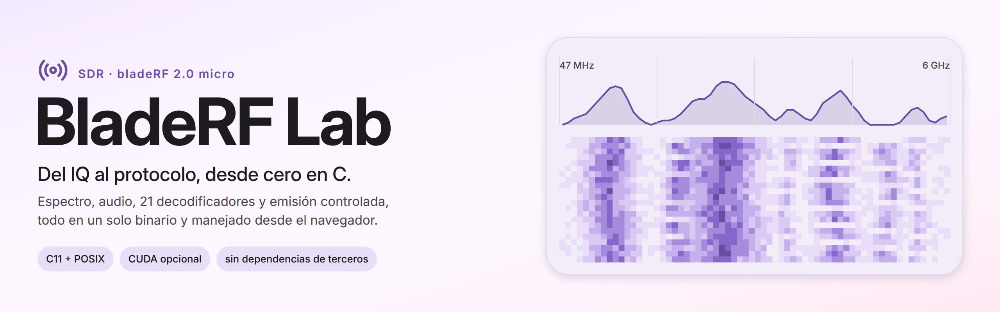
</picture>

**[Inicio rápido](#inicio-rápido)** ·
**[Capturas](#capturas)** ·
**[Protocolos](#protocolos-y-bandas)** ·
**[Arquitectura](#arquitectura)** ·
**[Emisión](#emisión)** ·
**[Validación](#estado-y-validación)** ·
**[Documentación](#documentación)**

</div>

## Qué es

BladeRF Lab es un receptor SDR completo para el **bladeRF 2.0 micro**, escrito desde cero en C11 (con aceleración CUDA opcional) y manejado desde el navegador.
Un único binario captura la señal, calcula el espectro, demodula audio para varios oyentes a la vez, detecta señales, graba IQ en SigMF y decodifica 21 protocolos de radio, desde la aviación hasta la telefonía, el WiFi o la televisión.
Sin GNU Radio, sin OpenWebRX y sin bibliotecas DSP de terceros: todo el tratamiento de señal está implementado y comentado en este repositorio.

> **Estado:** los decodificadores están implementados y pasan sus pruebas con señales sintéticas (`make check`).
> Varios se han contrastado ya con grabaciones reales y dos con señal en el aire (RDS y LTE en Pamplona); otros siguen pendientes.
> La matriz honesta está en [Estado y validación](#estado-y-validación). El plan y las reglas de trabajo están en [AGENTS.md](AGENTS.md).

---

## Funciones

<table>
<tr>
<td width="33%" valign="top">

**Espectro y cascada**<br>
FFT propia en CPU o en GPU (CUDA), difundida por WebSocket a todos los navegadores. Barrido rápido de 47 MHz a 6 GHz.

</td>
<td width="33%" valign="top">

**Audio por cliente**<br>
Cada navegador escucha su frecuencia: WFM estéreo, NFM, AM, USB, LSB y CW, con squelch y deénfasis.

</td>
<td width="33%" valign="top">

**Detector de señales**<br>
OS-CFAR sobre el espectro: marca las portadoras y puede crear decodificadores sobre ellas (perfiles `auto`).

</td>
</tr>
<tr>
<td valign="top">

**21 decodificadores**<br>
Un hilo por instancia y varias instancias a la vez. Tablas vivas (aviones, barcos, celdas, redes) y mapa.

</td>
<td valign="top">

**GPU para los canales**<br>
DDC por lotes de todos los decodificadores: 16 instancias a 20 Msps pasan de 5,2 núcleos a 0,3.

</td>
<td valign="top">

**Grabación SigMF**<br>
IQ a disco con un clic y descarga desde la web. Reproducción de ficheros `cs16`/`cs8`/`cu8`/SigMF en bucle.

</td>
</tr>
<tr>
<td valign="top">

**Perfiles**<br>
22 perfiles listos (FM, aire, mar, ADS-B, ISM, LoRa, LTE, TDT…) y configuración persistente.

</td>
<td valign="top">

**TV digital**<br>
Receptor DVB-T propio hasta el TS, demux, audio MP2 propio y vídeo H.264 por WebCodecs, con sincronía por PTS.

</td>
<td valign="top">

**Emisión con política**<br>
Moduladores gemelos de cada decodificador. Modo fichero, bucle interno y aire con lista blanca de bandas.

</td>
</tr>
<tr>
<td valign="top">

**Hardware avanzado**<br>
122,88 Msps, AGC rápida y lenta, calibración de ganancia (dBm) y sintonía rápida.

</td>
<td valign="top">

**FPGA propia**<br>
Imagen «lab» con un motor de espectro y un banco Wishbone, compilada y simulada.

</td>
<td valign="top">

**Pruebas y generador**<br>
Cada protocolo trae su modulador: se prueba de extremo a extremo sin antena (`--gen`, `--replay`).

</td>
</tr>
</table>

"Verificado" = compilado y probado (tests, sanitizers y prueba de extremo a extremo con ficheros). "Sin probar en hardware" = funciona con ficheros pero aún no se ha ejecutado con el bladeRF.

| Función | Estado |
|---|---|
| Captura del bladeRF o de ficheros `cs16`/`cs8`/`cu8`/SigMF | Verificado con ficheros |
| Espectro y cascada con FFT propia en CPU o en GPU (CUDA) | Verificado |
| Audio por cliente: WFM estéreo, NFM, AM, USB, LSB, CW | Verificado con ficheros |
| Detector automático de señales (OS-CFAR) | Verificado |
| Grabación IQ en SigMF y descarga desde la web | Verificado |
| Servidor HTTP + WebSocket propio, interfaz web completa con mapa y tablas | Verificado |
| Marco de decodificadores: un hilo por decodificador, varios a la vez | Verificado |
| DDC de todos los decodificadores en GPU (16 decodificadores a 20 Msps: de 5,2 núcleos a 0,3) | Verificado |
| Canalizador polifásico en GPU | Verificado (aún no lo usa ninguna función) |
| 22 perfiles predefinidos, configuración persistente | Verificado |
| TDT: receptor DVB-T, demux, audio MP2 y reproductor | Verificado con señal sintética y IQ de gr-dtv; con la antena actual no hay TS en el aire |
| Emisión: fichero, bucle interno y aire con lista blanca de bandas | Verificado en modo fichero; sin probar en hardware |
| Modo de 122,88 Msps, modos de AGC, barrido rápido de banda ancha | Sin probar en hardware |
| Imagen FPGA propia con motor de espectro | En desarrollo (simulada; sin probar en la placa) |
| Validación de los decodificadores con grabaciones reales | En curso |

---

## Capturas

Capturas de la interfaz real, a 1440 px. Las del receptor, la emisión y la TV salen de un servidor propio con señales generadas con `--gen` (FM con RDS) y un TS de prueba; las del mapa, las tablas y los mensajes usan **datos de demostración** (`tests/web_mock.js`), no radio real.

<table>
<tr>
<td width="50%">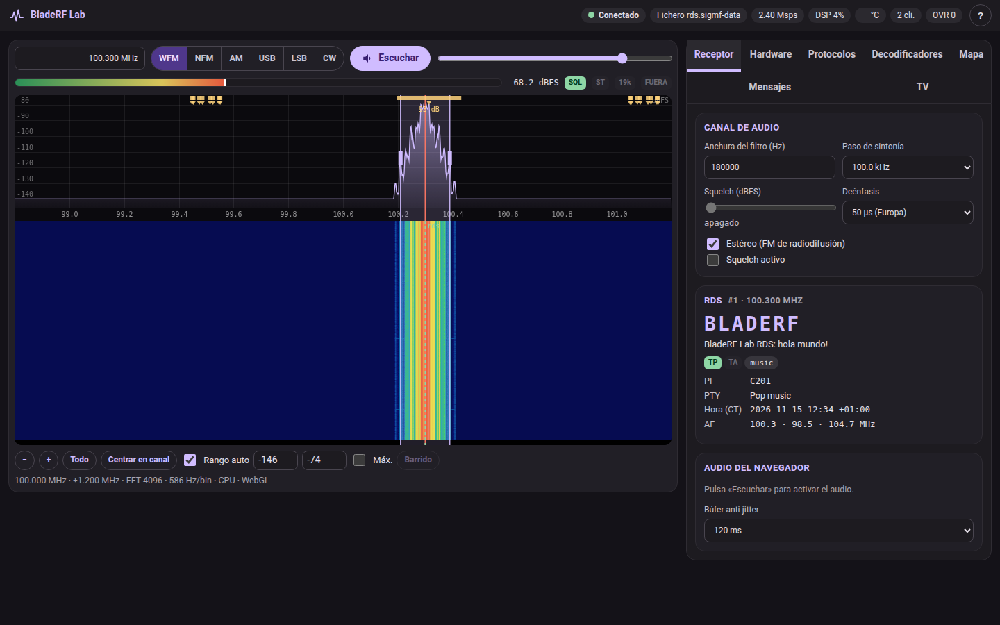<br><sub><b>Receptor.</b> Espectro, cascada, audio y panel RDS de una FM generada con <code>--gen</code>.</sub></td>
<td width="50%">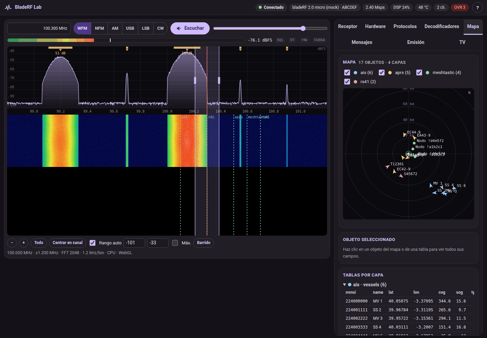<br><sub><b>Mapa.</b> Barcos, APRS, Meshtastic y radiosondas. <i>Datos de demostración.</i></sub></td>
</tr>
<tr>
<td>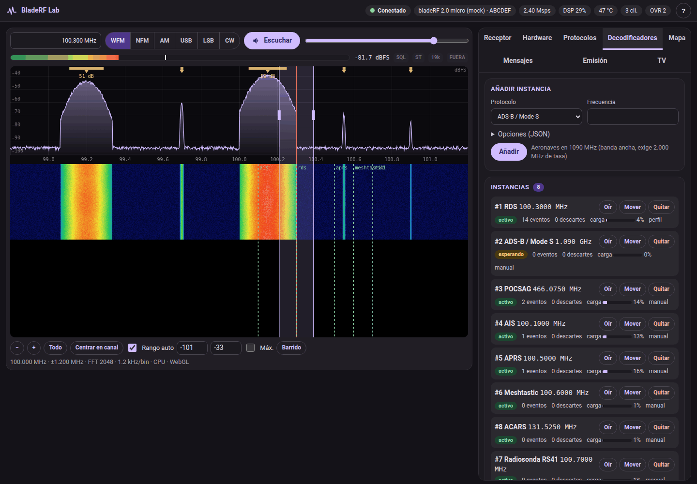<br><sub><b>Decodificadores.</b> Instancias, estado, carga y descartes. <i>Datos de demostración.</i></sub></td>
<td>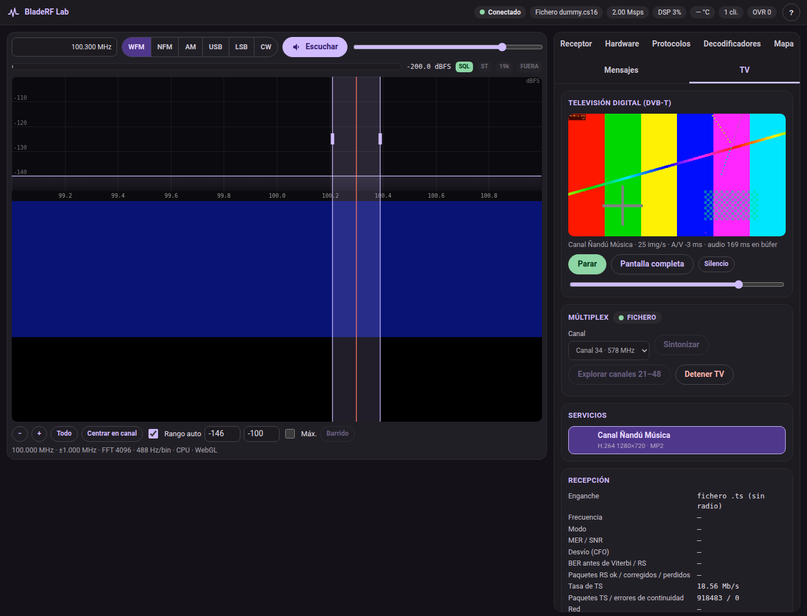<br><sub><b>TV.</b> Vídeo H.264 y audio MP2 desde un TS de prueba en bucle (<code>--tv-ts</code>).</sub></td>
</tr>
<tr>
<td>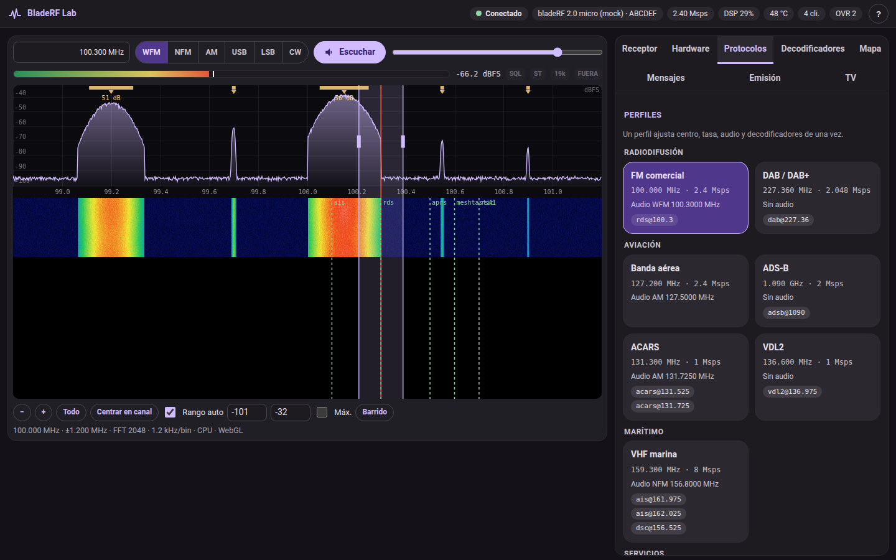<br><sub><b>Protocolos.</b> Perfiles por grupo: un clic ajusta centro, tasa, audio y decodificadores.</sub></td>
<td>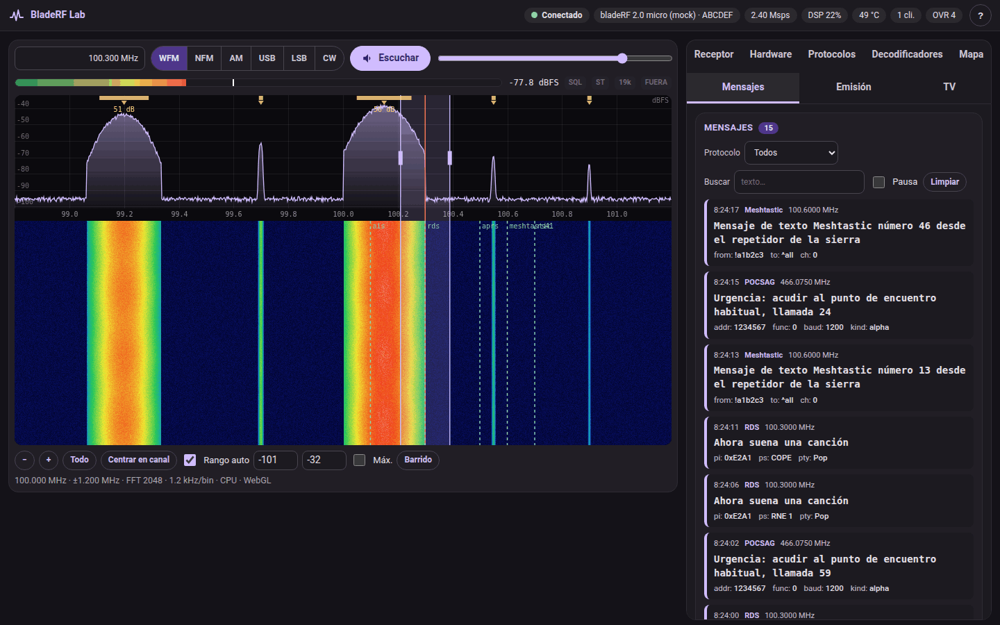<br><sub><b>Mensajes.</b> Flujo de eventos de todos los protocolos. <i>Datos de demostración.</i></sub></td>
</tr>
</table>

Más capturas, pestaña por pestaña, en la [guía de uso](docs/GUIA.md).

---

## Protocolos y bandas

<picture>
  <source media="(prefers-color-scheme: dark)" srcset="docs/img/mapa-bandas-dark.png">
  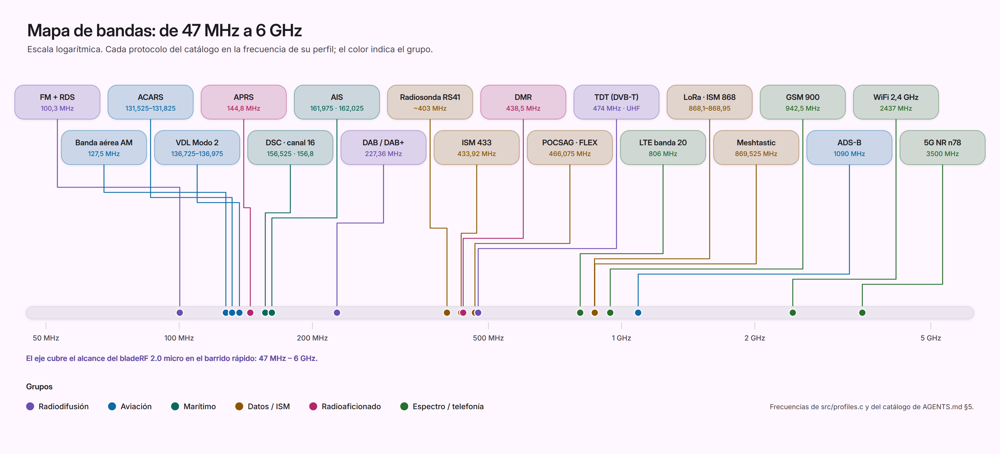
</picture>

| Grupo | Protocolos |
|---|---|
| Radiodifusión | FM + **RDS**, **DAB/DAB+** (lista de servicios) |
| Aviación | **ADS-B/Mode S** 1090 MHz, **ACARS**, **VDL Modo 2**, voz AM en banda aérea |
| Marítimo | **AIS** (dos canales a la vez), **DSC** canal 70, voz en canal 16 |
| Radioaficionado | **APRS/AX.25**, **DMR** (solo metadatos), NFM/USB/LSB/CW |
| Buscapersonas | **POCSAG**, **FLEX** |
| ISM y telemetría | Sensores **OOK/FSK de 433/868 MHz**, **LoRa/LoRaWAN**, **Meshtastic**, radiosondas **RS41** |
| Telefonía y redes | Identificación de celdas **LTE** y **5G NR**, **GSM** (BSIC), beacons **WiFi** |
| Televisión | **DVB-T** (parámetros TPS) y **TDT** completa (vídeo y audio) |

Solo se decodifica información de difusión o de sistema: nada de voz digital, identidades de abonados ni tráfico cifrado.
Una ficha por protocolo (qué es, frecuencia, cadena y validación) en [docs/PROTOCOLOS.md](docs/PROTOCOLOS.md).

---

## Arquitectura

<picture>
  <source media="(prefers-color-scheme: dark)" srcset="docs/img/arquitectura-dark.png">
  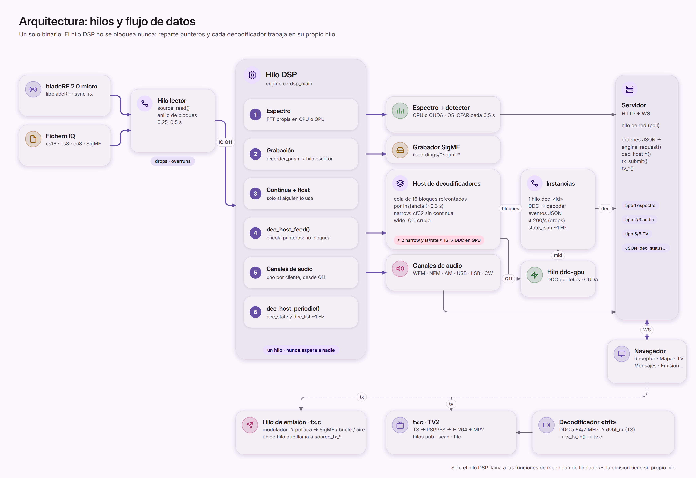
</picture>

El hilo DSP no se bloquea nunca: `dec_host_feed()` solo encola punteros a bloques compartidos con contador de referencias, y cada instancia de decodificador trabaja en su propio hilo con su propio DDC (o con el DDC por lotes en GPU). Más detalle en [docs/ARQUITECTURA.md](docs/ARQUITECTURA.md), [docs/PROTOCOLO.md](docs/PROTOCOLO.md) y [docs/CUDA.md](docs/CUDA.md).

<details>
<summary><b>Estructura del repositorio</b></summary>

```
src/
  main.c            programa principal y órdenes del WebSocket
  engine.*          hilo DSP: captura → espectro, audio, detector, grabación, decodificadores
  sdr/              fuente de muestras (bladeRF o fichero)
  dsp/              FFT, filtros, DDC, canal de audio, detector, FEC, sincronía
  decoders/         un fichero por protocolo + host de decodificadores
  tv/               receptor DVB-T, demux TS/PSI, audio MP2 y reproductor
  tx/               moduladores y política de emisión
  gpu/              espectro y canalizadores en CUDA (con sustitutos sin GPU)
  net/              servidor HTTP/WebSocket, SHA-1
  util/             JSON, cadenas, registro, grabador SigMF
web/                interfaz (HTML/CSS/JS sin dependencias)
tests/              pruebas
docs/               documentación técnica y diagramas (docs/img)
legacy/             montaje anterior con OpenWebRX+ (solo referencia)
```
</details>

---

## Inicio rápido

### Requisitos

- bladeRF 2.0 micro (probado con FPGA 0.16.0, firmware FX3 2.6.0) — o un fichero IQ para trabajar sin hardware.
- Linux, `gcc` (C11), `make`.
- `libbladeRF` ≥ 2.5 con sus cabeceras (`libbladerf-dev` o compilada desde el código de Nuand).
- Opcional: CUDA Toolkit (se detecta en el `PATH` o en `/usr/local/cuda`) y una GPU NVIDIA para el espectro y los canalizadores en GPU.
- Un navegador moderno (para la TV, Chrome o Edge con H.264, en `localhost` o HTTPS).

### Compilar

```sh
make            # build/bladerf-lab (usa CUDA si la encuentra)
make CUDA=0     # sin GPU
make test       # pruebas unitarias y de extremo a extremo con señales sintéticas
make check      # compilación estricta (-Werror) + pruebas
```

### Ejecutar

```sh
./build/bladerf-lab                     # abre el primer bladeRF y sirve http://127.0.0.1:8090
./build/bladerf-lab --host 0.0.0.0      # accesible desde la red local
./build/bladerf-lab --profile adsb      # arranca con un perfil (adsb, fm, maritimo, lora…)
./build/bladerf-lab --replay grabacion.sigmf-meta   # sin hardware, desde un fichero
./build/bladerf-lab --profile maritimo --print      # eventos decodificados en JSON por la consola
```

Abre <http://127.0.0.1:8090> en el navegador. Si `bladerf-lab` no puede abrir el equipo, comprueba que no lo esté usando otro programa (por ejemplo el servicio OpenWebRX: `sudo systemctl stop openwebrx`).

Opciones útiles: `--port`, `--serial`, `--rate`, `--freq`, `--no-gpu`, `--web`, `--recdir`, `--config`, `--decode <id>[@Hz]` (repetible), `--log-events <dir>`, `--duration <s>`, `--tv-ts <fichero.ts>` y `-v`.

### Generar señales de prueba

Cada protocolo tiene su modulador, así que se puede probar un decodificador de extremo a extremo sin antena:

```sh
./build/bladerf-lab --gen ais --gen-freq 161975000 --gen-center 162000000 \
                    --gen-rate 1000000 --out /tmp/ais
./build/bladerf-lab --replay /tmp/ais.sigmf-meta --decode ais@161975000 --print
```

Los perfiles (`--profile`) y todos los pasos de uso, con capturas, están en la [guía de uso](docs/GUIA.md).

---

## Emisión

La emisión está desactivada por defecto y sigue una política estricta (detalles en [AGENTS.md §6](AGENTS.md) y [docs/TX.md](docs/TX.md)):

<picture>
  <source media="(prefers-color-scheme: dark)" srcset="docs/img/politica-tx-dark.png">
  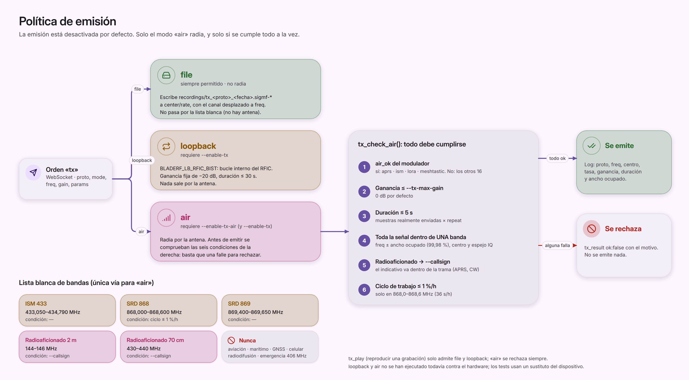
</picture>

- **file**: genera la señal en un fichero SigMF. Siempre disponible.
- **loopback**: bucle interno del transceptor; no sale nada por la antena (`--enable-tx`).
- **air**: solo con `--enable-tx-air`, solo en bandas ISM/SRD (433 y 868 MHz) o de radioaficionado con `--callsign`, con potencia y ciclo de trabajo limitados. Los protocolos de aviación, marítimos, de radiosondas, telefonía o radiodifusión **nunca** se pueden radiar.

---

## Estado y validación

Los 21 decodificadores superan la prueba de extremo a extremo (generar la señal con su modulador, añadir ruido y desvíos, reproducirla y decodificarla). Eso por sí solo no basta: una constante equivocada pasaría los tests y fallaría con tráfico real. Por eso se contrastan con grabaciones públicas y con herramientas de referencia (`acarsdec`, `dumpvdl2`, `multimon-ng`, `redsea`, `dump1090-fa`, `direwolf`, `rtl_433`, gr-dtv) usadas como cajas negras.

<picture>
  <source media="(prefers-color-scheme: dark)" srcset="docs/img/matriz-validacion-dark.png">
  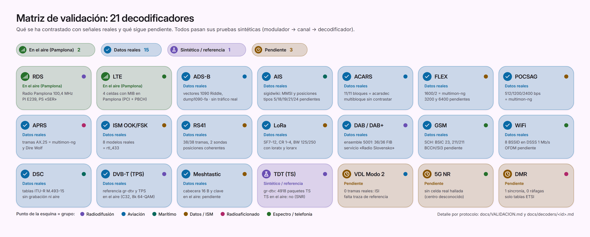
</picture>

- **En el aire (Pamplona):** RDS (Radio Pamplona) y LTE (4 celdas con MIB).
- **Con datos reales:** ADS-B (vectores publicados y `dump1090-fa`; sin tráfico real por la antena actual), AIS, ACARS, FLEX 1600, POCSAG, APRS, ISM, RS41, LoRa (`loratx`/`lorarx`), DAB, GSM (SCH), WiFi (DSSS), DSC (tablas ITU-R M.493-15, sin grabación) y DVB-T (referencia gr-dtv + TPS en el aire).
- **Pendientes:** VDL2, 5G NR, DMR, GSM-BCCH/SI3, WiFi OFDM, Meshtastic en el aire (descifrado y protobuf) y FLEX 3200/6400.
- **TDT:** el receptor reproduce un TS idéntico al de gr-dtv, pero con la antena actual la SNR en el aire (≈ −9 dB) no permite sacar TS.
- **Hardware:** no llega ADS-B a 1090 MHz con la antena actual; los modos `loopback` y `air`, el modo de 122,88 Msps y la imagen FPGA «lab» no se han probado en la placa.

Detalle en [docs/VALIDACION.md](docs/VALIDACION.md) y en cada `docs/decoders/<protocolo>.md`.

---

## Documentación

| | Documento | Contenido |
|---|---|---|
|  | [**Guía de uso**](docs/GUIA.md) | Paso a paso con capturas: perfiles, decodificadores, mapa, grabación, barrido, emisión y TV; consejos de antena |
|  | [**Protocolos**](docs/PROTOCOLOS.md) | Una ficha por protocolo con el mapa de bandas |
|  | [Arquitectura](docs/ARQUITECTURA.md) | Hilos, host de decodificadores, módulos |
| 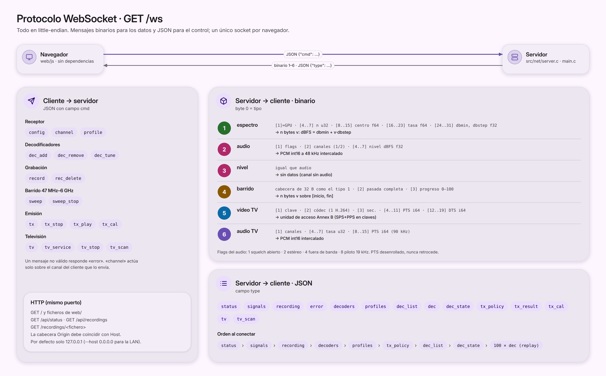 | [Protocolo WebSocket](docs/PROTOCOLO.md) | Mensajes binarios y JSON |
| 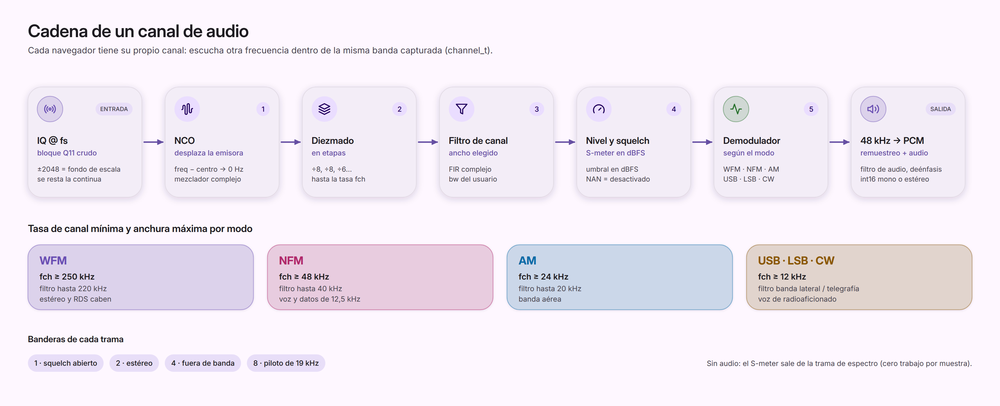 | [DSP](docs/DSP.md) | Filtros, remuestreo, DDC y canal de audio |
| 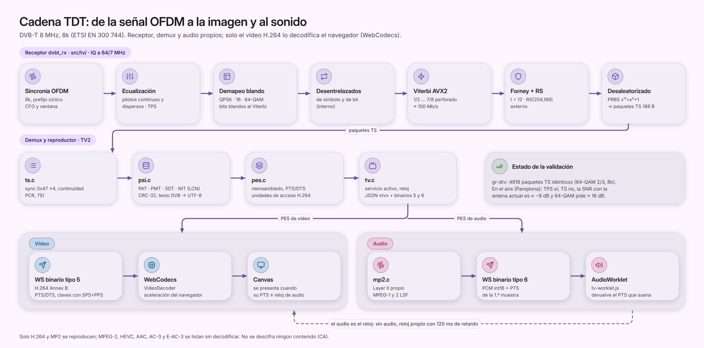 | [TDT](docs/TDT.md) | Demux, audio MP2 y reproductor; receptor DVB-T |
|  | [Emisión](docs/TX.md) | Moduladores, política de `air`, calibración |
| 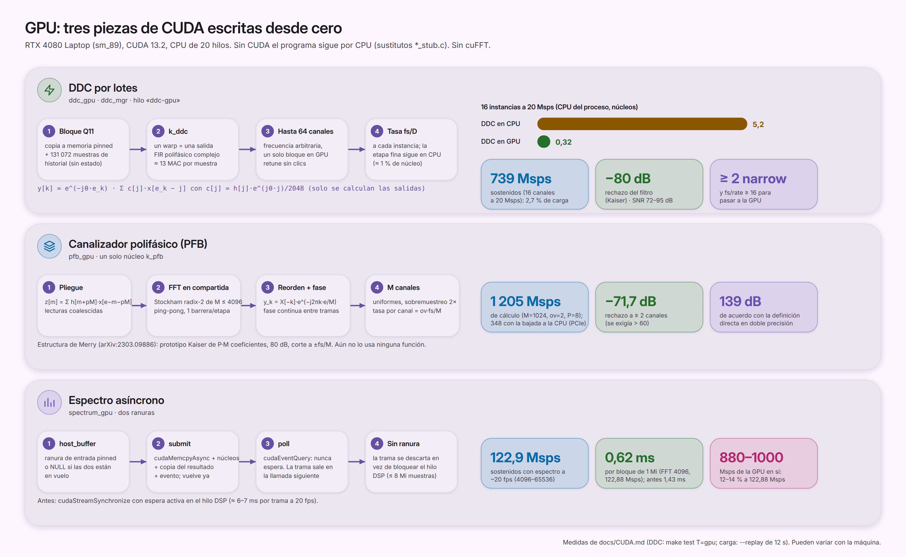 | [CUDA](docs/CUDA.md) | DDC por lotes, PFB y espectro asíncrono, con medidas |
| 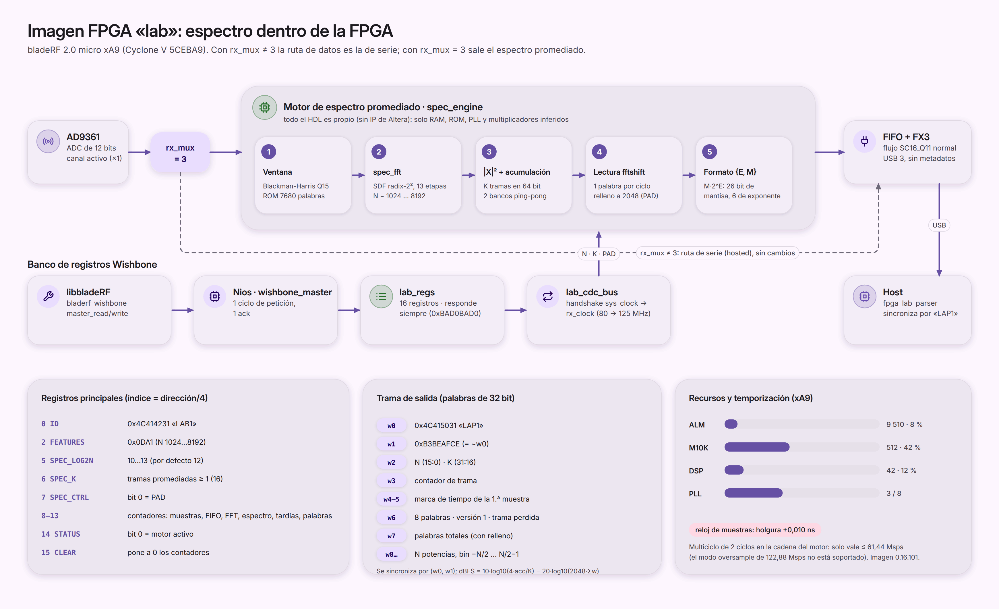 | [Hardware](docs/HARDWARE.md) · [Firmware/FPGA](docs/FIRMWARE.md) | Funciones del equipo y la imagen «lab» |
|  | [Validación](docs/VALIDACION.md) | Qué se ha contrastado con señales reales |
| | [ADS-B](docs/ADSB.md) · [Rendimiento](docs/RENDIMIENTO.md) · [Investigación](docs/INVESTIGACION.md) | Detalle de ADS-B, medidas de rendimiento y papers aplicados |
| | [AGENTS.md](AGENTS.md) | Contratos entre módulos, catálogo de protocolos y plan de trabajo |

Los diagramas se generan con `python3 docs/img/src/gen.py` y se renderizan a PNG (claro y oscuro) con `docs/img/render.sh`.

---

## Aviso legal

Recibir señales de radio es legal en general, pero **interceptar, guardar o divulgar comunicaciones que no están destinadas al público** (por ejemplo, mensajes de buscapersonas) puede no serlo; infórmate de la normativa de tu país. Para transmitir hay que respetar el cuadro de atribución de frecuencias, los límites de potencia y de ciclo de trabajo de las bandas ISM/SRD y, en bandas de radioaficionado, tener licencia. Usar este software es responsabilidad de quien lo utiliza.
