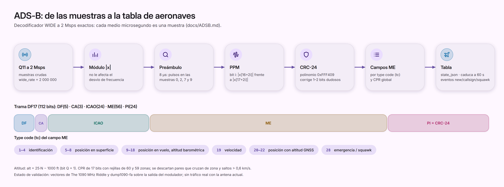

# ADS-B / Mode S (1090 MHz)

## Figuras

<picture>
  <source media="(prefers-color-scheme: dark)" srcset="img/adsb-cadena-dark.png">
  
</picture>

*Figura. Cadena del decodificador ADS-B: del módulo a 2 Msps al estado de aeronaves.*

Referencia: Junzi Sun, *The 1090 Megahertz Riddle*, 2ª ed., TU Delft OPEN, 2021.

## Capa física

Tramas de 56 o 112 bits con **PPM**: cada bit dura 1 µs; un 1 tiene el pulso en la
primera mitad, un 0 en la segunda. Preámbulo de 8 µs con pulsos de 0,5 µs en
0; 1; 3,5 y 4,5 µs. A **2 Msps exactos** cada medio microsegundo es una muestra:
el preámbulo son las muestras 0, 2, 7 y 9 altas y el bit `i` se decide comparando
`|x[16+2i]|` con `|x[17+2i]|`. Por eso el decodificador es **WIDE con
`wide_rate = 2 000 000`** y trabaja con el módulo de la señal (no le afecta el
desvío de frecuencia).

## Trama DF17 (112 bits)

`DF(5) CA(3) ICAO(24) ME(56) PI(24)`. `PI` es el CRC-24 de los 88 bits previos con
polinomio generador `0xFFF409`; el síndrome de una trama válida es 0. Los errores
de 1 y 2 bits se corrigen (ver «Confianza por bit y corrección»); los 5 bits de DF
nunca se tocan.

Campo ME por *type code* (`tc`): 1–4 identificación (8 caracteres de 6 bits +
categoría), 5–8 posición en superficie, 9–18 posición en vuelo con altitud
barométrica, 19 velocidad, 20–22 posición con altitud GNSS, 28 emergencia/squawk.

* **Altitud** (AC12, bit Q = 1): `alt = 25·N − 1000` ft.
* **CPR** (17 bits): dos rejillas, 60 y 59 zonas de latitud (par/impar).
  Decodificación global con un par: `j = ⌊59·lat_E − 60·lat_O + ½⌋`,
  `lat = (360/60 o 360/59)·(j mod 60|59 + lat_cpr)`; la longitud usa `NL(lat)`.
  Se rechazan pares que cruzan de zona y saltos inverosímiles (>0,6 km/s).
* **Velocidad** (subtipo 1): `v_ew`, `v_ns` con signo; `gs = √(vx²+vy²)`,
  `rumbo = atan2(vx, vy)`; régimen vertical `64·(vr−1)` ft/min.

También: DF11 (all-call), DF0/4/16/20 (altitud con ICAO en el CRC) y DF5/21
(squawk); solo se aceptan para aeronaves ya vistas por ADS-B.

## Integración en el marco

* `DEC_ADSB` (`src/decoders/adsb.c`): WIDE, `process_raw` recibe Q11 a 2 Msps,
  `state_json` = tabla de aeronaves, `set_location` actualiza la referencia del
  receptor (distancia).
* **Eventos** (por defecto, pocos): uno cuando aparece una aeronave ADS-B nueva y
  otro cuando cambian su indicativo, su squawk o su emergencia. Forma:
  `{"icao":"4840D6","kind":"new|callsign|squawk|emerg","cs":"KLM1023","sq":"7700",
  "emerg":1,"text":"Nuevo 4840D6 KLM1023"}`. Textos: «Nuevo 4840D6 KLM1023»,
  «Indicativo …», «Squawk 4840D6 7700 (emergencia)», «Emergencia 4840D6: emergencia
  médica». Con `opts {"raw":true}` se emite en cambio **un evento por trama
  DF17/18** (cientos por segundo en zonas con tráfico; el host limita a 200/s):
  `{"icao","df","tc","hex":"8D48…","cs","cat","alt","lat","lon","gs","trk","vr","sq",
  "emerg","fix":1|2,"crc":true,"text"}` (`fix` si se corrigió; `crc` si vino del
  entramado CRC).
* **Estado** (`dec_state.state`): `{"msgs","rate","fps","fix1","fix2","crc","rej","rx","ac":[{"icao","cs","cat",
  "alt","galt","gs","trk","ias","hdg","vr","sq","emerg","lat","lon","seen_pos",
  "dist","gnd","msgs","seen","rssi","adsb"}]}` (los campos opcionales solo si hay
  dato). Las aeronaves caducan a los 60 s. Métricas: `fps` = tramas válidas por
  segundo (ventana de 2 s; `rate` es el mismo valor), `fix1`/`fix2` = tramas
  corregidas de 1 y 2 bits, `crc` = recuperadas por el entramado CRC deslizante,
  `rej` = candidatos DF17/18 descartados por CRC incorregible (acumulados).
* La hora de cada trama es la del bloque más la posición de la muestra.

## Confianza por bit y corrección de errores

La demodulación PPM compara las dos mitades `x = |mag[16+2i]|`, `y = |mag[17+2i]|`
de cada bit: el bit vale 1 si `x > y`. La **confianza** del bit es
`c = |x−y| / (x+y) ∈ [0,1]`: ≈1 con pulso limpio, ≈0 en un empate (ruido o
interferencia). Idea de Landry et al., *Applied Sciences* 13(1):493: los errores
caen casi siempre en los bits peor valorados.

El CRC-24 es lineal, así que el síndrome de errores en los bits `i` y `j` es
`S_i ⊕ S_j` (`S_k` = síndrome de un único error en `k`, precalculado). Probar todos
los pares de 112 bits son 6 216 hipótesis para 2²⁴ síndromes (0,04 % de falsos
positivos por trama). Por eso solo se exploran los **12 bits menos fiables**
(con `c < 0,6`): 12 + 66 = 78 hipótesis (≈5·10⁻⁶ por trama). Salvaguardas:

1. nunca se tocan los 5 bits de DF; solo DF17/18;
2. si coincide más de una hipótesis, se descarta por ambigua;
3. la aeronave (ICAO de la trama corregida) debe ser **conocida**: vista antes en
   tramas sin corrección (así un falso positivo debe además acertar una dirección
   viva);
4. el `tc` resultante debe ser creíble (1–22, 28, 29, 31);
5. se cuentan (`fix1`, `fix2`; el evento raw lleva `"fix"`).

Tramas desde texto hexadecimal (pruebas): sin confianza, solo 1 bit en cualquier
posición. DF11 sigue aceptando síndromes de interrogador ≤ 7 bits como antes;
DF0/4/5/16/20/21 solo para aeronaves conocidas. `opts {"fix":0|1|2}` (por defecto
2) limita las correcciones.

## Entramado por CRC deslizante (`opts {"crcframe":true}`)

Inspirado en Stream1090: en vez de exigir el preámbulo, **cada muestra** se prueba
como primer bit de datos de una trama DF17/18. Recupera tramas con el preámbulo
pisado por otra transmisión (solapamientos). Además, tras aceptar una trama no se
salta su duración (otra puede estar solapada dentro), y se deduplica por posición
absoluta (±2 muestras).

**Riesgo**: son 2·10⁶ hipótesis por segundo y un CRC de 24 bits deja pasar 2⁻²⁴ al
azar (≈0,01 tramas falsas/s si fuera el único filtro). Se acota con cuatro
filtros en cadena: (1) los 5 primeros bits deben dar DF17/18 (descarta 15/16);
(2) confianza media de los 112 bits ≥ 0,45 (el ruido da ≈0,3); (3) CRC válido o
corregible con la regla anterior; (4) ICAO de aeronave **conocida**. Coste: una
aeronave que solo llegara por esta vía no se descubre; necesita una trama normal
previa. Desactivado por defecto porque cuesta más CPU (≈ una demodulación parcial
por muestra). La prueba de ruido (abajo) exige 0 tramas aceptadas en un minuto.

## Resultados medidos

`tests/test_adsb.c` sintetiza 288 tramas distintas (24 aeronaves) con `mod_adsb`,
las coloca al azar en una ventana (7 % de ocupación = pocas colisiones; 28 % =
muchas; y con diferencias de nivel hasta 10 dB), añade ruido blanco y cuenta las
tramas correctas recuperadas (por su hex) y las falsas. Última ejecución
(tramas correctas de 288 por fila; «antes» = `fix:0`, sin crcframe):

| escenario | SNR dB | antes | +fix | +crcframe | ambos |
|---|---|---|---|---|---|
| esparso | 8 | 17 | 31 | 20 | 39 |
| esparso | 10 | 180 | 230 | 191 | 246 |
| esparso | 12 | 235 | 239 | 246 | 250 |
| esparso | 15 | 253 | 256 | 256 | 259 |
| esparso | 20 | 243 | 243 | 244 | 245 |
| denso | 8 | 7 | 10 | 7 | 15 |
| denso | 10 | 100 | 130 | 118 | 156 |
| denso | 12 | 152 | 163 | 156 | 168 |
| denso | 15 | 186 | 189 | 188 | 191 |
| denso | 20 | 167 | 173 | 171 | 179 |
| denso, cerca-lejos | 10 | 13 | 14 | 16 | 19 |
| denso, cerca-lejos | 15 | 129 | 148 | 131 | 152 |
| denso, cerca-lejos | 20 | 171 | 183 | 183 | 197 |

Total (15 filas × 288): 1909 → 2187 tramas (+14,6 %), 0 falsas. La corrección ayuda
sobre todo a SNR bajo (10 dB: +28 %); el entramado CRC, en solapamientos y a SNR
alto. Un solapamiento entre tramas de igual potencia sigue siendo irrecuperable.
Además, 60 s (120 Mmuestras) de ruido gaussiano con todo activado: 0 tramas
aceptadas.

## Modulador y pruebas

`src/tx/mod_adsb.c` genera, para `params` `{"icao","callsign","alt","lat","lon",
"gs","trk","vr","repeat"}`, la ráfaga ident + posición par + posición impar +
velocidad (×`repeat`, 10 ms entre tramas), PPM a 2 Msps, `air_ok = false`.

`tests/test_adsb.c` usa los vectores del libro: `8D4840D6202CC371C32CE0576098` →
KLM1023; `8D40621D58C382D690C8AC2863A7` + `8D40621D58C386435CC412692AD6` → 52,2572°,
3,9194°; `8D485020994409940838175B284F` → 159 kt, 182,9°, −832 ft/min.
`tests/test_host.c` recorre modulador → ruido (18 dB) → host → evento («Nuevo 4840D6
KLM1023», uno solo por defecto; 8 con `raw`) y estado.
