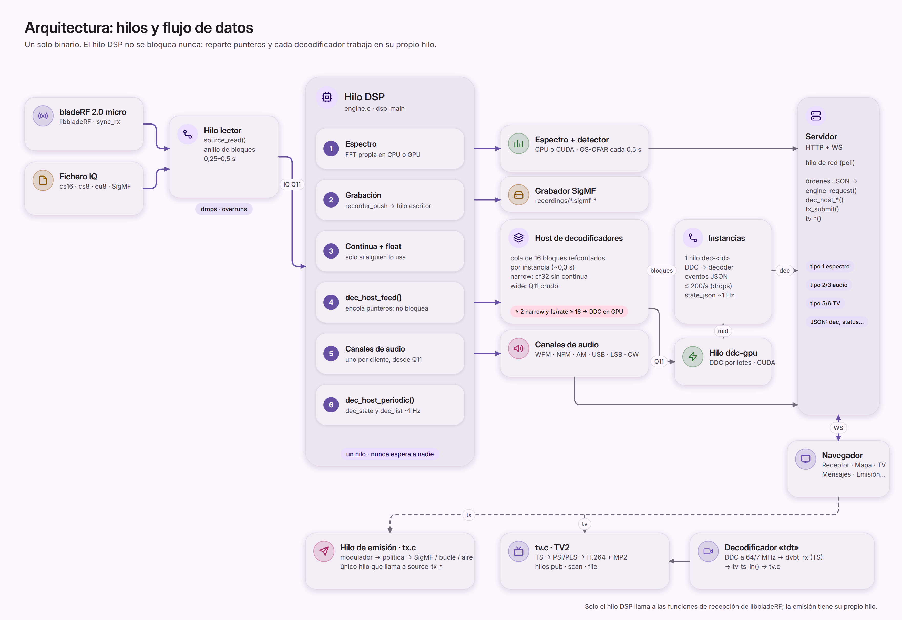
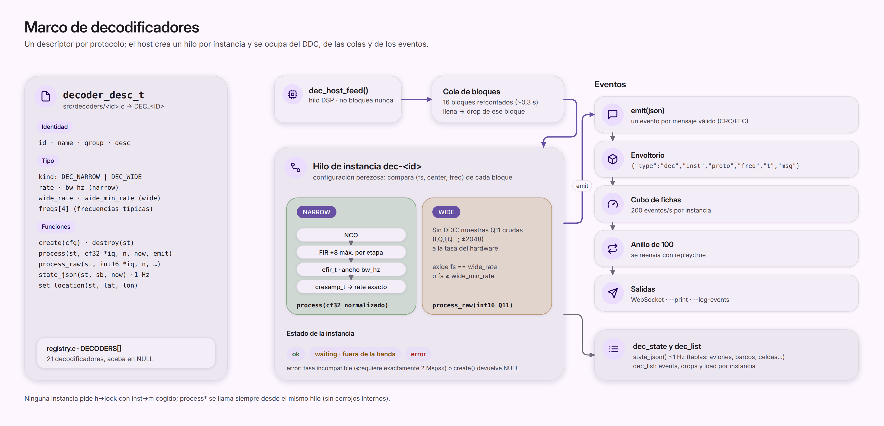

# Arquitectura de BladeRF Lab

## Figuras

<picture>
  <source media="(prefers-color-scheme: dark)" srcset="img/arquitectura-dark.png">
  
</picture>

*Figura 1. Hilos y flujo de datos: del bladeRF o el fichero al navegador. El hilo DSP reparte punteros y nunca espera; cada instancia de decodificador, la emisión y `tv.c` trabajan en sus propios hilos (fuentes: `src/engine.c`, `src/decoders/host.c`).*

<picture>
  <source media="(prefers-color-scheme: dark)" srcset="img/marco-decodificadores-dark.png">
  
</picture>

*Figura 2. El marco de decodificadores: descriptor, host, DDC, cola de bloques refcontados, eventos y `dec_state`.*


BladeRF Lab es un servidor SDR escrito desde cero en C11 (sin librerías de
terceros salvo libbladeRF) para el bladeRF 2.0 micro. Un único binario captura IQ,
calcula espectro, demodula audio por cliente, detecta señales, graba SigMF,
decodifica protocolos y sirve la interfaz web.

## Mapa de hilos

```
                 ┌────────────── hilo de red (server_run, poll) ──────────────┐
 navegador ⇄ WS ─┤ main.c: on_open / on_text / on_close  → órdenes JSON        │
                 └───────┬───────────────────────┬────────────────┬───────────┘
                         │ engine_request()       │ dec_host_*()    │ tx_submit()
                         ▼                        ▼                 ▼
 bladeRF/fichero ─► hilo DSP (engine.c) ───────► dec_host ───► hilo de TX
   source_read      1 espectro → difusión       1 hilo por       (tx.c)
                    2 grabador ─► hilo escritor instancia:
                    3 DC + dec_host_feed()      cola de bloques
                    4 canales de audio          refcontados →
                    5 dec_host_periodic()       DDC → decoder →
                                                eventos JSON → WS
```

* **El hilo DSP no se bloquea nunca.** `dec_host_feed()` copia el bloque UNA vez
  (solo los formatos que alguien necesita: Q11 crudo para los *wide*, `cf32`
  normalizado sin continua para los *narrow*) y encola un puntero con contador de
  referencias en la cola de cada instancia. Si una cola está llena (16 bloques,
  ~0,3 s) se descarta el bloque *para esa instancia* y se suma a `drops`.
* **Una instancia = un hilo** (`dec-<id>`). Los 20 decodificadores pueden usar 20
  núcleos y uno lento no retrasa a los demás.
* Solo el hilo DSP llama a las funciones de **recepción** de libbladeRF; la emisión
  usa su propio hilo y libbladeRF serializa el acceso al dispositivo.
* Cierre ordenado (`SIGINT`/`SIGTERM`/`--duration`): servidor → motor → host de
  decodificadores → TX → fuente.

## Módulos

| Directorio | Contenido |
|---|---|
| `src/common.h`, `src/util/` | tipos (`cf32`), log, JSON (analizador sin reservas), `sb_t`, grabador SigMF |
| `src/dsp/` | FFT, filtros (Kaiser, FIR diezmador, FIR complejo, remuestreadores real y complejo, NCO), DDC, canal de audio, espectro, detector OS-CFAR; A3 añade FEC, CRC, sincronía… |
| `src/sdr/source.*` | bladeRF o fichero (`cs16`/`cs8`/`cu8`/SigMF en bucle) + TX básico |
| `src/net/` | HTTP/1.1 + WebSocket propios (un hilo, `poll`) |
| `src/engine.*` | hilo DSP, configuración, estado |
| `src/decoders/` | `decoder.h` (contrato), `registry.c`, `host.*`, un `.c` por protocolo |
| `src/tx/` | `mod.h` (moduladores), `tx.*` (política y emisión), `mod_<id>.c` |
| `src/profiles.*` | perfiles de servicio (centro/tasa/audio/decodificadores) |
| `src/main.c` | opciones, configuración persistente, órdenes WebSocket, `--gen` |

## Host de decodificadores (`src/decoders/host.c`)

**Reparto.** `dec_host_feed(iq, buf, n, fs, center, now)` toma `h->lock`, anota
`(fs, center)`, decide qué instancias deben recibir el bloque (las que están en
estado `ok` o pendientes de configurar) y copia el bloque solo si alguien lo
necesita. Las instancias en `waiting`/`error` no reciben datos hasta que cambian
`(fs, center)`.

**Configuración perezosa.** Cada hilo de instancia compara `(fs, center, freq)` de
cada bloque con los de su última configuración y reconstruye lo necesario:

* NARROW: comprueba que `|freq − center| + bw/2 ≤ 0,48·fs`; si no → `waiting`
  ("fuera de la banda capturada", no es un error). Si la captura tiene menos tasa
  que el canal (`fs < rate`) → `error`. Crea el DDC (`ddc_create`) o lo retoca
  (`ddc_retune`, sin clics) y llama a `create()` una vez.
* WIDE: exige `fs == wide_rate` (o `fs ≥ wide_min_rate`); si no → `error` con
  "requiere exactamente 2 Msps (ahora 2.4 Msps)". Al cambiar la tasa destruye y
  recrea el estado.
* `create()` devuelve NULL → `error` con el texto de `err` (los stubs dicen
  "no implementado todavía").

**Eventos.** El `emit()` de cada decodificador envuelve el JSON en
`{"type":"dec","inst","proto","freq","t","msg":{…}}`, aplica un cubo de fichas de
**200 eventos/s** por instancia (el exceso se descarta y suma a `drops`), lo guarda
en un anillo de **100** eventos (se reenvían con `"replay":true` a quien conecte),
llama al callback `dec_host_on_event` (`--print`, `--log-events`) y lo difunde por
WebSocket.

**Estado.** `dec_host_periodic()` (hilo DSP, llamado en cada iteración) pide
~1 Hz a cada instancia que genere su `state_json`; el propio hilo de la instancia
lo calcula (así el decodificador no necesita cerrojos), lo cachea y lo envía como
`dec_state`. También envía `dec_list` (~1 Hz o a los 0,2 s de un cambio de
estado) y calcula `load` (tiempo ocupado / tiempo real, ventana de 1 s).

**Cerrojos.** `h->lock` (tabla, historial, última captura) → `inst->m` (cola,
banderas, contadores). Un hilo de instancia nunca pide `h->lock` con `inst->m`.

**Extras para pruebas** (`host.h`): `dec_host_flush`, `dec_host_request_state`,
`dec_host_inst_state`, `dec_host_inst_info`; `dec_host_create(NULL)` funciona sin
servidor.

## Cómo añadir un decodificador

1. `src/decoders/<id>.c` exporta `const decoder_desc_t DEC_<ID>` (ver
   `decoder.h`); sustituye al esqueleto.
2. `src/tx/mod_<id>.c` exporta `const modulator_desc_t MOD_<ID>`.
3. Las líneas de `registry.c` y `modreg.c` ya existen para los 20 protocolos de
   AGENTS.md §5; un protocolo nuevo añade ahí una línea.
4. `tests/test_<id>.c`: modular → canal (`chan_awgn`, `chan_cfo`, `chan_drift`) →
   `run_narrow`/`run_wide` → `ev_has`. `make test T=<id>`.

## Compilación

`make` busca todo `src/**/*.c` (y `*.cu` si hay `nvcc`, en el PATH o en
`/usr/local/cuda/bin`; `CUDA=0` lo desactiva y se usan los `*_stub.c`). Cada
`tests/test_*.c` se enlaza con todos los objetos menos `main.o`. Las banderas se
guardan en `$(BUILD)/.flags`: cambiar `SAN`, `CUDA` o `WERROR` recompila todo.
Ver `make` en la cabecera del `Makefile`.

## Configuración persistente

`~/.config/bladerf-lab/config.json` (o `--config`): centro, tasa, ancho RF,
ganancia, bias-tee, FFT, fps, umbral del detector y localización. Se guarda desde
`engine_on_config_change` (escritura atómica `tmp` + `rename`). Con una fuente de
fichero no se sobrescriben centro y tasa. No se guardan instancias de
decodificadores ni perfil.
