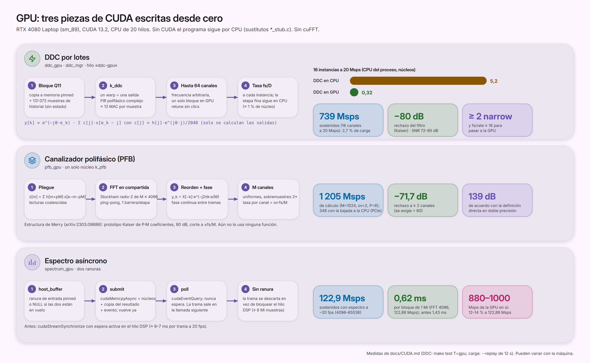

# CUDA en BladeRF Lab (agente C1)

## Figuras

<picture>
  <source media="(prefers-color-scheme: dark)" srcset="img/gpu-dark.png">
  
</picture>

*Figura. Las tres piezas de CUDA con las cifras medidas de este documento (máquina de medida: RTX 4080 Laptop, CUDA 13.2).*


Todo el código de GPU vive en `src/gpu/` y está escrito desde cero (sin cuFFT ni
bibliotecas). Sin CUDA (`make CUDA=0` o sin `nvcc`) se compilan los `*_stub.c` y
el programa sigue por CPU; las partes de C puro (`ddc_plan.c`, `pfb_plan.c`) se
compilan siempre.

| Módulo | Ficheros | Qué hace |
|---|---|---|
| Espectro | `spectrum_gpu.{h,cu}` | FFT Stockham propia, promedia todas las FFT (ya existía) |
| DDC por lotes | `ddc_gpu.{h,cu}`, `ddc_plan.c`, `ddc_gpu_stub.c` | N canales de frecuencia arbitraria a la vez, un solo bloque IQ en la GPU |
| Gestor para el host | `ddc_mgr.{h,c}` | hilo GPU, anillo de bloques, callbacks por canal |
| Canalizador PFB | `pfb_gpu.{h,cu}`, `pfb_plan.c`, `pfb_gpu_stub.c` | M canales uniformes, sobremuestreo 2× |

Máquina de medida: RTX 4080 Laptop (sm_89), CUDA 13.2, CPU de 20 hilos.

## 1. DDC por lotes (`ddc_gpu`)

### Problema
El host crea un hilo por instancia *narrow* y cada una hacía su NCO + FIR
diezmadores sobre los 20–61 Msps completos: el coste crece linealmente con el
número de instancias. Medido con `--replay` a 20 Msps y 16 instancias
(ais/acars/pocsag repartidas en ±8 MHz): **63,7 s de CPU en 12 s = 5,2 núcleos**.

### Diseño
Cada canal se reduce a **un único FIR polifásico complejo** por canal sobre la
entrada Q11 cruda:

```
y[k] = e^{-jθ·e_k} · Σ_j c[j]·x[e_k − j],   e_k = (k+1)·D − 1
c[j] = h[j]·e^{+jθ·j}/2048,                 θ = 2π(f − fc)/fs
```

Es "NCO → FIR real h → diezmar por D" con la suma reordenada: x[m]·e^{-jθm} =
e^{-jθe}·x[m]·e^{+jθ(e−m)}. Consecuencias:

* **Solo se calculan las salidas** (1 de cada D), coste ≈ ntaps/D ≈ 13 MAC
  complejos por muestra de entrada y canal (80 dB de rechazo).
* **No hay NCO por muestra**: los `c[j]` se calculan en la CPU en doble precisión
  (la fase `θ·j` se reduce módulo 1 antes de pasar a float) y la fase de salida
  usa un acumulador entero de 64 bits `ph = e·inc + ph0 (mod 2^64)` con el índice
  absoluto `e` del flujo: exacta durante horas (el rotor float de `nco_t` deriva
  ~0,05 Hz, por eso el test mezcla la entrada en doble precisión, ver §5).
* **Retune sin clics**: `ddc_gpu_retune` recalcula `c[j]` y ajusta `ph0` para que
  la fase sea continua en la próxima muestra aún no consumida (misma semántica
  que `ddc_retune`).
* **D** es el mismo que usa `ddc.c` (mayor entero de factores 2,3,5,7 ≤ fs/fs_out):
  la tasa intermedia `fs/D` queda en [fs_out, ~1,5·fs_out). El filtro (Kaiser 80
  dB; paso = bw/2 + ¼(fs_mid − bw), como la última etapa de `ddc.c`) se diseña en
  `ddc_plan_design`. Solo se usa la GPU con D ≥ 16 (`DDC_GPU_MIN_DECIM`).
* **Quita-continua** como el motor (paso alto de 1 polo, k = 2e-5): `k_mean` saca
  la media de cada bloque, se suaviza con `1−(1−k)^n` y se resta de las muestras
  al leerlas (el motor entrega a los decodificadores `buf` ya sin continua; la
  GPU recibe el `iq` crudo).

El ajuste fino (filtro de canal `cfir_t` + remuestreo exacto `cresamp_t`) sigue
en CPU con las piezas de `filter.c` (`ddc_fine_t`, copia fiel del final de
`ddc.c`): trabaja a ~48 ksps, coste despreciable.

### Núcleos (`ddc_gpu.cu`)
* **Copia**: el bloque se copia una vez a memoria *pinned* y a `d_x[H..H+n)`.
  Delante van las `H` últimas muestras del bloque anterior (copia D2D entre dos
  búferes ping-pong, `H` = 131 072 muestras o 2·ntaps si hace falta más), así
  cada ventana es contigua y **los canales no tienen estado en la GPU**.
* **`k_ddc`**: rejilla (⌈maxsal/8⌉, nº de canales), 256 hilos. **Un warp = una
  salida**: los 32 hilos recorren `c[j]` de 32 en 32 (lecturas de `x` y de `c`
  coalescidas), reducen con `__shfl_xor_sync` y el hilo 0 aplica la rotación
  final con `sincospif`. Los descriptores de canal (`cdesc`) se suben en cada
  bloque (unos bytes), los coeficientes solo al crear o resintonizar.
* **`k_mean`**: suma en doble precisión con reducción por warp.

### Rendimiento (`make test T=gpu`)
Tiempo de pared por bloque de 1 Mi muestras (copias incluidas), 48 ksps/12,5 kHz:

| fs | canales | D | coef/canal | sostenido | carga a tiempo real |
|---|---|---|---|---|---|
| 20 Msps | 16 | 405 | 5 441 | 739 Msps (1,4 ms/bloque) | 2,7 % |
| 61,44 Msps | 16 | 1280 | 17 361 | 705 Msps | 8,7 % |
| 61,44 Msps | 40 | 1280 | 17 361 | 427 Msps | 14,4 % |

### Integración en `host.c`
```
hilo DSP ─ dec_host_feed ─┬─► instancias en CPU (bloque compartido, como antes)
                          └─► ddc_mgr_feed: memcpy a un anillo de 4 bloques (no bloquea;
                              lleno → se descarta y se cuenta) ─► hilo "ddc-gpu"
                                    ddc_gpu_process ─► gpu_deliver (callback por canal)
                                    ─► cola de la instancia (bloque "mid", tasa fs/D)
instancia: ddc_fine_process (filtro de canal + remuestreo exacto) ─► decodificador
```
* Una instancia *narrow* pasa a la GPU (`gpu_attach`, en `reconfigure`) si hay
  GPU, hay **≥ 2 instancias narrow** (`GPU_MIN_NARROW`) y `fs/rate ≥ 16`. Al
  añadir la segunda, `gpu_kick` hace que las que ya corrían en CPU lo
  reevalúen. Sin GPU, con una sola instancia o con diezmado pequeño: todo igual
  que antes.
* `dec_host_feed` **no espera nunca**: la única copia extra es el `memcpy` del
  bloque crudo al anillo, fuera del cerrojo del host. Las instancias en GPU ya
  no reciben el bloque CPU (se ahorra además el `memcpy` de `buf`).
* Un cambio de frecuencia, de centro o de tasa hace `gpu_detach` + `gpu_attach`
  (reconstruye el canal; unos ms). Las instancias fuera de banda o con error
  vuelven a la ruta CPU/espera de siempre.
* Control: `BLADERF_DDC_GPU=0` o `dec_host_set_gpu(h, false)` (para `--no-gpu`;
  **main.c lo tiene que llamar**, ver pendientes). `dec_host_gpu_info()` da
  dispositivo, canales, bloques, descartes y segundos de GPU/CPU del gestor.

### Medidas de carga de CPU (16 instancias a 20 Msps, `--replay` 12 s)
Mezcla de 16 instancias ais/acars/pocsag (decodificadores reales; su coste propio
es ≈ 0,01–0,02 núcleos cada uno):

| Configuración | CPU del proceso | Núcleos |
|---|---|---|
| Sin decodificadores (línea base: lectura, DC, espectro apagado) | 10 % | 0,10 |
| 1 instancia (CPU) | 38 % | 0,38 |
| 16 instancias, DDC en CPU (`BLADERF_DDC_GPU=0`) | **524 %** | **5,2** |
| 16 instancias, DDC en GPU | **32 %** | **0,32** |

Desglose con la GPU (`top -H`): hilo DSP 7,6 %, hilo `ddc-gpu` 5 %, cada
instancia ≈ 1 % (etapa fina + decodificador). GPU: ~3 % de utilización.
Los eventos decodificados son idénticos con y sin GPU (3 instancias POCSAG/AIS a
2 Msps durante 11 s: 12 y 12 eventos en ambas rutas).

## 2. Canalizador PFB (`pfb_gpu`)

Base para un escáner de banda completa (futuro). Estructura de Merry
(arXiv:2303.09886) con FFT propia: M canales uniformes, sobremuestreo `ov` (D =
M/ov), prototipo Kaiser de P·M coeficientes (80 dB, corte a ±fs/M).

```
z[m] = Σ_{p<P} h[m+pM]·x[e−m−pM];   X = FFT_M(z);   y_k = X[(−k) mod M]·e^{−j2πk(e mod M)/M}
```
Un tono en el centro del canal k sale con su amplitud original; el factor de
fase cuenta el avance absoluto de la trama (con ov = 2 es (−1)^{kt}, necesario
para que la fase de un canal no salte de trama en trama).

**Un solo núcleo (`k_pfb`) por lote de tramas**: un bloque CUDA = una trama;
pliegue con lecturas coalescidas → FFT Stockham radix-2 **entera en memoria
compartida** (ping-pong, una barrera por etapa) → reorden y rotación. Merry
separa FIR y FFT para M grandes; para M ≤ 4096 la trama cabe en compartida
(≈ 80 KB) y evitamos los viajes a memoria global entre etapas. El estado entre
llamadas son las últimas P·M muestras (copia D2D); las muestras que no completan
trama se conservan.

Salida: `out[t·M + k]` (trama a trama). Canal k centrado en k·fs/M (k ≥ M/2:
negativas), tasa por canal ov·fs/M.

Medidas (`make test T=gpu`):

| Prueba | Resultado |
|---|---|
| Ganancia de un tono en el centro (M=64, ov=2, P=8) | 0,1600 / 0,0900 (exacto, error < 2 %) |
| Rechazo a ≥ 2 canales | **−71,7 dB** (exigido > 60) |
| Canal adyacente | −6,0 dB (por diseño: corte a ±1 canal) |
| GPU frente a la definición directa en doble precisión | 139 dB |
| Rendimiento M=1024, ov=2, P=8 | **1 205 Msps** de cálculo; 348 Msps incluida la bajada de tramas a la CPU (límite el PCIe: la salida es 4× la entrada en bytes) |

## 3. Pruebas (`tests/test_gpu.c`)
* DDC GPU + etapa fina frente a `ddc.c` con 5 canales (D = 105…405, fs_out de 25 a
  96 ksps), tonos + ruido, bloques de tamaños irregulares: **SNR de la diferencia
  72–95 dB** (> 60). La ruta CPU de referencia se alimenta con la entrada ya
  mezclada en doble precisión (el rotor float de `nco_t` acumula ≈ 0,1 rad en 4 M
  muestras, que enmascararía la comparación); los dos retardos de grupo se
  alinean con `ddc_gpu_set_lead` + `ddc_plan_cpu_delay`.
* Retune: continuidad de fase y mismo resultado que `ddc_retune` tras asentarse
  (86,9 dB).
* Quita-continua: 200/−150 cuentas de continua, −80 dBFS residuales en el canal
  central.
* PFB: ganancia, rechazo, adyacente, exactitud y rendimiento (arriba).
* Sin GPU el test se omite limpiamente (mismo código de salida 0).

## 4. Límites y decisiones
* El DDC de GPU entrega la tasa intermedia, no la final: la etapa fina (CPU)
  sigue siendo por instancia. Su coste es ≈ 1 % de núcleo.
* Coste del filtro ∝ ntaps ≈ 13·D: con fs/fs_out muy grande (61 Msps → 8 ksps:
  D ≈ 7 680, ~100 k coeficientes, 0,8 MB por canal) sigue siendo viable pero la
  historia crece (`DDC_GPU_MAX_TAPS` = 262 143).
* Máx. 64 canales por banco; bloque ≤ 1 Mi muestras (el motor usa ≤ 1 Mi).
* Latencia: un bloque (~20 ms) + cola; los decodificadores reciben `now` de la
  primera salida, centrada en su ventana.
* El hilo `ddc-gpu` espera con `cudaEventSynchronize` (≈ 5 % de un núcleo a 20
  Msps). Se podría solapar copia y cálculo con dos flujos; no hace falta aún.
* `ddc_gpu_process` es síncrono y no es seguro entre hilos: lo serializa
  `ddc_mgr` (`cm`). `ddc_mgr_add/remove` pueden esperar un bloque (ms).
* No se implementaron Viterbi en GPU ni solape-guardado (E35/E36): el filtro de
  canal ya está resuelto por el diseño polifásico y ningún decodificador actual
  necesita Viterbi masivo.

## 5. Pendientes para otros ficheros
* `src/main.c`: llamar `dec_host_set_gpu(host, false)` con `--no-gpu`.
* Entorno: el `make` enlaza la `libbladeRF.so` de `/usr/lib` (más antigua) y
  `src/sdr/source.c` usa símbolos de la de `/usr/local/lib`
  (`bladerf_load_gain_calibration`…); hay que añadir `-L/usr/local/lib` al
  `LDLIBS` del Makefile o el enlace falla. Las medidas se hicieron con
  `make LDLIBS="-L/usr/local/lib -Wl,-rpath,/usr/local/lib -lbladeRF -lm -lpthread -L/usr/local/cuda/lib64 -lcudart -lstdc++"`.

## 6. Correlación de 5G NR en GPU (C2)

`src/gpu/nr_corr_gpu.{h,cu}` (+ `nr_corr_gpu_stub.c`) reimplementa `nr_corr_run()` (búsqueda de PSS en la rejilla
GSCN). `src/decoders/nr_corr.c` la usa si hay GPU: solo cambian `nr_corr_create` (intenta crearla), `nr_corr_run`
(si falla, pasa a CPU y no vuelve) y `nr_corr_destroy`; `nr.c` no se toca. `BLADERF_NR_GPU=0` fuerza la CPU y
`nr_corr_using_gpu()` informa de la ruta.

Diseño: los ≈ 25 bloques de solape-guardado de una ventana de 25 ms y las 6 plantillas forman **un solo lote de FFT**
(B bloques → producto por la conjugada de cada plantilla → B·6 FFT; la IFFT se hace por conjugación porque solo
interesa |·|²). FFT Stockham radix-2 propia en memoria global (la de `spectrum_gpu.cu`). La energía de ventana
`Σ|x|²` se calcula en doble precisión con suma deslizante por trozos de 512 (sin sumas de prefijos globales) y el
suelo ε con una reducción en doble. Las copias usan búferes pinned y un evento con espera por interrupción (la CPU
duerme mientras la GPU trabaja).

Prueba `tests/test_nr_gpu.c`: 3 tamaños (192 000, 50 003 y 6 000 muestras, plantillas incrustadas, tramo de energía
casi nula) → máx |CPU−GPU| = 1,8·10⁻⁷ sobre valores en [0,1], mismos picos; el decodificador completo emite los
mismos eventos con ambas rutas (30,72 y 61,44 Msps).

Coste (máquina con otros procesos, tiempos indicativos):

| Medida | CPU | GPU |
|---|---|---|
| `nr_corr_run`, ventana de 25 ms a 7,68 Msps (192 000 muestras) | 15–24 ms de CPU | 1,1 ms de CPU (2,5–3,8 ms de pared) |
| Decodificador `nr`, 30,72 Msps, 1 pasada (1,31 M muestras) | 1,05 s de CPU | 0,60 s |
| Decodificador `nr`, 61,44 Msps, 1 pasada (2,63 M muestras) | 2,9 s de CPU | 2,3 s |

El correlador pasa de ≈ 60 % a ≈ 5 % del coste; lo que queda a 61,44 Msps es `channelize()` (mezcla + diezmado
FIR de 61,44 → 7,68 Msps por posición GSCN, en CPU, dentro de `nr.c`): es el siguiente candidato (un DDC de
`ddc_gpu` por posición lo resolvería, pero toca `nr.c`).

## 7. Espectro a 122,88 Msps (C2)

### Diagnóstico
`spectrum_feed` llamaba a `gpu_spec_run`, que copiaba, lanzaba y **esperaba** (`cudaStreamSynchronize`, espera
activa) en el hilo DSP: ≈ 6–7 ms por trama a 20 fps, con la GPU parada mientras la CPU rellenaba el lote.

### Cambio
`spectrum_gpu` es ahora asíncrono con **dos ranuras** (búfer pinned de entrada, copia en GPU, resultado pinned y
evento por ranura; los búferes de trabajo de la FFT se comparten porque un único flujo ordena los lotes):
`gpu_spec_host_buffer` (la ranura que se rellena, o NULL si las dos están en vuelo) → `gpu_spec_submit`
(`cudaMemcpyAsync` + núcleos + copia del resultado + evento, vuelve ya) → `gpu_spec_poll` (`cudaEventQuery`, nunca
espera). `spectrum_feed` recoge los lotes terminados al entrar y al salir y emite la trama en la llamada siguiente
(latencia ≤ un bloque). Si la GPU va tan retrasada que no hay ranura, esa trama se descarta en vez de bloquear. Tope
de 8 Mi muestras por lote (`GPU_MAX_SAMPLES`) para acotar la memoria con FFT grandes y fps bajos. `gpu_spec_run`
sigue existiendo (síncrono). Prueba en `tests/test_gpu.c`: mismas tramas que la CPU (dif. < 0,0001 dB).

### Medidas
Coste de pared de `spectrum_feed` por bloque de 1 Mi muestras (alimentado a ritmo real, 20 fps, todas las muestras
promediadas):

| Tasa | FFT | Antes (síncrono) medio / máx | Después medio / máx | Bloque |
|---|---|---|---|---|
| 61,44 Msps | 4096 | 1,01 / 3,5 ms | 0,67 / 1,6 ms | 17,1 ms |
| 61,44 Msps | 65536 | 1,06 / 4,4 ms | 0,80 / 2,1 ms | 17,1 ms |
| 122,88 Msps | 4096 | 1,43 / 8,5 ms | 0,62 / 2,9 ms | 8,5 ms |
| 122,88 Msps | 65536 | 1,78 / 12,6 ms | 1,50 / 34 ms (pico aislado) | 8,5 ms |

(el "antes" se midió con la API síncrona sobre el mismo código de GPU; el máximo del antes ≈ un bloque entero: no
cabía.) La GPU en sí hace ≈ 1 000 Msps (FFT 4096) y 880 Msps (65536): ≈ 12–14 % a 122,88 Msps.

Servidor completo (`--replay` de un cs8 de 122,88 Msps, un cliente WebSocket pidiendo `fft`/`fps = 20`, canal del
cliente fuera de banda; `cpu_nucleos` = CPU del proceso):

| FFT | Tasa sostenida | Tramas/s | Carga del hilo DSP |
|---|---|---|---|
| 4096 | 122,9 Msps | 20,1 | 0,43–0,65 |
| 8192 | 119,7–122,9 | 20,4 | 0,60 |
| 16384 | 122,9–127 | 20,1 | 0,51 |
| 32768 | 122,9 | 20,0 | 0,36 |
| 65536 | 122,8–149 | 19,9 | 0,54–0,70 |

(la máquina tenía carga 8–16 por otros agentes: la dispersión es ruido.) Sin dejar el canal del cliente fuera de banda
se sostienen solo 42–80 Msps con **cualquier** espectro, incluida la CPU: ver "Qué más pesa".

### Qué más pesa en el bucle del motor (no es de C2)
* **Canal del cliente**: `engine_add_client` crea un canal NFM por cliente y `channel_process` hace NCO + diezmado
  FIR sobre TODAS las muestras aunque `audio_on` sea falso (solo para el medidor). A 122,88 Msps es lo que satura
  el hilo (carga 0,88). Con el canal fuera de banda (`out_of_band` sale pronto) todo cabe.
* Conversión + quita-continua por muestra (`engine.c` paso 3): 3,4 ms por bloque de 1 Mi (de 8,5 ms disponibles a
  122,88 Msps) = 0,40 núcleos; es la mayor partida fija. La dependencia serie del filtro de 1 polo impide vectorizar:
  se puede restar la media del bloque (o hacerlo en la GPU, como `k_mean` del DDC) y convertir con SIMD.
* Conversión cs8→Q11 del fichero: 0,32 ms por bloque (despreciable); copia de 4 MB: < 0,1 ms.
* La CPU "sostiene" 122,88 Msps de espectro solo porque limita sus FFT a 4 Msps/s (≈ 3 % de las muestras
  promediadas); la GPU promedia el 100 % con 0,6–1,5 ms de hilo DSP por bloque.
* Corregido en `test_gpu.c`: el SIGSEGV de `test_ddc_vs_cpu` NO dependía de CUDA sino de un defecto de la prueba:
  `MIN((long)sizes[bi++ % 5], N - off)` evalúa `bi++` dos veces (`MIN` es una macro), así que el último bloque podía
  pedir más muestras de las que quedaban y `memcpy` leía más allá del búfer de la prueba; que cayera en la página
  de guarda o no dependía de la disposición del montón (cambiada por usar CUDA antes). Mismo patrón en la prueba del
  PFB. Las pruebas ya pasan en cualquier orden.

### Calibración absoluta (C2)
El espectro salía 66,2 dB (= 20·log10 2048) bajo lo documentado: las muestras se dividían entre 2048 al cargar la
FFT (CPU: `w/2048`; GPU: `k_load`) y `norm_db` volvía a incluir ×2048. Ahora `norm_db = −20·log10(Σw)`.
`tests/test_gpu.c` mide tonos de 0, −6, −20 y −60 dBFS con FFT 1024, 4096, 16384 y 65536 en CPU y GPU: error máximo
0,09 dB. Cuantificación del mensaje de espectro (`engine.c`): −145 dBFS + 0,6 dB·v → techo +8 dBFS (antes −12,5).
`dbm_offset` no cambia (dBm = dBFS + offset; ahora los dBFS sí son correctos).
