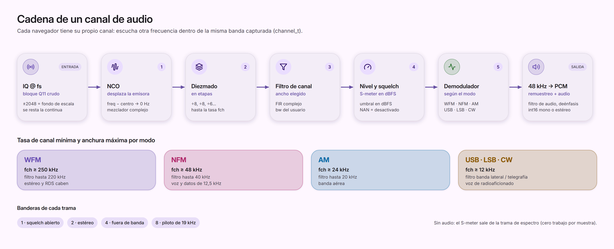

# DSP: filtros, remuestreo y DDC

## Figuras

<picture>
  <source media="(prefers-color-scheme: dark)" srcset="img/canal-audio-dark.png">
  
</picture>

*Figura. Cadena de un canal de audio (`src/dsp/channel.h`): NCO, diezmado, filtro de canal, nivel y squelch, demodulador y remuestreo a 48 kHz.*


Este documento resume lo que añade la base (A1). Los bloques anteriores (FFT,
canal de audio, detector) están explicados en las cabeceras de `src/dsp/`.

## Diseño FIR por ventana de Kaiser (`filter.c`)

Un paso bajo ideal de corte `fc` (normalizado a fs) es `h[n] = 2fc·sinc(2fc·n)`.
Se trunca a N coeficientes y se multiplica por la ventana de Kaiser
`w[n] = I0(β·√(1−r²)) / I0(β)`, `r = (n − m)/m`. Las fórmulas empíricas de Kaiser
dan, para una atenuación A (dB) y una transición Δf/fs:

```
β = 0,1102·(A − 8,7)            (A > 50)
N ≈ (A − 8) / (2,285·2π·Δf/fs)
```

Todos los filtros se normalizan para ganancia 1 en continua.

## Diezmador `firdec_t`

Solo calcula una de cada D salidas: el coste es proporcional a la tasa de
**salida**. La línea de retardo está duplicada (cada muestra se escribe en `i` e
`i+N`) para que las N últimas muestras sean contiguas y el producto escalar se
vectorice. Con paso `pass_hz` la banda de rechazo empieza en `fs_out − pass_hz`:
lo que aliasee dentro de la banda útil queda ≥ 70 dB abajo.

## Remuestreador fraccionario `resamp_t` / `cresamp_t`

Para obtener `y(τ)` entre muestras se evalúa `Σ x[k]·h(τ − k)` con `h` un paso
bajo continuo. Se precalcula en **P = 256 fases**: `bank[p][j] = h(L/2−1−j+p/P)`,
cada fase normalizada a ganancia 1. La salida usa la fase más cercana a la
fracción de `τ` (error temporal ≤ 1/512 de muestra). El avance por salida es
`step = fs_in/fs_out` y la fracción `frac` se acumula en `double`: la **tasa de
salida es exacta** a largo plazo (error < 1e-12). `cresamp_t` es idéntico pero la
línea de retardo guarda muestras `cf32`; comparte el banco de coeficientes con
`resamp_init`. Las pruebas (`tests/test_dsp.c`) miden `n·fout/fin ± 1,5` salidas y
conservación de frecuencia y amplitud del tono.

## DDC (`ddc.c`)

```
x[n] ─► NCO e^{-jωn} ─► firdec ÷D1 ─► firdec ÷D2 … ─► cfir ±bw/2 ─► cresamp ─► y[m]
```

1. **Mezcla.** `ω = 2π(f_canal − f_centro)/fs_in` con signo negativo: el canal queda
   en 0 Hz. El NCO es un rotor (`fasor·e^{jω}`), renormalizado por bloque.
2. **Diezmado en etapas.** `M = ⌊fs_in/fs_out⌋` se reduce al mayor `M' ≤ M` con
   factores primos {2,3,5,7} y se reparte en etapas ≤ 8 (8,7,6,5,4,3,2). Cada etapa
   `k` con tasa de salida `r` usa `pass = bw/2 + ¼(r − bw)`, transición `½(r − bw)`.
   Las primeras etapas, con tasas altas, tienen transiciones anchas → pocos taps.
3. **Filtro de canal.** `cfir_t` paso banda `[−bw/2, +bw/2]` (transición el 20 % de
   `bw`, mín. 2 % de la tasa intermedia), 65 dB.
4. **Remuestreo.** `cresamp_t` de la tasa intermedia (entre `fs_out` y ~1,5·`fs_out`)
   a `fs_out` exacto, con corte en `bw/2`.

`ddc_retune` solo cambia el paso del NCO y conserva su fase: la salida no tiene
saltos. El trabajo se hace en bloques internos de 8192 muestras (cabe en caché
aunque la entrada sea de 61 Msps). Resultado medido (`test_dsp`): un interferente a
+30 kHz de un canal de 16 kHz queda a −93 dB.
