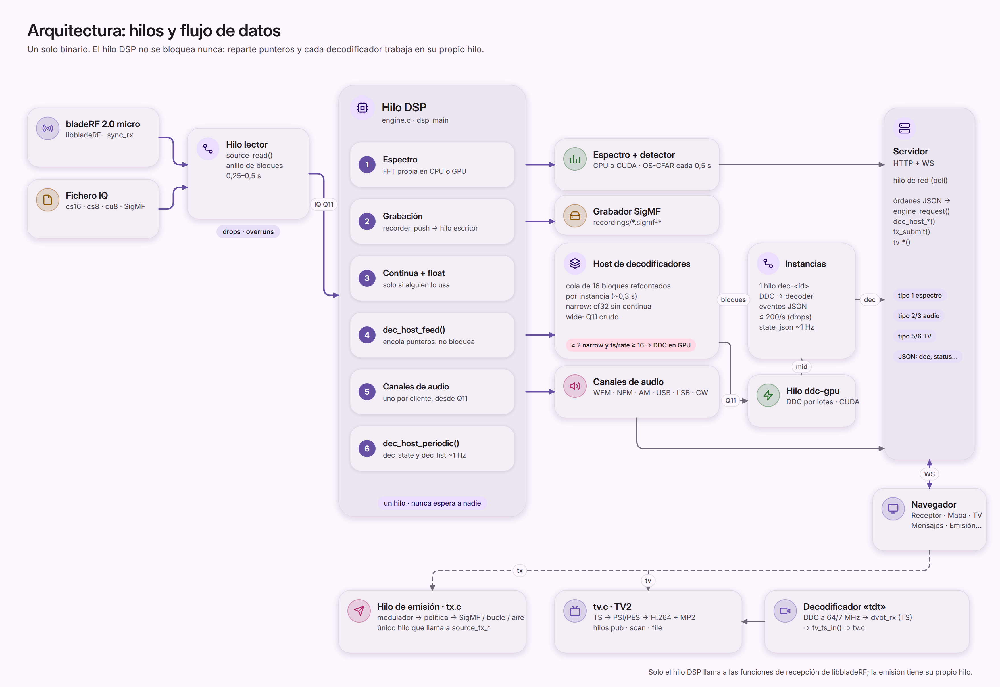
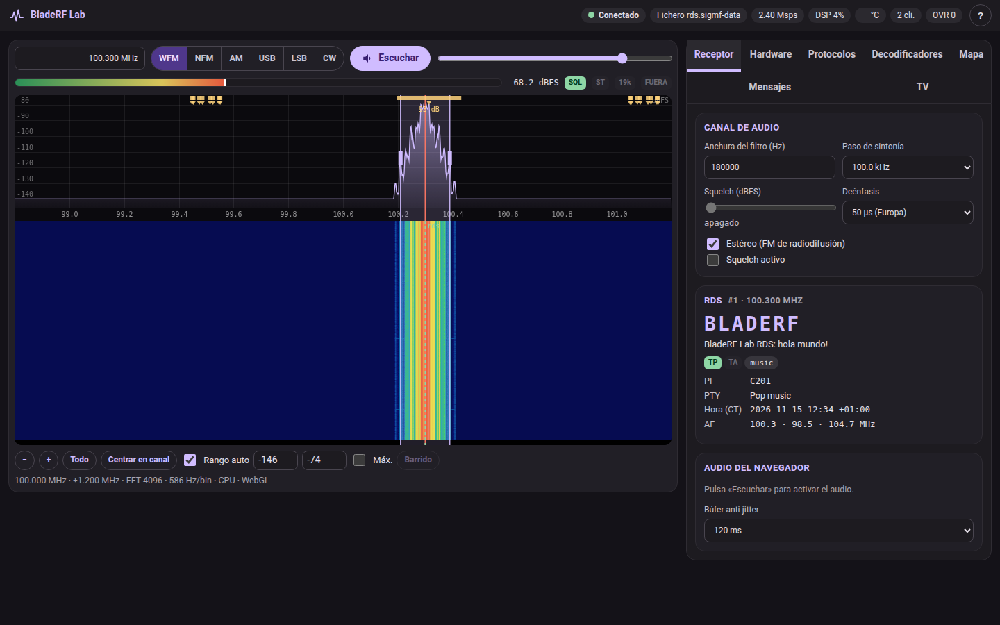
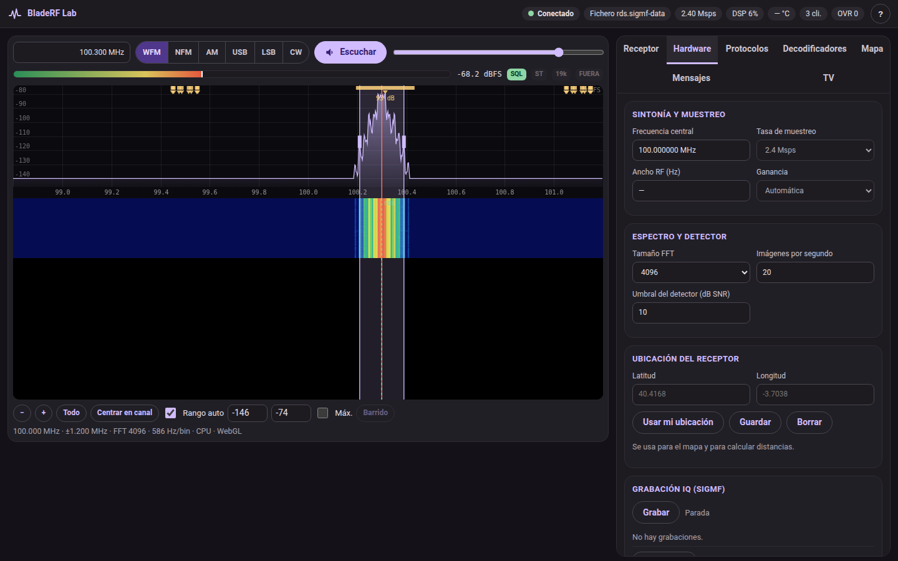
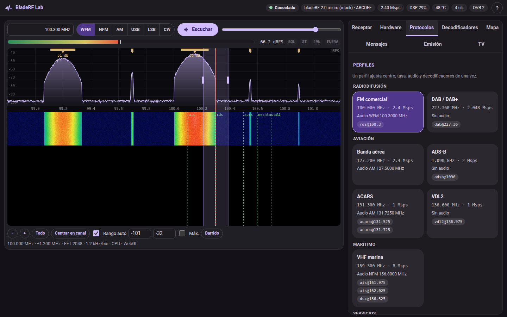
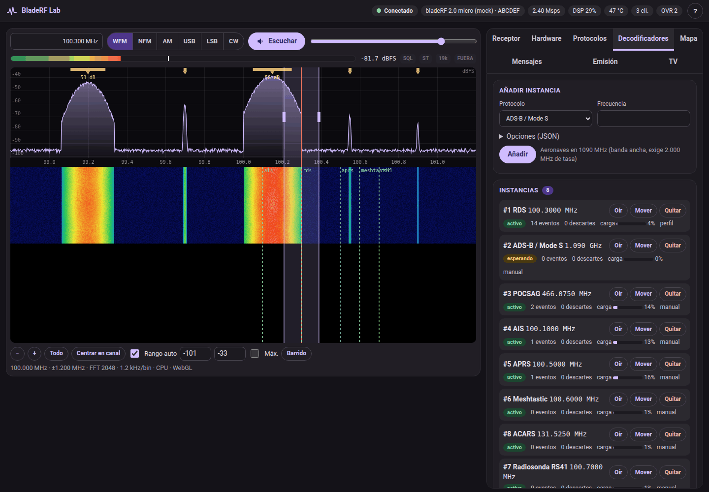
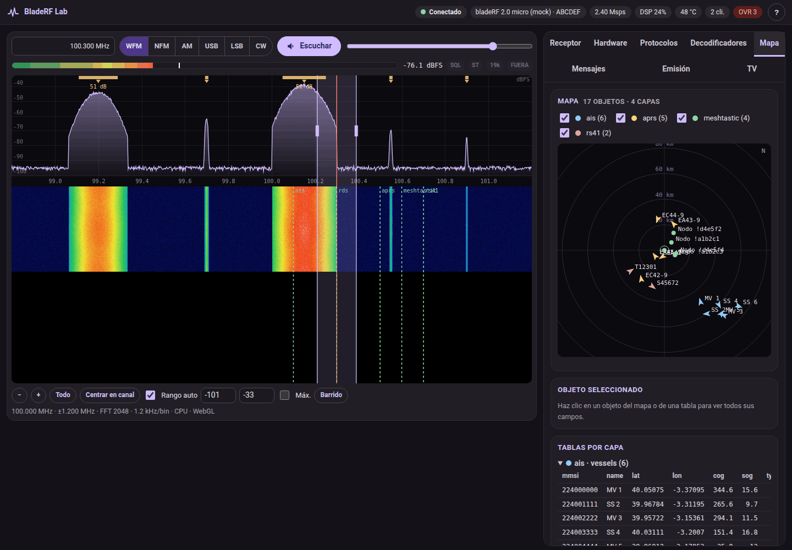
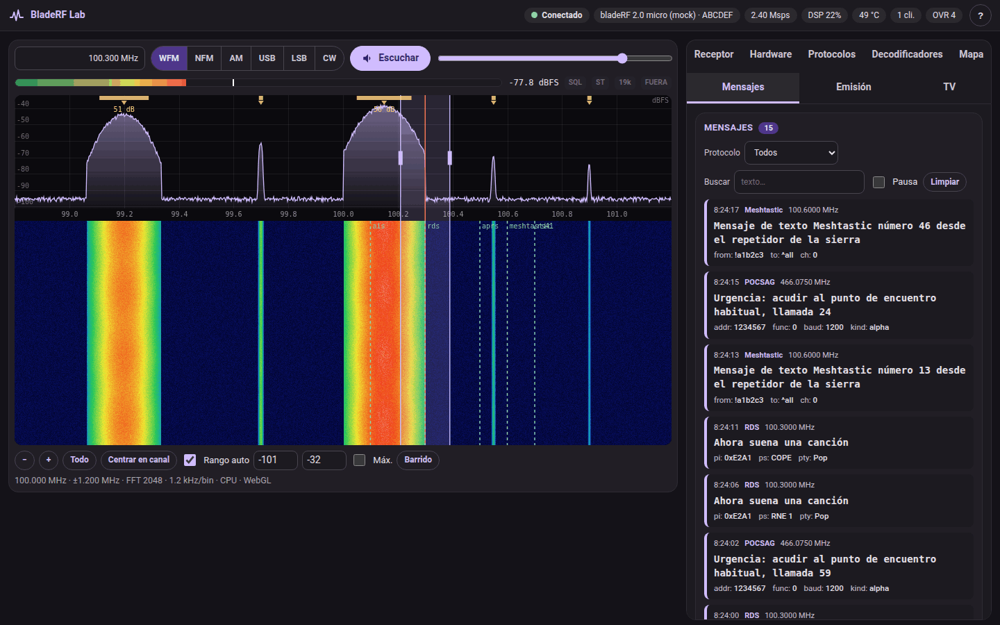
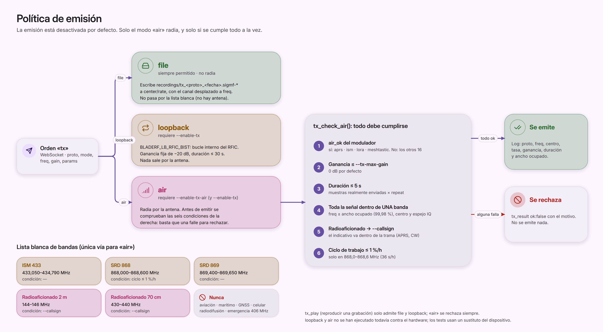
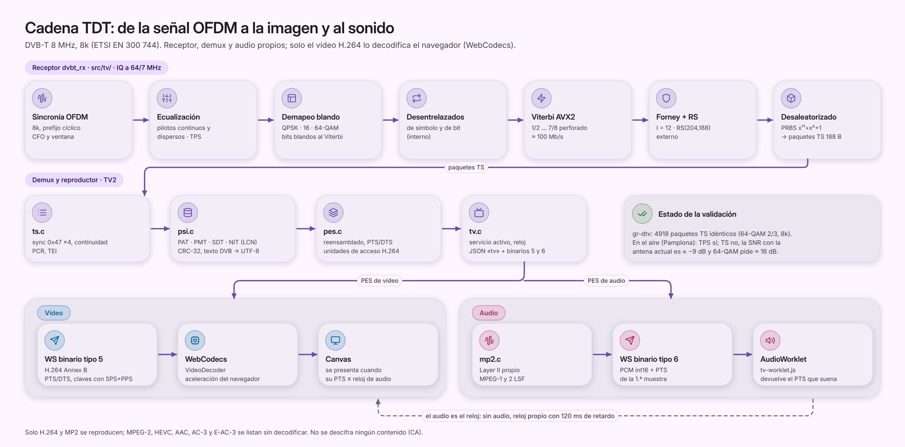

# Guía de uso

Una guía paso a paso de la interfaz web de BladeRF Lab, pestaña por pestaña. Todas las capturas son de la interfaz real a 1440 px; las del mapa, las tablas, los decodificadores y los mensajes usan **datos de demostración** (`tests/web_mock.js`), no radio real. Las del receptor, la emisión, el hardware y la TV salen de un servidor propio con señales generadas con `--gen` y un TS de prueba.

<picture>
  <source media="(prefers-color-scheme: dark)" srcset="img/arquitectura-dark.png">
  
</picture>

## Índice

1. [Arrancar](#1-arrancar)
2. [Receptor: espectro, cascada y audio](#2-receptor-espectro-cascada-y-audio)
3. [Hardware: sintonía, ganancia y grabación](#3-hardware-sintonía-ganancia-y-grabación)
4. [Protocolos: perfiles](#4-protocolos-perfiles)
5. [Decodificadores](#5-decodificadores)
6. [Mapa](#6-mapa)
7. [Mensajes](#7-mensajes)
8. [Barrido de banda ancha](#8-barrido-de-banda-ancha)
9. [Emisión](#9-emisión)
10. [TV (TDT)](#10-tv-tdt)
11. [Consejos de antena](#11-consejos-de-antena)
12. [Sin hardware: ficheros y generador](#12-sin-hardware-ficheros-y-generador)

---

## 1. Arrancar

```sh
make                                    # build/bladerf-lab (CUDA automático si hay nvcc)
./build/bladerf-lab                     # abre el primer bladeRF
./build/bladerf-lab --profile fm        # o arranca ya con un perfil
```

Abre <http://127.0.0.1:8090>. El servidor solo escucha en `127.0.0.1`; para verlo desde otro equipo de la red usa `--host 0.0.0.0` (ojo: el reproductor de TV necesita `localhost` o HTTPS, ver [§10](#10-tv-tdt)).

Si el bladeRF está ocupado por otro programa (p. ej. el servicio OpenWebRX), el servidor no podrá abrirlo: libéralo antes.

La barra superior muestra la conexión, la fuente (bladeRF o fichero), la tasa, la carga del hilo DSP, la temperatura, los clientes conectados y los overruns. El botón **?** abre los atajos de teclado.

## 2. Receptor: espectro, cascada y audio



*Receptor con una FM generada con `--gen rds`: el espectro, la cascada y el panel RDS.*

- **Sintonizar.** Clic en el espectro o en la cascada, o escribe la frecuencia en el campo de la izquierda (tecla `F`). Las flechas ajustan con el paso elegido; arriba y abajo, ×10.
- **Modo.** WFM (FM comercial, estéreo y RDS), NFM, AM, USB, LSB y CW. Cada navegador tiene su propio canal: dos personas pueden escuchar frecuencias distintas de la misma banda capturada.
- **Escuchar.** Activa el audio del navegador. El filtro se ajusta arrastrando sus bordes en el espectro, o con la anchura en la pestaña.
- **Squelch y deénfasis.** En el panel «Canal de audio»; 50 µs es el estándar europeo.
- **Zoom.** Rueda o pellizco; `+`, `−` y `0` (todo).
- **Señales detectadas.** El detector OS-CFAR marca las portadoras con una barra amarilla y su SNR. Un clic sobre una marca abre un menú para sintonizarla o crear un decodificador sobre ella.
- **RDS.** En una FM, el panel RDS muestra PS, texto de radio, tipo de programa, hora y frecuencias alternativas del decodificador `rds` del perfil `fm`.

Para escuchar una emisora de FM sin más: perfil **FM comercial**, `Escuchar` y sintoniza.

## 3. Hardware: sintonía, ganancia y grabación



- **Sintonía y muestreo.** Frecuencia central, tasa y ancho RF. El tamaño de banda capturada (la tasa) es lo que deja a los decodificadores ver varios canales a la vez. Con más de 61,44 Msps se activa el modo de 122,88 Msps (FPGA ≥ 0.15).
- **Ganancia.** Automática, manual o los AGC rápido, lento e híbrido del AD9361. Si existe tabla de calibración se muestra el nivel en dBm.
- **Bias-tee.** Alimenta una antena activa o un LNA. ¡Cuidado!: solo con antenas que lo admitan.
- **Espectro y detector.** Tamaño de FFT, imágenes por segundo y umbral del detector.
- **Ubicación.** Latitud y longitud del receptor: el mapa y las distancias las usan, y se pasan a los decodificadores que decodifican posiciones (ADS-B).
- **Grabación IQ.** `Grabar` (o la tecla `R`) guarda la banda capturada en `recordings/` como SigMF (`.sigmf-meta` + `.sigmf-data`). La lista permite descargar y borrar. Una grabación se puede reproducir luego con `--replay` o con el comando `tx_play` en modo fichero o bucle interno.

## 4. Protocolos: perfiles



*Perfiles agrupados por familia (captura con servidor de demostración).*

Un **perfil** ajusta de una vez el centro, la tasa, el ancho RF, el canal de audio y los decodificadores. Hay 22, por ejemplo:

| Perfil | Centro / tasa | Qué crea |
|---|---|---|
| `fm` | 100,0 MHz / 2,4 Msps | WFM en 100,3 MHz + RDS que sigue a la sintonía |
| `airband` | 127,2 MHz / 2,4 Msps | AM en 127,5 MHz |
| `adsb` | 1090 MHz / 2 Msps | ADS-B |
| `maritimo` | 159,3 MHz / 8 Msps | NFM en el canal 16 + AIS en 161,975 y 162,025 + DSC en 156,525 |
| `acars`, `vdl2` | 131,3 / 136,6 MHz / 1 Msps | ACARS (3 canales) o VDL2 (4 canales) |
| `busca` | 466,3 MHz / 1 Msps | POCSAG y FLEX en 466,075 |
| `aprs`, `ham2m`, `ham70` | 145 / 433 MHz | APRS en 144,8 y NFM |
| `ism433`, `ism868`, `lora`, `meshtastic` | 433–869 MHz | ISM, LoRaWAN, Meshtastic |
| `sonda` | 403 MHz / 6 Msps | RS41 (instancias automáticas sobre las señales detectadas) |
| `lte`, `gsm`, `nr` | 806 / 942,5 / 3500 MHz | celdas (desde señales detectadas) |
| `wifi`, `dvbt`, `dab` | 2437 / 474 / 227,36 MHz | beacons WiFi, TPS de DVB-T, DAB |

Se usan por pestaña o desde la línea de órdenes (`--profile <id>`). Un perfil retira antes las instancias del perfil anterior; las instancias manuales se conservan. La lista completa está en [AGENTS.md §5](../AGENTS.md) y en [PROTOCOLOS.md](PROTOCOLOS.md).

## 5. Decodificadores



*Instancias en marcha (datos de demostración).*

- **Añadir instancia.** Elige el protocolo, la frecuencia y, si hace falta, opciones JSON, y pulsa `Añadir`. Cada instancia es un hilo propio.
- **Estado.** `activo`, `esperando` (el canal queda fuera de la banda capturada: no es un error; cambia el centro o la tasa) o `error` (tasa incompatible, p. ej. «requiere exactamente 2 Msps»).
- **Carga y descartes.** La fracción de núcleo que ocupa la instancia y los bloques o eventos descartados (el host nunca frena al hilo DSP).
- **Oír, Mover, Quitar.** `Oír` lleva el audio a esa frecuencia; `Mover` la retunea sin clics.
- **Tablas.** Los decodificadores que mantienen una tabla (aviones, barcos, celdas, redes WiFi…) la muestran en «Estado de las tablas».

Los decodificadores *wide* (ADS-B, DAB, WiFi, NR) exigen una tasa de captura concreta (2 Msps, 2,048 Msps, 20 Msps…); los *narrow* funcionan con cualquier tasa que contenga su canal.

## 6. Mapa



*Datos de demostración (`tests/web_mock.js`).*

Cualquier decodificador cuya tabla tenga objetos con `lat` y `lon` se dibuja en el mapa por capas (AIS, APRS, Meshtastic, ADS-B, RS41…). Activa o desactiva capas, haz clic en un objeto para ver todos sus campos y mira las tablas por capa debajo. Pon antes tu ubicación en la pestaña Hardware para tener un punto de referencia y las distancias.

## 7. Mensajes



*Datos de demostración.*

El flujo de eventos de todos los decodificadores: texto RDS, mensajes POCSAG y FLEX, texto de Meshtastic, ACARS… Se puede filtrar por protocolo, buscar texto y pausar. Al conectar se reenvían los últimos 100. Recuerda el [aviso legal](../README.md#aviso-legal) sobre comunicaciones no públicas.

## 8. Barrido de banda ancha

El botón **Barrido** (bajo el espectro) recorre de 47 MHz a 6 GHz con sintonía rápida y pinta un espectro de todo el rango (mensajes binarios de tipo 4); sirve para ver dónde hay señal antes de elegir un perfil. Mientras barre no hay espectro normal, detector, audio, decodificadores ni grabación; al parar se repone la configuración. No funciona con una fuente de fichero. Detalle en [HARDWARE.md](HARDWARE.md).

## 9. Emisión


La pestaña **Emisión** solo aparece si el servidor se arrancó con `--enable-tx` (captura con `--enable-tx --callsign EA2XXX` sobre un fichero; no se emitió nada). Muestra la política vigente (aire activado o no, indicativo, ganancia máxima, bandas permitidas).

<picture>
  <source media="(prefers-color-scheme: dark)" srcset="img/politica-tx-dark.png">
  
</picture>

1. Elige el protocolo, el modo y la frecuencia.
2. **Fichero SigMF (seguro)**: escribe `recordings/tx_<proto>_<fecha>.sigmf-*`. No radia. Se reproduce con `--replay` y se decodifica con el protocolo gemelo: la forma de comprobar de extremo a extremo.
3. **Bucle interno**: requiere `--enable-tx`. Nada sale por la antena.
4. **Aire**: requiere además `--enable-tx-air`; solo ISM/SRD de 433 y 868 MHz o radioaficionado con `--callsign`, ganancia ≤ `--tx-max-gain` (0 dB por defecto), 5 s por orden y ciclo ≤ 1 %/h en 868,0–868,6 MHz. Los protocolos de aviación, marítimo, radiosondas, telefonía o radiodifusión nunca se radian.

Los modos `loopback` y `air` no se han probado todavía contra la placa. **Radiar exige cumplir la normativa de tu país** (ver el [aviso legal](../README.md#aviso-legal)).

## 10. TV (TDT)


*Vídeo H.264 y audio MP2 desde un TS de prueba en bucle (`--tv-ts fichero.ts`), sin radio.*

1. **Canal.** Elige el canal (21–48, 306 + 8·n MHz) y pulsa `Sintonizar`, o `Explorar canales 21–48` para listar los múltiplex que enganchan.
2. **Servicios.** Elige uno de la lista (nombre, proveedor, códec, resolución) y pulsa `Ver`.
3. **Recepción.** El panel inferior da el enganche, MER/SNR, desvío de frecuencia, BER antes de Viterbi y de Reed-Solomon, paquetes RS corregidos y tasa del TS.

Requisitos: el vídeo lo decodifica el navegador con WebCodecs (Chrome o Edge con H.264) y WebCodecs exige `localhost` o HTTPS. Solo se reproducen H.264 y audio MP2; AAC, AC-3 y E-AC-3 se listan sin sonido. No se descifra ningún servicio de pago.

<picture>
  <source media="(prefers-color-scheme: dark)" srcset="img/cadena-tdt-dark.png">
  
</picture>

## 11. Consejos de antena

- **ADS-B (1090 MHz).** Con la antena actual **no llega** ADS-B: el decodificador está probado con vectores públicos, con `dump1090-fa` y con señal sintética, pero sin tráfico real. Hace falta una antena de 1090 MHz (un monopolo de ¼ de onda de unos 6,9 cm, o una colineal) cuanto más alta y despejada mejor, y un filtro de 1090 MHz con LNA cerca de la antena si el cable es largo.
- **TDT (UHF).** Con la antena actual la señal de UHF no basta: en Pamplona el mejor múltiplex (C32, 562 MHz) llegaba con una SNR en banda de ≈ −9 dB y 64-QAM necesita ≈ 16 dB, así que se decodifican los parámetros TPS pero no hay TS. **Conecta el bladeRF a la toma de antena de TV de casa** (con un adaptador de F o IEC a SMA): la antena colectiva de la vivienda da la señal que hace falta. Si la toma tiene amplificador de distribución, no hace falta bias-tee; si usas un LNA externo alimentado por bias-tee, actívalo en la pestaña Hardware solo si el LNA lo requiere.
- **VHF y FM.** Cualquier antena de banda ancha o una discone dan RDS, AIS (marítimo) y APRS en zonas con actividad; AIS y ACARS agradecen visibilidad.
- **Ganancia.** Empieza en automática; si la cascada se llena de señales falsas, baja la ganancia (saturación del ADC). Los límites de ganancia del AD9361 dependen de la banda.
- **Seguridad.** No conectes el puerto TX a una antena sin querer emitir, y no actives el bias-tee con antenas que no lo esperen.

## 12. Sin hardware: ficheros y generador

El servidor trabaja igual con un fichero de IQ (`cs16`, `cs8`, `cu8` o SigMF) en bucle:

```sh
./build/bladerf-lab --replay grabacion.sigmf-meta            # SigMF
./build/bladerf-lab --replay cap.cs16 --rate 2000000 --freq 100000000   # IQ crudo: tasa y centro
./build/bladerf-lab --replay cap.cs16 --rate 2000000 --tv-ts prueba.ts   # TV desde un TS
```

Cada protocolo trae su modulador, así que puedes **generar** una señal y decodificarla sin antena:

```sh
./build/bladerf-lab --gen rds --gen-freq 100300000 --gen-center 100000000 --gen-rate 2400000 --out /tmp/rds
./build/bladerf-lab --replay /tmp/rds.sigmf-meta --profile fm

./build/bladerf-lab --gen ais --gen-freq 161975000 --gen-center 162000000 --gen-rate 1000000 --out /tmp/ais
./build/bladerf-lab --replay /tmp/ais.sigmf-meta --decode ais@161975000 --print
```

`--print` escribe los eventos decodificados como JSON por la consola y `--log-events <dir>` los guarda en un directorio; `--duration <s>` termina el programa al cabo de unos segundos (útil en scripts).
