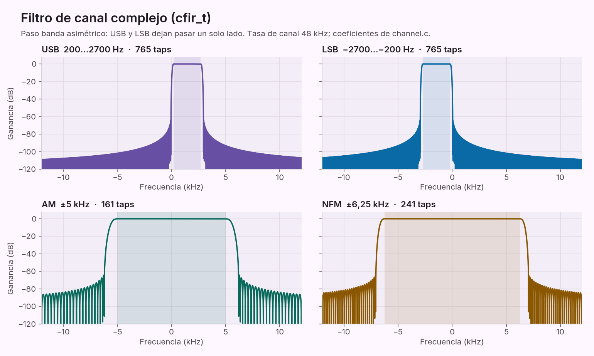
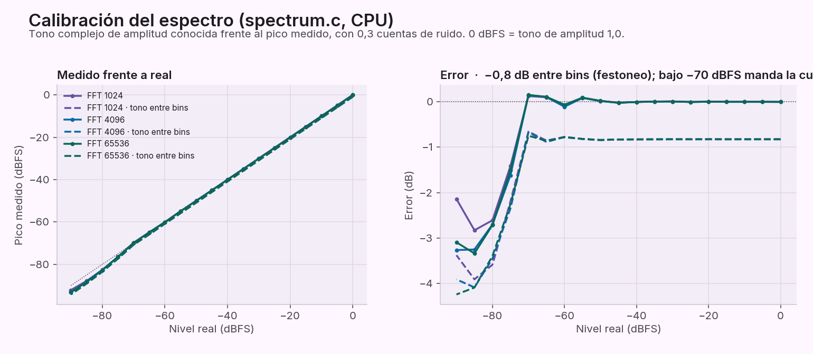
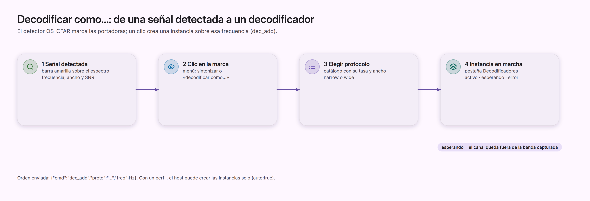
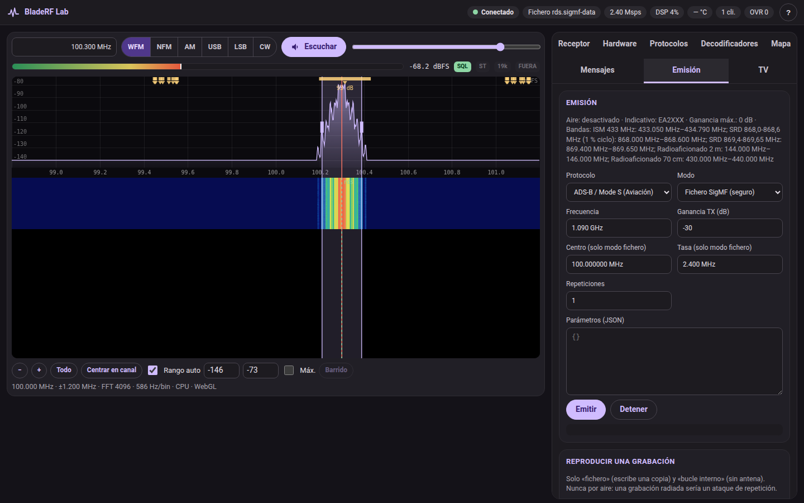
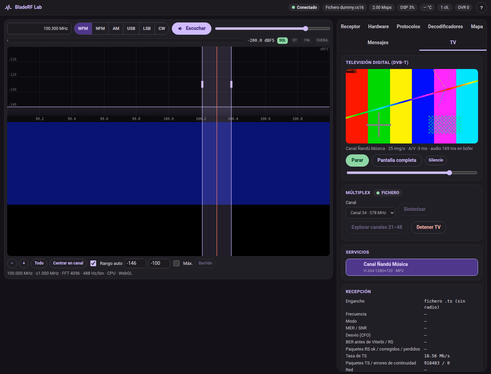
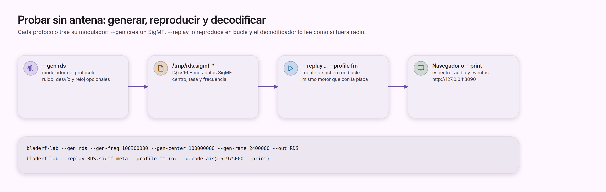
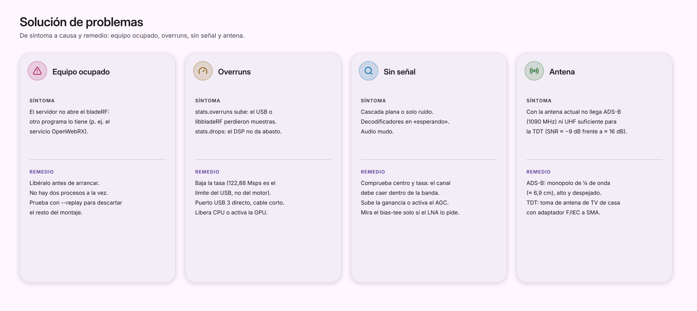

# Guía de uso

Una guía paso a paso de BladeRF Lab: desde el primer arranque hasta la TDT, con tutoriales cortos, diagramas y una sección de solución de problemas. Las capturas de la interfaz son de servidores propios con señales generadas con `--gen` y, donde se indica, con **datos de demostración** (`tests/web_mock.js`), que no son radio real.

> Estado de las capturas: la interfaz web se está rehaciendo. Las capturas de esta guía (`img/screens/`) se sustituirán por capturas anotadas de cada pestaña cuando termine ese trabajo; los pasos y los diagramas no dependen de ellas.

<picture>
  <source media="(prefers-color-scheme: dark)" srcset="img/arquitectura-dark.png">
  
</picture>

## Índice

1. [Primer arranque](#1-primer-arranque)
2. [Receptor: espectro, cascada y audio](#2-receptor-espectro-cascada-y-audio)
3. [Escuchar FM y ver el RDS](#3-escuchar-fm-y-ver-el-rds)
4. [Sintonizar fuera de banda](#4-sintonizar-fuera-de-banda)
5. [Hardware: sintonía, ganancia y grabación](#5-hardware-sintonía-ganancia-y-grabación)
6. [Usar los perfiles](#6-usar-los-perfiles)
7. [Decodificadores y «decodificar como…»](#7-decodificadores-y-decodificar-como)
8. [Mapa](#8-mapa)
9. [Mensajes y tablas](#9-mensajes-y-tablas)
10. [Grabar y reproducir con `--replay`](#10-grabar-y-reproducir-con---replay)
11. [Barrido de banda ancha](#11-barrido-de-banda-ancha)
12. [Emisión en modo fichero y su política](#12-emisión-en-modo-fichero-y-su-política)
13. [TV (TDT)](#13-tv-tdt)
14. [Probar sin antena con `--gen`](#14-probar-sin-antena-con---gen)
15. [Usar el servidor desde otra máquina](#15-usar-el-servidor-desde-otra-máquina)
16. [Solución de problemas](#16-solución-de-problemas)
17. [Consejos de antena](#17-consejos-de-antena)

---

## 1. Primer arranque

```sh
make                                    # build/bladerf-lab (CUDA automático si hay nvcc)
make CUDA=0                             # sin GPU
./build/bladerf-lab                     # abre el primer bladeRF
./build/bladerf-lab --profile fm        # o arranca ya con un perfil
```

1. **Libera el equipo.** El bladeRF solo lo puede tener abierto un programa; si otro servicio (p. ej. OpenWebRX) lo usa, el servidor no podrá abrirlo ([§16](#16-solución-de-problemas)).
2. **Arranca el servidor.** Lee el registro: debe decir la placa, la versión de la FPGA y la dirección web.
3. **Abre** <http://127.0.0.1:8090>. El servidor solo escucha en `127.0.0.1`; para otra máquina, [§15](#15-usar-el-servidor-desde-otra-máquina).
4. **Mira la barra superior:** conexión, fuente (bladeRF o fichero), tasa, carga del hilo DSP, temperatura, clientes y overruns. El botón **?** abre los atajos de teclado.
5. **Primera comprobación sin antena:** si no tienes nada conectado, usa [§14](#14-probar-sin-antena-con---gen).

Opciones útiles: `--port`, `--host`, `--serial`, `--rate`, `--freq`, `--no-gpu`, `--recdir`, `--config`, `--profile`, `--decode id[@Hz]`, `--print`, `--duration` y `-v`. La configuración (centro, tasa, ganancia, FFT, ubicación…) se guarda en `~/.config/bladerf-lab/config.json`.

## 2. Receptor: espectro, cascada y audio


*Receptor con una FM generada con `--gen rds`: el espectro, la cascada y el panel RDS.*

- **Sintonizar.** Clic en el espectro o en la cascada, o escribe la frecuencia en el campo de la izquierda (tecla `F`). Las flechas ajustan con el paso elegido; arriba y abajo, ×10.
- **Modo.** WFM (FM comercial, estéreo y RDS), NFM, AM, USB, LSB y CW. Cada navegador tiene su propio canal: dos personas pueden escuchar frecuencias distintas de la misma banda capturada.
- **Escuchar.** Activa el audio del navegador. El filtro se ajusta arrastrando sus bordes en el espectro, o con la anchura en la pestaña.
- **Squelch y deénfasis.** En el panel «Canal de audio»; 50 µs es el estándar europeo.
- **Zoom.** Rueda o pellizco; `+`, `−` y `0` (todo).
- **Señales detectadas.** El detector OS-CFAR marca las portadoras con una barra amarilla y su SNR. Un clic sobre una marca abre un menú para sintonizarla o crear un decodificador sobre ella.
- **Indicadores del canal.** Squelch abierto, estéreo, fuera de banda y piloto de 19 kHz (las banderas de los mensajes binarios de audio).

El filtro del canal depende del modo; en USB y LSB solo pasa un lado de la portadora:

<picture>
  <source media="(prefers-color-scheme: dark)" srcset="img/dsp/cfir-canal-dark.png">
  
</picture>

## 3. Escuchar FM y ver el RDS

1. Abre la pestaña **Protocolos** y pulsa el perfil **FM comercial** (centro 100,0 MHz, 2,4 Msps, WFM en 100,3 MHz y el decodificador `rds`).
2. Vuelve a **Receptor**, pulsa **Escuchar** y haz clic sobre una emisora (o escribe su frecuencia en MHz).
3. Comprueba que el modo es WFM y que se enciende el indicador de piloto de 19 kHz: es estéreo.
4. El panel **RDS** muestra PS (nombre), texto de radio, tipo de programa, hora y frecuencias alternativas. El decodificador `rds` del perfil sigue a la sintonía (`follow`): si cambias de emisora, él va detrás con `dec_tune`.
5. Si no hay RDS, prueba con una emisora más fuerte.

Sin antena: `./build/bladerf-lab --gen rds --gen-freq 100300000 --gen-center 100000000 --gen-rate 2400000 --out /tmp/rds` y `--replay /tmp/rds.sigmf-meta --profile fm` ([§14](#14-probar-sin-antena-con---gen)).

## 4. Sintonizar fuera de banda

La banda capturada es `centro ± tasa/2`. Si haces clic en una frecuencia que queda fuera, el canal de audio pasa a **fuera de banda** (bandera 4: el audio calla) y el decodificador de esa frecuencia queda en estado `esperando`, que no es un error.

Dos formas de resolverlo:

1. **Mover la banda.** En Hardware o en la barra de frecuencia, cambia el **centro** para que la frecuencia deseada quede dentro. La captura se rehace sola y se borra el perfil activo (un cambio de centro o tasa lo invalida).
2. **Cambiar la tasa.** Una tasa mayor da más banda (hasta 61,44 Msps; con más, el modo de 122,88 Msps, FPGA ≥ 0.15). Tasas altas cuestan CPU: mira la carga del hilo DSP.

Los canales no pueden caer en el pico de continua del centro; por eso los perfiles desplazan el centro unos cientos de kHz respecto al canal (p. ej. FM: centro 100,0 y audio 100,3 MHz).

## 5. Hardware: sintonía, ganancia y grabación


- **Sintonía y muestreo.** Frecuencia central, tasa y ancho RF. El tamaño de banda capturada (la tasa) es lo que deja a los decodificadores ver varios canales a la vez. Con más de 61,44 Msps se activa el modo de 122,88 Msps (FPGA ≥ 0.15).
- **Ganancia.** Automática, manual o los AGC rápido, lento e híbrido del AD9361. Si existe tabla de calibración se muestra el nivel en dBm.
- **Bias-tee.** Alimenta una antena activa o un LNA. ¡Cuidado!: solo con antenas que lo admitan.
- **Espectro y detector.** Tamaño de FFT, imágenes por segundo y umbral del detector.
- **Ubicación.** Latitud y longitud del receptor: el mapa y las distancias las usan, y se pasan a los decodificadores que decodifican posiciones (ADS-B).
- **Grabación IQ.** `Grabar` (o la tecla `R`) guarda la banda capturada en `recordings/` como SigMF (`.sigmf-meta` + `.sigmf-data`). La lista permite descargar y borrar.

La escala del espectro está calibrada: un tono complejo de amplitud 1,0 mide 0 dBFS con un error máximo de 0,09 dB, y con el tono entre dos bins la ventana pierde ≈ 0,8 dB.

<picture>
  <source media="(prefers-color-scheme: dark)" srcset="img/dsp/calibracion-espectro-dark.png">
  
</picture>

## 6. Usar los perfiles


*Perfiles agrupados por familia (captura con servidor de demostración).*

Un **perfil** ajusta de una vez el centro, la tasa, el ancho RF, el canal de audio y los decodificadores. Hay 22, por ejemplo:

| Perfil | Centro / tasa | Qué crea |
|---|---|---|
| `fm` | 100,0 MHz / 2,4 Msps | WFM en 100,3 MHz + RDS que sigue a la sintonía |
| `airband` | 127,2 MHz / 2,4 Msps | AM en 127,5 MHz |
| `adsb` | 1090 MHz / 2 Msps | ADS-B |
| `maritimo` | 159,3 MHz / 8 Msps | NFM en el canal 16 + AIS en 161,975 y 162,025 + DSC en 156,525 |
| `acars`, `vdl2` | 131,3 / 136,6 MHz / 1 Msps | ACARS (3 canales) o VDL2 (4 canales) |
| `busca` | 466,3 MHz / 1 Msps | POCSAG y FLEX en 466,075 |
| `aprs`, `ham2m`, `ham70` | 145 / 433 MHz | APRS en 144,8 y NFM |
| `ism433`, `ism868`, `lora`, `meshtastic` | 433–869 MHz | ISM, LoRaWAN, Meshtastic |
| `sonda` | 403 MHz / 6 Msps | RS41 (instancias automáticas sobre las señales detectadas) |
| `lte`, `gsm`, `nr` | 806 / 942,5 / 3500 MHz | celdas (desde señales detectadas) |
| `wifi`, `dvbt`, `dab` | 2437 / 474 / 227,36 MHz | beacons WiFi, TPS de DVB-T, DAB |

Cómo se usan:

1. Pulsa el perfil en la pestaña **Protocolos**, o arranca con `--profile <id>`.
2. El servidor retira las instancias del perfil anterior (`owner` 1), fija centro, tasa y ancho RF, mueve **tu** canal de audio si el perfil trae audio y crea las instancias del perfil. Las instancias manuales (las que tú añadiste) se conservan.
3. Si cambias el centro o la tasa a mano, el perfil deja de figurar como activo.
4. Algunos perfiles traen `auto`: el host crea instancias sobre las señales que detecta el detector dentro de la banda útil (como máximo 8, y las retira si la señal lleva 60 s sin verse).

La lista completa está en [AGENTS.md §5](../AGENTS.md) y en [PROTOCOLOS.md](PROTOCOLOS.md).

<picture>
  <source media="(prefers-color-scheme: dark)" srcset="img/mapa-bandas-dark.png">
  
</picture>

## 7. Decodificadores y «decodificar como…»


*Instancias en marcha (datos de demostración).*

**Añadir una instancia a mano**

1. En **Decodificadores**, elige el protocolo, la frecuencia y, si hace falta, opciones JSON, y pulsa `Añadir`.
2. Cada instancia es un hilo propio con su DDC. Mira su **estado** (`activo`, `esperando`, `error`), su **carga** (fracción de núcleo) y los **descartes**.

**Decodificar como… desde una señal detectada**

<picture>
  <source media="(prefers-color-scheme: dark)" srcset="img/guia/decodificar-como-dark.png">
  
</picture>

1. En el **Receptor**, busca una barra amarilla del detector sobre el espectro: es una portadora con su frecuencia, ancho y SNR.
2. Haz clic en ella: se abre el menú de la señal con **Decodificar como…**.
3. Elige el protocolo del catálogo (la lista indica si es *narrow* o *wide* y la tasa que exige).
4. La instancia aparece en **Decodificadores**. Si el protocolo es *wide* y la tasa de captura no coincide («requiere exactamente 2 Msps»), queda en `error`; cambia la tasa en Hardware o usa un perfil.

**Operar sobre una instancia**

- **Oír** lleva el audio a esa frecuencia; **Mover** la retunea sin clics; **Quitar** la elimina.
- **Tablas.** Los decodificadores que mantienen una tabla (aviones, barcos, celdas, redes WiFi…) la muestran en «Estado de las tablas».
- Los decodificadores *wide* (ADS-B, DAB, WiFi, NR) exigen una tasa de captura concreta (2 Msps, 2,048 Msps, 20 Msps…); los *narrow* funcionan con cualquier tasa que contenga su canal.

La figura del [marco de decodificadores](ARQUITECTURA.md) explica el recorrido interno.

## 8. Mapa


*Datos de demostración (`tests/web_mock.js`).*

1. Pon tu **ubicación** en la pestaña Hardware: da un punto de referencia y las distancias.
2. Cualquier decodificador cuya tabla tenga objetos con `lat` y `lon` se dibuja en el mapa por capas (AIS, APRS, Meshtastic, ADS-B, RS41…).
3. Activa o desactiva capas, haz clic en un objeto para ver todos sus campos y mira las tablas por capa debajo.
4. Sin mapas externos: la cartografía va incluida en la propia aplicación.

## 9. Mensajes y tablas


*Datos de demostración.*

- **Mensajes.** El flujo de eventos de todos los decodificadores: texto RDS, mensajes POCSAG y FLEX, texto de Meshtastic, ACARS… Se puede filtrar por protocolo, buscar texto y pausar. Al conectar se reenvían los últimos 100 (marcados `replay`). Recuerda el [aviso legal](../README.md#aviso-legal) sobre comunicaciones no públicas.
- **Tablas.** Cualquier `dec_state` que contenga un array de objetos se muestra como tabla sin código específico: aviones con ICAO, indicativo y altura; barcos con MMSI; celdas con PCI; redes con SSID y BSSID. Las filas caducan solas.
- **Eventos por consola.** Con `--print` los eventos salen como JSON por la salida estándar y con `--log-events <dir>` se guardan en un directorio.

## 10. Grabar y reproducir con `--replay`

1. **Grabar.** Pulsa `Grabar` (o la tecla `R`) en Hardware. El fichero queda en `recordings/` como SigMF: `<nombre>.sigmf-meta` (centro, tasa, formato) y `<nombre>.sigmf-data`. Se puede descargar y borrar desde la lista.
2. **Reproducir.** Arranca otra instancia sin placa:

```sh
./build/bladerf-lab --replay recordings/captura.sigmf-meta --profile fm      # SigMF
./build/bladerf-lab --replay cap.cs16 --rate 2000000 --freq 100000000         # IQ crudo: tasa y centro
./build/bladerf-lab --replay cap.sigmf-meta --decode ais@161975000 --print    # solo decodificar
```

3. El fichero se lee **en bucle a ritmo real**; para el motor es una fuente más, así que espectro, audio, detector y decodificadores funcionan igual. Las fuentes de fichero no se pueden sintonizar: el centro y la tasa son los del fichero (y el barrido no está disponible).
4. Formatos admitidos: `cs16`, `cs8`, `cu8` y SigMF (`ci16_le`, etc.). Una grabación también se puede reenviar con el comando `tx_play` en modo fichero o bucle interno.
5. Consejo: el canal no debe caer en 0 Hz ni fuera de ±fs/2 del centro; una grabación a 250 ksps con el canal a 200 kHz del centro «se pliega» y no decodifica.

## 11. Barrido de banda ancha

1. Pulsa **Barrido** bajo el espectro: aparece la barra con **Inicio** y **Fin** (por omisión de 70 MHz a 6 GHz; el equipo admite 47 MHz–6 GHz).
2. Pulsa para empezar. El servidor recorre el rango con sintonía rápida y pinta el espectro de todo el intervalo (mensajes binarios de tipo 4) con el progreso de cada pasada.
3. Úsalo para ver **dónde hay señal** antes de elegir un perfil; haz clic en un pico y apunta su frecuencia.
4. Mientras barre no hay espectro normal, detector, audio, decodificadores ni grabación; al parar se repone la configuración. No funciona con una fuente de fichero. Detalle en [HARDWARE.md](HARDWARE.md).

## 12. Emisión en modo fichero y su política



La pestaña **Emisión** solo aparece si el servidor se arrancó con `--enable-tx` (captura con `--enable-tx --callsign EA2XXX` sobre un fichero; no se emitió nada). Muestra la política vigente (aire activado o no, indicativo, ganancia máxima, bandas permitidas).

<picture>
  <source media="(prefers-color-scheme: dark)" srcset="img/politica-tx-dark.png">
  
</picture>

**Probar una emisión de punta a punta, sin radiar**

1. Elige el protocolo (p. ej. POCSAG), el modo **Fichero** y la frecuencia.
2. Pulsa emitir. Se escribe `recordings/tx_<proto>_<fecha>.sigmf-*` con la señal a la `center` y `rate` pedidas. **No sale nada por la antena.**
3. Reprodúcelo: `./build/bladerf-lab --replay recordings/tx_pocsag_….sigmf-meta --decode pocsag@466075000 --print`. Si el mensaje sale, el modulador y el decodificador se entienden.

**Los tres modos**

| Modo | Requisito | Qué ocurre |
|---|---|---|
| `file` | ninguno | escribe un SigMF; siempre permitido |
| `loopback` | `--enable-tx` | bucle interno del RFIC con la ganancia al mínimo; nada sale por la antena |
| `air` | `--enable-tx-air` **y** la política | solo ISM/SRD de 433 y 868 MHz o radioaficionado con `--callsign`, ganancia ≤ `--tx-max-gain` (0 dB por defecto), 5 s por orden y ciclo ≤ 1 %/h en 868,0–868,6 MHz |

Los protocolos de aviación, marítimo, radiosondas, telefonía o radiodifusión nunca se radian. Antes de aceptar `air`, el servidor mide el **ancho ocupado** de la señal (99,98 % de la potencia) y exige que quepa entera en una banda permitida; ver [TX.md](TX.md).

Los modos `loopback` y `air` no se han probado todavía contra la placa. **Radiar exige cumplir la normativa de tu país** (ver el [aviso legal](../README.md#aviso-legal)).

## 13. TV (TDT)



*Vídeo H.264 y audio MP2 desde un TS de prueba en bucle (`--tv-ts fichero.ts`), sin radio.*

1. **Canal.** Elige el canal (21–48, 306 + 8·n MHz) y pulsa `Sintonizar`, o `Explorar canales 21–48` para listar los múltiplex que enganchan.
2. **Servicios.** Elige uno de la lista (nombre, proveedor, códec, resolución) y pulsa `Ver`.
3. **Recepción.** El panel inferior da el enganche, MER/SNR, desvío de frecuencia, BER antes de Viterbi y de Reed-Solomon, paquetes RS corregidos y tasa del TS.
4. **Sin antena:** `./build/bladerf-lab --replay cap.cs16 --rate 2000000 --tv-ts prueba.ts` reproduce un TS en bucle; con eso `tv` y `tv_scan` se rechazan (la fuente ya es el fichero).

Requisitos: el vídeo lo decodifica el navegador con WebCodecs (Chrome o Edge con H.264) y WebCodecs exige `localhost` o HTTPS ([§15](#15-usar-el-servidor-desde-otra-máquina)). Solo se reproducen H.264 y audio MP2; AAC, AC-3 y E-AC-3 se listan sin sonido. No se descifra ningún servicio de pago. **Con la antena actual la señal de UHF no basta** ([§17](#17-consejos-de-antena)).

<picture>
  <source media="(prefers-color-scheme: dark)" srcset="img/cadena-tdt-dark.png">
  
</picture>

## 14. Probar sin antena con `--gen`

Cada protocolo trae su modulador, así que puedes **generar** una señal y decodificarla sin radio:

<picture>
  <source media="(prefers-color-scheme: dark)" srcset="img/guia/flujo-sin-antena-dark.png">
  
</picture>

```sh
./build/bladerf-lab --gen rds --gen-freq 100300000 --gen-center 100000000 --gen-rate 2400000 --out /tmp/rds
./build/bladerf-lab --replay /tmp/rds.sigmf-meta --profile fm

./build/bladerf-lab --gen ais --gen-freq 161975000 --gen-center 162000000 --gen-rate 1000000 --out /tmp/ais
./build/bladerf-lab --replay /tmp/ais.sigmf-meta --decode ais@161975000 --print
```

`--gen-params` acepta el mensaje a modular (JSON); sin él se usa uno de ejemplo. El programa imprime el ancho ocupado de la señal generada. `--print` escribe los eventos decodificados como JSON por la consola, `--log-events <dir>` los guarda y `--duration <s>` termina el programa al cabo de unos segundos (útil en scripts).

## 15. Usar el servidor desde otra máquina

```sh
./build/bladerf-lab --host 0.0.0.0 --port 8090     # escucha en toda la red local
```

1. Abre `http://<ip-del-servidor>:8090` desde el otro equipo. Por seguridad el servidor escucha por omisión solo en `127.0.0.1`; no lo expongas a Internet (no hay autenticación).
2. Cada navegador tiene su propio canal de audio y sus propias órdenes de canal; la configuración de hardware (centro, tasa, ganancia, perfil) es **compartida**: lo que cambia uno lo ve el resto.
3. **Limitación: WebCodecs.** El reproductor de TV usa WebCodecs, que los navegadores solo ofrecen en un *contexto seguro*: `localhost` o HTTPS. Desde otra máquina por `http://ip:8090` la web lo detecta y avisa. Soluciones sin tocar el servidor: abrir un túnel SSH (`ssh -L 8090:127.0.0.1:8090 usuario@servidor`) y usar `http://localhost:8090` en tu equipo; o poner un proxy inverso con HTTPS delante. El resto de pestañas (espectro, audio, decodificadores, mapa) funcionan por HTTP normal.
4. La cabecera `Origin` de la conexión WebSocket debe coincidir con `Host`; un proxy debe conservar ambos.

## 16. Solución de problemas

<picture>
  <source media="(prefers-color-scheme: dark)" srcset="img/guia/solucion-problemas-dark.png">
  
</picture>

**Equipo ocupado.** El servidor no puede abrir el bladeRF y lo dice en el registro. Otro proceso lo tiene abierto (típicamente el servicio `openwebrx`). Para el otro programa antes de arrancar este; no hay forma de compartir el dispositivo. Mientras tanto puedes seguir probando con `--replay`.

**Overruns y drops.** Están en la barra superior y en `status.stats`:

- `overruns`: el hardware o el USB declararon muestras perdidas. A 61,44 Msps con la máquina libre son escasos; a 122,88 Msps (246 MB/s por USB 3) el límite es el USB y libbladeRF, no el motor. Baja la tasa, usa un puerto USB 3 directo y un cable corto.
- `drops`: bloques que el hilo DSP no consumió a tiempo (anillo lleno). Libera CPU, activa la GPU o baja la tasa y el tamaño de FFT. En una instancia de decodificador, los descartes indican que esa instancia va retrasada, no el motor.
- `ring_ms` cerca del tamaño del anillo significa que el DSP va justo.

Medidas en [RENDIMIENTO.md](RENDIMIENTO.md):

<picture>
  <source media="(prefers-color-scheme: dark)" srcset="img/rendimiento/rendimiento-bladerf-dark.png">
  
</picture>

**Sin señal.** Cascada plana o solo ruido, decodificadores en `esperando`, audio mudo:

1. ¿El canal cae dentro de `centro ± tasa/2`? Si no, [§4](#4-sintonizar-fuera-de-banda).
2. ¿La ganancia es suficiente? Prueba el AGC automático; si la cascada se llena de señales falsas, bájala (saturación del ADC).
3. ¿Hay antena adecuada para esa banda? [§17](#17-consejos-de-antena).
4. Descarta el software con una señal generada ([§14](#14-probar-sin-antena-con---gen)): si eso decodifica, el problema está en la radio.

**Antena.** Con la antena actual **no llega ADS-B** (1090 MHz) ni UHF suficiente para la **TDT**; la causa es la antena, no el decodificador (probado con vectores públicos y señal sintética). Para la TDT usa la **toma de antena de TV de casa**.

**La web no conecta o se queda sin datos.** Comprueba que el servidor sigue vivo; el cliente reintenta solo (0,5 s, multiplicando por 1,7 hasta 6 s). El diagrama de la sesión está en [PROTOCOLO.md](PROTOCOLO.md).

## 17. Consejos de antena

- **ADS-B (1090 MHz).** Con la antena actual **no llega** ADS-B: el decodificador está probado con vectores públicos, con `dump1090-fa` y con señal sintética, pero sin tráfico real. Hace falta una antena de 1090 MHz (un monopolo de ¼ de onda de unos 6,9 cm, o una colineal) cuanto más alta y despejada mejor, y un filtro de 1090 MHz con LNA cerca de la antena si el cable es largo.
- **TDT (UHF).** Con la antena actual la señal de UHF no basta: en Pamplona el mejor múltiplex (C32, 562 MHz) llegaba con una SNR en banda de ≈ −9 dB y 64-QAM necesita ≈ 16 dB, así que se decodifican los parámetros TPS pero no hay TS. **Conecta el bladeRF a la toma de antena de TV de casa** (con un adaptador de F o IEC a SMA): la antena colectiva de la vivienda da la señal que hace falta. Si la toma tiene amplificador de distribución, no hace falta bias-tee; si usas un LNA externo alimentado por bias-tee, actívalo en la pestaña Hardware solo si el LNA lo requiere.
- **VHF y FM.** Cualquier antena de banda ancha o una discone dan RDS, AIS (marítimo) y APRS en zonas con actividad; AIS y ACARS agradecen visibilidad.
- **Ganancia.** Empieza en automática; si la cascada se llena de señales falsas, baja la ganancia (saturación del ADC). Los límites de ganancia del AD9361 dependen de la banda.
- **Seguridad.** No conectes el puerto TX a una antena sin querer emitir, y no actives el bias-tee con antenas que no lo esperen.
