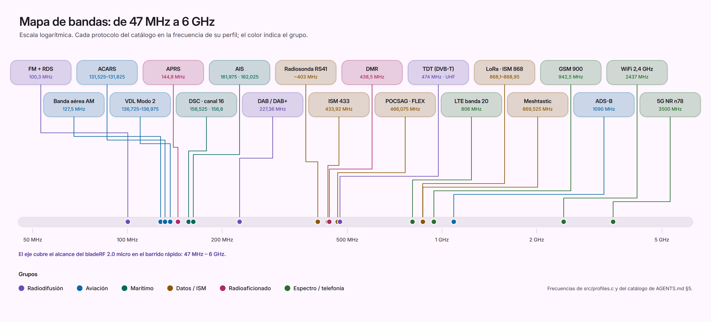
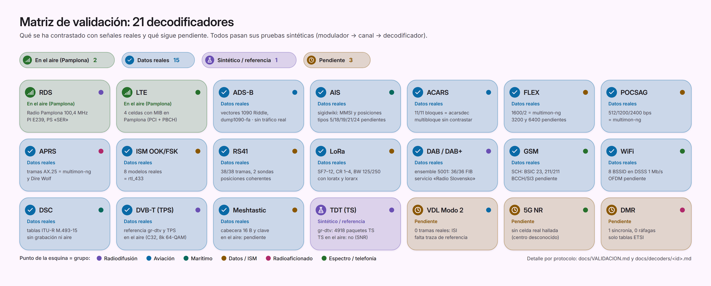

# Protocolos

Una ficha por protocolo del catálogo: qué es, en qué frecuencia se busca, la cadena de proceso, qué se decodifica y hasta dónde está validado. El detalle técnico de cada uno vive en `docs/decoders/<id>.md`.

Solo se decodifica información de difusión o de sistema: nunca voz, identidades de abonados (IMSI/TMSI) ni tráfico cifrado (la única excepción es la clave pública por defecto de Meshtastic, que es pública por diseño).

<picture>
  <source media="(prefers-color-scheme: dark)" srcset="img/mapa-bandas-dark.png">
  
</picture>

*Mapa de bandas en escala logarítmica, con cada protocolo en la frecuencia de su perfil (`src/profiles.c`) y coloreado por grupo.*

## Resumen

| Protocolo | Grupo | Frecuencia típica | Tipo | Validación | Ficha |
|---|---|---|---|---|---|
| RDS en FM comercial | Radiodifusión | 100,3 MHz | narrow, 250 kHz | En el aire (Pamplona) | [`rds`](#rds) |
| DAB / DAB+ | Radiodifusión | 227,36 MHz | wide, 2,048 Msps exactos | Datos reales | [`dab`](#dab) |
| ADS-B / Mode S | Aviación | 1090 MHz | wide, 2 Msps exactos | Datos reales | [`adsb`](#adsb) |
| ACARS | Aviación | 131,525 / 131,725 / 131,825 MHz | narrow, 48 kHz | Datos reales | [`acars`](#acars) |
| VDL Modo 2 | Aviación | 136,725 / 136,775 / 136,875 / 136,975 MHz | narrow, 105 kHz | Pendiente | [`vdl2`](#vdl2) |
| AIS | Marítimo | 161,975 y 162,025 MHz | narrow, 48 kHz | Datos reales | [`ais`](#ais) |
| DSC VHF (canal 70) | Marítimo | 156,525 MHz | narrow, 48 kHz | Datos reales | [`dsc`](#dsc) |
| APRS / AX.25 | Radioaficionado | 144,8 MHz | narrow, 48 kHz | Datos reales | [`aprs`](#aprs) |
| DMR (solo metadatos) | Radioaficionado | 438,5 MHz | narrow, 48 kHz | Pendiente | [`dmr`](#dmr) |
| POCSAG | Buscapersonas | 466,075 MHz | narrow, 48 kHz | Datos reales | [`pocsag`](#pocsag) |
| FLEX | Buscapersonas | 466,075 MHz | narrow, 48 kHz | Datos reales | [`flex`](#flex) |
| ISM OOK/FSK | Sensores | 433,92 y 868,3 / 868,95 MHz | narrow, 250 kHz | Datos reales | [`ism`](#ism) |
| Radiosonda Vaisala RS41 | Meteorología | ~403 MHz, automático | narrow, 48 kHz | Datos reales | [`rs41`](#rs41) |
| LoRa PHY / LoRaWAN | IoT | 868,1 / 868,3 / 868,5 MHz | narrow, 500 kHz | Datos reales | [`lora`](#lora) |
| Meshtastic | IoT | 869,525 MHz | narrow, 500 kHz | Datos reales | [`meshtastic`](#meshtastic) |
| LTE (búsqueda de celda) | Celular | banda 20 / 3 | narrow, 1,92 Msps | En el aire (Pamplona) | [`lte`](#lte) |
| 5G NR (SSB) | Celular | n78, rejilla GSCN | wide, ≥ 15,36 Msps | Pendiente | [`nr`](#nr) |
| GSM | Celular | GSM 900 | narrow, 1,083 Msps | Datos reales | [`gsm`](#gsm) |
| WiFi (beacons) | Redes | 2,4 GHz | wide, 20 Msps exactos | Datos reales | [`wifi`](#wifi) |
| DVB-T (parámetros TPS) | Televisión | UHF, por ejemplo 474 MHz | narrow, 64/7 Msps | Datos reales | [`dvbt`](#dvbt) |
| TDT completa (múltiplex) | Televisión | UHF 21–48 | narrow, 64/7 Msps | Sintético / referencia | [`tdt`](#tdt) |

Los *narrow* reciben el canal ya filtrado y remuestreado por un DDC a la tasa indicada; los *wide* reciben las muestras crudas a la tasa del hardware, que debe ser la exigida.

## Validación

<picture>
  <source media="(prefers-color-scheme: dark)" srcset="img/matriz-validacion-dark.png">
  
</picture>

Todos pasan sus pruebas sintéticas (modulador → canal con ruido, desvío de frecuencia y de reloj → decodificador). Las categorías de la matriz son: **en el aire** (señal propia captada con el bladeRF), **datos reales** (grabaciones públicas o herramientas de referencia), **sintético / referencia** y **pendiente**. Más detalle en [VALIDACION.md](VALIDACION.md).

## Fichas

### RDS en FM comercial

| | |
|---|---|
| **Grupo** | Radiodifusión |
| **Frecuencia** | 100,3 MHz (perfil `fm`; sigue a la sintonía de audio) |
| **Tipo** | narrow, 250 kHz |
| **Cadena** | FM → subportadora de 57 kHz → BPSK diferencial → sincronía de grupo y CRC |
| **Se decodifica** | PI, PS, PTY, RT, CT, AF y grupos 0A/0B/2A/2B/4A. |
| **Validación** | *En el aire (Pamplona).* En el aire: Radio Pamplona (100,4 MHz, PI E239, PS «SER»); PI, grupos, PTY, AF y DI idénticos a `redsea`. |
| **Documentación** | [`docs/decoders/rds.md`](decoders/rds.md) |

### DAB / DAB+

| | |
|---|---|
| **Grupo** | Radiodifusión |
| **Frecuencia** | 227,36 MHz (perfil `dab`) |
| **Tipo** | wide, 2,048 Msps exactos |
| **Cadena** | sincronía OFDM modo I → demodulación diferencial → FIC (desentrelazado, Viterbi, CRC) |
| **Se decodifica** | Conjunto, servicios y subcanales (sin audio). |
| **Validación** | *Datos reales.* Datos reales (sigidwiki): ensemble 5001 «Towercom», servicio «Radio Slovensko», 36/36 FIB. |
| **Documentación** | [`docs/decoders/dab.md`](decoders/dab.md) |

### ADS-B / Mode S

| | |
|---|---|
| **Grupo** | Aviación |
| **Frecuencia** | 1090 MHz (perfil `adsb`) |
| **Tipo** | wide, 2 Msps exactos |
| **Cadena** | módulo de la señal → preámbulo → PPM → CRC (con corrección de 1–2 bits) → campos DF17 |
| **Se decodifica** | Identificación, posición CPR, altitud, velocidad, squawk y emergencias; tabla de aeronaves. |
| **Validación** | *Datos reales.* Vectores de *The 1090 MHz Riddle* y `dump1090-fa` sobre la salida del modulador. **Sin tráfico real**: la antena actual no recibe 1090 MHz. |
| **Documentación** | [`docs/ADSB.md`](ADSB.md) |

### ACARS

| | |
|---|---|
| **Grupo** | Aviación |
| **Frecuencia** | 131,525 / 131,725 / 131,825 MHz (perfil `acars`) |
| **Tipo** | narrow, 48 kHz |
| **Cadena** | AM → MSK 2400 (codificación diferencial) → paridad y BCS |
| **Se decodifica** | Campos de la trama: modo, registro, etiqueta, bloque, texto. |
| **Validación** | *Datos reales.* Datos reales (sigidwiki): 11/11 bloques = `acarsdec`. Multibloque (ETB) y etiquetas sin interpretar. |
| **Documentación** | [`docs/decoders/acars.md`](decoders/acars.md) |

### VDL Modo 2

| | |
|---|---|
| **Grupo** | Aviación |
| **Frecuencia** | 136,725 / 136,775 / 136,875 / 136,975 MHz (perfil `vdl2`) |
| **Tipo** | narrow, 105 kHz |
| **Cadena** | D8PSK 10 500 Bd → aleatorizador → Reed-Solomon → AVLC → ACARS sobre AVLC |
| **Se decodifica** | Tramas AVLC y ACARS encapsulado. |
| **Validación** | *Pendiente.* **Pendiente**: 0 tramas reales (la grabación disponible tiene ISI sistemática); falta una traza de referencia. |
| **Documentación** | [`docs/decoders/vdl2.md`](decoders/vdl2.md) |

### AIS

| | |
|---|---|
| **Grupo** | Marítimo |
| **Frecuencia** | 161,975 y 162,025 MHz (perfil `maritimo`) |
| **Tipo** | narrow, 48 kHz |
| **Cadena** | GMSK 9600 → NRZI → HDLC → CRC → mensajes M.1371 |
| **Se decodifica** | Tipos 1–3, 4, 5, 18, 19, 21 y 24; tabla de barcos con posición. |
| **Validación** | *Datos reales.* Datos reales (sigidwiki): MMSI y posiciones coherentes. Tipos 5/18/19/21/24 sin contrastar con tráfico real. |
| **Documentación** | [`docs/decoders/ais.md`](decoders/ais.md) |

### DSC VHF (canal 70)

| | |
|---|---|
| **Grupo** | Marítimo |
| **Frecuencia** | 156,525 MHz (perfil `maritimo`) |
| **Tipo** | narrow, 48 kHz |
| **Cadena** | FSK 1200 → sincronía de puntos → símbolos de 10 bits con comprobación → ECC |
| **Se decodifica** | Formatos de socorro y rutina, MMSI y telemandos. |
| **Validación** | *Datos reales.* Tablas ITU-R M.493-15 y un acuse de socorro en los tests. **Sin grabación real ni en el aire.** |
| **Documentación** | [`docs/decoders/dsc.md`](decoders/dsc.md) |

### APRS / AX.25

| | |
|---|---|
| **Grupo** | Radioaficionado |
| **Frecuencia** | 144,8 MHz (perfiles `aprs` y `ham2m`) |
| **Tipo** | narrow, 48 kHz |
| **Cadena** | FM → AFSK 1200 Bell 202 → NRZI → HDLC → CRC → AX.25 → APRS |
| **Se decodifica** | Posición, estado y mensajes; tabla de estaciones. |
| **Validación** | *Datos reales.* Datos reales (sigidwiki): tramas AX.25 idénticas a `multimon-ng` y Dire Wolf. El análisis APRS de posición sin contrastar. |
| **Documentación** | [`docs/decoders/aprs.md`](decoders/aprs.md) |

### DMR (solo metadatos)

| | |
|---|---|
| **Grupo** | Radioaficionado |
| **Frecuencia** | 438,5 MHz (perfil `dmr`) |
| **Tipo** | narrow, 48 kHz |
| **Cadena** | 4FSK 4800 → sincronías → BPTC/Golay → LC y CSBK |
| **Se decodifica** | Sincronías, CC, slot, origen y destino. **Sin voz.** |
| **Validación** | *Pendiente.* **Pendiente**: una sincronía y 0 ráfagas en la grabación disponible; solo tablas de ETSI TS 102 361-1. |
| **Documentación** | [`docs/decoders/dmr.md`](decoders/dmr.md) |

### POCSAG

| | |
|---|---|
| **Grupo** | Buscapersonas |
| **Frecuencia** | 466,075 MHz (perfil `busca`) |
| **Tipo** | narrow, 48 kHz |
| **Cadena** | FM → FSK 512/1200/2400 → sincronía → BCH(31,21) con corrección |
| **Se decodifica** | RIC, función y mensajes numéricos o alfanuméricos. |
| **Validación** | *Datos reales.* Datos reales (repositorio de pruebas de `multimon-ng`): 512, 1200 y 2400 bps idénticos. |
| **Documentación** | [`docs/decoders/pocsag.md`](decoders/pocsag.md) |

### FLEX

| | |
|---|---|
| **Grupo** | Buscapersonas |
| **Frecuencia** | 466,075 MHz (perfil `busca`) |
| **Tipo** | narrow, 48 kHz |
| **Cadena** | FM → 2/4-FSK → sincronía → BCH → mensajes |
| **Se decodifica** | Mensajes alfanuméricos. |
| **Validación** | *Datos reales.* Datos reales: FLEX 1600/2 idéntico a `multimon-ng`. **3200 y 6400 pendientes.** |
| **Documentación** | [`docs/decoders/flex.md`](decoders/flex.md) |

### ISM OOK/FSK

| | |
|---|---|
| **Grupo** | Sensores |
| **Frecuencia** | 433,92 y 868,3 / 868,95 MHz (perfiles `ism433`, `ism868`) |
| **Tipo** | narrow, 250 kHz |
| **Cadena** | analizador de pulsos (PWM, PPM, Manchester) → protocolos con suma o CRC |
| **Se decodifica** | Sensores meteorológicos, TPMS, mandos; 10 protocolos más trama de prueba. |
| **Validación** | *Datos reales.* Datos reales de `rtl_433_tests` (8 modelos): idéntico a `rtl_433`. |
| **Documentación** | [`docs/decoders/ism.md`](decoders/ism.md) |

### Radiosonda Vaisala RS41

| | |
|---|---|
| **Grupo** | Meteorología |
| **Frecuencia** | ~403 MHz, automático (perfil `sonda`) |
| **Tipo** | narrow, 48 kHz |
| **Cadena** | GFSK 4800 → desaleatorizado → Reed-Solomon (paridad en bloque) |
| **Se decodifica** | Posición, altura, temperatura, presión y humedad. |
| **Validación** | *Datos reales.* Datos reales (rs1729/RS, audio FM): 38/38 tramas en dos sondas, posiciones coherentes. |
| **Documentación** | [`docs/decoders/rs41.md`](decoders/rs41.md) |

### LoRa PHY / LoRaWAN

| | |
|---|---|
| **Grupo** | IoT |
| **Frecuencia** | 868,1 / 868,3 / 868,5 MHz (perfil `lora`) |
| **Tipo** | narrow, 500 kHz |
| **Cadena** | CSS SF7–12 → desmodulación por bin del máximo → cabecera y CRC → LoRaWAN |
| **Se decodifica** | Cabecera explícita, CRC, MHDR y DevAddr. |
| **Validación** | *Datos reales.* Datos reales con `loratx` y `lorarx`: SF7–12, CR 1–4, BW 125/250 en ambos sentidos. |
| **Documentación** | [`docs/decoders/lora.md`](decoders/lora.md) |

### Meshtastic

| | |
|---|---|
| **Grupo** | IoT |
| **Frecuencia** | 869,525 MHz (perfil `meshtastic`) |
| **Tipo** | narrow, 500 kHz |
| **Cadena** | LoRa → cabecera de 16 bytes → AES-CTR con la clave pública por defecto → protobuf |
| **Se decodifica** | Texto, posición e información de nodo. |
| **Validación** | *Datos reales.* Cabecera, hash y clave confirmados con `lorarx -H 4`; **descifrado y protobuf sin validar en el aire**. |
| **Documentación** | [`docs/decoders/meshtastic.md`](decoders/meshtastic.md) |

### LTE (búsqueda de celda)

| | |
|---|---|
| **Grupo** | Celular |
| **Frecuencia** | banda 20 / 3 (perfil `lte`: 806 MHz) |
| **Tipo** | narrow, 1,92 Msps |
| **Cadena** | PSS → SSS → PCI → CFO → potencia → MIB del PBCH |
| **Se decodifica** | PCI, CFO, RSRP y MIB (ancho de banda). |
| **Validación** | *En el aire (Pamplona).* En el aire (Pamplona): 4 celdas con MIB. También sigidwiki (PCI 65 y 44 con MIB). |
| **Documentación** | [`docs/decoders/lte.md`](decoders/lte.md) |

### 5G NR (SSB)

| | |
|---|---|
| **Grupo** | Celular |
| **Frecuencia** | n78, rejilla GSCN (perfil `nr`: 3500 MHz) |
| **Tipo** | wide, ≥ 15,36 Msps |
| **Cadena** | correlación de PSS en la rejilla GSCN (CPU o GPU) → SSS → PCI |
| **Se decodifica** | PCI por posición GSCN. |
| **Validación** | *Pendiente.* **Pendiente**: sin celda real hallada (centro desconocido en las grabaciones disponibles). |
| **Documentación** | [`docs/decoders/nr.md`](decoders/nr.md) |

### GSM

| | |
|---|---|
| **Grupo** | Celular |
| **Frecuencia** | GSM 900 (perfil `gsm`: 942,5 MHz) |
| **Tipo** | narrow, 1,083 Msps |
| **Cadena** | FCCH → SCH (BSIC, FN) → SI3 del BCCH |
| **Se decodifica** | BSIC y número de trama; SI3 (MCC/MNC/LAC/CI) con BCCH. |
| **Validación** | *Datos reales.* Datos reales: 211/211 SCH, BSIC 23. **BCCH/SI3 reales siguen sin decodificar.** |
| **Documentación** | [`docs/decoders/gsm.md`](decoders/gsm.md) |

### WiFi (beacons)

| | |
|---|---|
| **Grupo** | Redes |
| **Frecuencia** | 2,4 GHz (perfil `wifi`: 2437 MHz) |
| **Tipo** | wide, 20 Msps exactos |
| **Cadena** | 802.11b DSSS 1 Mb/s y 802.11a/g OFDM 6 Mb/s → CRC |
| **Se decodifica** | SSID, BSSID y canal de las balizas. |
| **Validación** | *Datos reales.* Datos reales (sigidwiki): 8 BSSID en DSSS. **OFDM sin validar.** |
| **Documentación** | [`docs/decoders/wifi.md`](decoders/wifi.md) |

### DVB-T (parámetros TPS)

| | |
|---|---|
| **Grupo** | Televisión |
| **Frecuencia** | UHF, por ejemplo 474 MHz (perfil `dvbt`) |
| **Tipo** | narrow, 64/7 Msps |
| **Cadena** | sincronía OFDM 2k/8k → CFO → TPS (BCH) |
| **Se decodifica** | Modulación, tasa, guarda y cell ID. |
| **Validación** | *Datos reales.* Referencia gr-dtv (constantes validadas) y TPS en el aire (8k, 1/4, 64-QAM, HP 2/3). |
| **Documentación** | [`docs/decoders/dvbt.md`](decoders/dvbt.md) |

### TDT completa (múltiplex)

| | |
|---|---|
| **Grupo** | Televisión |
| **Frecuencia** | UHF 21–48 (canal 34 = 578 MHz) |
| **Tipo** | narrow, 64/7 Msps |
| **Cadena** | receptor `dvbt_rx` → TS → demux/PSI → H.264 (WebCodecs) + MP2 propio |
| **Se decodifica** | Servicios, vídeo y audio de un múltiplex. |
| **Validación** | *Sintético / referencia.* gr-dtv: 4918 paquetes TS idénticos. **En el aire no hay TS** con la antena actual (SNR ≈ −9 dB). |
| **Documentación** | [`docs/TDT.md`](TDT.md) |

## Emisión de estos protocolos

Cada decodificador tiene un modulador gemelo (`src/tx/mod_<id>.c`) para probar sin antena. Solo APRS, ISM, LoRa y Meshtastic tienen `air_ok = true` y solo pueden radiarse dentro de la lista blanca de bandas con las limitaciones de [TX.md](TX.md); el resto es únicamente `file` y `loopback`.
