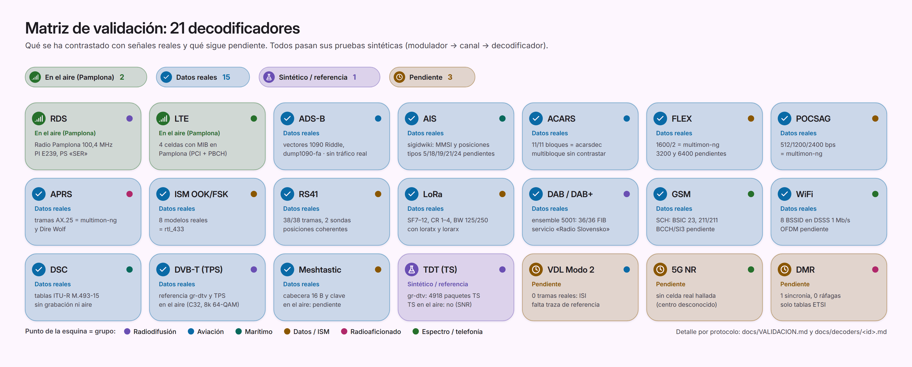

# Validación con señales reales

## Figuras

<picture>
  <source media="(prefers-color-scheme: dark)" srcset="img/matriz-validacion-dark.png">
  
</picture>

*Figura. Estado de validación de los 21 decodificadores (en el aire, datos reales, sintético y pendiente).*

Cada decodificador se probó al principio solo contra su propio modulador; una constante
equivocada (tabla, polaridad, CRC, orden de bits) habría pasado los tests y fallado con tráfico
real. Este documento recoge lo que se contrastó con grabaciones públicas y con los decodificadores
de referencia instalados en el sistema (`acarsdec`, `dumpvdl2`, `multimon-ng`, `redsea`,
`dump1090-fa`, `direwolf`). Se ejecutaron como cajas negras y su salida se usó como evidencia; no
se leyó ni copió su código. Las grabaciones se usan solo como datos de prueba locales.

Cada sección la escribe el agente de su grupo. Relee el fichero antes de editarlo.

## Grupo A (V1): adsb, ais, dsc, aprs, pocsag, flex, acars, vdl2, rds

### Método

* Descargas en `build/v1/dl/<fuente>/` (datos no fiables, un directorio por fichero); herramientas en
  `build/v1/tools/` (`audio2sigmf.py`, `wav2sigmf.py`, `scale_noise.py`, `mkphase.py`, `mkvec.py`,
  `feed.c`…). Todo el Python se ejecuta con `-I` y con las rutas como argumentos.
* Fuentes: Signal Identification Wiki (sigidwiki.com, audio y IQ de muestra), repositorio de
  pruebas de multimon-ng (muestras de POCSAG y FLEX; GPL-2.0, solo como datos).
* Audio FM demodulado → se remodula en FM con la desviación del protocolo como IQ SigMF `ci16`
  (`audio2sigmf.py … fm …`); audio AM (ACARS) → AM con m = 0,7; IQ WAV de SDR# → SigMF a la tasa del
  decodificador (`wav2sigmf.py … --to`), y se pasa por
  `build/v1/bladerf-lab --replay … --decode <id>@freq --print`.
* Trampas encontradas: (1) el canal no debe caer en 0 Hz ni fuera de ±fs/2 del centro (una
  grabación a 250 kS/s con el canal a 200 kHz del centro se pliega y "no decodifica"); (2) los WAV
  IQ de SDR# vienen con I/Q intercambiados (VDL2); (3) `dumpvdl2` exige S16 a 105 kS/s ×
  `oversample`, escala por encima de ≈ 1000 y no clipea; `dump1090-fa` solo acepta 2,4 MS/s.

### Resultados

| Protocolo | Grabación real | Antes | Después | Qué estaba mal |
|---|---|---|---|---|
| ais | sigidwiki "AIS Sound" (Long Beach, FM) y "AIS IQ" (Dinamarca, IQ 48 kHz) | CRC correcto pero "tipo 8, MMSI 98xxxxxxx" (basura) | tipo 1, MMSI 367003560 / 366982310 y 219…/538…, posiciones coherentes | **orden de bits de los campos M.1371** (octetos con LSB primero) |
| acars | sigidwiki "ACARS sound" (11 bloques, Nueva Zelanda) e "ACARS IQ" (VQ-BKV) | 0 bloques | 11/11 = acarsdec; BCS, paridad y LSB-primero confirmados | **codificación diferencial** (2400 Hz = bit igual al anterior, 1200 Hz = cambia); n.º de mensaje no siempre "M…" |
| flex | multimon-ng `FLEX_1600_2fsk_P2000_proef_alarm.flac`; sigidwiki FLEX 1600/3200/3200-4 | 0 mensajes | 1600/2: 20 mensajes con texto idéntico a multimon-ng; 3200/2, 3200/4 y 6400/4: **siguen sin decodificar** (solo hay muestras reales de 3200/4; Sync 1 y FIW bien, mapeo de niveles y direcciones largas sin resolver) | palabra A = código + **0xA6C6** (no el complemento); falsa sincronía con la 1ª copia (~A) del Sync 1; 7 bits de cabecera en la 1ª palabra de datos |
| pocsag | multimon-ng `POCSAG_sample_-_{512,1200,2400}_bps.flac` | no probado | 3/3 = multimon-ng (RIC 273040/1022869, texto "+++TIME=…") | nada |
| aprs | sigidwiki "AFSK1200 Sound" (BBS FBB ZL1AB) | no probado | tramas AX.25 idénticas a multimon-ng y Dire Wolf | nada (las tramas no son APRS de posición: ese análisis sigue sin contrastar) |
| rds | `redsea` sobre la salida de `--gen rds`; RDS real captado por el orquestador (Radio Pamplona, 100,4 MHz: PI E239, PS "SER") | — | PI/grupos/PTY/AF/DI idénticos | nada |
| adsb | `dump1090-fa` sobre la salida de `--gen adsb` (remuestreada a 2,4 MS/s); sin señal real (la antena actual no recibe 1090 MHz) | — | decodifica las mismas 4 tramas DF17 (KLM1023, posiciones, velocidad) | nada. **Sin validar con tráfico real** |
| vdl2 | sigidwiki "VDL-M2 IQ" (50 ráfagas, 11 tramas decodificables con `dumpvdl2`); ETSI EN 301 841-1 §5.4 | 0 tramas | **sigue en 0** por la calidad de la grabación (ISI sistemática, BER ~10 %). Confirmados: UW, D8PSK, 10 500 Bd, estructura de la cabecera (reservado + 17 + 5), e I/Q intercambiados en el WAV | **aleatorizador** (x¹⁵+x¹⁴+1, solo datos, primeros bits 010011100011111; antes estado 0x6959 y realimentación equivocada). La longitud ya no depende solo de la cabecera |
| dsc | ninguna grabación; norma ITU-R M.493-15 (itu.int) | — | tests con la Tabla A1-1 y un acuse de socorro; sigue **sin validar con aire** | bits de comprobación MSB primero (el modulador los enviaba LSB primero); especificador de formato duplicado y EOS ×3 que faltaban; telemandos 109/110/112/113/115 mal rotulados; acuse/retransmisión de socorro llevan un solo telemando |

### Pendiente del grupo A

* VDL2: cabecera, aleatorizador y orden RS (ver `docs/decoders/vdl2.md`); necesita la norma o una
  traza de referencia. La salida de `--gen vdl2` no la decodifica `dumpvdl2`.
* FLEX: 3200/2, 3200/4, 6400/4 (BIW ilegible; mapeo de 4 niveles/fases) y direcciones largas.
* DSC y ADS-B: sin grabación real.
* AIS: tipos 5/18/19/21/24 y PLVA sin contrastar con tráfico real.
* ACARS: mensajes multibloque (ETB) y etiquetas sin interpretar.

## Grupo B (V2): dmr, ism, rs41, lora, meshtastic, dab, lte, nr, gsm, wifi

Dvbt pasó a TV1 y no se tocó (sin constantes confirmadas ni refutadas por V2). Detalle por protocolo en
`docs/decoders/<id>.md` ("Validación con señal real"). Herramientas en `build/v2/tools/` (conversión a SigMF, re-modulación FM,
recortes), descargas en `build/v2/dl/<fuente>/` (datos no fiables, Python siempre con `-I`). Fixtures < 200 kB en `tests/data/`;
`tests/vec_real.h` (cargadores + `VR_CPU`, umbral de CPU ×8 bajo sanitizer, aplicado a los tests del grupo).

| Protocolo | Grabación real / referencia | Antes | Después | Qué estaba mal |
|---|---|---|---|---|
| ism | rtl_433_tests (Acurite 592TXR, Nexus, F007TH, WH1080, TX141 v2/v3, Oregon THN132N/THGR122N) + `rtl_433` sobre `--gen ism` | WH1080, TX141 y Oregon v2.1 sin decodificar | todos los reales = salida de rtl_433; `rtl_433` decodifica los 8 modelos generados | WH1080: tiempos/polaridad/última marca/lluvia 12 bits; TX141: tiempos, 37/33 bits, sin humedad; Oregon v2.1: bit + complemento, THGR122N 17 nibbles |
| rs41 | rs1729/RS (audio FM demodulado, 2 sondas) | RS sin confirmar | 38/38 tramas por grabación, posiciones coherentes | **paridad RS en bloque (0x08+24k+j), no entrelazada**; GF 0x11D/fcr 0/24 raíces confirmados |
| lora | `loratx`/`lorarx` instalados | SF7/8/9 de loratx fallaban; CRC de lorarx = error | SF7-12, CR 1-4, BW 125/250 ok en ambos sentidos | **CRC sin blanquear**; decisión de símbolo por bin del máximo y lazo solo con símbolos de extremo |
| meshtastic | `lorarx -H 4`; fuentes públicas (clave, nonce) | sin contrastar | cabecera 16 B, hash 8 y clave confirmados | nada; **descifrado/protobuf sin validar con aire real** |
| dab | sigidwiki `DAB.zip` | sin contrastar | ensemble 5001 "Towercom", servicio "Radio Slovensko", 36/36 FIB | nada (punzonado/entrelazado correctos) |
| lte | sigidwiki LTE 1,4 y 10 MHz | sin contrastar | PCI 65 y PCI 44 con MIB (6 y 50 RB) | nada (PBCH confirmado) |
| gsm | sigidwiki `GSM_downlink_BCCH` | FN del SCH incoherente | 211/211 SCH, BSIC 23, FN avanza bien | **orden de bits T1/T2/T3' del SCH**. **BCCH/SI3 reales siguen sin decodificar** |
| wifi | sigidwiki `Wi-Fi.zip` | sin contrastar | 8 BSSID reales (DSSS 1 Mb/s) | nada. **OFDM sin validar** |
| nr | sigidwiki NR 10/40 MHz | — | no apareció celda (centro desconocido) | **sin validar** |
| dmr | sigidwiki `DMR.zip` | — | 1 sincronía, 0 ráfagas | **sin validar** (no hay evidencia de que sea DMR; sin herramienta de referencia) |

Trampas: las WAV de sigidwiki declaran a veces otra tasa; las grabaciones de RS41 son audio FM, no IQ; los cu8 de rtl_433_tests
necesitan pasar el fragmento dos veces (el detector aprende el ruido en ≈ 8 ms; `--replay` repite en bucle).
