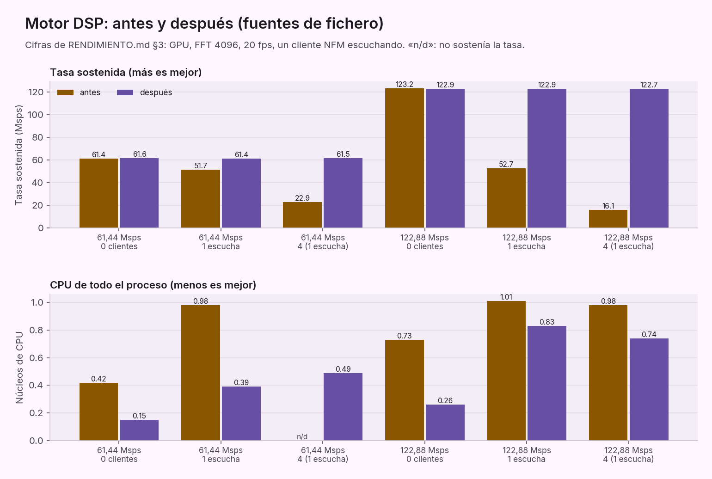
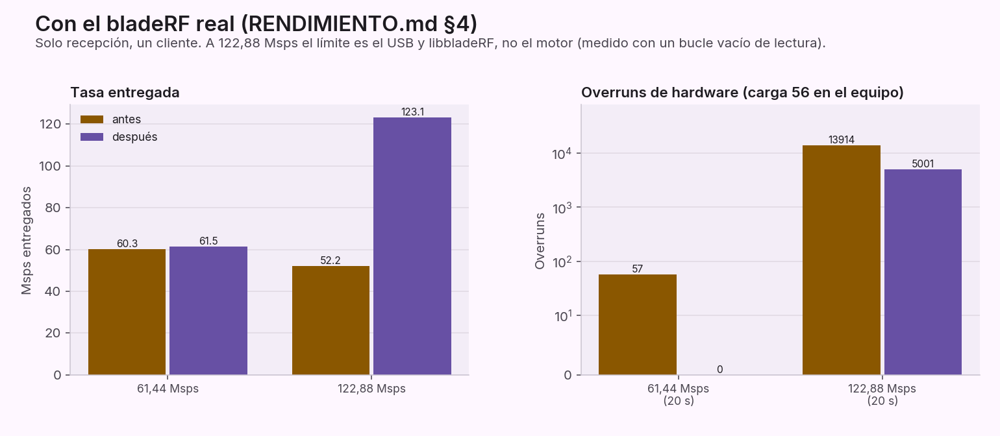

# Rendimiento del motor (agente P1)

Qué se cambió para sostener 61,44 Msps (cs16) y 122,88 Msps (cs8/SC8) y cómo se midió.
Código: `src/engine.{h,c}`, `src/dsp/channel.{h,c}`. Prueba: `tests/test_engine_perf.c`.

## 1. Problema de partida

Medido con el bladeRF real (un cliente WebSocket, espectro en GPU): 61,44 Msps pedidos → 60,3
reales y 57 overruns en 20 s; 122,88 → 52,2 Msps y 13 914 overruns; el hilo DSP al 0,9.
Causas (C2, `docs/arquitectura/CUDA.md` §7): (1) cada cliente mezclaba y diezmaba TODAS las muestras aunque
no escuchara; (2) quitar la continua con un IIR por muestra costaba 3,4 ms por bloque de 1 Mi;
(3) `source_read` iba en el mismo hilo que el procesado: cualquier pausa era un overrun.

## 2. Cambios

### 2.1 Hilo lector + anillo (`engine.c`)
* `reader_main` solo llama a `source_read` (bladerf_sync_rx o fichero a ritmo real) y escribe en un
  anillo de bloques: 0,5 s hasta 16 Msps, 0,3 s hasta 64 Msps, 0,25 s por encima (≈ 126 MB a
  122,88 Msps). Las páginas se tocan al reservar.
* El DSP toma el bloque más viejo (`ring_pop`). Si el anillo se llena, el lector descarta el bloque
  más viejo SIN leer más despacio: un "drop" es un bloque entero que el DSP no llegó a consumir.
* Dos contadores separados en `status.stats`: `overruns` (el hardware/USB perdió muestras, lo
  declara libbladeRF) y `drops` (bloques descartados por el DSP). Además `ring_ms` (cola máxima
  del último segundo). `rate` cuenta lo que entrega la fuente.
* Cambios de tasa, sintonía, ancho de banda, ganancia y bias-tee: el DSP pausa el lector
  (`reader_pause`, espera a que salga de `source_read`), reconfigura y vacía el anillo (esas muestras
  son de la sintonía anterior). Los barridos mantienen el lector en pausa porque leen ellos mismos.
* La hora de cada bloque (`dec_host_feed`, `engine_capture_iq`) es la de fin de lectura, no la de
  consumo; `tx_cal` solo acepta bloques que empezaron después de armar la toma.
* `engine_debug_stall()` (solo pruebas): el DSP deja de consumir N s. El test comprueba que 1,5 s
  con anillo de 0,5 s dan 50 drops de 20 ms, 0 overruns y recuperación.

### 2.2 Clientes que no escuchan
`channel_feed_spectrum`: el S-meter sale de la última trama de espectro, sin tocar ni una muestra IQ.
Potencia del canal = Σ P_k / ENBW (Parseval; ENBW = N·Σw²/(Σw)² = 2,0044 bins en Blackman-Harris),
integrando la banda real del filtro del canal con bordes fraccionarios y nunca menos de ENBW bins.
Mismo suavizado de 50 ms, squelch con histéresis de 2 dB y banderas (squelch, fuera de banda) que
el método por muestras. La cadena de filtros ni se diseña mientras `audio_on` es falso (se construye
al activar el audio, con el estado de los filtros a cero).

**Diferencia con el método anterior** (test `A)`; espectro corregido por la escala, ver §5):

| Caso | por muestras | por espectro | dif. | bins del canal |
|---|---|---|---|---|
| NFM 12,5k ruido, 2,4 Msps FFT 4096 | −62,36 | −62,95 | −0,59 | 21 |
| NFM 12,5k tono, 2,4 Msps FFT 4096 | −25,04 | −25,00 | +0,04 | 21 |
| WFM 180k ruido | −50,84 | −51,21 | −0,38 | 307 |
| AM 10k ruido | −63,43 | −63,75 | −0,32 | 17 |
| USB 2,7k ruido | −69,89 | −70,53 | −0,65 | 4,6 |
| NFM 12,5k ruido, 61,44 Msps FFT 65536 | −66,57 | −67,23 | −0,66 | 13 |
| NFM 12,5k tono, 61,44 Msps FFT 4096 | −30,04 | −30,99 | −0,95 | 0,8 |
| **NFM 12,5k ruido, 61,44 Msps FFT 4096** | −66,92 | −63,18 | **+3,74** | 0,8 |
| **CW 500 Hz ruido, 2,4 Msps FFT 4096** | −76,24 | −72,50 | **+3,74** | 0,9 |

Con el canal ≥ ~8 bins la diferencia es < 1 dB. Con canales más estrechos que ~2 bins el espectro
no resuelve el canal: el ruido se mide de más ≈ 10·log10(ENBW·bin/ancho) (+3,7 dB en los dos últimos
casos); un tono se mide bien. A 61,44 Msps y FFT 4096 un bin son 15 kHz, así que el S-meter de un
canal NFM sin audio es un límite superior del ruido. Subir la FFT lo corrige (FFT 65536: −0,66 dB).

### 2.3 Conversión y continua (`engine.c`)
* Solo se estima/convierte si hay consumidores: canales con audio dentro de banda o decodificadores
  NARROW sin DDC en GPU (la ruta GPU y los WIDE usan Q11 crudo). `host.h` no expone esa
  información: se deduce de `dec_list` + `dec_host_gpu_info` cada 0,25 s (conservador). Pide un
  `dec_host_needs_float()` real a quien posea `host.c`.
* Continua = media de las primeras 256 Ki muestras del bloque, suavizada entre bloques (τ = 0,25 s).
* Los canales con audio leen el Q11 crudo (`channel_process_q11`) y restan la continua en el
  mezclador: no hay copia float de todo el bloque salvo para los decodificadores.
* Bucles con vectores de GCC (`__builtin_convertvector`): con `-O2 -march=native` el autovectorizador
  NO entraba (`-fopt-info-vec-all`: "relevant stmt not supported", "no vectype"). Ahora el
  ensamblador tiene `vpaddd`/`vpmovsxwd`/`vcvtdq2ps` sobre ymm.

### 2.4 Canal más rápido (`channel.c`)
Mezclador por tabla de fase con productos complejos vectoriales (antes: recurrencia serie, 2,6 ns/muestra);
diezmador FIR con historia contigua y producto escalar vectorial con acumuladores reasociados
(antes 3,2 ns/muestra de entrada); trabajo por trozos de 8192 muestras (caché); búferes dimensionados
por la tasa tras el diezmado (antes 48 MB por canal). Un canal NFM escuchando: 6,6 → ≈ 1,7–2,3 ns/muestra
(medido con la máquina libre); error relativo del audio frente a bloques irregulares: 2,6·10⁻⁶.

## 3. Medidas con ficheros (GPU, FFT 4096, 20 fps, un cliente NFM escuchando, otros solo miden)

Antes = `build/c2/bladerf-lab` (motor anterior); después = `build/p1g/bladerf-lab`. Medida en estado
estacionario de 12 s tras 4 s; `cores` = CPU de todo el proceso.

| Fichero | Clientes | Antes: tasa / carga DSP / núcleos | Después: tasa / carga DSP / núcleos | overruns / drops después |
|---|---|---|---|---|
| cs16 61,44 Msps | 0 | 61,4 / 0,29 / 0,42 | 61,6 / 0,00 / 0,15 | 0 / 0 |
| cs16 61,44 Msps | 1 (escucha) | 51,7 / 0,92 / 0,98 | 61,4 / 0,27 / 0,39 | 0 / 0 |
| cs16 61,44 Msps | 4 (1 escucha) | no sostiene (22,9 en la 1.ª pasada) | 61,5 / 0,27 / 0,49 | 0 / 0 |
| cs8 122,88 Msps | 0 | 123,2 / 0,49 / 0,73 | 122,9 / 0,00 / 0,26 | 0 / 0 |
| cs8 122,88 Msps | 1 (escucha) | 52,7 / 0,87 / 1,01 | 122,9 / 0,62 / 0,83 | 0 / 0 |
| cs8 122,88 Msps | 4 (1 escucha) | 16,1 / 0,96 / 0,98 | 122,7 / 0,48 / 0,74 | 0 / 0 |

(La máquina tenía carga 17–49 por un `quartus_fit` ajeno durante parte de las medidas; las cifras
"después" son pesimistas, las "antes" también. En las medidas con la máquina libre un canal NFM cuesta
0,11–0,20 del tiempo real a 61,44–122,88 Msps.) Audio: 46,9 tramas/s, nivel −12,2 dBFS (tono de
prueba) en todos los casos; los clientes que no escuchan reciben su nivel (los valores de su S-meter
dependen de la escala del espectro, ver §5).

## 4. Medidas con el bladeRF real (solo recepción, pruebas ≤ 60 s)

| Caso | Antes | Después |
|---|---|---|
| 61,44 Msps, 1 cliente | 60,3 Msps, 57 overruns / 20 s, carga 0,90 (medida del usuario); 44 Msps y 131 overruns con la máquina cargada | 61,5 Msps, **0 overruns, 0 drops en 30 s**, carga DSP 0,40, 0,5 núcleos |
| 122,88 Msps, 1 cliente | 52,2 Msps, 13 914 overruns | 123,1 Msps entregados, DSP 0,37, **0 drops**, pero 5 001 overruns de hardware en 20 s |
| 2,4 Msps, FM real 20 s | — | 0 / 0; 1 005 tramas de audio estéreo con piloto, RMS alto |
| FM 100,4 MHz (SER Pamplona) a 61,44 Msps, 30 s | — | 1 594 tramas de audio, 1 586 con estéreo + piloto, nivel −22,6 dBFS |

**El límite a 122,88 Msps es el USB/libbladeRF, no el motor.** Bucle vacío de `source_read` (sin
procesado, sin hilo DSP, mismo código de `source.c`):

| Tasa | Resultado |
|---|---|
| 61,44 Msps SC16, 15 s, bloques de 1 Mi | 61,45 Msps, 5 bloques con overrun de 880 (con la máquina a carga 56) |
| 122,88 Msps SC8 oversample, 15 s | 122,5 Msps, **1 236 de 1 753 bloques con overrun** (otra medida: 362) |

libbladeRF avisa además: "245,76 Msps de rendimiento, por encima de los 160 Msps recomendados".
122,88 Msps SC8 son 246 MB/s por USB 3: el FX3 pierde muestras aunque nadie procese. A 61,44 Msps no hay límite.

Reproducir (con el equipo libre; es solo recepción):
`gcc -std=c11 -D_GNU_SOURCE -O2 -march=native -Isrc -I/usr/local/include rdloop.c build/p1/obj/src/sdr/source.o build/p1/obj/src/util/{log,json,strbuf}.o -L/usr/local/lib -Wl,-rpath,/usr/local/lib -lbladeRF -lm -lpthread -o rdloop`
y `./rdloop 122.88e6 15 1048576` (programa auxiliar no incluido en el repositorio; llama a
`source_set_rate`, `source_start` y `source_read` en bucle y cuenta bloques con overrun).
Con el servidor: `bladerf-lab --rate 122.88M --freq 100M --config /tmp/x.json` y mira
`status.stats.{rate,overruns,drops,ring_ms,load}` por WebSocket.

### Repetición con la máquina libre (carga 10, equipo libre, 25 s + 4 s de arranque)

| Caso | Resultado |
|---|---|
| Servidor, 61,44 Msps, 1 cliente WFM | 61,5 Msps, 3 overruns de hardware, **0 drops**, DSP 0,20 |
| Servidor, 122,88 Msps, 1 cliente WFM | 122,9 Msps, 22 overruns, **0 drops**, DSP 0,26 |
| Bucle vacío 61,44 Msps, 10 s | 3 de 586 bloques con overrun |
| Bucle vacío 122,88 Msps, 10 s | 3 de 1 173 bloques con overrun |

Con la máquina libre los overruns son escasos y del mismo orden con el bucle vacío que con el servidor: el DSP ya
no los provoca (0 drops); lo que queda es pérdida del USB. Las cifras de 1 236 y 5 001 de arriba se midieron con
la máquina a carga 56 (compilación de Quartus), es decir, con el lector sin CPU.

## 5. Defecto ajeno detectado: escala de `spectrum.c`

Con `src/dsp/spectrum.c` (22:54) y `src/gpu/spectrum_gpu.cu` (23:04) tal como estaban, el espectro sale
**66,2 dB (= 20·log10 2048) por debajo**: un tono de 0,5 de amplitud (−6,0 dBFS) da un pico de −72,2 dBFS,
tanto en CPU como en GPU (también en el binario `build/c2`). Las muestras se dividen entre 2048 al cargar
(ventana/2048) y `norm_db` vuelve a incluir el 2048. Esto rompe la cascada (`DB_MIN = −140`) y el S-meter
por espectro. `test_engine_perf` mide ese error con un tono de referencia, lo imprime como AVISO y
compara con la trama corregida, así que no depende del arreglo; el dueño de `spectrum.c` debe quitar
uno de los dos factores.

## 6. Pendientes para otros ficheros
* `host.{h,c}`: `dec_host_needs_float()` ya existe (C2); `engine.c` puede sustituir su deducción por esa llamada.
* (hecho) `docs/arquitectura/WEBSOCKET.md`: `stats.drops`, `stats.ring_ms`, `overruns`.
* `Makefile`/`filter.c`: `firdec_process` y `cfir_process` siguen siendo serie (los usa el DDC del host).

## 7. Barrido a modo lento (no medido)
No se midió la latencia de retuneo frente al tiempo de asentamiento: `src/sdr/sweep.c` no es de P1 y no quedó tiempo. Propuesta: medir en `sweep.c` el intervalo entre `source_retune_at` y la marca de tiempo real del primer bloque tras el salto, y fijar el adelanto de programación a (p95 de esa latencia + asentamiento) en vez de un valor fijo.

## Figuras

Las barras usan solo las cifras de las tablas de este documento.

<picture>
  <source media="(prefers-color-scheme: dark)" srcset="../img/rendimiento/rendimiento-ficheros-dark.png">
  
</picture>

*Figura 1. §3: tasa sostenida y CPU del proceso antes y después, con fuentes de fichero. «n/d»: la medida «antes» no sostuvo la tasa y no dio cifra de núcleos.*

<picture>
  <source media="(prefers-color-scheme: dark)" srcset="../img/rendimiento/rendimiento-bladerf-dark.png">
  
</picture>

*Figura 2. §4: con el bladeRF real. Los overruns de 122,88 Msps se midieron con la máquina a carga 56; con el equipo libre fueron 22 en 25 s (tabla de repetición).*
