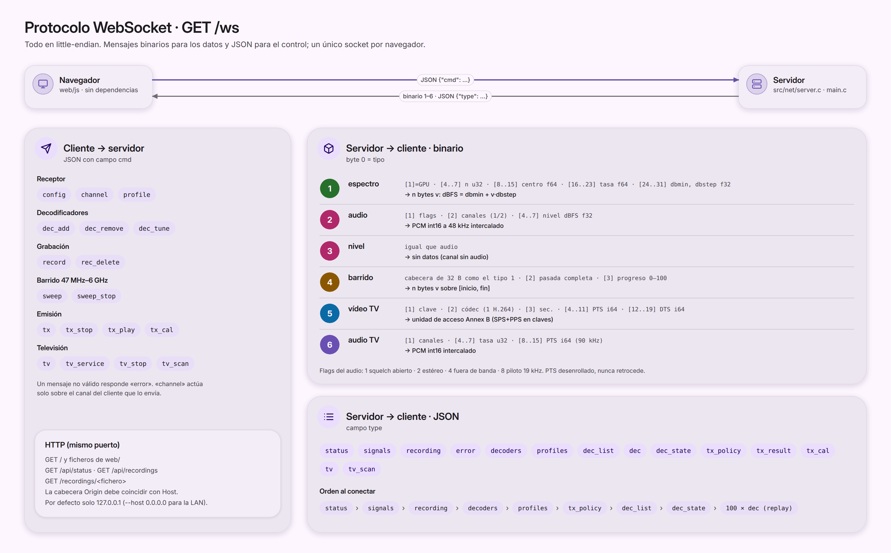
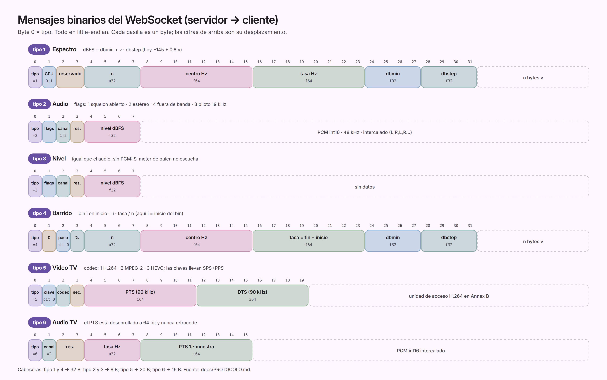
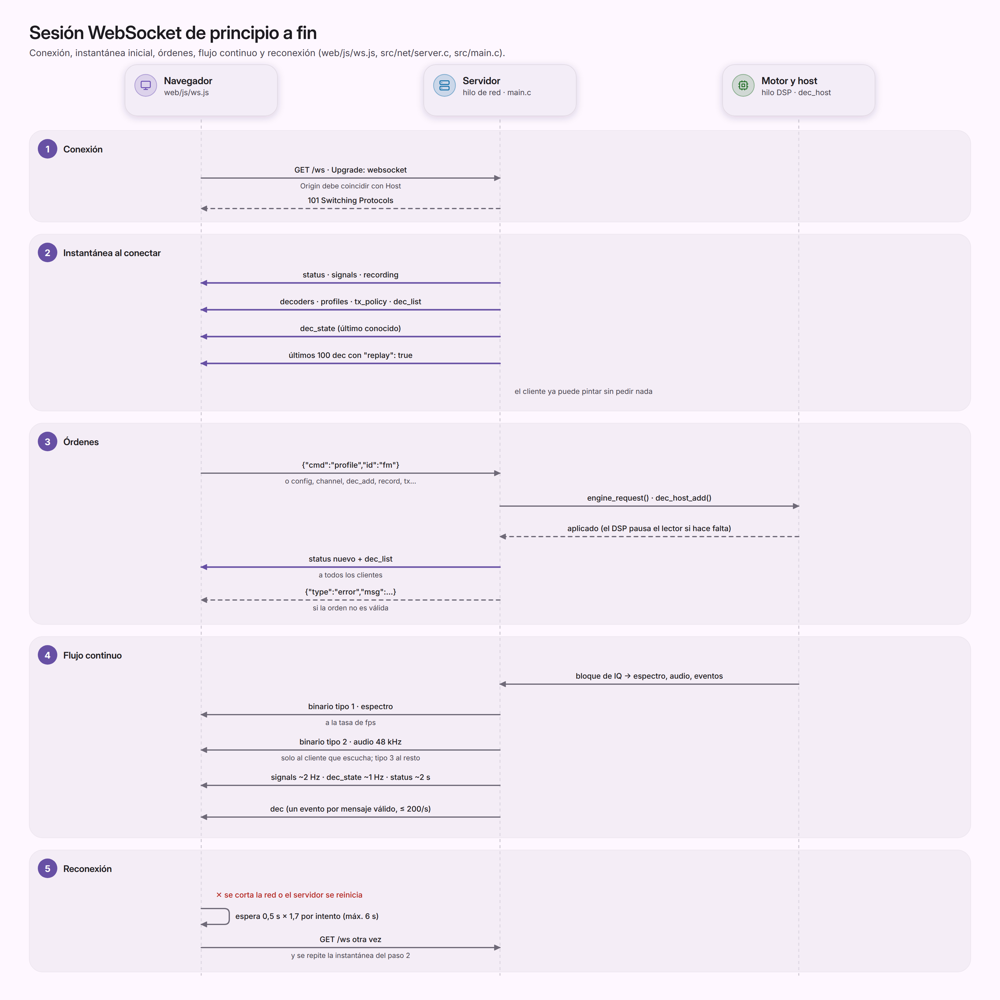

# Protocolo WebSocket (`GET /ws`)

## Figuras

<picture>
  <source media="(prefers-color-scheme: dark)" srcset="../img/protocolo-ws-dark.png">
  
</picture>

*Figura. Mensajes binarios (tipos 1–6) y JSON del protocolo `GET /ws`; abajo, el orden de envío al conectar.*


Un cliente se conecta a `ws://host:puerto/ws` (la cabecera `Origin` debe coincidir
con `Host`). Todo es little-endian. Hay mensajes binarios (datos) y JSON (control).

## Servidor → cliente, binario (byte 0 = tipo)

| Tipo | Cabecera | Datos |
|---|---|---|
| 1 espectro | `[1]`=1 si GPU, `[4..7]` u32 n, `[8..15]` f64 centro Hz, `[16..23]` f64 tasa, `[24..27]` f32 dbmin, `[28..31]` f32 dbstep | n bytes `v`: dBFS = dbmin + v·dbstep. Hoy dbmin = −145, dbstep = 0,6 (rango −145…+8 dBFS; 0 dBFS = tono complejo de amplitud 1,0): léelos siempre de la cabecera |
| 2 audio | `[1]` flags, `[2]` canales (1/2), `[4..7]` f32 nivel dBFS | PCM int16 48 kHz intercalado |
| 3 nivel | igual que audio | — (sin datos) |
| 4 barrido | ver abajo (cabecera de 32 bytes como el tipo 1) | n bytes `v`, dBFS = dbmin + v·dbstep |

**Tipo 4 (barrido, `sweep`)**: `[0]`=4, `[1]`=0, `[2]` bit 0 = pasada completa (si 0,
actualización parcial cada ~0,25 s con los bins aún no barridos al valor de la pasada
anterior, o −140 en la primera), `[3]` progreso 0–100 (% de saltos de la pasada), el
resto igual que el tipo 1 pero cubriendo [inicio, fin]: centro = (inicio+fin)/2,
«tasa» = fin − inicio, de modo que el bin `i` está en `inicio + i·tasa/n` (aquí `i` es
el inicio del bin, no su centro). Mientras barre no hay tipos 1, 2 ni 3. Un cliente que
sabe pintar el tipo 1 puede pintar el 4 igual.

Flags: 1 squelch abierto, 2 estéreo, 4 fuera de banda, 8 piloto 19 kHz. El pico de
continua (±2 bins del centro) ya viene sustituido en el espectro.

## Servidor → cliente, JSON (`type`)

**`status`** (al conectar, ~cada 2 s y tras cada cambio aplicado):
```
{"type":"status","app","version",
 "device":{"kind":"bladerf|file","board","serial","fw","fpga","lib","freq_min","freq_max",
           "rate_min","rate_max","rate_max_oversample":Hz|null,"bw_min","bw_max",
           "gain_min","gain_max","can_tune","biastee","can_tx"},
 "center","rate","rf_bw","gain_mode":"auto|manual|fast|slow|hybrid","gain","gain_now",
 "format":"sc16|sc8|…","oversample":bool,"dbm_offset":dB|null,
 "sweep":null|{"start","stop","fft","rate","hops","bins","mode":"quick|slow","sweeps","restarts"},
 "biastee","fft","fps","det_snr","profile":"id"|null,"loc":{"lat","lon"}|null,
 "stats":{"rate","overruns","drops","ring_ms","temp","load","clients","sent","backend"}}
```
(`adsb`/`adsb_active` ya no existen.) El mismo objeto responde a `GET /api/status`.

* `stats.overruns`: muestras que el hardware/USB declaró perdidas (solo bladeRF; 0 con fichero).
  `stats.drops`: bloques de IQ que el hilo DSP no llegó a consumir (anillo lleno). `stats.ring_ms`: cola
  máxima del anillo entre el lector y el DSP en el último segundo (ms); cerca del tamaño del anillo = el DSP va justo.

* `device.rate_max` llega limitado a 61,44 Msps; `device.rate_max_oversample` es
  `null` o 122 880 000 (modo oversample SC8, FPGA ≥ 0.15): solo entonces se pueden
  pedir tasas mayores que `rate_max`.
* `gain_mode`: `auto` y `manual` como siempre; `fast`, `slow` y `hybrid` son los AGC del
  AD9361. `format` es el formato de las muestras en el USB/fichero (el resto del
  programa siempre trabaja en Q11) y `oversample` indica si está activo el modo de
  122,88 Msps.
* `dbm_offset`: dBm = dBFS + `dbm_offset`; `null` si no hay tabla de calibración de
  ganancia (no mostrar dBm).
* `sweep`: `null` o el barrido en curso (ver «Cliente → servidor»).

**`signals`** `{"center","noise","list":[[offset_hz,bw_hz,peak_dbfs,snr_db],…]}` (~2 Hz).

**`recording`** `{"on","name","bytes","seconds","dropped"}`.

**`error`** `{"msg"}`.

**`decoders`** (catálogo, al conectar):
`{"list":[{"id","name","group","desc","kind":"narrow|wide","rate","bw","wide_rate",
"wide_min_rate","freqs":[..],"tx":bool,"air_ok":bool}]}`.

**`profiles`** `{"list":[{"id","name","group","center","rate","mode":"wfm|nfm|am|…"|null,
"chan_freq","bw","decoders":[{"proto","freq","follow","auto"}],"spectrum_only"}]}`.
`follow:true`: la interfaz mueve ese decodificador (`dec_tune`) cuando el usuario
cambia la frecuencia de audio (RDS). `auto:true`: el host crea instancias de ese
decodificador sobre las señales que detecta el detector dentro de la banda útil del
perfil (80 % central de la tasa): como máximo 8 en total, sin duplicados (otra
instancia del mismo protocolo a menos de max(10 kHz, anchura/2)), con `owner:1`, y las
retira cuando su señal lleva más de 60 s sin verse.
`spectrum_only`: el perfil no tiene audio ni decodificadores.

**`dec_list`** `{"list":[{"inst","proto","freq","rate","owner":0|1,
"state":"ok|waiting|error","err","events","drops","load"}]}`. Se envía al conectar,
a cada alta/baja/retune y ~1 Hz. `state` `waiting` = canal fuera de la banda capturada;
`error` = tasa incompatible, `create()` fallido ("no implementado todavía") o tasa de
captura insuficiente. `drops` cuenta bloques de IQ y eventos descartados; `load` es la
fracción de tiempo real ocupada (1 = un núcleo al 100 %).

**`dec`** `{"inst","proto","freq","t","msg":{…,"text":"resumen"},"replay"?:true}`:
un evento por mensaje válido (máx. 200/s por instancia). En ADS-B, `msg.kind` vale
`new|callsign|squawk|emerg` (los eventos `raw` no lo llevan). `t` = hora Unix. Los últimos
100 se reenvían al conectar con `"replay":true`.

**`dec_state`** `{"inst","proto","t","state":{…}}` ~1 Hz por instancia con tabla
(ADS-B: `{"msgs","rate","fps","fix1","fix2","crc","rej","rx","ac":[…]}`, ver ../protocolos/adsb.md:
`fps` tramas válidas/s, `fix1`/`fix2` corregidas de 1 y 2 bits, `crc` recuperadas por
entramado CRC, `rej` candidatos descartados). Al conectar se envía el último
conocido.

**`tx_cal`** `{"ok","saved","msg","irr_before_db","irr_after_db","lo_before_dbc","lo_after_dbc","center","rate"}`:
resultado de la calibración del TX (orden `tx_cal`). Los rechazos van como `tx_result`.

**`tx_policy`** `{"enabled","air","callsign","max_gain","bands":[[lo_hz,hi_hz,"nombre"],…]}`.

**`tx_result`** `{"ok","msg","file":"x.sigmf-meta"|null,"seconds"}`: respuesta a cada `tx`
(éxito, rechazo por política o fin de la emisión).

**Orden al conectar:** `status`, `signals`, `recording`, `decoders`, `profiles`,
`tx_policy`, `dec_list`, `dec_state` (si existe), los `dec` recientes (`replay`).

## Cliente → servidor, JSON (campo `cmd`)

Todos los campos salvo `cmd` son opcionales, salvo donde se indica. Un mensaje no
válido responde `error`.

```
{"cmd":"config","center":Hz,"rate":Hz,"rf_bw":Hz,"gain_mode":"auto|manual","gain":dB,
 "biastee":bool,"fft":N,"fps":N,"det_snr":dB,"loc":{"lat":..,"lon":..}|null}
{"cmd":"channel","freq":Hz,"mode":"wfm|nfm|am|usb|lsb|cw","bw":Hz,"squelch":dBFS|null,
 "deemph":50|75|0,"stereo":bool,"audio":bool}
{"cmd":"profile","id":"ais"}
{"cmd":"dec_add","proto":"ais","freq":Hz,"opts":{...}}    (proto y freq obligatorios)
{"cmd":"dec_remove","inst":N}
{"cmd":"dec_tune","inst":N,"freq":Hz}
{"cmd":"record","on":bool}
{"cmd":"rec_delete","name":"fichero"}
{"cmd":"tx","proto":"pocsag","mode":"file|loopback|air","freq":Hz,"gain":dB,
 "center":Hz,"rate":Hz,"repeat":N,"params":{...}}
{"cmd":"tx_stop"}
{"cmd":"tx_play","name":"grabacion","mode":"file|loopback","repeat":N}
{"cmd":"tx_cal","freq":Hz,"rate":sps}
{"cmd":"sweep","start":Hz,"stop":Hz,"fft":N}
{"cmd":"sweep_stop"}
```

Notas:

* `config` con `center` o `rate` borra el `profile` del `status`. `loc` actualiza también
  la posición de los decodificadores. Se persiste en `~/.config/bladerf-lab/config.json`.
* `channel` actúa sobre el canal de audio **del cliente que lo envía**; cambiar `mode`
  sin `bw` pone el ancho por defecto del modo.
* `profile` retira las instancias de decodificador de perfil (`owner:1`), fija centro,
  tasa y ancho RF automático, mueve el canal de audio del cliente que lo pide (si el
  perfil trae audio) y crea las instancias del perfil. Las manuales (`owner:0`) se
  conservan.
* `dec_add` con `freq` ≤ 0 o ausente en un narrow sin frecuencia típica → `error`. Para
  decodificadores *wide* la frecuencia es informativa. `opts` debe ser un objeto JSON.
* `tx` con `mode` ausente usa `file`. `loopback` y `air` solo se aceptan si el servidor
  se arrancó con `--enable-tx` / `--enable-tx-air` (ver TX.md).

* `config.gain_mode` admite también `fast`, `slow` y `hybrid`. Una tasa mayor que 61,44 Msps
  activa el modo oversample automáticamente (solo si `device.rate_max_oversample`).
* `tx_play` reproduce una grabación de `recordings/` (nombre con o sin extensión). Solo
  `file` (escribe una copia `tx_play_*`) y `loopback` (bucle interno, requiere
  `--enable-tx`); `air` se rechaza siempre. Responde con `tx_result`.
* `tx_cal` calibra IQ/LO del TX en bucle interno (requiere `--enable-tx`, nunca radia).
  El servidor sintoniza el receptor en `freq`/`rate` (433,92 MHz y 1 Msps por omisión),
  mide y devuelve el receptor a su configuración anterior; responde con `tx_cal` (o
  `tx_result` si se rechaza). Aviso: el bucle `RFIC_BIST` es digital y no pasa por el LO
  del TX; la calibración real exige cable TX→RX con atenuador ≥ 30 dB (ver TX.md).
* `sweep` inicia el barrido rápido de espectro (47 MHz–6 GHz, `fft` potencia de 2 de
  256 a 8192, por omisión 1024): llegan mensajes binarios de tipo 4 y `status.sweep`
  deja de ser `null`. Mientras barre no hay espectro normal, detector, audio,
  decodificadores ni grabación, y una `config` queda pendiente. `sweep_stop` repone la
  configuración normal. Errores (`error`): fuente de fichero, rango vacío o fuera del
  equipo, `fft` no válido. Ver ../hardware/HARDWARE.md.

## TV (pestaña «TV», AGENTS.md §8c)

Órdenes (JSON cliente → servidor):

```
{"cmd":"tv","freq":Hz[,"sid":N]}      sintoniza un múltiplex (centro, 10 Msps, filtro de 8 MHz) y crea la instancia "tdt"
{"cmd":"tv_service","sid":N}          elige el servicio a ver
{"cmd":"tv_stop"}                     deselecciona y quita la instancia "tdt"
{"cmd":"tv_scan"[,"start":Hz,"stop":Hz]}   recorre los canales 21–48 (centro 306+8·n MHz) y lista los que enganchan
```
Con `--tv-ts fichero.ts` el TS sale de un fichero en bucle (al ritmo del PCR): `tv`/`tv_scan` se rechazan y `tv.file` es `true`.

JSON servidor → cliente:

* `tv` (~1 Hz y al conectar): `{"freq","ch","file","lock","stats":{lock,mode_k,guard_den,qam,cr_num,cr_den,cell_id,cfo_hz,mer_db,snr_db,ber_pre_viterbi,ber_pre_rs,rs_ok,rs_corrected,rs_failed,ts_bitrate},"ts":{packets,cc_errors,tei,sync_losses,video_frames,key_frames,audio_frames,pes_dropped},"network","services":[{"sid","name","provider","type","lcn","ca","pmt","video":{"pid","codec":"h264|mpeg2|hevc","w","h"}|null,"audio":[{"pid","codec":"mp2|aac|ac3|eac3","lang"}]}],"current":sid|null,"audio_ok","scanning"}`.
* `tv_scan`: `{"running","done","pos","total","ch","freq","found":[{"freq","ch","mer_db","n","network","names":[..]}]}`.

Binarios (little-endian):

| Tipo | Cabecera | Datos |
|---|---|---|
| 5 vídeo | `[1]` bit0 = clave, `[2]` códec (1 H.264, 2 MPEG-2, 3 HEVC), `[3]` nº de secuencia mod 256, `[4..11]` i64 PTS, `[12..19]` i64 DTS (90 kHz) | unidad de acceso en Annex B; las claves llevan siempre SPS+PPS |
| 6 audio | `[1]` canales (2), `[4..7]` u32 tasa, `[8..15]` i64 PTS de la primera muestra | PCM int16 intercalado |

El PTS está desenrollado (33 bits → 64) y nunca retrocede: ante un salto del reloj el servidor abre una época nueva. Las tramas de vídeo no clave son descartables si el cliente va lento; un hueco en `[3]` obliga a esperar al siguiente fotograma clave. Se emiten a todos los clientes mientras haya un servicio elegido. Solo el audio MP2 se decodifica (AAC, AC-3 y E-AC-3 se listan sin sonido); el vídeo lo decodifica el navegador (WebCodecs, solo H.264).

## HTTP

`GET /` y ficheros de `web/`; `GET /api/status`; `GET /api/recordings`;
`GET /recordings/<fichero>`. Por defecto solo `127.0.0.1` (`--host 0.0.0.0` para la LAN).

## Diagramas

### Mensajes binarios 1 a 6

<picture>
  <source media="(prefers-color-scheme: dark)" srcset="../img/protocolo/msg-binarios-dark.png">
  
</picture>

*Figura. Disposición byte a byte de las cabeceras binarias; las casillas punteadas son los datos que siguen a cada cabecera.*

### Una sesión WebSocket

<picture>
  <source media="(prefers-color-scheme: dark)" srcset="../img/protocolo/secuencia-ws-dark.png">
  
</picture>

*Figura. Conexión, instantánea inicial, órdenes, flujo continuo y reconexión. El cliente web espera 0,5 s tras un corte y multiplica la espera por 1,7 en cada intento hasta 6 s (`web/js/ws.js`).*
