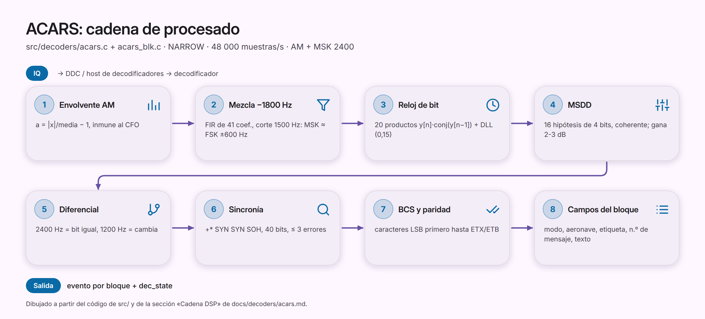
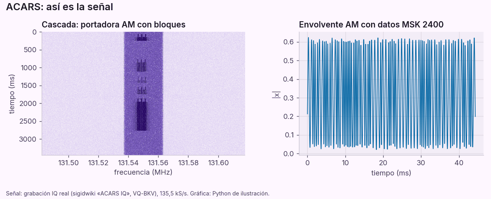
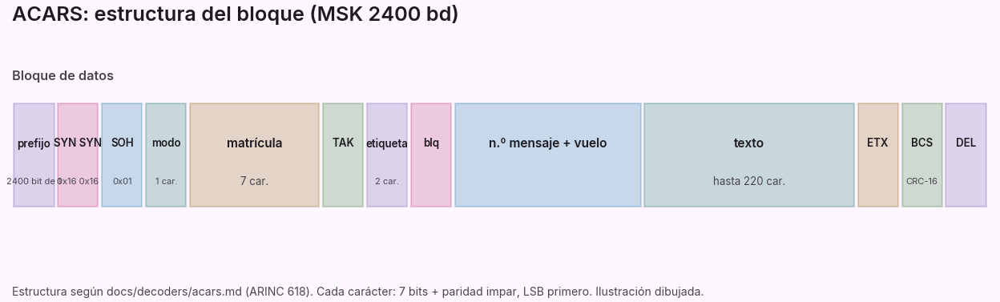
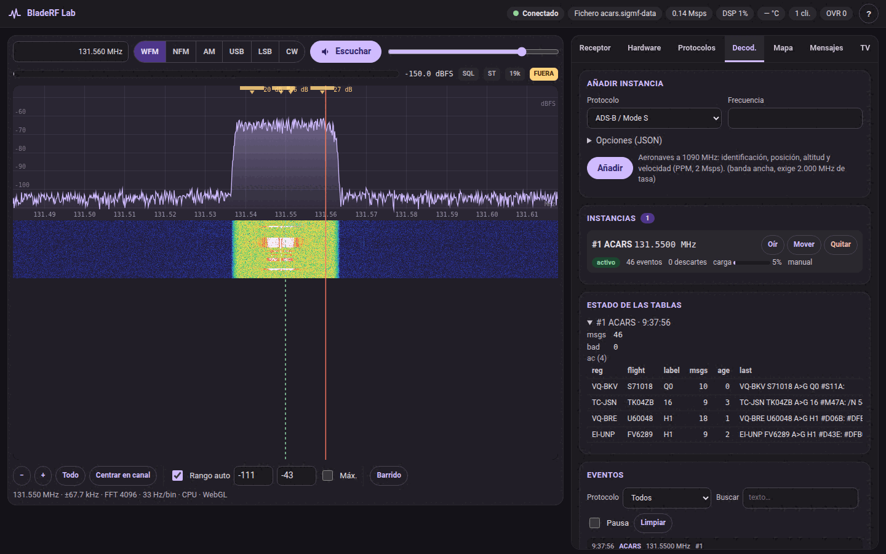

# ACARS (VHF, ARINC 618)

<!-- vision-rapida:inicio (generada por docs/img/src/doc_decoders.py) -->

## Visión rápida

<picture>
  <source media="(prefers-color-scheme: dark)" srcset="../img/decoders/acars-cadena-dark.png">
  
</picture>

*Figura. Cadena de procesado de ACARS, dibujada a partir del código de `src/` y de la sección «Cadena DSP» de este documento.*

### Así es la señal

<picture>
  <source media="(prefers-color-scheme: dark)" srcset="../img/decoders/acars-senal-dark.png">
  
</picture>

*Figura. Cascada y envolvente AM de la grabación real.*

<picture>
  <source media="(prefers-color-scheme: dark)" srcset="../img/decoders/acars-estructura-dark.png">
  
</picture>

*Figura. Bloque ACARS.*

La procedencia de cada señal (grabación real o sintética) y qué parte del procesado es Python de ilustración y no el código C se indican en el pie de cada imagen.

### Ejemplo de evento y de estado

Procedencia: grabación IQ real (sigidwiki «ACARS IQ»). Sacado de ejecutar el decodificador, no escrito a mano (`bladerf-lab --replay acars.sigmf-meta --decode acars@131550000 --print`).

Evento `dec` (campo `msg`, listas largas recortadas):

```json
{
  "proto": "acars",
  "mode": "O",
  "reg": "VQ-BKV",
  "dir": "down",
  "tak": "NAK",
  "label": "Q0",
  "block": "6",
  "msgno": "S11A",
  "flight": "S71018",
  "end": "ETX",
  "parity_ok": true,
  "body": "",
  "level_db": -9.2,
  "text": "VQ-BKV S71018 A>G Q0 #S11A: "
}
```

Último `dec_state` recibido por WebSocket (`state`, listas recortadas):

```json
{
  "msgs": 21,
  "bad": 0,
  "ac": [
    {
      "reg": "VQ-BKV",
      "flight": "S71018",
      "label": "Q0",
      "msgs": 5,
      "age": 1,
      "last": "VQ-BKV S71018 A>G Q0 #S11A: "
    },
    {
      "reg": "TC-JSN",
      "flight": "TK04ZB",
      "label": "16",
      "msgs": 4,
      "age": 3,
      "last": "TC-JSN TK04ZB A>G 16 #M47A: /N 54.924/E 36.578/20411/1510/1747/09759/2020/"
    },
    "… (2 más)"
  ]
}
```

### En la web



*Captura de la interfaz con un servidor `--replay` propio mostrando ACARS.*

<!-- vision-rapida:fin -->

Ficheros: `src/decoders/acars.c`, `src/decoders/acars_blk.{c,h}` (bloque, BCS; lo reutiliza VDL2),
`src/tx/mod_acars.c`, `tests/test_acars.c`.

## Teoría

ACARS (Aircraft Communications Addressing and Reporting System) envía bloques de hasta ~220
caracteres entre avión y tierra por canales VHF de 25 kHz (Europa: 131,525; 131,725; 131,825 MHz).
La capa física es **AM de baja profundidad** cuya señal moduladora es un **MSK a 2400 bit/s**:
"1" = 1200 Hz, "0" = 2400 Hz, fase continua (índice h = 0,5). **Corregido con una grabación real
(2026-11-15): la codificación es diferencial.** Un tono de 2400 Hz significa "el bit de datos es
igual al anterior" y uno de 1200 Hz "cambia"; así el pre-key de unos es un tono fijo de 2400 Hz y el
"+*" (1101 0101 0101 0100, casi todo alternancias) un tren de 1200 Hz. Antes se leía 1200 Hz = 1 y
2400 Hz = 0 directamente y no se decodificaba ningún bloque real.

Bloque en el aire (caracteres de 7 bits + **paridad impar**, bit menos significativo primero):

```
pre-key (≥16 unos) | '+' '*' | SYN SYN | SOH | Modo | Matrícula(7) | TAK | Etiqueta(2) |
Id. bloque | STX | [nº msg(4) vuelo(6) en bajada] texto | ETX/ETB | BCS(2) | DEL
```

* Matrícula: 7 caracteres rellenos con `.` por la izquierda.
* TAK: acuse (letra/dígito) o NAK (0x15). Etiqueta `_` + DEL (Q0) se muestra como `_d`.
* Id. de bloque: dígito en bajada (avión → tierra), letra en subida (heurística de este decodificador).
* BCS: CRC-16 x¹⁶+x¹²+x⁵+1, registro inicial 0, bits LSB primero (CRC-16/KERMIT del catálogo
  reveng), calculado sobre Modo…ETX/ETB tal como van por el aire (con paridad), byte bajo primero.
  Se acepta también el CRC calculado sobre los caracteres sin el bit de paridad.

## Cadena DSP (48 kHz, 20 muestras/bit)

1. Envolvente `a = |x|/media − 1` (inmune al desvío de portadora → tolera ±¼ del canal).
2. Mezcla a −1800 Hz y paso bajo FIR de 41 coeficientes (corte 1500 Hz): el MSK queda como FSK de ±600 Hz.
3. Reloj de bit: suma deslizante de 20 productos `y[n]·conj(y[n−1])`; sus cruces por cero alimentan
   un DLL (ganancia 0,15) que fija el instante de decisión.
4. Decisión de bit: **detección coherente por secuencia (MSDD)**. Por cada bit se correlaciona el
   tramo con las rampas de fase de "0" (+600 Hz) y "1" (−600 Hz); se prueban las 16 hipótesis de 4
   bits integrando coherentemente (la fase de portadora se descarta con el módulo) y se decide el
   segundo bit de la ventana. Gana ~2–3 dB frente al discriminador simple (a 10 dB de SNR en 48 kHz
   el detector simple solo acertaba ~80 % de los bloques; el MSDD ~100 %).
5. Sincronía: patrón `+*` SYN SYN SOH (40 bits, hasta 3 errores, ambas polaridades), caracteres
   LSB primero hasta ETX/ETB + 2 bytes de BCS, validación del BCS y de la paridad.

## Eventos

```json
{"proto":"acars","mode":"2","reg":"EC-MXY","dir":"down","tak":"NAK","label":"H1","block":"3",
 "msgno":"M12A","flight":"IB3456","end":"ETX","parity_ok":true,"body":"#DFB/WX …",
 "level_db":-12.3,"text":"EC-MXY IB3456 A>G H1 #M12A: #DFB/WX …"}
```
`dir` = `down` (avión→tierra, A>G) o `up`. `level_db` = potencia media del canal (dBFS).
Solo se emiten bloques con BCS correcto. Con `ETB` el mensaje continúa en el siguiente bloque.

## state_json

```json
{"msgs":12,"bad":3,"ac":[{"reg":"EC-MXY","flight":"IB3456","label":"H1","msgs":2,"age":4,"last":"…"}]}
```
Aeronaves vistas con su último mensaje; se olvidan a los 900 s (máx. 256). Varias instancias
(perfil `acars`: 3 canales) son independientes.

## Referencias

* ARINC Specification 618 (protocolo aire-tierra) y 620 (formatos de mensaje): de pago, **no consultadas**.
  Todas las constantes salen de descripciones públicas y de memoria; ver limitaciones.
* Catálogo de CRC de Greg Cook (reveng): CRC-16/KERMIT, `check` = 0x2189 (verificado en el test).

## Limitaciones

* **Validado con tráfico real** (V1): audio AM de la Signal Identification Wiki ("ACARS sound",
  11 bloques de Nueva Zelanda, ZK-OKM/ZK-NGM/ZK-SJC) y su IQ ("ACARS IQ", VQ-BKV). Los 11 bloques
  coinciden con acarsdec 4.3.1 (matrícula, etiqueta, id. de bloque, nº de mensaje, vuelo, texto).
  Quedan confirmados: BCS = CRC-16/KERMIT sobre Modo…ETX con paridad (con el bit 7) y byte bajo
  primero; paridad impar; orden LSB primero; polaridad (la diferencial no depende de ella).
  Lo único que estaba mal era la codificación diferencial (arriba). Test:
  `tests/data/acars_sigid_am.cs8` en `tests/test_acars.c`.
* El número de mensaje ("F11A", "S20A") no empieza siempre por M: el análisis acepta
  `[A-Z][0-9][0-9][A-Z]` seguido del vuelo de 6 caracteres.
* No corrige errores de paridad con ayuda del BCS, no reensambla mensajes multibloque (ETB) ni
  interpreta etiquetas (H1, 5Z…).
* Rendimiento medido: ~95-100 % de bloques con AWGN de 10 dB (SNR de la señal AM completa en 48 kHz),
  CFO ±5 kHz y ±100 ppm; cae rápido por debajo de 8 dB. Coste ≈ 0,003 s de CPU por s de señal.
