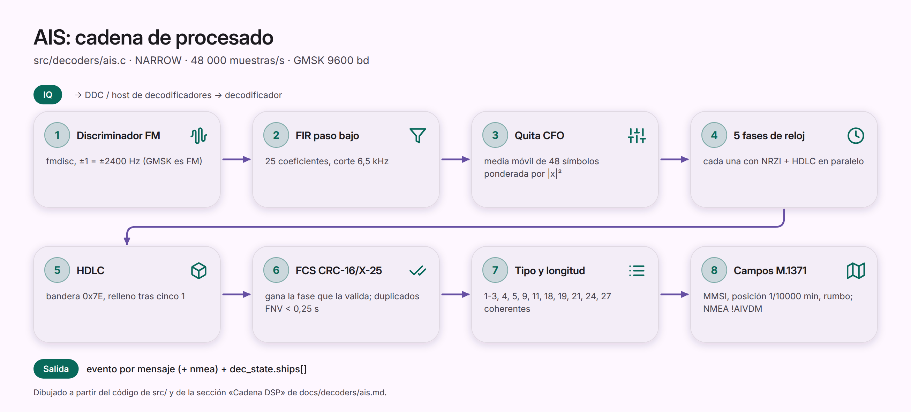
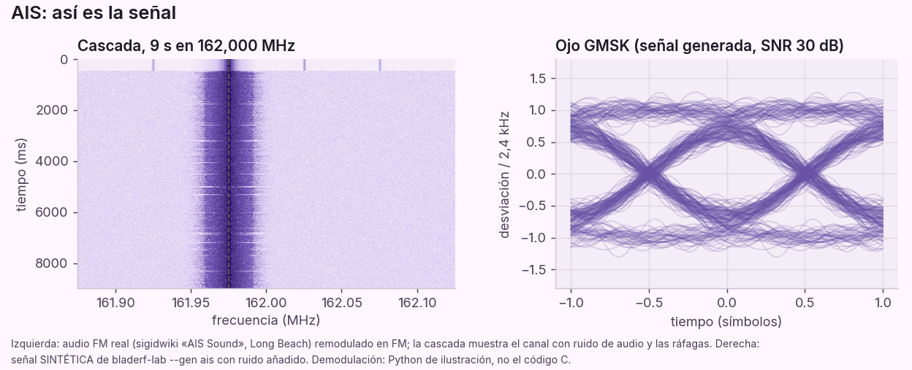
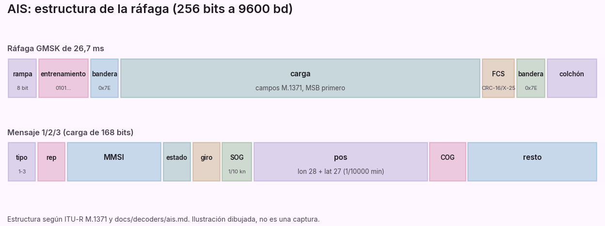

# AIS (Automatic Identification System)

<!-- vision-rapida:inicio (generada por docs/img/src/doc_decoders.py) -->

## Visión rápida

<picture>
  <source media="(prefers-color-scheme: dark)" srcset="../img/decoders/ais-cadena-dark.png">
  
</picture>

*Figura. Cadena de procesado de AIS, dibujada a partir del código de `src/` y de la sección «Cadena DSP» de este documento.*

### Así es la señal

<picture>
  <source media="(prefers-color-scheme: dark)" srcset="../img/decoders/ais-ojo-dark.png">
  
</picture>

*Figura. Cascada de la grabación (audio real remodulado) y diagrama de ojo GMSK de una señal generada.*

<picture>
  <source media="(prefers-color-scheme: dark)" srcset="../img/decoders/ais-estructura-dark.png">
  
</picture>

*Figura. Ráfaga AIS y mensaje 1/2/3.*

La procedencia de cada señal (grabación real o sintética) y qué parte del procesado es Python de ilustración y no el código C se indican en el pie de cada imagen.

### Ejemplo de evento y de estado

Procedencia: audio FM real (sigidwiki «AIS Sound», Long Beach) remodulado en FM. Sacado de ejecutar el decodificador, no escrito a mano (`bladerf-lab --replay ais.sigmf-meta --decode ais@161975000 --print`).

Evento `dec` (campo `msg`, listas largas recortadas):

```json
{
  "msg_type": 1,
  "repeat": 0,
  "mmsi": 367003560,
  "class": "A",
  "lat": 33.767095,
  "lon": -118.217115,
  "sog": 0.0,
  "cog": 0.0,
  "navstat": 15,
  "navstat_name": "no definido",
  "second": 45,
  "nmea": "!AIVDM,1,1,,A,15N07b?P00GRn56CDU`@0?wJ0HKO,0*22",
  "text": "AIS 1 MMSI 367003560 33.7671,-118.2171 0.0 kn"
}
```

Último `dec_state` recibido por WebSocket (`state`, listas recortadas):

```json
{
  "msgs": 2,
  "count": 2,
  "ships": [
    {
      "mmsi": 367003560,
      "name": "",
      "callsign": "",
      "shiptype": 0,
      "shiptype_name": "",
      "lat": 33.76709,
      "lon": -118.21712,
      "sog": 0.0,
      "cog": 0.0,
      "navstat": 15,
      "navstat_name": "no definido",
      "dest": "",
      "bow": 0,
      "stern": 0,
      "port": 0,
      "stbd": 0,
      "draught": 0.0,
      "class": "A",
      "msgs": 1,
      "age": 13
    },
    {
      "mmsi": 366982310,
      "name": "",
      "callsign": "",
      "shiptype": 0,
      "shiptype_name": "",
      "lat": 33.76142,
      "lon": -118.21862,
      "sog": 0.0,
      "cog": 205.6,
      "navstat": 0,
      "navstat_name": "en marcha con motor",
      "dest": "",
      "bow": 0,
      "stern": 0,
      "port": 0,
      "stbd": 0,
      "draught": 0.0,
      "class": "A",
      "msgs": 1,
      "age": 2
    }
  ]
}
```

<!-- vision-rapida:fin -->

Fuentes: ITU-R M.1371 (capa física anexo 2 §3, mensajes), tabla de campos de
gpsd "AIVDM/AIVDO protocol decoding", Kanaan et al. arXiv:2503.01744 (PLVA, no
implementado).

## Teoría

- Canales 161,975 MHz (AIS 1, "A") y 162,025 MHz (AIS 2, "B"), canal de 25 kHz.
- GMSK con BT = 0,4 a 9600 bit/s, índice de modulación 0,5: cada símbolo gira la
  fase ±π/2, desviación ±2400 Hz. A 48 ksps hay 5 muestras por símbolo.
- Datos: NRZI (0 = cambio de nivel) + HDLC: bandera 0x7E, relleno de ceros tras
  cinco unos, FCS CRC-16/X-25 sobre los bits de carga (LSB primero). La carga son
  campos de bits transmitidos MSB primero (no hay alineación a byte: la FCS se
  calcula bit a bit, `hdlc.c`).
- Ráfaga: rampa, 24 bits de entrenamiento, bandera, carga + FCS, bandera, colchón.

## Cadena DSP (`src/decoders/ais.c`)

1. Discriminador FM (`fmdisc`, ±1 = ±2400 Hz). GMSK es FM de envolvente
   constante: no hace falta fase de portadora.
2. FIR paso bajo de 25 coeficientes con corte 6,5 kHz (la elección se midió: 5,5 y
   8,5 kHz son peores).
3. El CFO es una constante sumada al discriminador. Se resta la media móvil de 48
   símbolos ponderada por |x|² (sin ponderar, el ruido anterior a la ráfaga la
   sesgaba: del 60 % al ~99 % de tramas a 10 dB).
4. Reloj: cinco desfases de muestreo en paralelo, cada uno con NRZI + HDLC. Gana
   el que valida la FCS; los duplicados (misma carga en menos de 0,25 s) se
   descartan por huella FNV. No hay lazo que enganchar en una ráfaga de 27 ms; a
   ±100 ppm la deriva en 1000 bits es 0,1 símbolo.
5. Tipo y longitud deben ser coherentes (1-3, 4, 11, 9, 18, 24, 27: longitud
   exacta; 5: 420-430; 19: 312; 21: 272-360). Los demás tipos se descartan.

## Mensajes

1/2/3 (clase A), 4/11 (estación base, hora UTC), 5 (estáticos y viaje), 9
(aeronave SAR, posición), 18 (clase B), 19 (clase B ampliado), 21 (ayuda a la
navegación), 24 A/B (clase B estáticos), 27 (largo alcance). Posiciones en 1/10000
min (1/10 min en el 27). Cada evento incluye `nmea` con sentencias `!AIVDM`
(checksum correcto, partidas a 60 caracteres de carga, id de secuencia rotativo,
canal A/B según la frecuencia de la instancia).

## Eventos

```json
{"msg_type":1,"repeat":0,"mmsi":265547250,"class":"A","lat":57.66035,"lon":11.832977,
 "sog":13.9,"cog":40.4,"hdg":41,"navstat":0,"navstat_name":"en marcha con motor",
 "second":33,"nmea":"!AIVDM,1,1,,A,...,0*xx","text":"AIS 1 MMSI 265547250 57.6604,11.8330 13.9 kn"}
```
Tipo 5 añade `name, callsign, shiptype(_name), imo, bow/stern/port/stbd, eta, draught,
dest`; tipo 4 `utc`; tipo 21 `aid_type`; tipo 24 `part`. `class`: A, B, S (base), N (ayuda).

## state_json

`{"msgs":N,"count":N,"ships":[{"mmsi","name","callsign","shiptype","shiptype_name",
"imo","lat","lon","dist_km","bearing","sog","cog","hdg","navstat","navstat_name",
"dest","bow","stern","port","stbd","draught","class","msgs","age"}]}`
Caducidad 600 s, máximo 1024 barcos. `dist_km`/`bearing` si el receptor tiene
ubicación (`set_location`).

## Pruebas (`tests/test_ais.c`)

- Capa de carga con las sentencias de gpsd (tipo 1 → MMSI 477553000, 47,58283 N
  −122,34583; tipo 5 de dos partes → MT.MITCHELL, WDA9674, SEATTLE): checksum,
  regeneración exacta de la sentencia tipo 1.
- 9 ráfagas (1, 5, 18, 24A, 24B, 19, 21, 4, 27) limpias: 9/9. Con AWGN 10 dB
  (en 48 kHz, luego filtro de canal de 25 kHz como el DDC), CFO ±6250 Hz y ±100
  ppm: 80/81. Ruido solo (20 s): 0 eventos. Coste: ~0,002 s de CPU por segundo de señal.

## Limitaciones

- PLVA / MLSE no implementados: la sensibilidad queda ~2-3 dB por detrás de un
  receptor óptimo.
- Constante no verificada contra la norma: si la secuencia de entrenamiento va
  también en NRZI (no se usa en la recepción).
- Mensajes distintos de los listados se descartan.
- Una colisión de dos ráfagas en la misma ranura no se separa.

## Validación con señales reales (V1, 2026-11-15)

Grabaciones de la Signal Identification Wiki: "AIS Sound" (audio FM, Long Beach/Los Ángeles) y
"AIS IQ" (IQ a 48 kHz, Dinamarca, 57°N 10°E). Antes: solo salían mensajes "tipo 8" con MMSI
98xxxxxxx (CRC correcto, campos mal interpretados). **Constante equivocada: el orden de bits de
los campos.** El HDLC transmite cada octeto con el bit menos significativo primero y los campos de
ITU-R M.1371 se definen sobre los octetos ya reordenados: el bit k del flujo recibido es el bit
7 − k%8 del octeto k/8. `ais_unscramble_bytes()` lo aplica antes de `ais_parse()` y el modulador
(`mod_ais.c`) lo deshace antes de `hdlc_encode`. Después: tipo 1, MMSI 367003560/366982310
(EE. UU.), posición 33,767°N 118,217°O, y en el IQ danés buques con MMSI 219…/538… y posiciones en
el Skagerrak. Una implementación independiente (Python: NRZI + HDLC + CRC-16) dio los mismos
tipos/MMSI. Test: `tests/data/ais_la_fm48k.cs8` y las NMEA reales en `tests/test_ais.c`.
Los tipos 5/18/19/21/24 siguen sin contrastar con tráfico real (la grabación solo tiene el 1 y 8
tras corregir). PLVA sigue sin hacerse.
