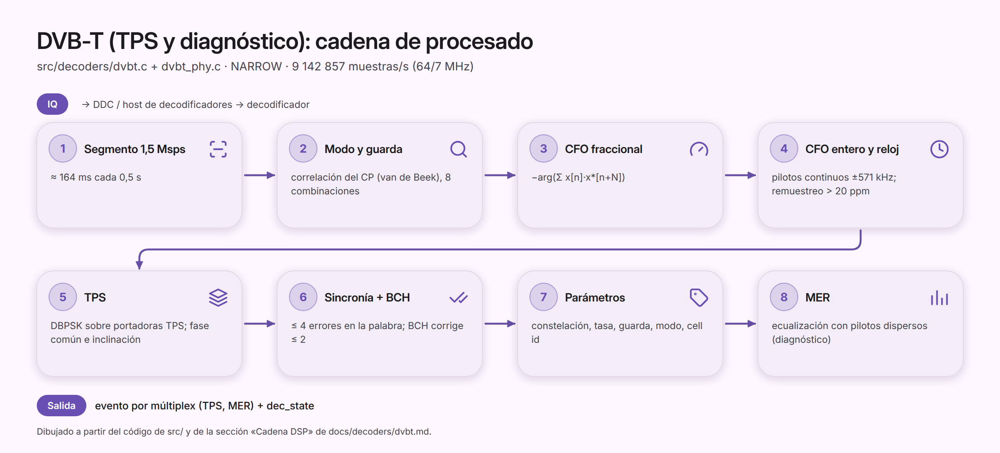
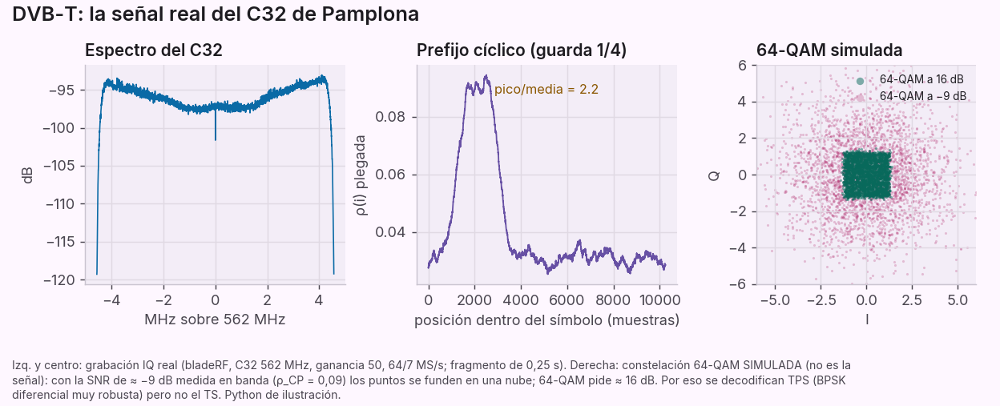
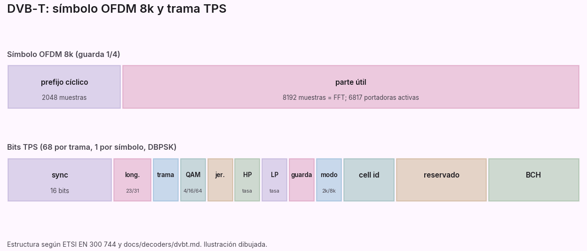

# DVB-T (TDT) — `dvbt`

<!-- vision-rapida:inicio (generada por docs/img/src/doc_decoders.py) -->

## Visión rápida

<picture>
  <source media="(prefers-color-scheme: dark)" srcset="../img/decoders/dvbt-cadena-dark.png">
  
</picture>

*Figura. Cadena de procesado de DVB-T, dibujada a partir del código de `src/` y de la sección «Cadena DSP» de este documento.*

### Así es la señal

<picture>
  <source media="(prefers-color-scheme: dark)" srcset="../img/decoders/dvbt-senal-dark.png">
  
</picture>

*Figura. Espectro y correlación del prefijo cíclico reales del C32, y por qué 64-QAM a −9 dB no demodula (simulada).*

<picture>
  <source media="(prefers-color-scheme: dark)" srcset="../img/decoders/dvbt-estructura-dark.png">
  
</picture>

*Figura. Símbolo OFDM 8k y bits TPS.*

La procedencia de cada señal (grabación real o sintética) y qué parte del procesado es Python de ilustración y no el código C se indican en el pie de cada imagen.

### Ejemplo de evento y de estado

Procedencia: grabación real del C32 de Pamplona: con la SNR de ≈ −9 dB el receptor engancha pero en el `--replay` del fragmento no se emite evento. Sacado de ejecutar el decodificador, no escrito a mano (`bladerf-lab --replay c32_frag.cs8 --rate 9142857.142857 --freq 562000000 --decode dvbt@562000000 --print`).

Esta grabación no produce ningún evento `dec`.

<!-- vision-rapida:fin -->

Decodificador **narrow** a 64/7 MHz = 9 142 857,14 Hz (T = 7/64 µs, canal de
8 MHz; el DDC entrega 7,61 MHz de ancho). Solo lee la **información de sistema**
(modo, guarda y señalización TPS); no decodifica el transporte MPEG.

## Teoría (ETSI EN 300 744)

OFDM con N = 2048 (2k, K = 1705 portadoras, Δf = 4464 Hz) o N = 8192 (8k, K = 6817,
Δf = 1116 Hz), prefijo cíclico N/32…N/4. Trama = 68 símbolos, superTrama = 4
tramas. Cada símbolo contiene datos, **pilotos continuos** (45 en 2k, 177 en 8k;
fijos), **pilotos dispersos** (`k mod 12 = 3·(l mod 4)`, amplitud 4/3) y **portadoras
TPS** (17 en 2k, 68 en 8k) con DBPSK diferencial entre símbolos. Pilotos y
referencia TPS usan la PRBS `x¹¹+x²+1` (unos iniciales, un bit por portadora).

Palabra TPS (68 bits): `s0` init; `s1–16` sincronía (`0011010111101110` en tramas
pares, complementaria en impares); `s17–22` longitud (23 sin cell id / 31 con él);
`s23–24` nº de trama; `s25–26` constelación; `s27–29` jerarquía (α, entrelazado);
`s30–32` tasa HP; `s33–35` tasa LP; `s36–37` guarda; `s38–39` modo; `s40–47` byte
de cell id; `s48–53` reservados; `s54–67` BCH(67,53) t=2, g(x)=x¹⁴+x⁹+x⁸+x⁶+x⁵+x⁴+x²+x+1
(acortado de BCH(127,113); se verificó que divide a x¹²⁷+1).

## Cadena DSP (por ráfagas de tiempo)

Segmento de 1,5 Msps (≈ 164 ms: ≥ 140 símbolos, > 2 tramas TPS) cada 0,5 s sin
enganche, 3 s con múltiplex ya decodificado, 0,35 s si falta algún byte del cell id.
Coste medido: 0,02–0,04 s de CPU por s de señal; ruido: ≈ 0,04.

1. **Modo y guarda** por correlación del CP (van de Beek et al. 1997): coeficiente
   `ρ(i)=|Σ_{j<N/32} x[i+j]x*[i+j+N]|/√(E₁E₂)` con ventana deslizante, plegado por
   cada `Ts=N(1+1/g)` candidato (8 combinaciones). Solo el verdadero alinea los
   picos de los 140 símbolos; se exige media del pliegue > 0,3 y contraste > 1,5. El
   centro de la meseta ≥ 0,9·pico da el inicio del CP.
2. **CFO fraccional** `f=−arg(Σ x[n]x*[n+N])·fs/(2πN)`.
3. **CFO entero** (±N/16 = ±571 kHz): con FFT de 16 símbolos se busca el
   desplazamiento `s` que maximiza `Σ|Σ_k Y_l[k+s]Y*_{l−1}[k+s]|` sobre los pilotos
   continuos (constantes en el tiempo). No necesita la PRBS. **Deriva de reloj**: de la
   pendiente de fase entre 8 grupos de pilotos, `ε=−b·N/(2πTs)`; si |ε| > 20 ppm se
   remuestrea el segmento (Catmull-Rom) y se re-sincroniza el CP.
4. **TPS**: FFT de todos los símbolos (ventana N/8 antes del final del CP); por cada
   par consecutivo se miden fase común `a` e inclinación `b` con los pilotos
   continuos y se suma `Re(Y_l Y*_{l−1} e^{−j(a+bκ)})` sobre las portadoras TPS →
   bit DBPSK (≥ 0 → 0). No depende del canal ni de la PRBS.
5. **Sincronía + BCH**: búsqueda de la palabra (≤ 4 errores) y comprobación BCH
   (corrige ≤ 2 bits; también prueba el orden inverso de paridad, marcado
   `"bch":"alt-order"`); longitud 23/31; segunda trama del segmento para el otro
   byte del cell id.
6. **Ecualización con pilotos dispersos** (diagnóstico): H por interpolación lineal
   entre pilotos del propio símbolo con la pendiente de fase compensada; `mer_db` =
   mediana del MER sobre los pilotos continuos que no son dispersos en ese símbolo.

## Salida

Evento por múltiplex nuevo o cambiado (o cell id completado):

```json
{"text":"DVB-T 8k guarda 1/8 64-QAM HP 2/3 LP 2/3 cell 0x1234 @474.000 MHz",
 "event":"new","freq_hz":474000000,"mode":"8k","guard":"1/8",
 "constellation":"64-QAM","hierarchy":"none","interleaver":"native",
 "hp_rate":"2/3","lp_rate":"2/3","frame":0,"length_indicator":31,
 "cell_id":4660,"cell_id_hex":"0x1234","bch":"std","cfo_hz":10000,
 "mer_db":10.6,"level_dbfs":-13.5}
```
`cell_id` es `null` hasta tener los dos bytes (tramas pares e impares).
`frame` = valor de los bits s23-s24 (0…3). `hierarchy`: `none`, `alpha1`, `alpha2`,
`alpha4`.

**state_json**: `{"muxes":[{freq_hz, …los mismos campos…, "locks","age"}],"scans",
"cp_found","tps_ok","cp_rho","locked"}`; caducan a los 600 s.

Modulador (`mod_dvbt.c`, `--gen dvbt`): señal OFDM completa (datos aleatorios, sin
FEC); `{"mode":"2k|8k","guard","constellation":"qpsk|16qam|64qam","hierarchy":0|1|2|4,
"hp","lp","cell_id","frames":1-16,"frame0"}`. `air_ok=false`.

## Pruebas (`tests/test_dvbt.c`)

Tablas: 45/177 pilotos, 17/68 TPS, estructura +1704, g(x) | x¹²⁷+1, sincronías
complementarias, PRBS; TPS: construir, corregir 2 errores. Sistema: 2k/8k × 4 guardas
(15 dB, CFO +25,3 kHz), cell id, estrés (10–11 dB, CFO −61,7/+180/+45,1/−150 kHz,
±100 ppm, 2 ecos con guarda ≥ 1/8), ruido (0 eventos) y coste.

## Limitaciones y RIESGO PRINCIPAL

- **No se pudo contrastar con la norma ni con señal real** (sin acceso a EN 300 744
  ni a capturas): las posiciones de pilotos continuos y TPS se escribieron de memoria
  (2k: 45 y 17; la tabla de 8k se deriva con la estructura +m·1704); los totales 45/177
  y 17/68 y la divisibilidad de g(x) son coherentes, pero **una errata en una
  posición haría fallar el TPS real** sin que los tests (que usan las mismas tablas)
  lo detecten. Por eso la detección de CFO entero/inclinación usa solo los pilotos
  continuos y el TPS es robusto a una portadora errónea (suma de 17–68).
- PRBS (`x¹¹+x²+1`, orden y semilla), el reparto de bytes del **cell id** (se asume
  byte alto en tramas de valor par) y el orden de la paridad BCH (se prueba también el
  inverso) no están verificados; el `mer_db` solo valida la PRBS por coherencia propia.
- Sin 4k (DVB-H) ni canales de 6/7 MHz (otra T); sin transporte.
- El segmento de 1,5 Msps es fijo (≥ 140 símbolos 8k con guarda 1/4); en el peor caso
  el análisis tarda ~100 ms en el hilo del decodificador (el host descartará bloques).
- Con una muestra de 20 Msps (DDC) el CFO máximo útil es ±571 kHz; el aliasing de
  la banda a 9,14 Msps limita CFO mayores.

## Referencias

- ETSI EN 300 744 V1.6.1, §4.4–4.6 (tablas de pilotos, TPS, BCH).
- van de Beek, Sandell, Börjesson, "ML estimation of time and frequency offset in
  OFDM systems", IEEE Trans. Signal Process. 45(7), 1997.
- Liu, tesis NYCU 2006 (detección ciega de modo/guarda); patentes US 7729414 y
  US 9100226 (TPS).

---

# Receptor completo hasta TS (TV1) — `src/tv/dvbt_rx.*`

API en AGENTS.md §8c. Ficheros: `dvbt_rx.c` (sincronía, canal, TPS, demapeo), `dvbt_tab.c`
(tablas compartidas con el modulador), `dvbt_vit.c` (Viterbi AVX2, ≈ 100 Mb/s), `dvbt_outer.c`
(sincronía de paquete, Forney, RS(204,188), PRBS), `tx/mod_dvbt.c` (modulador TS → OFDM).
El decodificador del catálogo `dvbt` (arriba) sigue usando su analizador por ráfagas
(0,02–0,04 s de CPU por s); el receptor completo lo usa el decodificador `tdt` de TV2.

## Constantes validadas contra GNU Radio gr-dtv

gr-dtv (3.10.9) solo se EJECUTÓ como referencia (`build/tv1/ref/grgen.py`; no se leyó ni copió su código).
Resultado de comparar `mod_dvbt.c` con su cadena `dtv.dvbt_*`:

- Constelación tras aleatorizador, RS, Forney (I=12, M=17), convolucional+perforado,
  entrelazado de bits y de símbolo: **error 0** en 9 combinaciones (QPSK/16/64 × 1/2…7/8, 2k/8k).
- Símbolo OFDM completo (pilotos continuos 177, dispersos, TPS 68 con BCH y cell id, 2 tramas):
  error relativo 3e-14 en el dominio del tiempo. Las tablas de pilotos y TPS "de memoria" de D8 eran
  correctas (también se comprobó la PRBS x¹¹+x²+1 y la paridad de sincronía de TPS).
- **Única constante corregida**: la permutación de bits R'→R del entrelazado de símbolo 2k
  (tabla `p2` en `dvbt_tab.c`: R'₈→R₇, R'₉→R₀; las dos últimas estaban intercambiadas).
- Receptor sobre IQ generado por gr-dtv (64-QAM 2/3, 8k, 1/4, cell id 4660): 4918 paquetes TS
  idénticos (`build/tv1/ref/g64_iq.cs16`).
- Contraste en el aire (C32): el CFO entero y la fase de pilotos dispersos se detectan con
  contraste alto (4,5 frente a 1,2): confirma pilotos continuos, PRBS y posiciones dispersas.

## Pruebas (`tests/test_dvbt_rx.c`)

TS → modulador → canal (AWGN respecto a potencia media, CFO 0–3300 Hz, ±20 ppm, eco a 800
muestras) → receptor: paquetes idénticos en 2k/8k, guardas 1/32…1/4, 4/16/64-QAM, tasas 1/2…7/8.
Rendimiento (8k, 1/4, 64-QAM 2/3, 19,9 Mb/s): 0,64–0,8 núcleos (i7-13650HX, CUDA=0); 2k 1/4:
1,4 núcleos (3,5 símbolos/ms).

## Limitaciones conocidas

- Jerarquía: se demapea solo el flujo HP (y0, y1); la parte LP y el mapa de demux LP del modulador
  no se contrastaron con gr-dtv.
- Deriva de reloj > ~50 ppm y canales con ecos > guarda/2 no están probados; el seguimiento
  de la ventana es de ±1 muestra por símbolo.
- El decodificador `dvbt` del catálogo no añade bitrate/servicios (se deja a TV2/`tdt`).

## Señal real de Pamplona (2026-11-16, bladeRF RX1, ganancia 50, 64/7 MHz)

Barrido C21–C48: CP con guarda 1/4 en 8k en C23, C32, C37, C47 (y débil C39/C26). Mejor: **C32
(562 MHz, MPE1)**: el receptor engancha, estima CFO +821 Hz, decodifica TPS (8k, 1/4,
64-QAM, HP 2/3) pero la SNR en banda es de **≈ −9 dB** (ρ_CP = 0,09): imposible demodular 64-QAM
(necesita ≈ 16 dB), así que no hay TS. La antena entrega ≈ 60 dB menos de lo esperado en UHF TV;
con la ganancia sin efecto (el ruido es del frontal). Grabación: `build/tv1/rec/c32_gain50.cs16`
(15 s) y fragmento `c32_frag.cs8` (4,6 MB). Requiere mejor antena/LNA para TS real.
