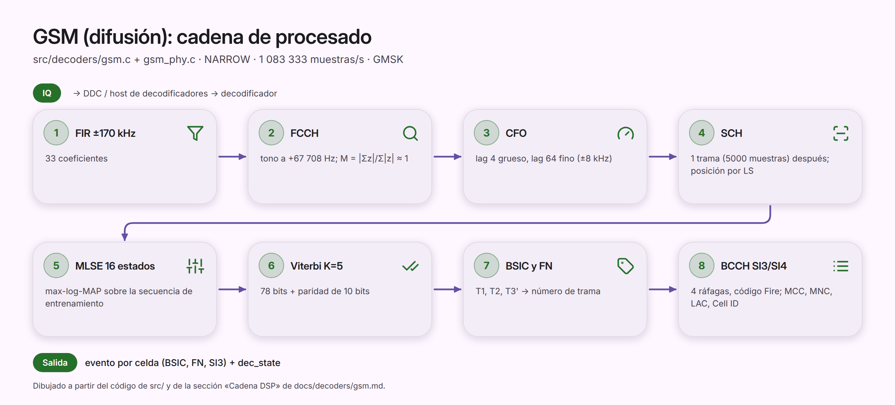
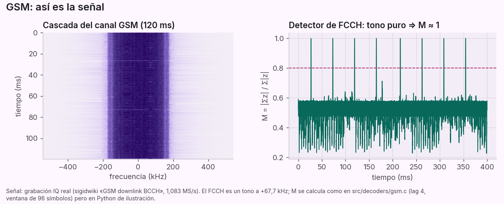
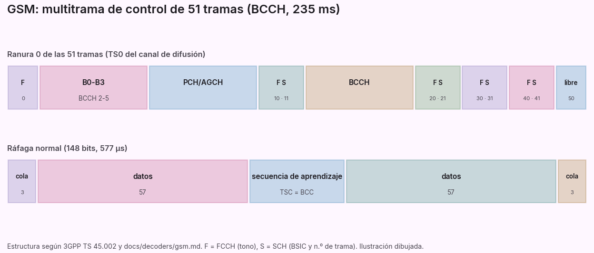
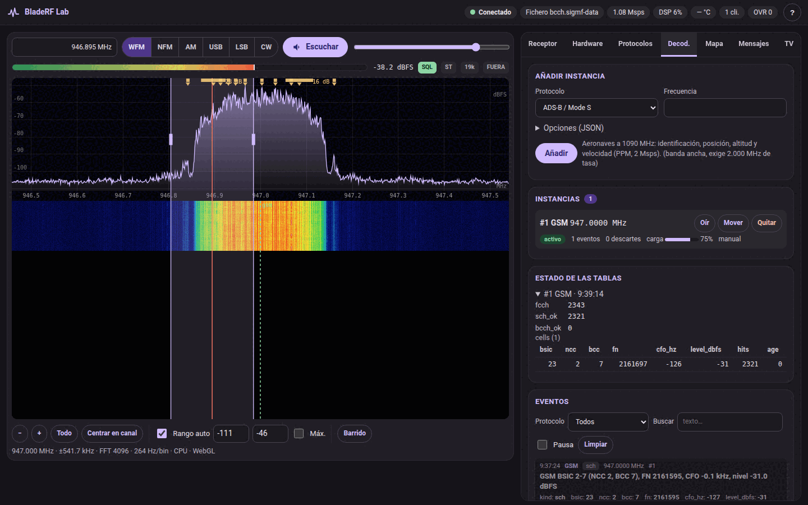

# Decodificador GSM (`gsm`)

<!-- vision-rapida:inicio (generada por docs/img/src/doc_decoders.py) -->

## Visión rápida

<picture>
  <source media="(prefers-color-scheme: dark)" srcset="../img/decoders/gsm-cadena-dark.png">
  
</picture>

*Figura. Cadena de procesado de GSM, dibujada a partir del código de `src/` y de la sección «Cadena DSP» de este documento.*

### Así es la señal

<picture>
  <source media="(prefers-color-scheme: dark)" srcset="../img/decoders/gsm-fcch-dark.png">
  
</picture>

*Figura. Cascada y detector de FCCH sobre la grabación real.*

<picture>
  <source media="(prefers-color-scheme: dark)" srcset="../img/decoders/gsm-estructura-dark.png">
  
</picture>

*Figura. Multitrama de 51 y ráfaga normal.*

La procedencia de cada señal (grabación real o sintética) y qué parte del procesado es Python de ilustración y no el código C se indican en el pie de cada imagen.

### Ejemplo de evento y de estado

Procedencia: grabación IQ real (sigidwiki «GSM downlink BCCH»). Sacado de ejecutar el decodificador, no escrito a mano (`bladerf-lab --replay gsm.sigmf-meta --decode gsm@947000000 --print`).

Evento `dec` (campo `msg`, listas largas recortadas):

```json
{
  "text": "GSM BSIC 2-7 (NCC 2, BCC 7), FN 2161595, CFO -0.1 kHz, nivel -31.0 dBFS",
  "kind": "sch",
  "bsic": 23,
  "ncc": 2,
  "bcc": 7,
  "fn": 2161595,
  "cfo_hz": -127,
  "level_dbfs": -31.0,
  "hits": 1
}
```

Último `dec_state` recibido por WebSocket (`state`, listas recortadas):

```json
{
  "fcch": 313,
  "sch_ok": 310,
  "bcch_ok": 0,
  "cells": [
    {
      "bsic": 23,
      "ncc": 2,
      "bcc": 7,
      "fn": 2162615,
      "cfo_hz": -137,
      "level_dbfs": -30.9,
      "hits": 310,
      "age": 0.0
    }
  ]
}
```

### En la web



*Captura de la interfaz con un servidor `--replay` propio mostrando GSM.*

<!-- vision-rapida:fin -->

Sincronización de una portadora BCCH: FCCH (corrección de frecuencia), SCH → BSIC (NCC, BCC) y número de trama,
y System Information 3/4 del BCCH → MCC, MNC, LAC y Cell ID (SI3). Código: `src/decoders/gsm.c`, estructura de
ráfagas y codificación en `gsm_phy.{h,c}` (compartidas con `src/tx/mod_gsm.c`), test `tests/test_gsm.c`.

**Ética (AGENTS.md §0.12):** solo FCCH, SCH y las 4 ráfagas del BCCH (tramas 2–5 de la ranura 0). No se decodifica
ningún PCH/AGCH (aviso/acceso), tráfico, ni se interpreta identidad de abonado alguna; no hay código que lea
ráfagas de otras tramas.

Descriptor: `N`, 1 083 333 Hz (4 muestras/símbolo, 270 833,33 Bd), `bw_hz` 200 000.

## Teoría y cadena DSP

Referencias: 3GPP TS 45.001/45.002 (tramas, multitrama de 51, secuencias de entrenamiento §5.2.3, FN §4.3.3),
TS 45.003 (§4.1 canales de control, §4.7 SCH), TS 45.004 (GMSK), TS 44.018 §9.1.30–36 (SI), §10.5.1.3 (LAI);
gr-gsm y airprobe (organización del receptor); Laurent 1986 (descomposición de CPM).

1. **Filtro** paso bajo de 33 coeficientes (±170 kHz, Kaiser 60 dB): el ruido de 1,08 MHz se reduce ≈ 5 dB.
2. **FCCH.** 148 ceros → fase +π/2 por símbolo = tono +fb/4 = **+67 708 Hz**. `z[n] = x[n]·conj(x[n−4])`, ventana de
   96 símbolos; `M = |Σz|/Σ|z|`: ≈ 1 en un tono, ≈ 0,1 con datos GMSK. Meseta `M ≥ 0,75 … < 0,6` de 150–900 muestras.
   Frecuencia: lag 4 (grueso) + lag 64 (fino, rango ±8 kHz); **CFO = f_tono − 67 708 Hz** (error ≲ 30 Hz). Rango de
   aceptación ±62 kHz alrededor de +67,7 kHz (cubre CFO de ±50 kHz).
3. **Demodulación de ráfaga** (`demod_burst`). Con la codificación diferencial, el primer término de Laurent convierte
   GMSK en BPSK de los bits girado `j^k`: `z_k = x(kT)·(−j)^k = Σ_m h_m b_{k−m} + n`, `b = 1 − 2d`, h de 5 coeficientes.
   Se barre el retardo (±100 muestras para el SCH, ±10 para el BCCH) maximizando la energía explicada por la estimación
   de canal por mínimos cuadrados sobre la secuencia de entrenamiento; luego **MLSE max-log-MAP de 16 estados**
   (conocidos: colas y entrenamiento) con salida blanda LLR.
4. **SCH** = 1 trama (5000 muestras) tras el FCCH: 78 bits blandos (3…41 y 106…144) → Viterbi K=5 r=½ (`conv_gsm_k5`,
   terminación a cero) → 25 bits + paridad de 10 bits (`D^10+D^8+D^6+D^5+D^4+D^2+1`, invertida). Campos MSB primero:
   BSIC(6) = NCC·8+BCC, T1(11), T2(5), T3'(3); `FN = 51·((T3−T2) mod 26) + T3 + 1326·T1`, `T3 = 10·T3'+1`.
5. **BCCH.** Si FN mod 51 = 1, los bloques de FN+1…+4 (SCH + 5000·k) forman un mensaje con TSC = BCC. 456 bits tras
   desentrelazar (`B = k mod 4`, `j = 2((49k) mod 57) + ((k mod 8) div 4)`) → Viterbi (224 bits) → código Fire
   `D^40+D^26+D^23+D^17+D^3+1` (paridad invertida, 40 bits) → 23 octetos. Se interpretan SI3 (0x1B: Cell Identity + LAI)
   y SI4 (0x1C: LAI); SI3 aparece solo en TC = (FN div 51) mod 8 = 2 y 6.
   LAI: `MCC2|MCC1, MNC3|MCC3, MNC2|MNC1, LAC(2)`; MNC3 = 0xF → MNC de 2 dígitos.

## Eventos y estado

Un evento por celda nueva (`"kind":"sch"`, primer SCH válido de ese BSIC) y otro cuando se decodifica o cambia SI3/SI4
(`"kind":"si3"|"si4"`), nunca por trama:

```json
{"text":"GSM BSIC 3-5 (NCC 3, BCC 5), FN 919, CFO +0.0 kHz, nivel -1.9 dBFS, MCC 214 MNC 07 LAC 4660 CI 22136","kind":"si3",
 "bsic":29,"ncc":3,"bcc":5,"fn":919,"cfo_hz":8,"level_dbfs":-1.9,"mcc":214,"mnc":7,"mnc_digits":2,"lac":4660,"ci":22136,"hits":11}
```
`state_json`: `{"fcch":n,"sch_ok":n,"bcch_ok":n,"cells":[{bsic,ncc,bcc,fn,cfo_hz,level_dbfs,mcc,mnc,lac,ci,hits,age}]}`
(caduca a 120 s). `air_ok = false`.

## Modulador

`{"ncc":3,"bcc":5,"fn":816,"frames":161,"mcc":214,"mnc":7,"mnc_digits":2,"lac":4660,"ci":22136,"seed":1}`: tramas TDMA
completas (8 ranuras de 625 muestras); ranura 0: FCCH, SCH, BCCH (SI3 en TC 2 y 6, SI4 en 3 y 7, relleno 0x19/0x1A
en el resto) y relleno aleatorio; ranuras 1–7: ráfagas normales con datos aleatorios. GMSK por integración exacta de
fase (`pulse_gmsk`, BT 0,3).

## Pruebas (`tests/test_gsm.c`)

Constantes: las 8 TSC cumplen la propiedad de diseño de la norma (correlación de los 16 bits centrales con la secuencia:
16 en el retardo 0 y exactamente 0 en ±1…±5), la ESQ tiene lóbulos laterales ≤ 6/64: contraste fuerte de la
transcripción. Ida y vuelta de SCH (con errores), BCCH + Fire + entrelazado, bytes del LAI (MCC 214/MNC 07 →
`12 F4 70`). Señal completa con AWGN 10 dB, CFO ±50/+30 kHz, deriva ±100 ppm, dos operadores (MNC de 2 y 3 dígitos):
BSIC, FN, MCC/MNC/LAC/CI correctos y exactamente 2 eventos; solo ruido → 0 eventos; coste ≈ 0,04–0,06 s/s.

## Limitaciones y constantes no verificadas

* **No contrastado con una captura real.** Ni los bits del SCH (orden BSIC/T1/T2/T3'), ni el contenido de SI3 salieron
  de una grabación; solo de la norma recordada y de la coherencia con el modulador. La ESQ de 64 bits y las TSC se
  contrastaron con sus propiedades de autocorrelación, no con el documento.
* Un solo término de Laurent y 5 coeficientes de canal (sin multitrayecto largo: no hay ecualizador de 16 símbolos).
* Sin saltos de frecuencia ni combinación de multitramas; SI3 solo se ve cada 8 multitramas (1,9 s de ciclo) y hay que
  esperar el SCH de FN mod 51 = 1 inmediatamente anterior.
* El BCCH de un operador con SI2ter/SI13 no afecta; sin A5 (el BCCH no se cifra).

## Validación con señal real (V2, 2026-11-15)

Grabación: sigidwiki.com `GSM_downlink_BCCH.zip` (IQ 8 bit a 300 kS/s, 10 s; celda con BSIC 23), remuestreada a 1,0833 MS/s.

* FCCH: 211 detecciones; SCH: 211/211 con CRC correcto, **BSIC 23 = NCC 2, BCC 7** en todas.
* **Orden de los campos del SCH: estaba mal** (BSIC bien, FN mal: saltaba ±1000 tramas entre ráfagas). Real (búsqueda exhaustiva de
  ordenaciones con 211 valores; solo una da FN que avanza 10-11 tramas entre SCH y ≈ 216,7 por segundo; coincide con los índices
  16/17/24 de T3' del decodificador de airprobe): d0-d5 BSIC; d6-d15 T1[10..1]; d16 T3'[1]; d17 T3'[2]; d18-d22 T2 con el **LSB primero**; d23 T1[0]; d24 T3'[0].
  Corregido en `gsm_phy.c` (`gsm_sch_encode/decode`; el modulador lo usa).
* **BCCH/SI3 reales: NO decodifican** (42 intentos, Fire/Viterbi falla; la ecualización cuadra con la TSC 7 sin errores). No se probaron
  como causa: variantes de entrelazado (j par/impar, mitades, orden de ráfagas B), signo de los LLR (ninguna ayudó); queda sin resolver.
  Sin MCC/MNC/LAC/CI reales.
Fixture: `tests/data/gsm_sigid_bcch_300k.cu8` (150 kB).
