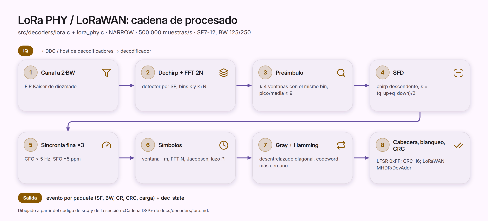
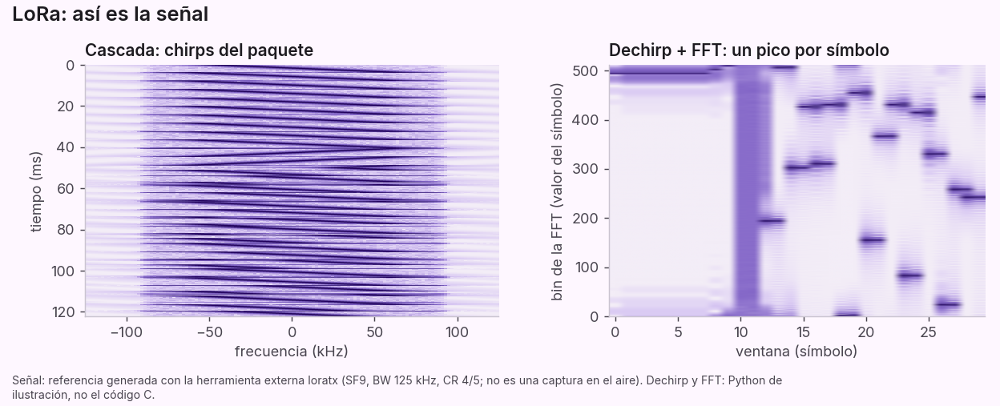
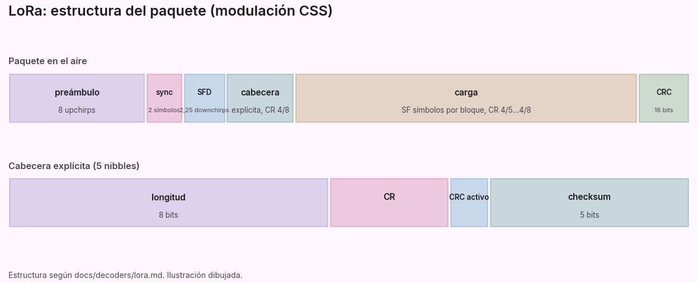

# LoRa / LoRaWAN (`lora`)

<!-- vision-rapida:inicio (generada por docs/img/src/doc_decoders.py) -->

## Visión rápida

<picture>
  <source media="(prefers-color-scheme: dark)" srcset="../img/decoders/lora-cadena-dark.png">
  
</picture>

*Figura. Cadena de procesado de LoRa, dibujada a partir del código de `src/` y de la sección «Cadena DSP» de este documento.*

### Así es la señal

<picture>
  <source media="(prefers-color-scheme: dark)" srcset="../img/decoders/lora-senal-dark.png">
  
</picture>

*Figura. Cascada de chirps y picos tras el dechirp (referencia de loratx).*

<picture>
  <source media="(prefers-color-scheme: dark)" srcset="../img/decoders/lora-estructura-dark.png">
  
</picture>

*Figura. Paquete LoRa y cabecera explícita.*

La procedencia de cada señal (grabación real o sintética) y qué parte del procesado es Python de ilustración y no el código C se indican en el pie de cada imagen.

### Ejemplo de evento y de estado

Procedencia: referencia generada con la herramienta externa loratx (no es una captura en el aire). Sacado de ejecutar el decodificador, no escrito a mano (`bladerf-lab --replay lora.sigmf-meta --decode lora@868100000 --print`).

Evento `dec` (campo `msg`, listas largas recortadas):

```json
{
  "sf": 9,
  "bw": 125000,
  "cr": "4/5",
  "crc_ok": true,
  "has_crc": true,
  "ldro": false,
  "sync": "0x12",
  "len": 21,
  "snr": 12.9,
  "rssi": -30.5,
  "cfo": 0,
  "sfo_ppm": 0,
  "fec_fixed": 0,
  "payload": "486F6C61206465736465206C6F7261747820313233",
  "text": "LoRa SF9 BW125 CR4/5 21 B, SNR 12.9 dB"
}
```

Último `dec_state` recibido por WebSocket (`state`, listas recortadas):

```json
{
  "bw": 125000,
  "frames": 73,
  "lorawan": 0,
  "preambles": 73,
  "hdr_bad": 0,
  "crc_bad": 0,
  "devices": []
}
```

<!-- vision-rapida:fin -->

Decodificador NARROW a 500 kS/s (`src/decoders/lora.c`, capa física en
`lora_phy.{h,c}`; modulador `src/tx/mod_lora.c`). Cubre SF7–SF12 con BW de 125 o
250 kHz, cabecera explícita, CR 4/5–4/8, LDRO y CRC de carga, y analiza la capa
MAC de LoRaWAN **sin descifrar** (ni verificar el MIC).

## Teoría

**Modulación (CSS).** Con ancho de banda BW y factor de ensanchado SF hay
N = 2^SF chips por símbolo (duración N/BW). El símbolo de valor *s* es un chirp
de −BW/2 a +BW/2 desplazado cíclicamente *s* chips:
f(t) = BW·(((s + t·BW) mod N)/N − ½). Una trama es: preámbulo (n upchirps de
valor 0), dos símbolos de palabra de sincronía (valores 8·nibble_alto y
8·nibble_bajo), 2,25 downchirps (SFD) y los símbolos de datos.

**Demodulación** (Tapparel et al., arXiv:2002.08208): multiplicar la ventana
por el chirp base conjugado ("dechirp") y hacer una FFT de N puntos. El símbolo es
el bin del pico. Un desfase de temporización τ (muestras a BW) y un CFO ε (bins
de BW/N) solo desplazan el pico a *s*+τ+ε.

## Cadena DSP

1. **Canal**: 500 kS/s → 2·BW (FIR Kaiser de decimación si BW = 125 kHz). Se
   trabaja a 2·BW para que un CFO de hasta ±BW/4 no se alias.
2. **Detección** (un detector por SF activo): ventanas sin solape de N·2
   muestras, dechirp + FFT de 2N puntos y suma de potencias de los bins *k* y
   *k*+N (tras el salto de frecuencia el chirp muestreado a 2·BW aparece en
   *k*+N). Preámbulo = ≥ 4 ventanas seguidas con el mismo bin y pico/media ≥ 9.
3. **SFD**: cada ventana se dechirpea también con el chirp ascendente; la
   primera con pico descendente marca el final de sincronía. Con
   q_up = ε+τ y q_down = ε−τ: ε = (q_up+q_down)/2, τ = (q_up−q_down)/2 módulo
   N/2; se elige |ε| < N/4 y se prueba también la alternativa ±N/2 (equivalente
   a un desplazamiento de medio símbolo; la decide la palabra de sincronía y la
   comprobación de energía de las ventanas alineadas).
4. **Sincronía fina en tres pasadas** (idea de Tapparel & Burg,
   arXiv:2502.08485: corregir CFO/STO/SFO ya en el preámbulo): cada pasada
   mezcla −ε, retrasa fraccionariamente la ventana (el mismo FIR de diezmado
   lleva el retardo) y mide el residuo en ventanas alineadas: upchirps
   p_u(t)=ε_r+τ(t), downchirps p_d(t)=ε_r−τ(t), con τ(t)=τ₀+b·t. La pendiente *b*
   por símbolo es la deriva de reloj (SFO). Un retardo fraccionario sin corregir
   sesga el pico según el valor del símbolo (el chirp envuelto tiene un salto de
   fase 2πτ), de ahí las iteraciones. Precisión lograda: CFO < 5 Hz, SFO ±5 ppm.
5. **Datos**: por símbolo, ventana desplazada −m (entero por índice, fracción
   por el FIR), FFT de N puntos, pico con interpolación de Jacobsen. Un lazo PI
   (α = 0,2; β = 0,01) sigue m con la parte fraccionaria del pico: así se cubren
   ±100 ppm incluso en SF12 (0,4 bin/símbolo).
6. **Decodificación**: símbolo−1, (÷4 con redondeo en cabecera/LDRO), Gray,
   desentrelazado diagonal, Hamming (búsqueda del codeword más cercano), cabecera
   (longitud, CR, CRC, checksum de 5 bits), dewhitening (LFSR 0xFF,
   x⁸+x⁶+x⁵+x⁴+1), CRC-16 de carga.

SNR: potencia de 3 bins del pico menos ruido, en la banda BW. Sensibilidad medida
en simulación (CR 4/8, AWGN): SF10 a −10 dB y SF12 a −15 dB decodifican 5/5.

## Opciones (`opts`)

```json
{"bw":125000, "sf":"all", "sync":[52,18,43], "ldro":false}
```
`bw`: 125000 (por defecto) o 250000. `sf`: 7..12, lista o `"all"` (por defecto).
`sync`: número, `"0x34"`, lista o `"any"`; por defecto 0x34 (LoRaWAN público),
0x12 (privado) y 0x2B (Meshtastic). `ldro`: por defecto automático (símbolo > 16 ms).

## Evento

```json
{"sf":7,"bw":125000,"cr":"4/5","crc_ok":true,"has_crc":true,"ldro":false,
 "sync":"0x34","len":17,"snr":21.0,"rssi":-2.0,"cfo":120,"sfo_ppm":-3,
 "fec_fixed":0,"payload":"40DA1B01…","lorawan":{"mtype":"UnconfirmedDataUp",
 "devaddr":"26011BDA","fctrl":128,"adr":true,"fopts_len":0,"fcnt":1,"fport":1,
 "frm_len":4,"mic":"A599DD11"},"text":"LoRaWAN UnconfirmedDataUp 26011BDA FCnt 1 …"}
```
Solo se emiten tramas con CRC correcto (o sin CRC en la cabecera, con
`crc_ok:false`). `lorawan` aparece si la estructura es coherente: MHDR con
Major 00 y RFU 000; datos (MType 2–5, longitud ≥ 12, FOptsLen coherente),
JoinRequest (23 B: `join_eui`, `dev_eui`, `dev_nonce`), JoinAccept (cifrado).
`rssi` está en dBFS (nivel de la señal en el DDC).

## state_json

`{"bw","frames","lorawan","preambles","hdr_bad","crc_bad","devices":[{"id"
(DevAddr o DevEUI),"count","sf","rssi","snr","age","fcnt","fport"}]}`; los
dispositivos caducan a los 15 min.

## Modulador

`{"sf":9,"bw":125000,"cr":1,"crc":true,"sync":52,"preamble":8,"repeat":1,
"payload":"hex"|"text":"…"|"lorawan":{"devaddr","fcnt","fport","confirmed",
"data"}}`. Por defecto una trama LoRaWAN de subida (DevAddr 26011BDA, FCnt 1,
FPort 1, carga "Hola", MIC ficticio). `air_ok = true` (SRD 868).

## Referencias

- Tapparel, Afisiadis, Mayoraz, Balatsoukas-Stimming, Burg, "An Open-Source LoRa
  Physical Layer Prototype on GNU Radio", arXiv:2002.08208.
- Tapparel & Burg, sincronía fina con corrección del SFO en el preámbulo,
  arXiv:2502.08485 (adaptada: tres pasadas de medida/corrección sobre el
  preámbulo y el SFD, en lugar de los estimadores cerrados del paper).
- Tablas contrastadas (solo hechos, sin copiar código): gr-lora_sdr (EPFL:
  header_impl, add_crc/crc_verif, interleaver, hamming_enc, gray_demap,
  fft_demod, modulate, tables.h), LoRa-SDR (Pothosware) y gr-lora (rpp0).
- LoRaWAN L2 1.0.4 (LoRa Alliance), cap. 4–6.

## Pruebas y vectores

`tests/test_lora.c`: modulador → canal (SNR +10 dB en BW, CFO ±BW/4, ±100 ppm)
para SF7–12 con BW 125 y SF7/9/11 con BW 250; SF10 a −10 dB y SF12 a −15 dB;
solo ruido → 0 eventos; CPU ≈ 0,005 s por s de señal y SF. Vectores publicados:
secuencia de blanqueo (gr-lora_sdr tables.h) y dos tramas LoRaWAN de
`brocaar/lorawan` (`phypayload_test.go`) enviadas por modulador → decodificador.

## Limitaciones

- **LoRa es propietario**: la capa física se ha construido a partir de las tres
  implementaciones abiertas citadas y se prueba contra el modulador propio.
  **No hay verificación contra un chip Semtech real.** Dudas conocidas: (a) si
  el CRC de carga se blanquea (LoRa-SDR/gr-lora: sí; gr-lora_sdr: no) — el
  receptor acepta ambas variantes, el modulador blanquea; (b) los bits bajos de
  los símbolos reducidos (cabecera/LDRO) los transmite el modulador a 0 y el
  receptor redondea (±2 bins); (c) el desplazamiento de +1 bin de los datos
  frente al preámbulo (gr-lora_sdr) sin contraste con hardware; (d) la rutina
  del CRC con el XOR de los dos últimos bytes de carga.
- Sin cabecera implícita (modo sin cabecera), sin LR-FHSS, sin BW 500 kHz (a 500
  kS/s no hay sobremuestreo ×2), un único canal por instancia.
- Detección: SF7 a SNR < −5 dB pierde sensibilidad (pico/media ≥ 9 con suma de
  potencias, ≈ 3 dB peor que la coherente). Colisiones: se decodifica la más
  fuerte si el sincronismo lo permite.
- LoRaWAN: no se descifra ni se valida el MIC; `JoinAccept` se muestra cifrado.

## Validación con un transmisor/receptor independiente (V2, 2026-11-15)

En el sistema están `loratx` y `lorarx` (paquete `dxlaprs-lora`; solo se ejecutan, sin leer su código). No hay
grabaciones LoRa públicas con bytes verificados, pero `loratx` genera tramas de referencia y `lorarx` decodifica las nuestras:

* **`--gen lora` → `lorarx`** (SF7, 8, 9, 10, 11, 12; CR 4/5…4/8; BW 125 y 250 kHz; sync 0x12): carga **idéntica** en
  las 9 combinaciones (cabecera, entrelazado diagonal, Gray, Hamming, blanqueo y el +1 de los datos **confirmados**).
  Fallaba el CRC (`crc:err`): **el CRC de carga va SIN blanquear** (byte bajo primero; el cálculo "CRC de n−2 bytes ⊕ últimos
  dos bytes" **sí** era correcto: coincide con una trama de `loratx` en SF12). Corregido en `lora_encode_symbols` y en
  `finish_frame` (solo se acepta sin blanquear).
* **`loratx` → decodificador**: SF7–SF12, CR 4/5 y 4/8, BW 125 y 250 kHz a 500 kS/s. Antes solo decodificaba SF12 (LDRO) y SF10/11;
  SF7, 8 y 9 perdían 1-5 símbolos por ±1 bin. Causa (con evidencia: ajuste de correlación de los símbolos medios y
  residuos fraccionarios por símbolo): la forma de onda real tiene una discontinuidad de fase en el salto del chirp y la
  interpolación de Jacobsen se sesga hasta ±0,5 bin cuando el salto cae a mitad de ventana (valor del símbolo ≈ N/2); el
  redondeo al entero vecino y el lazo PI se dejaban arrastrar. Corrección: la decisión entera es el bin del máximo y el lazo
  solo se actualiza con símbolos cuyo valor cae en los extremos (N/6). Los tests sintéticos (±100 ppm, −10/−15 dB) siguen pasando.
* Fixtures reales: `tests/data/lora_loratx_sf7_cr5_bw{125,250}.cs16` (121 kB y 59 kB).

Sigue **sin validar**: contra un chip Semtech real (los dos programas implementan la misma variante abierta), cabecera implícita,
BW 500 kHz y el bit bajo de los símbolos reducidos (se mantiene a 0).
