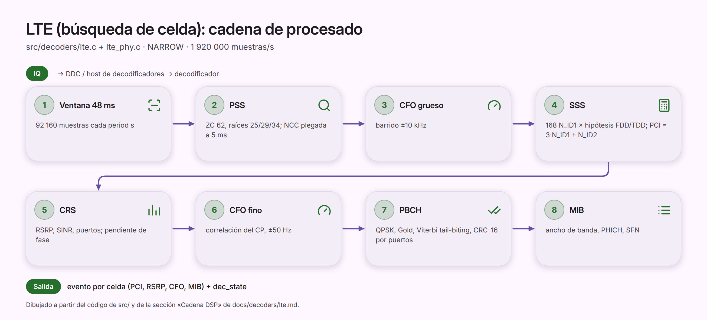
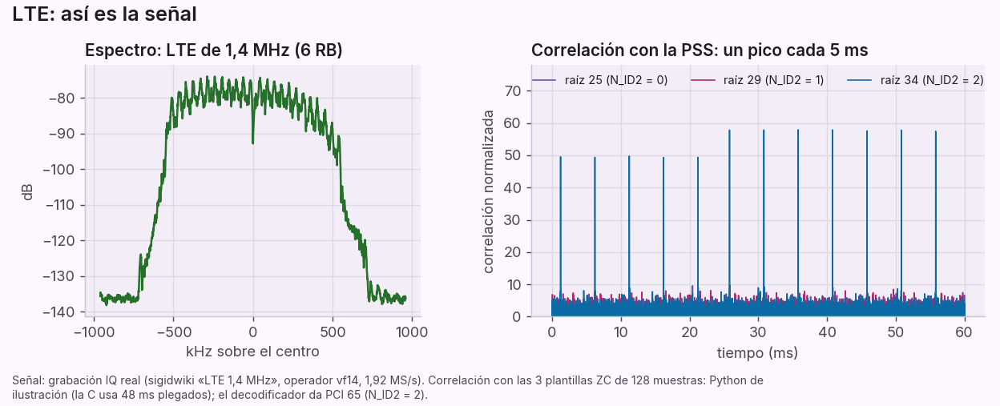
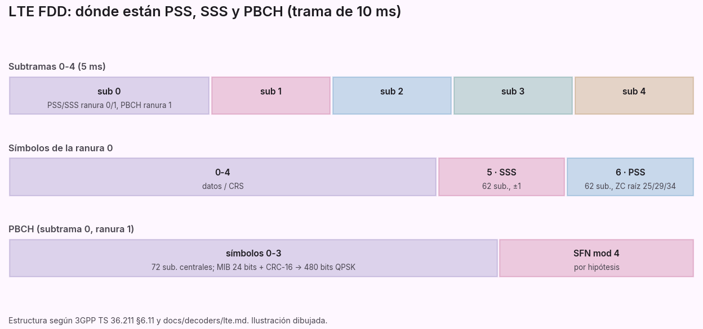

# Decodificador LTE (`lte`)

<!-- vision-rapida:inicio (generada por docs/img/src/doc_decoders.py) -->

## Visión rápida

<picture>
  <source media="(prefers-color-scheme: dark)" srcset="../img/decoders/lte-cadena-dark.png">
  
</picture>

*Figura. Cadena de procesado de LTE, dibujada a partir del código de `src/` y de la sección «Cadena DSP» de este documento.*

### Así es la señal

<picture>
  <source media="(prefers-color-scheme: dark)" srcset="../img/decoders/lte-pss-dark.png">
  
</picture>

*Figura. Espectro y picos de correlación con la PSS cada 5 ms (grabación real).*

<picture>
  <source media="(prefers-color-scheme: dark)" srcset="../img/decoders/lte-estructura-dark.png">
  
</picture>

*Figura. Posición de PSS, SSS y PBCH.*

La procedencia de cada señal (grabación real o sintética) y qué parte del procesado es Python de ilustración y no el código C se indican en el pie de cada imagen.

### Ejemplo de evento y de estado

Procedencia: grabación IQ real (sigidwiki «LTE 1,4 MHz»). Sacado de ejecutar el decodificador, no escrito a mano (`bladerf-lab --replay lte.sigmf-meta --decode lte@800000000 --print`).

Evento `dec` (campo `msg`, listas largas recortadas):

```json
{
  "text": "LTE PCI 65 (N_ID1 21, N_ID2 2) FDD CP normal, 1 puerto, CFO -0.01 kHz, RSRP -57.0 dBFS, SI…",
  "pci": 65,
  "n_id1": 21,
  "n_id2": 2,
  "duplex": "FDD",
  "cp": "normal",
  "ports": 1,
  "cfo_hz": -13,
  "rsrp_dbfs": -57.0,
  "sinr_db": 3.5,
  "rho": 0.39,
  "mib": true,
  "bw_rb": 6,
  "phich_duration": "normal",
  "phich_resource": 2,
  "sfn": 113,
  "bw_mhz": 1.4,
  "hits": 1
}
```

Último `dec_state` recibido por WebSocket (`state`, listas recortadas):

```json
{
  "windows": 14,
  "cells": [
    {
      "pci": 65,
      "n_id1": 21,
      "n_id2": 2,
      "duplex": "FDD",
      "cp": "normal",
      "ports": 1,
      "cfo_hz": -75,
      "rsrp_dbfs": -56.3,
      "sinr_db": -0.7,
      "rho": 0.44,
      "mib": true,
      "bw_rb": 6,
      "phich_duration": "normal",
      "phich_resource": 2,
      "sfn": 477,
      "bw_mhz": 1.4,
      "hits": 10,
      "age": 1.0
    }
  ]
}
```

<!-- vision-rapida:fin -->

Búsqueda de celdas LTE en un canal de 1,92 Msps (FFT de 128, subportadoras de 15 kHz): PCI, FDD/TDD,
prefijo cíclico, CFO, RSRP y SINR aproximadas, nº de puertos y MIB del PBCH (ancho de banda, PHICH y SFN).
Solo difusión: PSS, SSS, CRS y PBCH. Código: `src/decoders/lte.c`, secuencias y codificación del PBCH en
`src/decoders/lte_phy.{h,c}` (compartidas con el modulador `src/tx/mod_lte.c`). Test: `tests/test_lte.c`.

Descriptor: `N`, tasa 1 920 000 (exacta), `bw_hz` 1 500 000. Opción JSON: `{"period":s}` (segundos entre ventanas
de análisis, 1 s por defecto; 0 = analizar ventanas consecutivas, para pruebas).

## Teoría y cadena DSP

Referencias: 3GPP TS 36.211 (§6.11 PSS/SSS, §6.10 CRS, §6.6 PBCH, §6.12 OFDM, §7.2 Gold), TS 36.212 (§5.1.1 CRC,
§5.1.3.1 convolucional, §5.1.4.2 adaptación de velocidad, §5.3.1 PBCH), TS 36.331 (MIB); Nassralla, Mansour,
Jalloul, arXiv:1511.07316 (PSS por correlación con las 3 raíces ZC); Schmidl y Cox, IEEE Trans. Commun. 1997 (CFO).

1. **Ventana.** No se analiza de forma continua: se acumulan 48 ms (92 160 muestras) cada `period` s. Con 1 s el
   coste medido ≈ 0,04–0,12 s de CPU por s de señal.
2. **PSS.** Zadoff-Chu de 62 puntos en frecuencia (raíces 25, 29, 34 ↔ N_ID2 = 0, 1, 2), elemento DC eliminado,
   en el último símbolo de las ranuras 0 y 10 (FDD) o el 3.º de las subtramas 1 y 6 (TDD). Plantilla temporal de
   128 muestras; correlación por FFT con solape-guardado (16 384 puntos) con las 3 plantillas; normalizada
   `NCC[n] = |c[n]|²/Σ|x|²`. Como la PSS se repite cada 5 ms (9600 muestras) la NCC se *pliega* módulo 9600 y el
   estadístico es pico/media (umbral 6; en ruido ≈ 2,5). El pliegue se hace con 7 hipótesis de deriva de reloj
   (−100…+100 ppm) para que el error de reloj no emborrone el pico en 48 ms. Cada ocurrencia se refina por separado y
   una recta `t_i = a + P·i` da la fase y la razón de reloj real.
3. **CFO grueso.** Barrido ±10 kHz (paso 1 kHz, interpolación parabólica) de la correlación con la plantilla
   rotada en las posiciones de las PSS.
4. **SSS.** BPSK ±1 de 62 puntos (§6.11.2: m0, m1 a partir de N_ID1, secuencias s̃, c̃, z̃). Se prueban 4 hipótesis
   de rejilla (FDD/TDD × CP normal/extendido, separación SSS→PSS 137, 160, 412, 480 muestras) × 168 N_ID1 × 2
   (subtrama 0 o 5), con el canal medido en la PSS: `corr = Re Σ Y_sss·conj(H)·d_sss / norma`. La paridad
   de la ocurrencia se combina entre todas las PSS de la ventana. Umbral 0,30 (ruido: ≈ 0,19).
   **PCI = 3·N_ID1 + N_ID2.**
5. **CRS.** Con la trama fijada se correlaciona cada RE de CRS (puertos 0–3, rejilla N_ID mod 6, `c_init =
   2^10(7(ns+1)+l+1)(2N+1)+2N+N_CP`, índices m' = 104…115 para los 6 RB centrales con cualquier ancho de banda) y
   se estima la pendiente de fase (error de temporización) con `arg Σ H_m·conj(H_{m−1})`. Métrica de validación
   `ρ = |ΣH|²/(12 Σ|H|²)` (ruido ≈ 0,08; umbral 0,35). RSRP = potencia media de las CRS menos ruido (dBFS por RE,
   no dBm); SINR = potencia coherente / dispersión entre CRS vecinas (subestima con canal selectivo). Nº de puertos:
   ρ de los puertos 1, 2, 3 sobre 0,3.
6. **CFO fino.** Con la rejilla conocida, correlación del CP: `x[n]·conj(x[n+128])`, `f = −arg(·)·fs/(2π·128)`
   sobre la señal ya desrotada con el CFO grueso. Resultado típico ±50 Hz.
7. **PBCH.** Subtrama 0, ranura 1, símbolos 0–3, 72 subportadoras (240 REs con CP normal, 216 con extendido, sin
   los de CRS de 4 puertos). Canal por puerto interpolado de las CRS (frecuencia lineal, tiempo l = 0 → l = 4 o 3);
   1 puerto: MRC; 2 puertos: decodificación de Alamouti (SFBC). QPSK → desaleatorizado con Gold `c_init = N_ID`
   (índices 480·seg…) → de-adaptación de velocidad (3 corrientes × 40 bits, entrelazador de 32 columnas con el
   patrón `<1,17,9,25,…>` del convolucional) → Viterbi tail-biting r=1/3 (`conv_lte_k7_r3`) → CRC-16 enmascarado por
   puertos (0000…, 1111…, 0101…). Se prueban las 4 hipótesis `SFN mod 4`. MIB: `dl-Bandwidth(3) phich-Duration(1)
   phich-Resource(2) SFN(8) spare(10)`; **SFN = 4·sfn8 + (n_f mod 4)**.

## Eventos y estado

Un evento por celda nueva o cuyo duplexado, nº de puertos o ancho cambian, o cuya MIB se decodifica por primera
vez (no por trama ni por ventana):

```json
{"text":"LTE PCI 301 (N_ID1 100, N_ID2 1) FDD CP normal, 2 puertos, CFO +3.98 kHz, RSRP -33.1 dBFS, SINR 4.7 dB, MIB: 50 RB, PHICH norm/1, SFN 5",
 "pci":301,"n_id1":100,"n_id2":1,"duplex":"FDD","cp":"normal","ports":2,"cfo_hz":3983,"rsrp_dbfs":-33.1,
 "sinr_db":4.7,"rho":0.76,"mib":true,"bw_rb":50,"bw_mhz":10.0,"phich_duration":"normal","phich_resource":2,
 "sfn":5,"hits":1}
```

`phich_resource`: 0 = 1/6, 1 = 1/2, 2 = 1, 3 = 2. `state_json`: `{"windows":N,"cells":[{...mismos campos..., "age":s}]}`
con las celdas vistas en los últimos 120 s (16 como máximo). `air_ok = false`.

## Modulador

`{"pci":301,"cp":"normal|extended","duplex":"fdd|tdd","ports":1|2,"sfn":0,"frames":6,"bw_rb":50,"phich_res":2,
"phich_ext":0,"seed":1}`: PSS/SSS, CRS (puertos 0 y 1), PBCH real y relleno QPSK en el resto de REs; con 2 puertos se
suman las dos antenas tras un canal plano. `--gen lte --gen-freq F --gen-center F --gen-rate 1920000`.

## Pruebas (`tests/test_lte.c`)

Viaje de ida y vuelta modulador → AWGN 10 dB → CFO (0, ±7,5 kHz, +3…) → deriva de reloj (±100 ppm) → decodificador,
en FDD/TDD, CP normal/extendido, 1/2 puertos: PCI, puertos, ancho, PHICH y CFO (±400 Hz) correctos; solo ruido →
0 eventos; coste 0,04–0,12 s/s. Vectores publicados: ninguno disponible sin conexión; se comprueban las propiedades de PSS/SSS de la norma y la ida y vuelta del PBCH con errores de canal.
**No se ha contrastado con ninguna grabación real**.

## Limitaciones y constantes no verificadas

* El PBCH con **4 puertos** (SFBC + FSTD) no se decodifica (se informa `ports:4` sin MIB).
* Las constantes de la codificación del PBCH (patrón de columnas `<1,17,9,25,5,21,13,29,3,19,11,27,7,23,15,31,0,16,…>`,
  máscaras de CRC, orden de campos de la MIB) están transcritas de memoria de TS 36.212/36.331: se verifican solo por
  coherencia con el modulador, no con un vector publicado. La parte PSS/SSS/CRS sí cumple las propiedades de la norma.
* Solo los 6 RB centrales (1,08 MHz); no hay Doppler, ni multi-celda con la misma raíz y temporización, ni cuenta
  de RSRQ/RSSI.
* El mapeo SFBC de pares asume pares consecutivos de la lista de REs del PBCH, como el modulador.

## Validación con señal real (V2, 2026-11-15)

Grabaciones: sigidwiki.com `LTE_VF_1.4_downlink.zip` (1,4 MHz, IQ 8 bit a 1,25 MS/s, remuestreada a 1,92 MS/s) y
`LTE_OR_10_downlink.zip` (10 MHz, 10 MS/s, pasada por el DDC). Resultado: **PCI 65** (N_ID1 21, N_ID2 2, FDD, CP normal, 1 puerto,
MIB 6 RB, PHICH normal/1, SFN que avanza 498 tramas en 5 s: coherente) y **PCI 44** (N_ID1 14, N_ID2 2, 2 puertos, 50 RB). El CRC del PBCH solo
pasa si la codificación convolucional tail-biting, la adaptación de velocidad, el aleatorizado y la máscara de puertos son los de TS 36.212/36.211:
**las constantes del PBCH están confirmadas sin cambios**. Fixture: `tests/data/lte_sigid_vf14_1p92M.cs8` (192 kB).
Sin validar: TDD, CP extendido y SIB.
