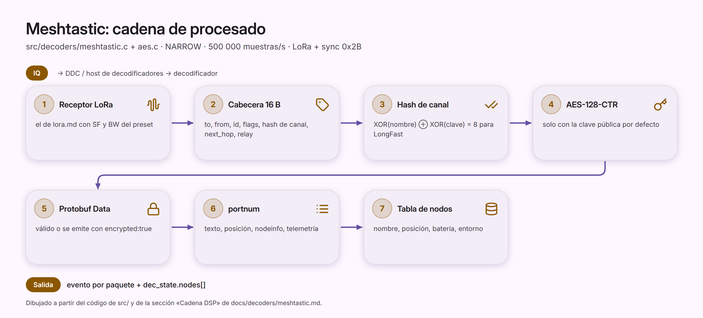
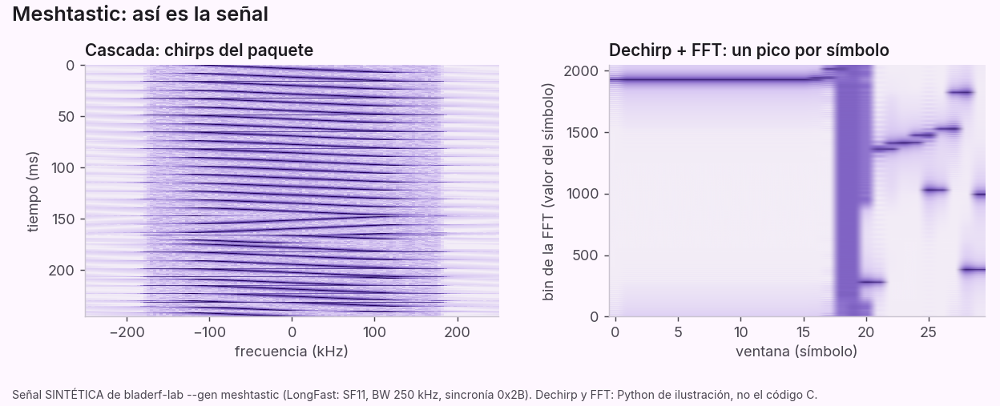
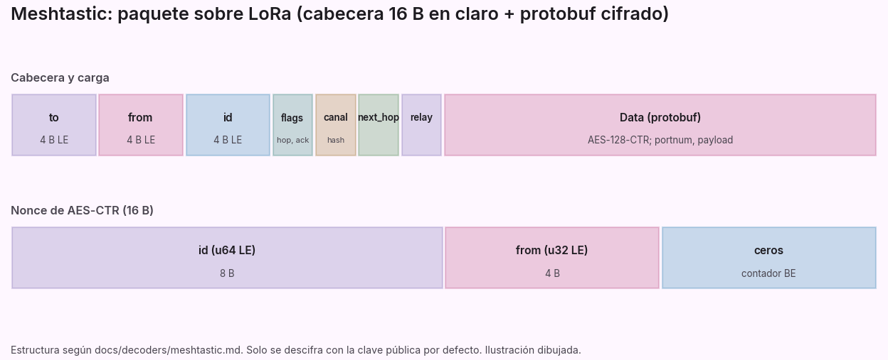

# Meshtastic (`meshtastic`)

<!-- vision-rapida:inicio (generada por docs/img/src/doc_decoders.py) -->

## Visión rápida

<picture>
  <source media="(prefers-color-scheme: dark)" srcset="../img/decoders/meshtastic-cadena-dark.png">
  
</picture>

*Figura. Cadena de procesado de Meshtastic, dibujada a partir del código de `src/` y de la sección «Cadena DSP» de este documento.*

### Así es la señal

<picture>
  <source media="(prefers-color-scheme: dark)" srcset="../img/decoders/meshtastic-senal-dark.png">
  
</picture>

*Figura. Cascada y picos tras el dechirp (SF11, BW 250 kHz). Señal sintética.*

<picture>
  <source media="(prefers-color-scheme: dark)" srcset="../img/decoders/meshtastic-estructura-dark.png">
  
</picture>

*Figura. Cabecera de 16 bytes y nonce de AES-CTR.*

La procedencia de cada señal (grabación real o sintética) y qué parte del procesado es Python de ilustración y no el código C se indican en el pie de cada imagen.

### Ejemplo de evento y de estado

Procedencia: señal sintética de `--gen meshtastic`. Sacado de ejecutar el decodificador, no escrito a mano (`bladerf-lab --replay meshtastic.sigmf-meta --decode meshtastic@869525000 --print`).

Evento `dec` (campo `msg`, listas largas recortadas):

```json
{
  "from": "!a1b2c3d4",
  "to": "^all",
  "to_id": 4294967295,
  "id": 439041024,
  "hop_limit": 3,
  "hop_start": 3,
  "want_ack": false,
  "via_mqtt": false,
  "channel": 8,
  "next_hop": 0,
  "relay": 212,
  "dup": false,
  "sf": 11,
  "bw": 250000,
  "snr": 32.3,
  "rssi": -2.0,
  "len": 53,
  "encrypted": false,
  "portnum": 4,
  "port": "NODEINFO_APP",
  "long_name": "BladeRF Lab",
  "short_name": "BLDR",
  "hw_model": 255,
  "text": "BLDR → ^all: nodeinfo «BladeRF Lab» (BLDR)"
}
```

Último `dec_state` recibido por WebSocket (`state`, listas recortadas):

```json
{
  "sf": 11,
  "bw": 250000,
  "packets": 19,
  "decrypted": 19,
  "encrypted": 0,
  "dups": 15,
  "nodes": [
    {
      "id": "!a1b2c3d4",
      "short_name": "BLDR",
      "long_name": "BladeRF Lab",
      "lat": 40.4168,
      "lon": -3.7038,
      "alt": 667,
      "battery": 87,
      "voltage": 4.01,
      "packets": 19,
      "rssi": -2.0,
      "snr": 31.7,
      "hops": 0,
      "age": 0
    }
  ]
}
```

<!-- vision-rapida:fin -->

Decodificador NARROW a 500 kS/s (`src/decoders/meshtastic.c`, utilidades en
`meshtastic.h`, AES en `aes.{h,c}`, capa física en `lora_phy.{h,c}`; modulador
`src/tx/mod_meshtastic.c`).

## Capa de radio

Presets de módem (meshtastic.org/docs/overview/radio-settings, comprobado en
línea): LongFast SF11/BW 250 kHz/CR 4/5 (**por defecto**), LongModerate
SF11/125 kHz/4/8, MediumFast SF9/250/4/5, MediumSlow SF10/250/4/5, ShortFast
SF7/250/4/5, ShortSlow SF8/250/4/5. LongSlow (SF12/125/4/8) es un valor histórico
no verificado en esa página; los Turbo (500 kHz) no caben en 500 kS/s. En UE_868 el
canal por defecto es LongFast en 869,525 MHz. Preámbulo de 16 símbolos
(`RadioInterface.h`) y palabra de sincronía 0x2B (conocimiento del proyecto; la
documentación no la lista). El receptor LoRa es el de `lora.md`, con BW y SF fijos
por el preset y `sync = 0x2B`.

## Paquete

Cabecera de 16 bytes en claro (`RadioInterface.h`): `to`(4 LE), `from`(4 LE),
`id`(4 LE), `flags`(1: hop_limit bits 0–2, want_ack 0x08, via_mqtt 0x10,
hop_start bits 5–7), hash de canal(1), `next_hop`(1), `relay_node`(1). Después, el
protobuf `Data` cifrado.

**Cifrado** (`CryptoEngine.cpp`, `Channels.cpp`): AES-128-CTR; nonce de 16 bytes =
`id` como u64 little-endian (8 B) | `from` u32 LE | 4 bytes a 0; contador
gran-endian en los 4 últimos bytes. El PSK por defecto "AQ==" es un solo byte
0x01 = "clave por defecto, índice 1", es decir los 16 bytes
`d4 f1 bb 3a 20 29 07 59 f0 bc ff ab cf 4e 69 01`. El hash de canal es
XOR(nombre) ⊕ XOR(clave); para "LongFast" con esa clave vale **8**, lo que sirve
de comprobación cruzada de la clave (test). AES se valida con FIPS-197 y NIST SP
800-38A (`tests/test_aes.c`).

**Solo se descifra con esta clave pública por defecto** (AGENTS.md §0.12). Un
paquete se considera descifrado únicamente si el protobuf resultante es válido
(tipos de cable correctos, consumo exacto, portnum conocido); si no, se emite con
`"encrypted":true` sin contenido (otra clave, canal privado, MD directos con
PKC…).

**Data** (campos del `.proto`): portnum=1, payload=2, want_response=3,
dest=4, source=5, request_id=6, reply_id=7, emoji=8, bitfield=9.
Mensajes internos interpretados:
`TEXT_MESSAGE_APP` (1: UTF-8), `POSITION_APP` (3: latitude_i/longitude_i en 1e-7°,
altitude, time, sats_in_view=19), `NODEINFO_APP` (4: long_name, short_name,
hw_model) y `TELEMETRY_APP` (67: device_metrics batería/tensión/uso de canal/uptime;
environment_metrics temperatura/humedad/presión). Otros portnums conocidos se
muestran por nombre.

## Opciones

`{"preset":"LONG_FAST"}` (o `"sf"` y `"bw"` sueltos).

## Evento

```json
{"from":"!a1b2c3d4","to":"^all","to_id":4294967295,"id":1000,"hop_limit":3,
 "hop_start":3,"want_ack":false,"via_mqtt":false,"channel":8,"next_hop":0,
 "relay":212,"dup":false,"sf":11,"bw":250000,"snr":9.0,"rssi":-2.1,"len":41,
 "encrypted":false,"portnum":3,"port":"POSITION_APP","lat":40.4168,"lon":-3.7038,
 "alt":667,"text":"BLDR → ^all: posición 40.41680, -3.70380"}
```
Texto: `"msg"`. NodeInfo: `long_name`, `short_name`, `hw_model`. Telemetría:
`battery`, `voltage`, `channel_util`, `air_util_tx`, `uptime`, `temperature`…
`dup:true` marca reenvíos del mismo (from, id) en 10 min (la malla retransmite).

## state_json

`{"sf","bw","packets","decrypted","encrypted","dups","nodes":[{"id":"!a1b2c3d4",
"short_name","long_name","lat","lon","alt","battery","voltage","temperature",
"packets","rssi","snr","hops","age"}]}`. Los nodos con `lat`/`lon` se dibujan en
el mapa; caducan a las 2 h (256 nodos máx.).

## Modulador

`{"src":"!a1b2c3d4","dst":"ffffffff","id":1000,"hops":3,"kinds":["nodeinfo",
"position","text","telemetry"],"text":"…","lat","lon","alt","long_name",
"short_name","battery","voltage","preset":"LONG_FAST"}`. El nodo de origen se fija
con `src`. La secuencia por defecto dura ≈ 3 s. `air_ok = true` (SRD 868,
869,4–869,65 MHz para LongFast EU).

## Referencias

Meshtastic: documentación (radio-settings, encryption) y firmware (`CryptoEngine.cpp`,
`Channels.cpp`, `RadioInterface.h`); protobufs `mesh.proto`, `telemetry.proto`
(números de campo recordados; solo se interpretan los listados). LoRa: ver `lora.md`.

## Limitaciones

- Sin capturas reales con bytes verificados: pruebas con el modulador propio. Las
  incertidumbres de la capa LoRa de `lora.md` se heredan.
- No se interpretan Routing/Admin/Traceroute/MapReport (solo se nombra el portnum).
- Mensajes directos con cifrado de clave pública (PKC, firmware ≥ 2.5) y canales
  con clave propia se muestran como cifrados.
- Un solo preset por instancia; para otro preset o canal hay que añadir otra instancia.

## Validación (V2, 2026-11-15)

* `lorarx -H 4` (instalado; solo se ejecuta) decodifica nuestras tramas (`--gen meshtastic`, SF11/BW 250) y muestra
  `Dest`, `SRC`, `MID`, `HopLim`, `HopStart`, **`Hash:08`**, `NextHop`, `RelayNode`: la cabecera de 16 bytes y el hash de canal (8)
  **coinciden** con lo que interpreta la referencia. Sync 0x2B no hay que cambiarlo (decodifica con el id de red 0x2B).
* La clave por defecto `d4f1bb3a20290759f0bcffabcf4e6901` (AQ== → índice 1) coincide con fuentes públicas independientes
  (documentación/gists); el nonce `id u64 LE | from u32 LE | 4 ceros` también (dos fuentes; una usa solo 32 bits del id).
* **Sin validar**: el descifrado y los campos del protobuf contra tráfico real (no hay captura con bytes verificados; `lorarx` no
  descifra). Las mejoras de LoRa (`lora.md`) se heredan: SF7-SF11/BW 250 ya decodifican las tramas de `loratx`.
