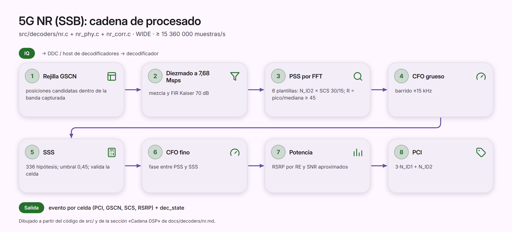
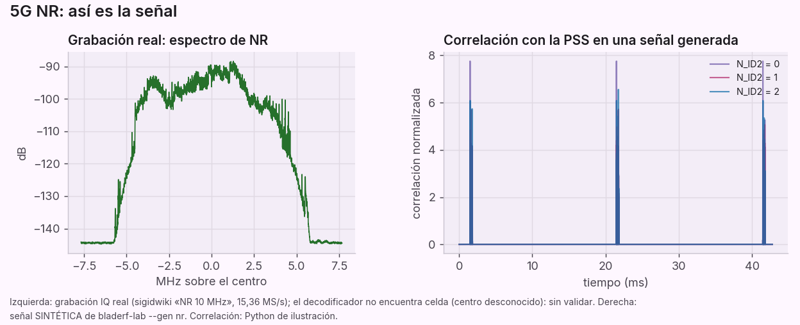
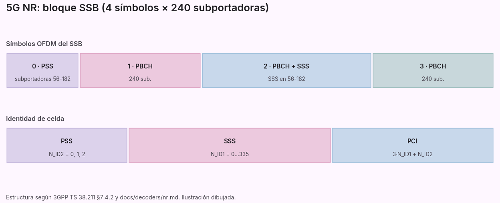
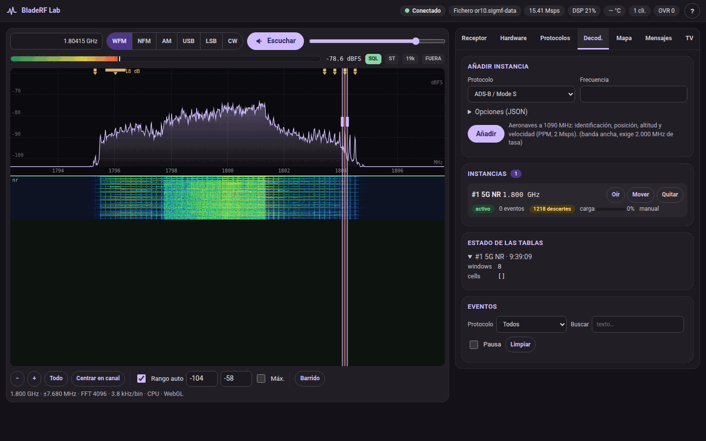

# Decodificador 5G NR (`nr`)

<!-- vision-rapida:inicio (generada por docs/img/src/doc_decoders.py) -->

## Visión rápida

<picture>
  <source media="(prefers-color-scheme: dark)" srcset="../img/decoders/nr-cadena-dark.png">
  
</picture>

*Figura. Cadena de procesado de NR, dibujada a partir del código de `src/` y de la sección «Cadena DSP» de este documento.*

### Así es la señal

<picture>
  <source media="(prefers-color-scheme: dark)" srcset="../img/decoders/nr-pss-dark.png">
  
</picture>

*Figura. Espectro de la grabación real y correlación con la PSS en una señal generada.*

<picture>
  <source media="(prefers-color-scheme: dark)" srcset="../img/decoders/nr-estructura-dark.png">
  
</picture>

*Figura. Bloque SSB e identidad de celda.*

La procedencia de cada señal (grabación real o sintética) y qué parte del procesado es Python de ilustración y no el código C se indican en el pie de cada imagen.

### Ejemplo de evento y de estado

Procedencia: grabación IQ real (sigidwiki «NR 10 MHz»): no aparece ninguna celda, así que no hay evento. Sacado de ejecutar el decodificador, no escrito a mano (`bladerf-lab --replay nr.sigmf-meta --decode nr --print`).

Esta grabación no produce ningún evento `dec`.

Último `dec_state` recibido por WebSocket (`state`, listas recortadas):

```json
{
  "windows": 2,
  "cells": []
}
```

### En la web



*Captura de la interfaz con un servidor `--replay` propio mostrando NR.*

<!-- vision-rapida:fin -->

Búsqueda de bloques SS/PBCH (SSB) en la rejilla GSCN que cae dentro de la captura: PSS/SSS → PCI (0–1007),
SCS (15/30 kHz), CFO, potencia. **Sin PBCH (polar)**: no se decodifica la MIB ni el índice de SSB. Código:
`src/decoders/nr.c`, secuencias y GSCN en `nr_phy.{h,c}`, correlación en `nr_corr.{h,c}` (aislada para C1), modulador
`src/tx/mod_nr.c`, test `tests/test_nr.c`.

Descriptor: `W`, tasa libre ≥ 15 360 000 pero **múltiplo entero de 7,68 Msps** (15,36 … 61,44; otras tasas →
`create` falla con un texto claro). Opción JSON: `{"period":s}` (por defecto `max(2, 0,4·nº de GSCN)` s).

## Teoría y cadena DSP

Referencias: 3GPP TS 38.211 §7.4.2 (PSS, SSS, estructura del SSB), TS 38.104 §5.4.3 (GSCN), TS 38.213 §4.1;
Kim et al., arXiv:2603.29341 (búsqueda por GSCN, solo resumen); *5G NR overview*, arXiv:1806.06898 (PSS: m-secuencia
de 127; SSB: 240 subportadoras × 4 símbolos); técnica de correlación masiva por FFT compartiendo la FFT de la señal
(E38 de `docs/INVESTIGACION.md`).

* PSS: `d(n) = 1 − 2x((n + 43·N_ID2) mod 127)`, `x(i+7) = x(i+4) ⊕ x(i)`, `x(0..6) = 0110111` (listado
  `x(6)…x(0) = 1110110`). SSS: `d(n) = [1 − 2x0((n+m0) mod 127)]·[1 − 2x1((n+m1) mod 127)]`, `m0 = 15⌊N_ID1/112⌋ +
  5N_ID2`, `m1 = N_ID1 mod 112`, `x0(i+7) = x0(i+4)⊕x0(i)`, `x1(i+7) = x1(i+1)⊕x1(i)`, `x(0) = 1`. **PCI = 3·N_ID1 +
  N_ID2.** Ambas ocupan las subportadoras 56…182 del SSB, centradas en la 120 = SS_REF = frecuencia del GSCN.
* GSCN: `N·1,2 MHz + {50,150,250} kHz` (< 3 GHz), `3 GHz + N·1,44 MHz` (3–24,25 GHz), `24,25008 GHz + N·17,28 MHz`.

Por cada posición candidata f_g dentro de `centro ± (fs/2 − 2,6 MHz)`:
1. Mezclado a banda base y diezmado a 7,68 Msps (FIR de Kaiser, paso ±2,4 MHz, 70 dB).
2. `nr_corr_run()`: correlación normalizada por FFT (solape-guardado, 8192 puntos) con **6 plantillas** = PSS
   N_ID2 {0,1,2} × SCS {30, 15 kHz} (longitudes 256 y 512). Estadístico `R = pico / mediana` de la NCC (mediana
   submuestreada). Umbral `R ≥ 45`: en ruido blanco el máximo de ≈ 2·10^5 muestras llega a ≈ 17×.
3. CFO grueso: barrido ±15 kHz (paso 2,5 kHz, parábola) de la correlación con la plantilla rotada.
4. SSS: FFT de 256/512 puntos de los símbolos 0 y 2 (separados 2·(N+CP), CP = N·9/128), equalización con el canal
   de la PSS y correlación real con las 336 hipótesis. Umbral 0,45 (ruido ≲ 0,27). El SSS valida de verdad la celda
   (los GSCN vecinos que ven parte de la PSS no pasan).
5. CFO fino: `arg Σ H_sss·conj(H_pss)` entre ambos símbolos (separados 2(N+CP)/7,68 M s); el barrido grueso resuelve
   la ambigüedad de ±7 kHz (30 kHz) o ±3,5 kHz (15 kHz).
6. Potencia: `mean|Y_sss|²/N²` menos el ruido por RE (percentil 20 de la energía por bloques de 256 muestras, /0,95).
   `rsrp_dbfs` es por RE y aproximado; `snr_db` subestima (el ruido medido a 7,68 Msps incluye la caída del FIR).

### Interfaz de correlación para GPU (C1)

```c
nr_corr_t *nr_corr_create(int nfft, int nt, const cf32 *const *tmpl, const int *tlen);
int nr_corr_run(nr_corr_t *c, const cf32 *x, int n, float *out);   /* out[t*nout+i], nout = n − max(tlen) + 1 */
```
Una señal, `nt` ≤ 8 plantillas de energía unidad; salida `|Σ x[i+k]·conj(p_t[k])|² / (Σ|x|² + ε)`. Basta
reimplementar estas dos funciones en `src/gpu/` (una FFT de la señal por bloque, `nt` IFFT, kernel de módulo²/energía
con la suma acumulada de |x|²). El resto (`channelize`, `verify_ssb`) es barato.

## Eventos y estado

Un evento por (PCI, GSCN) nuevo o cuyo SCS cambia:

```json
{"text":"5G NR PCI 321 (N_ID1 107, N_ID2 0) en 3499.68 MHz, SCS 30 kHz, CFO -0.00 kHz, RSRP -41.2 dBFS, SNR 8.4 dB",
 "pci":321,"n_id1":107,"n_id2":0,"freq_hz":3499680000,"scs_khz":30,"cfo_hz":-0,"rsrp_dbfs":-41.2,"snr_db":8.4,
 "sss_corr":0.88,"hits":1}
```
`state_json`: `{"windows":N,"cells":[{...,"age":s}]}` (caduca a 120 s, 32 celdas). `air_ok = false`.

## Modulador

`{"pci":321,"scs":30|15,"rate":15360000,"nssb":2,"periods":3,"period_ms":20,"start_ms":1.5,"seed":1}`: SSB con PSS, SSS y
relleno QPSK aleatorio en el PBCH (sin polar ni DMRS), ráfagas cada 20 ms, SSB centrado en 0 Hz (SS_REF). Ejemplo
de extremo a extremo:
`bladerf-lab --gen nr --gen-params '{"pci":321,"periods":3}' --gen-freq 3499680000 --gen-center 3500000000 --gen-rate 15360000 --out x`
y `bladerf-lab --replay x.sigmf-meta --decode nr@3500000000 --print --duration 5`.

## Pruebas y coste

AWGN 10 dB, CFO (0, ±7,5, +4, −3, +2,5 kHz), deriva ±100 ppm, SCS 30 y 15 kHz, 15,36 y 30,72 Msps: PCI, GSCN, SCS y
CFO (±600 Hz) correctos; solo ruido → 0 eventos; tasa 20 Msps rechazada. Propiedades de las secuencias (m-secuencia,
autocorrelación −1, desplazamiento 43) y GSCN. Coste a 15,36 Msps ≈ 0,06 s de CPU por posición y ventana: 0,16 s/s con
el periodo automático (7 posiciones → 2,8 s). **No contrastado con grabaciones reales.**

## Limitaciones

Sin PBCH/MIB/índice de SSB; SSB con periodicidad > 20 ms pueden perderse en una ventana de 25 ms; solo FR1 y SCS
15/30 kHz; tasas múltiplo de 7,68 Msps; a 61,44 Msps y GSCN < 3 GHz (≈ 40 posiciones) el periodo automático es de 16 s.
Las constantes de PSS/SSS (estados iniciales de los LFSR, m0/m1) son de memoria de TS 38.211 y se validan por las
propiedades de m-secuencia y por coherencia con el modulador.

## Intento de validación (V2, 2026-11-15) — sin validar

Se probaron sigidwiki.com `NR_OR_10_downlink.zip` (10 MHz FDD, 10 MS/s) y `NR_4ka_40_downlink.zip` (18 MS/s). No se conoce la frecuencia central
real; con 6 centros candidatos (1800 MHz + k·150 kHz, remuestreo a 15,36 MS/s) no apareció ninguna celda, y una búsqueda independiente de PSS por
correlación no fue concluyente. **PSS/SSS de NR siguen sin contrastar con aire real.**
