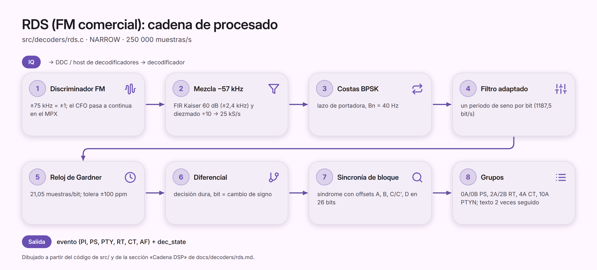
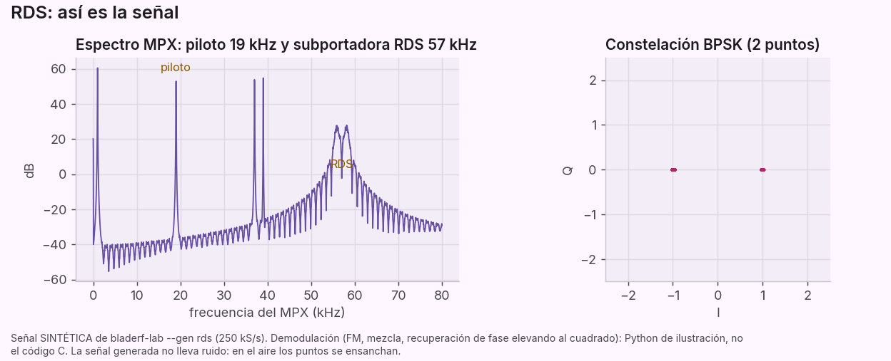
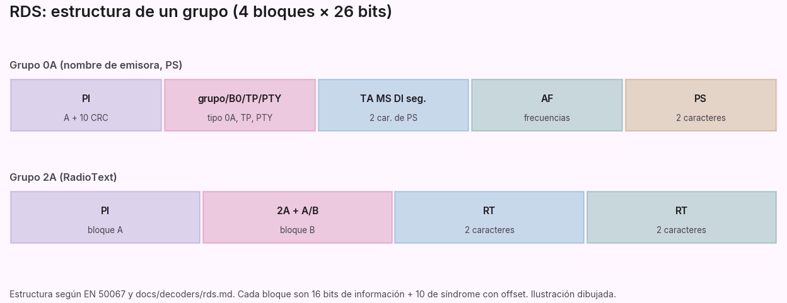
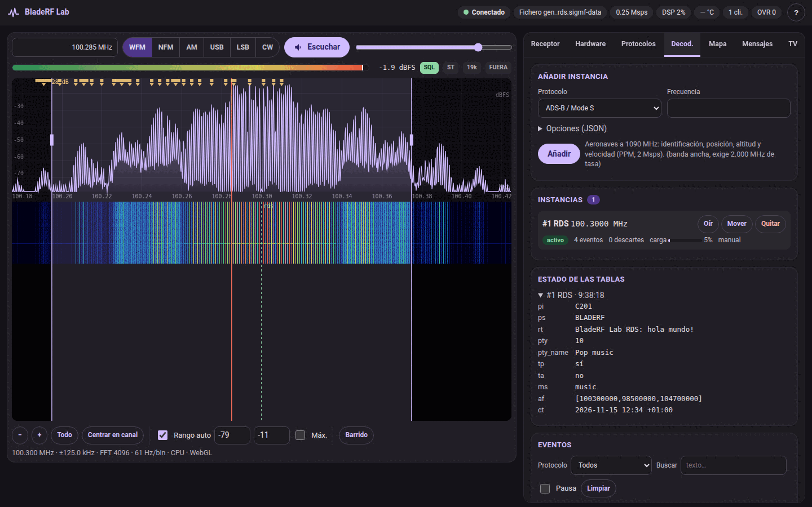

# RDS (Radio Data System) — `src/decoders/rds.c`, `src/tx/mod_rds.c`

<!-- vision-rapida:inicio (generada por docs/img/src/doc_decoders.py) -->

## Visión rápida

<picture>
  <source media="(prefers-color-scheme: dark)" srcset="../img/decoders/rds-cadena-dark.png">
  
</picture>

*Figura. Cadena de procesado de RDS, dibujada a partir del código de `src/` y de la sección «Cadena DSP» de este documento.*

### Así es la señal

<picture>
  <source media="(prefers-color-scheme: dark)" srcset="../img/decoders/rds-senal-dark.png">
  
</picture>

*Figura. Espectro MPX con piloto y subportadora de 57 kHz, y constelación BPSK. Señal sintética.*

<picture>
  <source media="(prefers-color-scheme: dark)" srcset="../img/decoders/rds-estructura-dark.png">
  
</picture>

*Figura. Estructura de los grupos 0A y 2A.*

La procedencia de cada señal (grabación real o sintética) y qué parte del procesado es Python de ilustración y no el código C se indican en el pie de cada imagen.

### Ejemplo de evento y de estado

Procedencia: señal sintética de `--gen rds` (RDS real validado aparte con `redsea`, sin grabación IQ). Sacado de ejecutar el decodificador, no escrito a mano (`bladerf-lab --replay rds.sigmf-meta --decode rds@100300000 --print`).

Evento `dec` (campo `msg`, listas largas recortadas):

```json
{
  "kind": "pi",
  "pi": "C201",
  "pty": 0,
  "pty_name": "None",
  "text": "PI C201"
}
```

Último `dec_state` recibido por WebSocket (`state`, listas recortadas):

```json
{
  "pi": "C201",
  "ps": "BLADERF",
  "rt": "BladeRF Lab RDS: hola mundo!",
  "pty": 10,
  "pty_name": "Pop music",
  "tp": true,
  "ta": false,
  "ms": "music",
  "af": [
    100300000,
    98500000,
    "… (1 más)"
  ],
  "ct": "2026-11-15 12:34 +01:00"
}
```

### En la web



*Captura de la interfaz con un servidor `--replay` propio mostrando RDS.*

<!-- vision-rapida:fin -->

Decodificador NARROW a 250 000 S/s complejos (DDC con filtro de 200 kHz). El perfil
`fm` lo crea con `follow:true`: al cambiar de emisora la interfaz envía `dec_tune`.

## Teoría

La señal multiplex (MPX) de una emisora FM es: L+R (0–15 kHz), piloto de 19 kHz,
L−R en DSB-SC a 38 kHz (23–53 kHz) y RDS: subportadora de 57 kHz (= 3 × piloto)
modulada en BPSK a 1187,5 bit/s (= 19 000/16). Cada bit va en **bifase**
(Manchester: pulso "+ −") tras una **codificación diferencial** (b'[k] = b[k] XOR
b'[k−1]), de modo que la ambigüedad de 180° de la portadora recuperada es inocua.

Un grupo son 4 bloques de 26 bits (16 de datos + 10 de control). El código es
cíclico (26,16) con g(x) = x¹⁰+x⁸+x⁷+x⁵+x⁴+x³+1 (0x5B9); la palabra de control es
`rem(m(x)·x¹⁰, g) XOR offset`, con offsets A=0x0FC, B=0x198, C=0x168, C'=0x350,
D=0x1B4. El resto de la palabra recibida es el offset: eso da la sincronía de bloque.

## Cadena DSP

1. Discriminador FM (`fmdisc`, ±75 kHz = ±1). Cualquier CFO del canal pasa a ser
   una continua en el MPX: **no hace falta estimar el CFO** (probado con ±50 kHz).
2. Mezcla a −57 kHz, FIR de Kaiser de 60 dB (pasa ±2,4 kHz, rechaza desde ±4 kHz
   para eliminar el L−R que llega a 53 kHz) con diezmado ÷10 → 25 kS/s.
3. Costas BPSK (`sync.h`, Bn = 40 Hz).
4. Filtro adaptado (un periodo de seno por bit) + reloj de Gardner (`symsync`,
   21,05 muestras/bit; tolera ±100 ppm con holgura).
5. Decisión dura + diferencial. 6. Sincronía de bloque (dos síndromes de offset a
   26 bits con secuencia A→B→C|C'→D; se pierde con ≥ 20 malos de 32 o 12 seguidos).
7. Corrección de ráfagas opcional (`opts {"fec":N}`, N ≤ 5; por defecto 0): tabla
   síndrome→patrón sobre el offset esperado, descartando síndromes ambiguos. Con N
   alto aumentan las falsas correcciones (redsea usa N = 2).
8. Grupos 0A/0B (PS, TA, MS, DI, AF método A y B), 2A/2B (RadioText con flag A/B y
   terminador 0x0D), 4A (CT: MJD, hora UTC y desfase en medias horas), 10A (PTYN);
   PTY con la tabla europea (EN 50067 anexo F). Cada segmento de texto debe llegar
   dos veces seguidas igual; TP/PTY también; el PI debe verse 2 veces (un PI nuevo
   reinicia PS, RT, AF… → resincronización rápida tras cambiar de emisora).

## Eventos y estado

Evento (uno por cambio): `{"kind":"pi|ps|rt|ptyn|ct","pi":"C201","pty":10,
"pty_name":"Pop music","ps":"BLADERF","text":"PS \"BLADERF\" (PI C201)"}` (la clave
del valor es `ps`, `rt`, `ptyn` o `ct` según el tipo).

`state_json` (campos fijados en AGENTS.md §8, sin añadir ninguno):
`{"pi","ps","rt","pty","pty_name","tp","ta","ms","af":[Hz],"ct"}`:
`pi` hex de 4 dígitos; `ps`/`rt` sin espacios finales; `pty` 0..31; `tp`/`ta`
booleanos; `ms` = `"music"|"speech"|""`; `af` en Hz (solo VHF; LF/MF no se
interpretan); `ct` = hora local `"AAAA-MM-DD HH:MM ±HH:MM"`. Caduca: 30 s sin ningún
grupo válido → cadenas vacías, `pty` 0, `af` [].

Los textos se pasan de EBU Latin a UTF-8 (ASCII tal cual en 0x20–0x7E; 0x80–0xFF
con la tabla de TS 101 756 anexo C, tomada de welle.io).

## Modulador (`modulate`, 250 kS/s, `air_ok=false`)

MPX = tono de audio (mono + L−R DSB) + piloto + RDS (bifase diferencial sobre
cos 3ϑ, todo enganchado a la fase del piloto) → FM (±75 kHz). Parámetros: `pi`,
`ps`, `rt`, `pty`, `tp`, `ta`, `ms`, `af` (Hz), `ct` (`"AAAA-MM-DD HH:MM"`),
`ct_off`, `seconds`, `audio_hz`, `audio_level`, `pilot`, `rds_level`, y `groups`
(grupos literales de 16 hex para reproducir vectores reales).

## Pruebas (`tests/test_rds.c`)

* Constantes del código contra la matriz H de EN 50067 anexo B (copiada de redsea):
  los 5 síndromes salen idénticos (0x3D8, 0x3D4, 0x25C, 0x3CC, 0x258) con nuestro
  generador y offsets. MJD 49273 = 1993-10-13 (ejemplo de EN 300 468).
* Síntesis: limpio, 30 y 20 dB, CFO ±50 kHz, ±100 ppm → PI, PS, RT, PTY, TP, MS, AF,
  CT correctos; tono de audio de 15 kHz; `fec:2`; cambio de emisora (PI nuevo).
* Solo ruido (20 s) → 0 eventos; caducidad del estado.
* **Vectores reales** (grupos de emisoras reales publicados en
  `test/components-hex.cc` de redsea, https://github.com/windytan/redsea): YLE X3M
  (PS, PTY, TA, AF), JACK 96.9 (RT método A), Radio Krka (RT grupo 2B), BR-KLASSIK y
  98.5 KFOX (CT con desfase +02:00 y −07:00), PI 3ABC (PTYN). Se pasan por el
  modulador (que añade CRC y offsets) y por toda la cadena de señal.
* Coste ≈ 0,02–0,09 s de CPU por s de señal (límite 0,3).

## Sensibilidad (limitación importante)

Con CNR medida en toda la banda de 250 kHz, el RDS se decodifica completo a ≥ 18–20 dB
(PS+RT en 20 s), parcialmente a 14–16 dB y **no se decodifica a 10 dB**: a 10 dB la FM
está por debajo de su umbral y el ruido del discriminador crece con f², de modo que
a 57 kHz la relación señal/ruido de RDS (≈ 4 dB por bit) deja ~0 bloques válidos de
cada 100. No es un defecto de la cadena sino de física (el requisito genérico de
"AWGN 10 dB" no es alcanzable para RDS tras un discriminador). En 10 dB se exige solo
que lo decodificado sea correcto. Se podría mejorar con un demodulador coherente de
RF (PLL sobre la señal compleja) pero queda fuera del alcance.

## Limitaciones y constantes no verificadas

* No hay ODA (RT+, TMC), EON ni grupos 1A, 3A, 14A, 15B: se descartan.
* Los vectores reales entran como datos de grupo ya demodulados; no se dispone de una
  captura de IQ real de FM con RDS en este entorno, por lo que la cadena de
  demodulación se valida solo con señal sintética.
* Tabla de caracteres de RDS: se usa la EBU Latin de DAB (0x24 se emite como "$" por
  compatibilidad ASCII; la norma de RDS define 0x24 = "¤").
* `chan_drift()` de `tests/test_util.h` (A1) reserva n+8 muestras y se desborda con
  ppm > 0 y n grande; este test usa `chan_resample` con su propio búfer.

## Validación cruzada (V1, 2026-11-15)

La salida de `--gen rds` (MPX demodulado a 250 ksps) la decodifica **redsea** (referencia
instalada): PI 0xC201, grupos 0A/2A, PTY, AF y DI coinciden con los del modulador, de modo que las
palabras de desplazamiento, el CRC y la modulación son correctos. Además el orquestador captó RDS
real con el bladeRF (Radio Pamplona, 100,4 MHz: PI E239, PS "SER", RT correcto) y los tests de
`tests/test_rds.c` usan vectores reales públicos.
