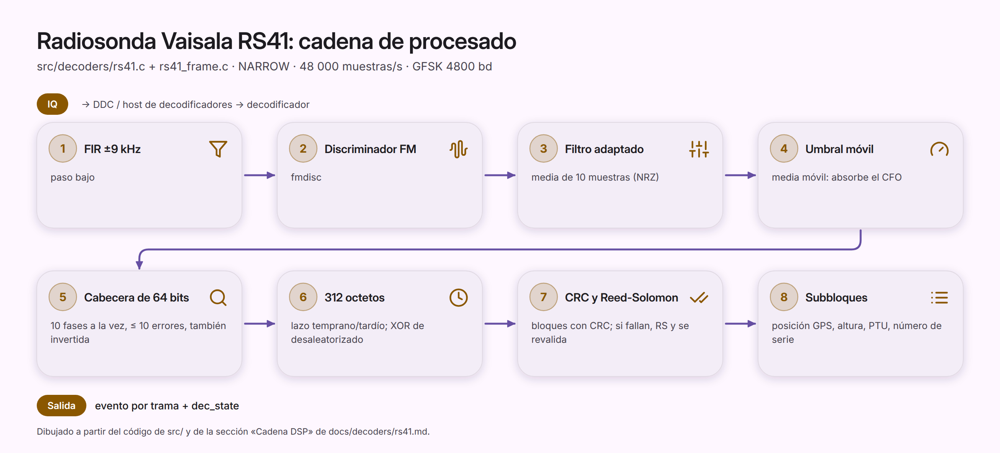
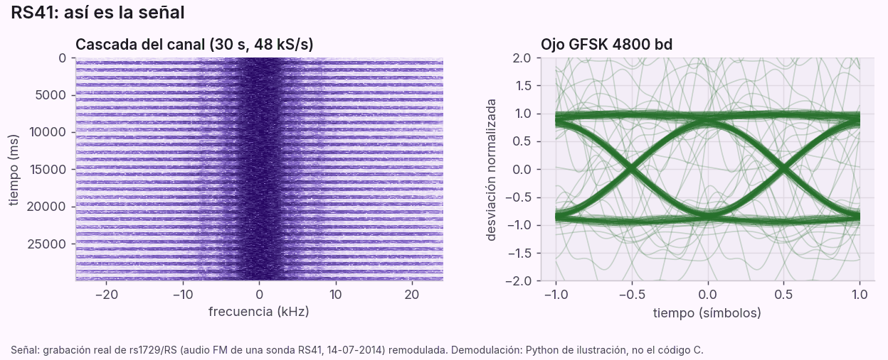
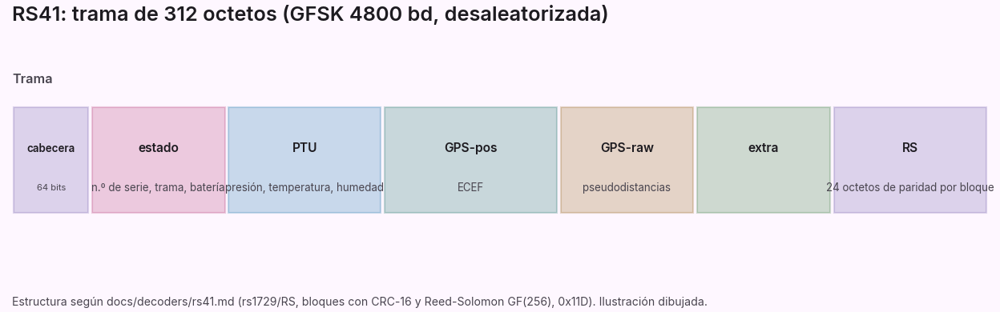
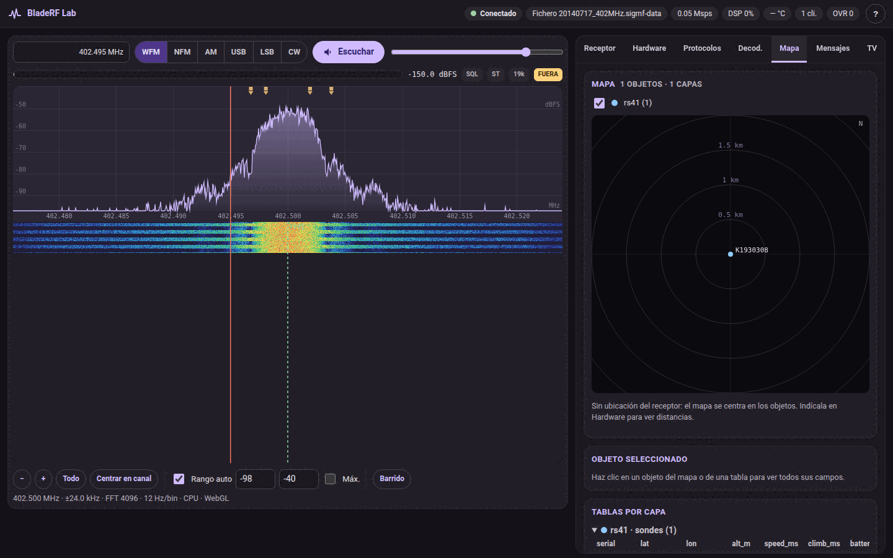

# Radiosonda Vaisala RS41 — `rs41`

<!-- vision-rapida:inicio (generada por docs/img/src/doc_decoders.py) -->

## Visión rápida

<picture>
  <source media="(prefers-color-scheme: dark)" srcset="../img/decoders/rs41-cadena-dark.png">
  
</picture>

*Figura. Cadena de procesado de RS41, dibujada a partir del código de `src/` y de la sección «Cadena DSP» de este documento.*

### Así es la señal

<picture>
  <source media="(prefers-color-scheme: dark)" srcset="../img/decoders/rs41-senal-dark.png">
  
</picture>

*Figura. Cascada y diagrama de ojo GFSK 4800 bd de la grabación real.*

<picture>
  <source media="(prefers-color-scheme: dark)" srcset="../img/decoders/rs41-estructura-dark.png">
  
</picture>

*Figura. Trama de 312 octetos.*

La procedencia de cada señal (grabación real o sintética) y qué parte del procesado es Python de ilustración y no el código C se indican en el pie de cada imagen.

### Ejemplo de evento y de estado

Procedencia: audio FM real de rs1729/RS (sonda RS41, 2014) remodulado. Sacado de ejecutar el decodificador, no escrito a mano (`bladerf-lab --replay rs41.sigmf-meta --decode rs41@402500000 --print`).

Evento `dec` (campo `msg`, listas largas recortadas):

```json
{
  "serial": "K1930308",
  "frame": 5047,
  "battery_v": 2.7,
  "gps_week": 1801,
  "gps_tow_ms": 390733999,
  "lat": 45.66939,
  "lon": 15.87963,
  "alt_m": 28527.2,
  "speed_ms": 9.8,
  "heading_deg": 252,
  "climb_ms": 6.1,
  "sats": 9,
  "ptu_raw": [
    16656386,
    15132929,
    "… (4 más)"
  ],
  "blocks_ok": 5,
  "rs_fixed": 0,
  "text": "RS41 K1930308  trama 5047  45.6694° 15.8796°  28527 m  +6.1 m/s  2.7 V"
}
```

Último `dec_state` recibido por WebSocket (`state`, listas recortadas):

```json
{
  "frames_ok": 15,
  "frames_bad": 0,
  "rs_fixed": 0,
  "sondes": [
    {
      "serial": "K1930308",
      "lat": 45.66922,
      "lon": 15.87718,
      "alt_m": 28623,
      "speed_ms": 11.4,
      "climb_ms": 6.8,
      "battery_v": 2.7,
      "frame": 5061,
      "frames": 15,
      "age_s": 0
    }
  ]
}
```

### En la web



*Captura de la interfaz con un servidor `--replay` propio mostrando RS41.*

<!-- vision-rapida:fin -->

Decodificador estrecho (N) a 48 kHz complejos (canal de 12 kHz), 403-406 MHz.
`air_ok = false`. Ficheros: `src/decoders/rs41.c` (DSP), `rs41_frame.{c,h}`
(trama, CRC, Reed-Solomon, ECEF), `src/tx/mod_rs41.c`, `tests/test_rs41.c`.

## Capa física y trama

GFSK 4800 Bd, ±2,4 kHz, 1 trama/s. Cada trama va precedida de un preámbulo
0101…01 de 320 bits y se envía LSB primero:

```
0x000-0x007 cabecera 10 B6 CA 11 22 96 12 F8
0x008-0x037 48 octetos de paridad Reed-Solomon
0x038       tipo: 0x0F normal (320 octetos), 0xF0 ampliada
0x039-…     bloques  id(1) len(1) datos(len) CRC-16/CCITT-FALSE LE(2)
```
Todo se aleatoriza con XOR con una máscara de 64 octetos que se repite
(desaleatorizada, la cabecera es 86 35 F4 40 93 DF 1A 60). Máscara y cabecera:
documentación pública de bazjo/RS41_Decoding (el test las contrasta).

Bloques usados: `0x79` estado (nº de trama u16, número de serie 8 ASCII, batería
0,1 V), `0x7A` PTU (6 palabras de 24 bits **crudas**), `0x7C` tiempo GPS (semana
u16, ms de la semana u32), `0x7B` posición ECEF en cm (3×int32) + velocidad
ECEF en cm/s (3×int16) + satélites. ECEF → WGS-84 por iteración de Bowring; la
velocidad se rota a ENU para dar velocidad horizontal, rumbo y ascenso.

## Cadena DSP

FIR paso bajo ±9 kHz → discriminador FM → media de 10 muestras (filtro adaptado al
NRZ) → umbral por media móvil (absorbe el CFO) → búsqueda de la cabecera de 64
bits en las 10 fases a la vez (≤ 10 errores, también invertida; se elige la mejor
fase) → captura de 312 octetos con lazo temprano/tardío (±100 ppm son 0,26
símbolos por trama) → XOR → bloques con CRC → si fallan, Reed-Solomon y se
vuelve a validar con los CRC. Se emite si el bloque de estado y al menos otro son
válidos.

## Eventos y `state_json`

Evento: `{"serial","frame","battery_v","gps_week"?,"gps_tow_ms"?,"lat"?,"lon"?,
"alt_m"?,"speed_ms"?,"heading_deg"?,"climb_ms"?,"sats"?,"ptu_raw":[6 enteros]?,
"blocks_ok","rs_fixed","text"}`.
`state_json`: `{"frames_ok","frames_bad","rs_fixed","sondes":[{"serial","lat",
"lon","alt_m","speed_ms","climb_ms","battery_v","frame","frames","age_s"}]}`
(`lat`/`lon` → el mapa de la web las dibuja). Caducidad 600 s, máx. 16.

## Modulador

`rs41_build()` + GFSK gaussiano BT 0,5 (Σh = 1) con h = 1 y 10 muestras/símbolo.
Parámetros: `serial,frame,lat,lon,alt,vn,ve,vu,batt,sats,week,tow_ms,errors,repeat`
(`errors` corrompe octetos tras la paridad para probar la FEC).

## Referencias

- bazjo/RS41_Decoding (formato de trama, máscara, cabecera).
- Reveng: CRC-16/CCITT-FALSE, check 0x29B1.
- WGS-84; Bowring (1976) para la conversión geodésica.

## Limitaciones y RIESGOS

- (Ver "Validación con señal real" al final: los puntos (a) y (b) se confirmaron salvo PTU.) Antes: **no había trama real de RS41**: no se han podido confirmar (a) los
  parámetros Reed-Solomon (`0x11D`, fcr 0, prim 1, 24 raíces, `rs_init_rs41`) ni el
  entrelazado/orden de paridad que se usa aquí (palabra k: datos en `0x38+k+2i`,
  paridad en `0x08+k+2i`); (b) los desplazamientos de campos dentro de 0x79/0x7A/
  0x7B/0x7C, tomados de descripciones públicas recordadas. La Reed-Solomon solo se
  intenta cuando los CRC fallan y su resultado se revalida con los CRC, de modo que
  un error de parámetros no produce datos falsos, solo pierde la corrección. Si los
  desplazamientos difieren de los reales, el CRC de los bloques reales seguirá
  validando pero los campos se interpretarían mal: **verificar con una captura real**.
- PTU: solo valores crudos; no se reunió la calibración (subtramas 0x7E/0x7F).
- Solo tramas de 320 octetos (las ampliadas 0xF0 se procesan en sus primeros 320).
  RS41-SGM/SGP cifradas y otros fabricantes: no.
- Probado con AWGN 10 dB de banda completa, CFO ±3 kHz (¼ del canal) y ±100 ppm;
  coste ≈ 0,003 s de CPU por segundo de señal.

## Validación con señal real (V2, 2026-11-15)

Grabaciones: `rs1729/RS` (GitHub) `rs41/wav/20140717_402MHz.wav` y `rs41pre_20150802.wav`: **audio FM demodulado** a
48 kHz (8 bit), no IQ. Se re-modula en FM (±2,4 kHz, escala por percentil 90) con `build/v2/tools/fmremod.py` y se pasa
por `--replay … --decode rs41` (y en `tests/test_rs41.c`, con `tests/data/rs41_demod_20140717.u8` de 1,9 s y tres tramas
reales desaleatorizadas en `tests/data/rs41_real_frames.hex`). Sin licencia explícita en el repositorio; solo datos de prueba.

| Elemento | Antes | Después |
|---|---|---|
| Decodificación (CRC de 5 bloques) | sin contrastar | **38/38 tramas en cada grabación**: sondas K1930308 (semana GPS 1801 = jul. 2014, 45,67°N 15,88°E, 28,5 km, 2,7 V) y L1830070 (semana 1856, 46,02°N 16,35°E, 14 km); posiciones/alturas/tiempo GPS coherentes con la ascensión |
| Cabecera, máscara de 64 B, orden LSB primero, CRC-16 | de memoria | **confirmados** (CRC válidos en los bloques 0x79, 0x7A, 0x7C, 0x7B y 0x76/0x7D) |
| Reed-Solomon: GF(256) 0x11D, **fcr 0, prim 1, 24 raíces** | sin confirmar | **confirmado**: 121 de 179 tramas de una grabación tienen síndrome cero (las demás traen errores de bit) con raíces α⁰…α²³ |
| Reed-Solomon: **disposición** | paridad entrelazada (0x08+k+2i) | **MAL**. Real: datos de la palabra k = octetos 0x38+k+2i (entrelazados) y **paridad = 24 octetos consecutivos 0x08+24k+j**; polinomio con el mayor grado primero: d[131]…d[0], p[23]…p[0]. Corregido en `rs41_rs_correct` y `rs41_build` |
| Desplazamientos de 0x79/0x7A/0x7B/0x7C | de memoria | serie, nº de trama, batería, semana/TOW y ECEF **coherentes** (posición real); las 6 palabras PTU siguen crudas y sin calibrar |

Sigue sin validar: modo ampliado 0xF0, calibración PTU y cualquier sonda con la antena propia (solo hay audio
demodulado, no IQ real; el discriminador propio sobre IQ real no está probado).
