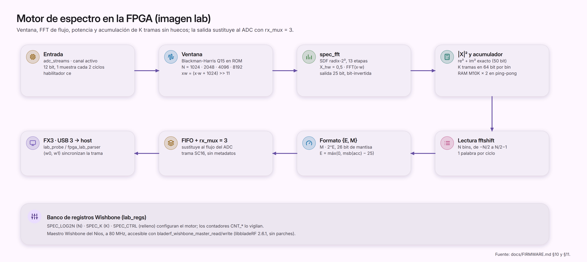
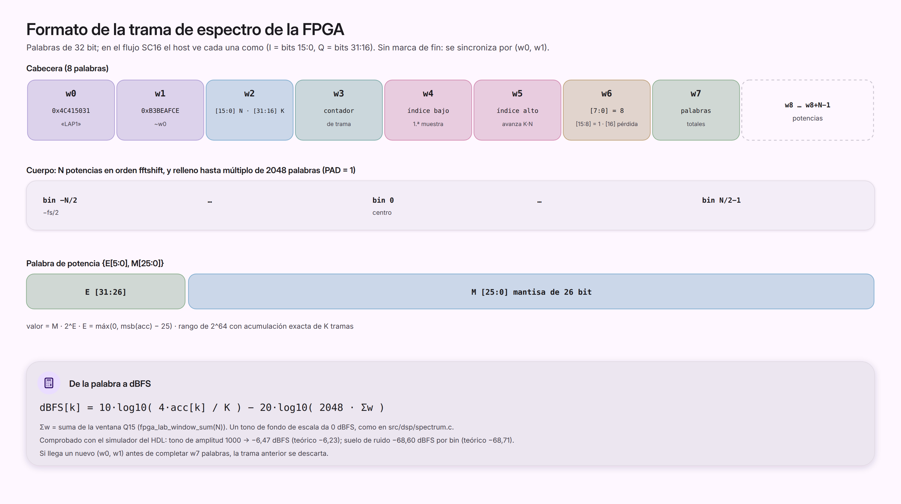
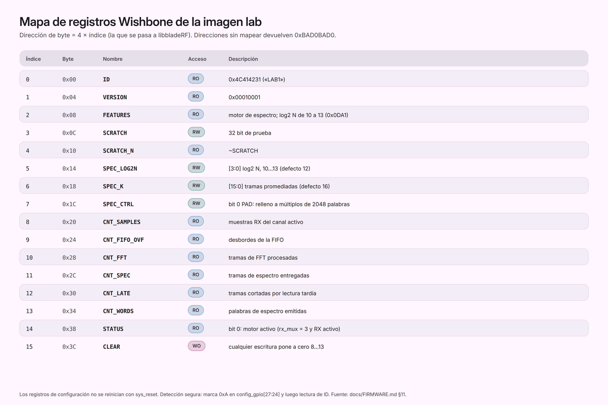

# FPGA de la bladeRF 2.0 micro: cadena de herramientas, análisis y plan

Documento del agente F1. Fase 1 (cadena de herramientas y análisis). **Todavía no
hay bloques DSP nuevos**; solo se ha compilado y simulado el HDL oficial sin
cambios. Nada de lo descrito aquí se ha cargado en la placa.

Fecha de las mediciones: 2026-11-15. Árbol HDL: commit `35174c3` del repositorio
oficial (`libbladeRF 2.6.1`), copia de trabajo en `firmware/bladeRF`, rama `lab`.

## 1. Resumen

| Cuestión | Resultado |
|---|---|
| Compilación `hosted` xA9 de serie (Quartus 20.1.1) | Correcta a la primera, **6 min 15 s** (375 s), 0 *critical warnings* |
| Recursos | 6 768 / 113 560 ALM (6 %), 14 599 registros, 274 / 1 220 M10K (22 %), 8 / 342 DSP (2 %), 3 / 8 PLL |
| Temporización | Cumplida en los 4 modelos (slow 85/0 °C, fast 85/0 °C). Peor *setup*: +0,512 ns; peor *hold*: +0,065 ns |
| Simulador | **Questa FSE 25.1 (vsim 2025.2) funciona**: ya hay una licencia válida en `~/.altera.quartus/questa_lic.dat` |
| Prueba de humo | `firmware/sim/run_rx_timestamp.sh`: testbench oficial `rx_timestamp_tb` de la ruta de RX, OK |
| Punto de enganche recomendado | Bus Wishbone del Nios (`bladerf_wishbone_master_read/write`, API pública de libbladeRF 2.6.1) para registros, y un modo nuevo del `rx_mux` para el flujo de datos. **Cero parches a libbladeRF** |

**Fase 2** (imagen `lab`: banco Wishbone + motor de espectro, versión de FPGA 0.16.101): ver §9 en adelante. Resultado: temporización cumplida (setup ≥ +0,255 ns), 9 518 ALM, 512 M10K, 42 DSP, comparación al bit con el modelo en C sin diferencias, SHA-256 `0cd2913c…943c`.

## 2. Estructura de ficheros (todo bajo `firmware/`)

```
firmware/
  env.sh                    entorno Quartus 20.1 + Nios II (source)
  build_stock.sh            compila la imagen de serie y guarda el log
  bladeRF/                  copia de trabajo del HDL (git, rama lab); NO es el original
  sim/run_rx_timestamp.sh   prueba de humo en Questa
  out/
    hosted-xA9-stock-0.16.0.rbf         imagen de serie recompilada
    hosted-xA9-stock-0.16.0.rbf.sha256
    logs/build_stock_hosted_xA9.log     log completo (3 770 líneas)
    reports/                            *.fit.rpt, *.sta.rpt, *.map.rpt, *.summary, git_info.txt
```

El original `~/bladerf-firmware/bladeRF` no se ha tocado (solo lectura).

## 3. Cadena de herramientas y compilación reproducible

### 3.1 Requisitos

- Quartus Prime **Lite 20.1.1** en `~/altera_lite/20.1` (con soporte Cyclone V y Nios II EDS).
  El README del HDL menciona 23.1.1 pero `platform.conf` solo exige >= 16.0 y
  `build_bladerf.sh` aplica los ajustes para ≤ 20.1 (`GLIBC_TUNABLES=glibc.rtld.execstack=2`).
  Con 20.1.1 todo funciona.
- `java`, `perl`, `make`, `git` del sistema. Nada de `sudo`.
- Red solo la primera vez: `build_bladerf.sh` ejecuta `git submodule update` y
  descargó `bladeRF-fsk` y `no-OS` dentro de `firmware/bladeRF` (no se usan para
  compilar el FPGA; son para host/ADI-no-OS). Si no hay red, el script sigue
  adelante (esa parte no tiene `set -e` todavía).

### 3.2 Entorno

```bash
source firmware/env.sh
```

`env.sh` hace lo que haría `nios2_command_shell.sh` pero sin abrir un subshell:
exporta `QUARTUS_ROOTDIR` y `SOPC_KIT_NIOS2`, antepone al `PATH` `quartus/bin`,
`quartus/sopc_builder/bin` (qsys-script, qsys-generate), `nios2eds/bin`,
`nios2eds/sdk2/bin` (nios2-bsp-*) y el compilador cruzado `nios2-elf-gcc`;
fija `GLIBC_TUNABLES` y `LC_ALL=C`. **No** añade Questa al `PATH` para no mezclar
bibliotecas de 25.1 con las de 20.1 (`QUESTA_BIN` queda definido para los scripts de simulación).

### 3.3 Compilar la imagen de serie

```bash
firmware/build_stock.sh      # ≈ 6 min; salida en firmware/out/logs/
```

Equivale a `cd firmware/bladeRF/hdl/quartus && ./build_bladerf.sh -b bladeRF-micro -r hosted -s A9 -D`
(`-D` quita la fecha del directorio de salida: `hostedxA9/`). Etapas y tiempos
medidos (Quartus, 20 núcleos):

| Etapa | Tiempo |
|---|---|
| Qsys (generar `nios_system`) + BSP + software Nios (`bladeRF_nios`) | ≈ 1 min |
| Análisis y síntesis (`quartus_map`) | 41 s |
| Fitter (`quartus_fit`) | 4 min 06 s |
| Ensamblador (`.sof`/`.rbf`) | 25 s |
| Temporización (`quartus_sta`) | 13 s |
| **Total** | **6 min 15 s** |

Salidas del script: `hostedxA9/hostedxA9.rbf` (12 858 972 bytes), informes y
`git_info.txt`. Para iterar en un diseño propio, `-k` conserva el directorio de
trabajo (compilación incremental) y `-l synth` solo sintetiza (≈ 1 min), útil
para comprobar sintaxis y recursos.

Quartus escribe en `firmware/bladeRF/hdl/quartus/work/` y `.../hostedxA9/`; ambos
están en `.git/info/exclude` de la copia. No se tocó ningún fichero versionado.

### 3.4 Resultado de la imagen de serie (hosted, xA9)

SHA-256 del `.rbf`: `42433119b10530f04beec980ceca43c1bd2b65f815c0adfa46c5a30de83bd054`.
Versión de FPGA integrada: 0.16.0 (`fpga_version.h`), la misma que hay en la flash.
No se ha podido (ni se debe) verificar byte a byte contra la flash.
Reproducibilidad: ver §3.6.

**Recursos** (5CEBA9F23C8):

| Recurso | Usado | Disponible | % |
|---|---|---|---|
| ALM | 6 768 | 113 560 | 6 |
| Registros | 14 599 | — | — |
| Bloques M10K | 274 | 1 220 | 22 |
| Bits de memoria | 2 209 280 | 12 492 800 | 18 |
| Bloques DSP | 8 | 342 | 2 |
| PLL | 3 | 8 | 38 |
| Pines | 173 | 224 | 77 |

Reparto por entidad (ALM): `nios_system` 4 715 (Nios II/e, ADI axi_ad9361 con 4 correctores IQ,
SPI, I2C, time_tamer…), `rx` 779, `fx3_gpif` 282, `ps_sync` 150, resto menor.
Los 8 DSP son los 8 correctores IQ de la IP de ADI (4 canales RX + 4 TX, "sum of two 18x18").
La memoria se reparte entre la RAM del Nios (1 062 400 bits) y las FIFOs de `rx` (819 200 bits).

**Relojes y holgura** (peor caso por dominio, modelo lento 1100 mV 85 °C, *setup*):

| Reloj | Frecuencia | Holgura setup |
|---|---|---|
| `pll_fclk` del receptor LVDS (ADI) | 500 MHz | +0,512 ns (peor global) |
| `pll_sclk` del receptor LVDS (reloj de muestras `ad9361.clock`) | 125 MHz (restricción) | +0,540 ns |
| `fx3_virtual` (E/S GPIF del FX3) | 100 MHz | +0,652 ns |
| PLL FX3 (`fx3_pclk_pll`) | 100 MHz | +2,129 ns |
| `adi_sclk_pin` | 40 MHz | +2,228 ns |
| PLL del sistema (`sys_clock`, Nios) | 80 MHz | +2,267 ns |
| `fx3_pclk` | 100 MHz | +4,091 ns |
| `c5_clock2` | 38,4 MHz | +8,981 ns |

*Hold* peor: +0,065 ns (modelo rápido 0 °C, `pll_sclk`); sin violaciones (TNS = 0 en todo).
La holgura del dominio de muestras es pequeña pero viene de la IP de ADI y de las
restricciones de E/S, no de la lógica de `rx.vhd`; hay que vigilarla al añadir lógica
en `rx_clock` (125 MHz = 8 ns de periodo). Los informes completos están en `firmware/out/reports/`.

### 3.5 Problemas encontrados

Ninguno en la compilación. Observaciones:
- El `.do` oficial `rx_timestamp_tb.do` compila `rx.vhd` antes que los paquetes de los que depende
  (no funciona tal cual en Questa); `firmware/sim/run_rx_timestamp.sh` lo reordena.
- `-D` es necesario para un nombre de directorio estable.

### 3.6 Reproducibilidad

Una segunda compilación completa e independiente (directorio de trabajo borrado, 414 s) produjo el
**mismo SHA-256**: la compilación es determinista con la misma versión de Quartus y la semilla 1 por
defecto (`-S`). Así, cualquier diferencia futura del `.rbf` proviene de cambios en el HDL.

## 4. Simulación

### 4.1 Questa FSE (operativo)

`~/altera_lite/25.1std/questa_fse/bin/vsim` → *Questa Altera Starter FPGA Edition-64 vsim 2025.2*.
La licencia **ya está instalada**: `~/.altera.quartus/questa_lic.dat` contiene una
`INCREMENT intelqsimstarter` de nodo fijo (HOSTID `c87f5464cb77`, caduca el **23-ago-2027**,
emitida 23-ago-2026). El HOSTID es la MAC de la primera interfaz de red (`c8:7f:54:64:cb:77`).
Hay que apuntar a ella con `SALT_LICENSE_SERVER` (los scripts lo hacen):

```bash
export PATH=~/altera_lite/25.1std/questa_fse/bin:$PATH
export SALT_LICENSE_SERVER=$HOME/.altera.quartus/questa_lic.dat
vsim -version
```

Si algún día falla (cambio de tarjeta de red, caducidad), la licencia gratuita se renueva así:
1. Entrar en el *Self-Service Licensing Center* de Altera/Intel con la cuenta gratuita
   (https://licensing.intel.com) y pedir "Questa-Intel FPGA Starter Edition" (gratuita).
2. Como identificador de host, dar la MAC de la NIC (`ip link`, formato sin dos puntos, 12 hex).
3. Descargar el `.dat` y guardarlo como `~/.altera.quartus/questa_lic.dat`.
Plan B si no hay licencia: entorno conda de usuario con `ghdl`/`iverilog` (no hizo falta; no se creó).

Las bibliotecas `altera_mf`, `altera`, `altera_lnsim` ya vienen precompiladas en
`questa_fse/intel/vhdl/` y están referenciadas en su `modelsim.ini`.

### 4.2 Prueba de humo: `rx_timestamp_tb`

```bash
firmware/sim/run_rx_timestamp.sh     # ≈ 50 s; log en firmware/sim/rx_timestamp.log
```

Compila la biblioteca `nuand` (todo `ip/nuand`, `common_dcfifo`, wrappers de FIFOs), `bladerf_p`,
`rx.vhd`, `tx.vhd`, `fx3_gpif.vhd`, el modelo del FX3 y el testbench, y simula 12 ms.
Ejercita la ruta de RX completa del micro: generador de paquetes → `rx` (mux, `fifo_writer`,
FIFO de muestras y de metadatos con `dcfifo`) → `fx3_gpif` → bus GPIF modelado.
El testbench lee las cabeceras de metadatos y comprueba que la diferencia de marcas de tiempo
entre mensajes consecutivos es la esperada (**4088 muestras** en modo SC8 con un canal:
2·(2048−4); 2044 en 16 bits). Resultado: `RESULTADO: OK`, 0 errores (67 avisos de `to_integer` de
64 bits, inocuos), tres iteraciones incluida la del reinicio de timestamp.

Para añadir bloques propios: crear testbench VHDL-2008 en `firmware/sim/`, compilar tras
`compile_nuand` (definido en `hdl/fpga/ip/nuand/nuand.do`) y comparar contra referencias en C del
árbol (`src/dsp/`) mediante ficheros de vectores (`textio`).

## 5. Análisis de la arquitectura (HDL `bladerf-micro`, revisión `hosted`)

### 5.1 Visión general

```
 AD9361 ──LVDS 6 bit DDR──► axi_ad9361 (IP de ADI, dentro de nios_system)
                              │ adc_i/q[0..1], valid, enable   (dominio ad9361.clock = rx_clock)
                              ▼
                       bladerf-hosted.vhd: adc_streams(i) (data_i/q 16 bit con 12 útiles, data_v)
                              ▼
                       rx.vhd:  rx_mux ──► fifo_writer ──► FIFO muestras (dcfifo, 8192×64→32 bit)
                                                    └────► FIFO metadatos (2048×128→32 bit)
                              ▼  (cruce de reloj rx_clock → fx3_pclk_pll)
                       fx3_gpif.vhd ──► GPIF II 32 bit @ 100 MHz ──► FX3 ──► USB 3 ──► libbladeRF
```

La ruta de TX es simétrica (`tx.vhd`, FIFOs de TX, y un FIFO de *loopback* digital que
alimenta la entrada del mux de RX).

### 5.2 Interfaz con el AD9361 y relojes

- La interfaz LVDS (receptor y transmisor, 4 muestras de 12 bit en dos ciclos) la hace la IP de
  ADI `axi_ad9361` con `altlvds_rx`. `adi_rx_clock` (DATA_CLK) está restringido a **250 MHz**
  (`.sdc`); el reloj de datos interno es la mitad, `ad9361.clock` = `rx_clock` = `tx_clock`
  (restricción 125 MHz; 122,88 MHz a 61,44 Msps).
- En `axi_ad9361_dev_if_alt.v` `adc_valid` alterna cada ciclo de `l_clk`, de modo que se obtiene
  **una muestra I/Q por canal cada 2 ciclos de `rx_clock`** (`fs = rx_clock / 2`).
  `bladerf-hosted.vhd` convierte `valid` en un pulso de un ciclo (`data_v = valid and not last_v`).
  La IP entrega 16 bit pero solo los 12 de mayor peso son datos (en TX se rellena con `"0000"`).
- `time_tamer` (`rx_tamer`, `tx_tamer`) incrementa el contador de 64 bit **una vez cada 2
  ciclos de `rx_clock`**, es decir, **un tick por periodo de muestra del AD9361**.
- Otros relojes: 38,4 MHz (`c5_clock2`, entrada) → PLL a **80 MHz** (`sys_clock`: Nios, SPI, I2C,
  registros); `fx3_pclk` 100 MHz → PLL con desfase de −3,42 ns (`fx3_pclk_pll`) para cerrar la
  temporización del GPIF.
- **Modo oversample 122,88 Msps (SC8)**: es una función de libbladeRF (`BLADERF_FEATURE_OVERSAMPLE`,
  `bladerf2.c`/`bladerf.c`), no un cambio de la FPGA. libbladeRF **divide la tasa pedida por 2**
  antes de programar el AD9361 (máx. 61,44 Msps de reloj del AD9361), y tras cada
  `set_sample_rate` reescribe registros del AD9361 (`bladerf_set_oversample_register_config`, entre
  ellos `0x003 = 0xD4`) y limita el formato a 8 bit (`SC8_Q7`; con SC16 devuelve
  `BLADERF_ERR_UNSUPPORTED`). El límite de rendimiento total pasa de 80 a 160 Msps
  (`check_total_sample_rate`). La FPGA ve el mismo flujo que en modo normal (misma
  interfaz, mismo `rx_clock` ≤ 125 MHz); el detalle de cómo se intercalan las muestras
  en el AD9361 en este modo **no se ha podido confirmar leyendo solo el HDL** y debe medirse (p. ej. con
  `RX_MUX_32BIT_COUNTER` y el modo oversample, o con SignalTap) antes de diseñar un DDC para él.
- Ancho de banda USB: GPIF 32 bit × 100 MHz = 400 MB/s brutos. 61,44 Msps × 1 canal × SC16
  (4 B) = 245,8 MB/s; 122,88 Msps SC8 (2 B) = 245,8 MB/s. Con 2 canales SC16 a 61,44 Msps harían falta 491 MB/s: imposible (por eso el límite de 80 Msps totales).
  El formato `SC16_Q11_PACKED` (12 bit/componente, `highly_packed_en`) baja a 3 B/muestra.

### 5.3 Formatos de datos

Controlados por bits de `config_gpio` (ver §5.5):

| Formato libbladeRF | Bits GPIO | Ruta |
|---|---|---|
| `SC16_Q11` | ninguno | `fifo_writer` empaqueta I(16)/Q(16) por canal en 64 bit |
| `SC8_Q7` (`eightbit_en`, bit 20) | 20 | 4 componentes de 8 bit por palabra; los 8 bit son `data >> 4` |
| `SC16_Q11_PACKED` (`highly_packed_en`, bit 21) | 21 | 12 bit por componente, 8 pares IQ cada 3 palabras de 64 bit |
| `*_META` | 16 (`meta_sync`) | añade cabecera de metadatos cada mensaje |
| `PACKET_META` | 19 (`packet_en`) + 16 | modo paquete (`rx_packet_generator`, usado por wlan) |

Un canal activo: `fifo_writer` empaqueta dos muestras seguidas del mismo canal en una palabra de 64 bit.

### 5.4 Metadatos y marcas de tiempo

La FPGA parte el flujo en mensajes de **2048 palabras de 32 bit (8192 bytes) con USB 3 SuperSpeed y
1024 palabras (4096 bytes) con USB 2** (`GPIF_BUF_SIZE_SS/HS`; el comentario de `metadata.h` habla
de 2048 bytes para USB 2, está desfasado). Con `meta_en = 1` cada mensaje empieza con una cabecera
de **16 bytes** (4 palabras) y el resto son muestras: en SC16 con un canal, 2044 muestras por mensaje
(4088 en SC8, comprobado en simulación, §4.2).

| Offset | Tamaño | Contenido |
|---|---|---|
| 0x00 | 2 B | longitud de paquete (solo modo paquete; en modo normal, marca `0x12344321` que el host ignora) |
| 0x02 | 1 B | flags de paquete |
| 0x03 | 1 B | core ID del paquete |
| 0x04 | 8 B | **timestamp** (uint64 little-endian): valor del contador de `rx_tamer` al aceptar la primera muestra del mensaje; un tick por periodo de muestra del AD9361 |
| 0x0c | 4 B | flags: bits 31:16 = `0xFFF` & `"11"` & `mini_exp[1:0]` (estado de los pines `mini_exp`); los 16 LSB los sobrescribe `fx3_gpif` con el estado de *underrun* |

(`fifo_writer.vhd` construye el vector de 128 bit; `fx3_gpif.vhd`, estado `RX_META`, sobrescribe los
16 LSB de la última palabra.) libbladeRF retira las cabeceras en `bladerf_sync_rx` con formato `*_META` y
entrega el timestamp en `bladerf_metadata`. Con `meta_en = 0` el flujo es continuo, sin cabeceras.
El contador se pone a cero mientras `meta_en = 0` (`timestamp_reset`).

### 5.5 Cómo controla el host la FPGA

Cadena: libbladeRF → USB (FX3, vendor/bulk) → **UART FX3↔FPGA** (`command_uart`) →
**Nios II/e** (software `bladeRF_nios`) → periféricos Avalon/PIO. Paquetes de 16 bytes
(`nios_pkt_*.h`): `8x8`, `8x16`, `8x32`, `8x64`, `16x64`, `32x32`, `retune`, `retune2`.
Destinos relevantes en el micro:

| Paquete / destino | Función |
|---|---|
| `8x32` `VERSION` (0x00) | versión de FPGA (0x7777 / 0.16.0) |
| `8x32` `CONTROL` (0x01) | **`config_gpio`** (32 bit, PIO `gpio_out`): controla bloques de la FPGA (abajo) |
| `8x32` `RFFE_CSR` (0x03) | GPIO del RFFE (enable, txnrx, sw RF, bias-T, AGC) |
| `8x64` `TIMESTAMP` | lectura de timestamp |
| `16x64` `AD9361`/`RFIC` | acceso a registros del AD9361 y órdenes de RFIC (SPI vía Nios) |
| `32x32` `EXP`/`EXP_DIR` | GPIO de la expansión |
| `32x32` `ADI_AXI` | registros AXI de la IP de ADI (IQ corr, DC, etc.) |
| `32x32` `WB_MSTR` (0x03) | **maestro Wishbone** → `IORD/IOWR_32DIRECT(WISHBONE_MASTER_0_BASE, addr)` |
| `8x8/8x16/8x32/...` `USR1..USR128` (0x80–0xff) | reservados para personalizaciones en el software Nios |
| `retune`, `retune2` | *quick tune* con perfiles guardados |

Mapa del `config_gpio` (`bladerf_p.vhd`, `nios_gpo_t`):

| Bits | Campo | Notas |
|---|---|---|
| 31:30 | `xb_mode` | expansión |
| 29:22 | **sin usar** | libres para registros propios |
| 21 | `highly_packed_en` | SC16_Q11_PACKED |
| 20 | `eightbit_en` | SC8 |
| 19 | `packet_en` | modo paquete |
| 18 | `si_clock_sel` | reloj Si5338/entrada |
| 17 | `ufl_clock_oe` | reloj a conector U.FL |
| 16 | `meta_sync` | metadatos/timestamps activos |
| 15 | `led_mode` | |
| 14:12 | `leds` | |
| 11 | `adf_chip_enable` | ADF4002 vs DAC |
| 10:8 | **`rx_mux_sel`** | 0 normal, 1 contador 12 bit, 2 contador 32 bit, **3 "entropía" (no implementado, libre)**, 4 loopback digital, 5–7 libres |
| 7 | `usb_speed` | |
| 0 | `pwr_status` | solo lectura |

El acceso es siempre lectura-modificación-escritura (`bladerf_config_gpio_read/write`, API pública),
con lo que los bits 29:22 sobreviven a libbladeRF.

`bladerf_set_rx_mux()` solo acepta 0, 1, 2 y 4 (valida en `bladerf2.c`), pero **`bladerf_config_gpio_write()`
escribe el valor en bruto**, por lo que se puede seleccionar el modo 3 (o 5–7) sin parchear.

### 5.6 Mejor punto de enganche (sin parchear libbladeRF)

1. **Registros de control y lectura de resultados: bus Wishbone.** libbladeRF 2.6.1 exporta
   `bladerf_wishbone_master_read/write(dev, addr, data)` (`libbladeRF.h`, descrito como "reservado para
   módem"). El Nios ya traduce el paquete `32x32 WB_MSTR` a accesos de 32 bit a una dirección de 32 bit.
   La IP `wishbone_master` (con *dcfifo* de cruce de reloj) exporta el bus (`wbm_wb_*`) fuera de
   `nios_system`; **en `hosted` está sin conectar** y se queda esperando `ack`: *no se debe leer/escribir
   por Wishbone con la imagen de serie* (cuelga el Nios hasta reiniciar). En nuestra revisión se
   conecta a un banco de registros propio. El reloj `wb_clk_i` lo aporta la lógica (usar `sys_clock`, 80 MHz).
   `bladeRF-cli` no ofrece una orden Wishbone; nuestro código llamará a la API directamente.
2. **Activación del flujo de datos propio: `rx_mux_sel = 3`** (reservado como "reservado para uso futuro" en
   `libbladeRF.h`; en `rx.vhd` es el caso `RX_MUX_ENTROPY`, "no implementado"). Se activa con
   `bladerf_config_gpio_write` o, mejor, con un registro Wishbone de "habilitación" para no depender del
   bit 8–10. Alternativa: bits 29:22 de `config_gpio` (hay que ampliar `nios_gpo_t`, `pack`/`unpack`).
3. **Salida a host**: por la ruta normal. El flujo sale por `fifo_writer` → FIFO → GPIF → `bladerf_sync_rx`,
   así que libbladeRF, `bladeRF-cli rx` y nuestro `source.c` lo ven como un flujo de muestras ordinario
   (SC16). Para resultados no continuos (espectro promediado) conviene enviar tramas con una cabecera
   reconocible dentro del flujo (p. ej. palabra mágica + contador) o leerlas por Wishbone.

**Parche mínimo si hiciera falta** (no se prevé): añadir `BLADERF_RX_MUX_*` nuevos a los `switch` de
`bladerf2_set_rx_mux/get_rx_mux`; y/o `nios_access` con destinos `USR` (cambia el software Nios).
Cambios en el software Nios (`bladeRF_nios`) requieren regenerar el BSP; el build lo hace solo.

### 5.7 Dónde insertar un bloque DSP en RX

En `rx.vhd`, proceso `rx_mux`: la rama `RX_MUX_NORMAL` hace `mux_streams <= adc_streams` y
`mux_streams` entra en `fifo_writer` (`in_samples`). Un bloque propio se inserta ahí:

```
adc_streams ──► [bloque DSP: NCO+CIC+FIR / FFT+promedio / detector]
                         │  (misma interfaz sample_streams_t: data_i/data_q 16 bit + data_v)
                         ▼
          rx_mux  (nuevo caso "3": mux_streams <= dsp_streams)  ──► fifo_writer
```

Condiciones de diseño:
- La entrada es **una muestra por canal cada 2 ciclos de `rx_clock`** (pulso `data_v`). A 61,44 Msps
  hay 2 ciclos de 122,88 MHz por muestra: un único multiplicador puede dar servicio a 2 operaciones por
  muestra y por canal (compartir DSP de 18x18 con factor 2).
- `fifo_writer` es dirigido por `data_v`; no exige cadencia regular. Un diezmador solo genera `data_v`
  una de cada N muestras. La salida alimenta el mismo empaquetador SC16/SC8/packed.
- **Los timestamps cuentan ticks de muestra del AD9361, no de la salida diezmada**: tras un diezmado por N
  el timestamp avanza N ticks por muestra de salida. La cabecera sigue siendo válida, pero el host debe
  tenerlo en cuenta (documentarlo en `docs/hardware/HARDWARE.md`/`src/sdr`). El *flow-control* es el mismo
  (si la FIFO se llena, `fifo_writer` descarta y activa el LED de overrun).
- `fifo_writer` cierra cada mensaje cuando ha escrito 2048 (o 1024) palabras: si el bloque produce datos
  esporádicos (espectro, detecciones) el mensaje se queda sin completar y el host no recibe nada hasta
  que se llene. Un bloque así debe emitir un **flujo continuo** (tramas con cabecera reconocible y relleno con
  ceros) o usar la ruta Wishbone.
- Ruta alternativa para resultados escasos (histogramas, contadores, detecciones): registros Wishbone.

### 5.8 Presupuesto de recursos libres (tras la imagen de serie)

| Recurso | Libre aprox. | Comentario |
|---|---|---|
| ALM | ~106 800 (94 %) | sobra de todo |
| M10K (10 kbit) | ~946 (≈ 9,6 Mbit) | FFT de 4096 puntos complejos de 16 bit ≈ 130 kbit; cientos de kbit para promedios |
| DSP (18x18 ×2 / bloque) | 334 bloques (≈ 668 multiplicadores 18x18) | FIR/NCO/FFT/CIC caben holgadamente |
| PLL | 5 | |
| Pines | 51 | la placa tiene la E/S fija; no se necesitan más |

Limitación real: la temporización del dominio de muestras (holgura +0,5 ns en las rutas de ADI)
y el empaquetado hacia el FX3 (400 MB/s). Los límites de lógica no serán el problema.
Nota: Quartus Lite no incluye licencia completa de la IP FFT de Intel (evaluación con límite); conviene
escribir la FFT/CIC/NCO propios en VHDL. Las IP `cordic.vhd`, `nco.vhd`, `fir_filter.vhd`,
`iq_correction.vhd` del árbol (`ip/nuand/synthesis`) son reutilizables como punto de partida.

### 5.9 Revisiones `adsb`, `foxhunt` y `wlan`

`platform.conf` del micro lista `hosted adsb foxhunt wlan`. Estado en este árbol (sin compilarlas todas):

| Revisión | Qué hace | ¿Se puede compilar con este árbol? |
|---|---|---|
| `hosted` | Imagen genérica: stream de RX/TX a host, la de serie. | **Sí (compilada y medida)** |
| `adsb` | `rx-adsb.vhd`: decodificador ADS-B en FPGA (8 decodificadores en paralelo `adsb_fe`, `adsb_decoder_p`); entrega mensajes de 128 bit por una FIFO (`adsbfifo`). No incluye SC8 ni packed (es un derivado antiguo de `hosted`). | **No**: las entidades `adsb_fe`/`adsb_decoder_p` no están en el árbol (IP no publicada) |
| `foxhunt` | Baliza de "caza del zorro": `tone_generator` + software Nios propio (`software/foxhunt`): transmite un mensaje en Morse a 768 ksps, con bias-T. Es TX puro. | Sí en principio (todo en el árbol); no compilada aquí. **No se debe usar: emite** |
| `wlan` | Modem 802.11 (`wlan.wlan_top`) con AGC propio (`bladerf_agc_adi_drv`), modo paquete. | **No**: biblioteca `wlan` propietaria ausente |

Todas están "soportadas en el micro" en el sentido de que la plataforma las declara, pero solo
`hosted` (y en teoría `foxhunt`) son reproducibles con el código público. Ninguna es útil para nuestro plan salvo como
referencia de estilo (p. ej. `adsb` muestra cómo cambiar el tipo de FIFO y el formato de `rx`).

## 6. Mejoras posibles (valor / esfuerzo)

Ordenadas de mayor a menor relación valor/esfuerzo:

1. **Registros Wishbone + banco de diagnóstico** (esfuerzo bajo, valor de habilitación alto). Nueva revisión
   `lab` copiada de `hosted`, con un banco de registros en `sys_clock`: identificador/versión propios, registro
   *scratch*, contadores de muestras, de mensajes y de *overruns*, bits de habilitación. Sin él no se
   puede verificar nada en placa, y nada exige parchear libbladeRF.
2. **Diezmador/DDC en FPGA** (NCO + CIC + FIR de compensación, 2 etapas de media banda), con registros de frecuencia y
   factor. Reduce el flujo USB: con el AD9361 a 61,44 Msps (o a 122,88 Msps en oversample) se obtiene un canal de
   unos MHz en SC16 con >12 bit efectivos (la ganancia de proceso ya está en la FPGA y no se pierde en el SC8).
   Es el bloque con más valor para los decodificadores *narrow* de `src/`. Esfuerzo medio.
3. **Espectro promediado en FPGA** (ventana + FFT de flujo de 1024–4096 puntos + |X|² + promedio de N tramas): sale
   a pocos MB/s en lugar de 245 MB/s, y el host solo dibuja. Esfuerzo medio-alto (FFT propia).
4. **Detector de energía / compuerta de ráfagas** (umbral con histéresis en `|x|²` y captura con pre-disparo): solo se
   envían las ráfagas (ADS-B, ISM, LoRa), reduciendo el USB y la carga de CPU. Esfuerzo bajo-medio. Complementa a 2.
5. **Empaquetado de 12 bit a 3 B/muestra ya existe** (`SC16_Q11_PACKED`, bit 21): no es trabajo de FPGA, solo de
   host (H1): ahorra un 25 % de ancho de banda USB frente a SC16.
6. **Marcas de tiempo diezmadas coherentes** (contador en unidades de la muestra de salida) y reloj PPS/GPS para
   fijar el instante de captura: esfuerzo medio, útil para TDOA/MLAT.
7. **Corrección de DC/IQ y AGC rápido en FPGA** (la IP de ADI ya trae corrector IQ con 8 DSP; el AGC de
   hardware del AD9361 ya se controla por GPIO): bajo valor extra.

## 7. Procedimiento seguro de prueba en placa

Restricciones del proyecto (AGENTS.md §0.11): los agentes **nunca** cargan ni flashean nada. Solo el
orquestador, con permiso explícito y expreso del usuario, puede cargar una imagen **en la RAM de la FPGA**
(volátil).

1. Compilar la imagen candidata (solo xA9; una imagen para otro tamaño no sirve) y verificar antes
   `quartus_sta` sin violaciones y la simulación. Guardar el `.rbf`, su hash y el commit en `firmware/out/`.
2. Pedir permiso explícito al usuario. Cerrar los procesos que tengan la placa abierta (p. ej. `openwebrx`);
   los agentes no paran servicios.
3. Cargar **solo en RAM**: `bladeRF-cli -l firmware/out/<imagen>.rbf`. **Nunca** `-L` (flash SPI), ni `-f`
   (firmware del FX3), ni `bladerf_flash_*`/`autoload`.
4. Probar primero con lo menos arriesgado: leer la versión de FPGA, el contador *scratch*, `rx_mux` en modo
   normal comparando con la imagen de serie; después el modo nuevo. No activar TX. No tocar el Wishbone
   con la imagen de serie (está sin conectar y cuelga el Nios).
5. Volver atrás: **desconectar la alimentación/USB** (la RAM de la FPGA se pierde y vuelve a cargarse la imagen
   de la flash, 0.16.0 de serie), o recargar el `.rbf` de serie (`firmware/out/hosted-xA9-stock-0.16.0.rbf`,
   equivalente a la de la flash) con `-l`. Si el Nios queda colgado, basta reenchufar.

---

# Fase 2: imagen "lab" (banco Wishbone + motor de espectro)

## 9. Resumen de la imagen lab

La revisión `lab` de `bladerf-micro` es la imagen `hosted` de serie más:

1. un **banco de registros Wishbone** conectado al maestro Wishbone del Nios, accesible con la API
   pública `bladerf_wishbone_master_read/write` de libbladeRF 2.6.1 (sin parchear libbladeRF);
2. un **motor de espectro promediado** (ventana Blackman-Harris + FFT SDF radix-2^2 de 1024 a 8192
   puntos + |X|² + acumulación de K tramas con ciclo de trabajo del 100 %) que sustituye al flujo del ADC
   cuando `rx_mux = 3`, y entrega sus tramas por el flujo de muestras normal (SC16, sin metadatos);
3. una versión de FPGA propia (**0.16.102**, lab 1.2) y una marca de solo lectura en `config_gpio`
   (bits 27:24 = 0xA) para detectar la imagen de forma segura.

Con `rx_mux ≠ 3` la ruta de datos es la de serie (§13.2), de modo que la imagen lab sirve como imagen normal.
Todo el HDL es propio: no se usa ninguna IP con licencia o de evaluación (ni FFT II ni FIR II de Altera);
solo RAM, ROM, PLL y multiplicadores inferidos, y el código de Nuand ya presente en el árbol.

Entregables:

| Ruta | Contenido |
|---|---|
| `firmware/out/hosted-xA9-lab-0.16.102.rbf` (+ `.sha256`) | imagen compilada |
| `firmware/bladeRF/hdl/fpga/platforms/bladerf-micro/vhdl/lab/` | `spec_engine`, `spec_fft`, `sdf_stage`, `sdf_mult`, `spec_acc_ram`, `lab_regs`, `lab_cdc_bus`, `rx_lab`, `lab_rom_p` (generado) |
| `.../vhdl/bladerf-lab.vhd`, `.../bladerf-lab.qip`, `.../constraints/bladerf-lab.sdc` | tope de la revisión lab (diferencias con `hosted` marcadas `-- LAB`) y restricciones multiciclo |
| `firmware/patches/` | parches `git format-patch` del árbol HDL sobre el commit oficial 35174c3 (+ README para reconstruir) |
| `firmware/model/` | modelo en C exacto al bit (`spec_model.c`) y herramienta (`spec_tool`: genera la ROM, vectores y comprueba volcados) |
| `firmware/sim/` | `run_lab_spec.sh`, `run_lab_regs.sh`, `run_rx_timestamp_lab.sh`, bancos de pruebas VHDL |
| `firmware/build_lab.sh` | compilación reproducible de la imagen |
| `firmware/tools/lab_probe.c` | herramienta de prueba en hardware (para el orquestador) |
| `src/sdr/fpga_lab.{h,c}`, `tests/test_fpga_lab.c`, `tests/data/lab_spec_*.hex` | cliente del lado host y su prueba |

Cambios en ficheros oficiales (rama `lab` de `firmware/bladeRF`): `platform.conf` (añade la revisión),
`build/bladerf.tcl` (`make_revision lab`), `software/bladeRF_nios/src/fpga_version.h` y `Makefile`
(versión 0.16.101 solo si `LAB_BUILD=1`) y `quartus/build_bladerf.sh` (pasa `LAB_BUILD=1` si `rev = lab`).
La imagen de serie sigue compilando exactamente igual (mismos fuentes con `LAB_BUILD` sin definir).

## 10. Diseño del motor de espectro

### 10.1 Cadena y tiempos

<picture><source media="(prefers-color-scheme: dark)" srcset="../img/fpga/fpga-motor-espectro-dark.png"></picture>

*Figura. Motor de espectro (§10.1). Simplificada: no muestra los registros de segmentación (entrada de `rx_lab`, salidas de ROM, `ce` por etapa).*

```
 adc_streams(canal activo) ──► registro de entrada ──► ventana BH Q15 (ROM, 2 pasos) ──► spec_fft
   (12 bit, 1 muestra / 2 ciclos de rx_clock)                                            (SDF radix-2^2)
                                                                                                │ orden bit-invertido
 FIFO de muestras ◄── 1 palabra/ciclo ◄── formato {E,M} ◄── lectura fftshift ◄── RAM x2 (ping-pong) ◄── |X|² + acumulación (K tramas)
```

Todo el camino de datos avanza con un habilitador `ce` = un pulso por muestra del canal activo; los
registros se actualizan con `ce`, no con cada ciclo de reloj. No hay restricciones multiciclo: cada
camino cumple 8 ns (125 MHz) en una sola etapa de registro, y el motor funciona con cualquier
separación entre pulsos `ce` ≥ 1 ciclo. La entrada es el canal 0 si está habilitado y si no el canal 1; solo se usa **un canal**.

* **Ventana**: ROM con las mitades simétricas de la ventana Blackman-Harris de 4 términos para N = 1024,
  2048, 4096 y 8192 (7680 palabras de 16 bit), `w[i] = round(32768·BH(i/(N-1)))`; es la misma fórmula que
  `window_blackman_harris()` de `src/dsp/fft.c`. `xw = (x·wq + 1024) >> 11` (x en cuentas Q11 de 12 bit con signo),
  es decir x·w con 4 bits fraccionarios en 16 bits.
* **FFT** (`spec_fft`, `sdf_stage`, `sdf_mult`): 13 etapas fijas (retardo 2^12 … 2^0); para N = 2^n la señal entra en la
  etapa n-1. Cada etapa: línea de retardo (RAM M10K si D ≥ 16, registros si no), una mariposa con un único
  sumador por camino y, tras las etapas de índice par (≥ 2), el multiplicador de twiddles (4 productos 25x18 en DSP,
  ROM de twiddles en Q16, redondeo `(v + 32768) >> 16`). En radix-2² las etapas pares que no son la primera aplican la rotación
  trivial -j en las secciones impares (se resuelve cambiando suma por resta, sin hardware extra).
  Para n impar (N = 2048, 8192) la primera etapa es una mariposa radix-2 con su propio twiddle.
* **Anchos**: entrada 16 bit; cada etapa añade 1 bit hasta 25 bit y a partir de la etapa E = 4 cada salida se desplaza 1 bit con redondeo
  `(v+1)>>1` (5 desplazamientos): **X_hw = 0,5 · FFT(x·w)** para todos los N, con 25 bit con signo. Se comprobó en el modelo con
  tramas de fondo de escala aleatorias y tonos sin desbordes y con error < −100 dB frente a una DFT en doble.
* **Potencia y acumulación**: `|X|² = re² + im²` (exacto, 50 bit); acumulación exacta de K tramas en 64 bit por bin, en
  una RAM M10K de 8192 x 64 por banco; **dos bancos en ping-pong** (mientras uno acumula el grupo g, el otro se lee para el grupo g-1), así que
  no hay huecos: cada muestra de entrada entra en una trama (ciclo de trabajo del 100 %).
* **Lectura**: al terminar el grupo se leen los N bins en orden fftshift (bin -N/2 … N/2-1) a 1 palabra por ciclo, y se rellena
  con ceros hasta un múltiplo de 2048 palabras (opcional) para que el FX3 reciba la trama completa sin esperar a la siguiente.
  El orden de salida de la FFT es bit-invertido: la RAM se escribe en la dirección `bitrev_n(j)`.
* **Palabra de potencia**: `{E[5:0], M[25:0]}` con valor `M · 2^E`, `E = max(0, msb(acc) − 25)`, `M = (acc >> E)[25:0]`
  (pseudo-coma flotante: 26 bits de mantisa, rango de 2^64).
* **Reinicio**: si cambian N, K o el relleno con el motor activo, este se reinicia (se pierde la trama en curso). Con `rx_mux ≠ 3` o RX
  deshabilitado el motor está en reset y no consume nada.

### 10.2 Formato de la trama de salida

<picture><source media="(prefers-color-scheme: dark)" srcset="../img/fpga/fpga-trama-dark.png"></picture>

*Figura. Formato de la trama (§10.2).*

Palabras de 32 bits; en el flujo SC16_Q11 que ve el host, cada palabra es un par `(I = bits 15:0, Q = bits 31:16)`
(`word = (uint16)I | (uint16)Q << 16`). Sin metadatos de libbladeRF (formato `SC16_Q11`, un canal).

| Palabra | Contenido |
|---|---|
| w0 | `0x4C415031` ("LAP1") |
| w1 | `0xB3BEAFCE` (= ~w0) |
| w2 | `[15:0]` N (1024…8192), `[31:16]` K |
| w3 | contador de trama (desde 0 al arrancar el motor) |
| w4, w5 | índice (bajos, altos) de la primera muestra del grupo, contado desde el arranque del motor (al poner `rx_mux = 3`). **No** es el timestamp del AD9361: sin metadatos (`meta_en = 0`) el `time_tamer` está parado y valía siempre 0 (fallo hallado en la prueba en placa y corregido). Avanza K·N por trama |
| w6 | `[7:0]` = 8 (palabras de cabecera), `[15:8]` = 1 (versión del formato), `[16]` = se perdió una trama antes de esta |
| w7 | palabras totales de la trama en el flujo (con relleno) |
| w8 … w8+N-1 | potencias, orden fftshift: la primera es el bin −N/2 (frecuencia −fs/2) y la última el bin N/2−1 |
| resto | ceros hasta completar `ceil((8+N)/2048)·2048` palabras si PAD = 1 |

La FPGA no pone marca de fin: el host sincroniza por (w0, w1) y valida con w2, w6 y w7 (lo hace `fpga_lab_parser`).
Una trama está completa cuando llegan sus `w7` palabras; si llega un nuevo (w0, w1) antes, la anterior se descarta.

### 10.3 Escala: de la palabra a dBFS

Con `x` en cuentas Q11 (±2048 = fondo de escala), `w` la ventana (máximo 1) y `Σw` su suma sobre N puntos:

* `X_hw[k] = 0,5 · Σ x[i]·w[i]·e^{-j2πki/N}` (en cuentas; sin factor 1/N).
* Un tono complejo de amplitud A (cuentas) da `|X_hw| = 0,5·A·Σw`; con A = 2048 (fondo de escala) `|X_hw| = 1024·Σw`.
* `acc[k] = Σ_{K tramas} |X_hw[k]|²` (la palabra de salida representa `acc`).

Por tanto, **con el mismo criterio que `src/dsp/spectrum.c` (tono complejo de amplitud de fondo de escala = 0 dBFS)**:

```
dBFS[k] = 10·log10( acc[k] / K ) − 20·log10( 1024 · Σw )  =  10·log10( 4·acc/K ) − 20·log10( 2048 · Σw )
```

donde `Σw` = suma de la ventana cuantizada Q15 (`fpga_lab_window_sum(N)`); para el ruido blanco complejo de potencia
σ² el nivel medio por bin es `10·log10(σ²·Σw²) − 20·log10(2048·Σw)`. Comprobado con la volcada del simulador
(`tests/test_fpga_lab.c`): tono de amplitud 1000 → −6,47 dBFS (teórico −6,23 con la pérdida por escalón de la
ventana), tono de 40 → −34,35 dBFS (−34,19), suelo de ruido −68,60 dBFS/bin (teórico −68,71).

> Observación para quien integre: en `src/dsp/spectrum.c` (ruta CPU) las muestras se multiplican por `window/2048` **y** la constante
> `norm_db = −20·log10(Σw·2048)` vuelve a dividir entre 2048, de modo que un tono de fondo de escala saldría a −66 dBFS. Si la ruta de GPU no
> escala previamente, ambas rutas difieren; conviene revisarlo con la señal de prueba (tono 2048 → 0 dBFS). `fpga_lab_frame_to_dbfs()` usa la
> convención física (fondo de escala = 0 dBFS).

### 10.4 Restricciones de uso

* Un solo canal de RX habilitado, formato `SC16_Q11` sin metadatos (`BLADERF_RX_X1`); no usar SC8, empaquetado de 12 bit ni modo paquete.
* El motor trabaja a la tasa normal del AD9361 (≤ 61,44 Msps); el modo oversample de 122,88 Msps **no está soportado** en esta versión.
* Ancho de banda de salida: (N + 8 + relleno) palabras cada K·N muestras. Con K = 1 y N = 1024 y relleno, la lectura ocupa justo el periodo de la
  trama: puede cortarse la trama anterior (se cuenta en `CNT_LATE`); usar K ≥ 2 o PAD = 0 en ese caso.
* Los bits 29:22 de `config_gpio` siguen libres; `rx_mux` 5…7 también.

## 11. Banco de registros Wishbone

<picture><source media="(prefers-color-scheme: dark)" srcset="../img/fpga/fpga-registros-dark.png"></picture>

*Figura. Mapa de registros (§11).*

El maestro Wishbone del Nios (`wishbone_master`) presenta cada petición en `wb_cyc_o` durante **un ciclo** y espera **exactamente un** `ack`.
`lab_regs` responde siempre (también a direcciones sin mapear: `0xBAD0BAD0`) detectando el flanco de `wb_cyc_o`, de modo que no puede colgar el Nios.
El bus funciona en `sys_clock` (80 MHz, siempre presente); la configuración y los contadores cruzan al dominio `rx_clock` con el `handshake` de Nuand
(`lab_cdc_bus`), que no bloquea si `rx_clock` no corre.

**Direccionamiento**: `bladerf_wishbone_master_read/write(dev, addr, …)` → `IORD/IOWR_32DIRECT(base, addr)` → el interconnect Avalon (palabras de 32 bit, 24 bit de dirección)
entrega `addr/4` como dirección de palabra al bus. **Índice de registro = `addr/4`; la dirección de byte que se pasa a libbladeRF es `4·índice`.**

| Índice | Nombre | Acc. | Descripción |
|---|---|---|---|
| 0 | ID | RO | `0x4C414231` ("LAB1") |
| 1 | VERSION | RO | `0x00010002` (lab 1.2; era `0x00010001` en la 0.16.101) |
| 2 | FEATURES | RO | bit 0 motor de espectro; [7:4] = 10 (log2 Nmin); [11:8] = 13 (log2 Nmax) → `0x0DA1` |
| 3 | SCRATCH | RW | 32 bit |
| 4 | SCRATCH_N | RO | `~SCRATCH` |
| 5 | SPEC_LOG2N | RW | [3:0] log2 N, 10…13 (por defecto 12) |
| 6 | SPEC_K | RW | [15:0] tramas promediadas, ≥ 1 (por defecto 16) |
| 7 | SPEC_CTRL | RW | bit 0 PAD (relleno a múltiplo de 2048 palabras; por defecto 1) |
| 8 | CNT_SAMPLES | RO | muestras RX del canal activo (módulo 2^32), en cualquier modo de `rx_mux` |
| 9 | CNT_FIFO_OVF | RO | escrituras a la FIFO de muestras con la FIFO llena (desbordes) |
| 10 | CNT_FFT | RO | tramas de FFT procesadas |
| 11 | CNT_SPEC | RO | tramas de espectro entregadas (lecturas iniciadas) |
| 12 | CNT_LATE | RO | tramas cortadas por lectura tardía |
| 13 | CNT_WORDS | RO | palabras de espectro emitidas |
| 14 | STATUS | RO | bit 0: motor activo (`rx_mux = 3` y RX habilitado) |
| 15 | CLEAR | WO | cualquier escritura pone a cero los contadores 8…13 y 18…20 (lee el nº de borrados) |
| 16 | CAPS | RO | **(1.2)** mapa de capacidades, `0x0000000F`: bit 0 espectro, bit 1 saturación del ADC, bit 2 marca de tiempo de 64 bit, bit 3 tramas de espectro perdidas; bits 4…7 libres; **bits 8…14 reservados para F11…F17** (0 = ausente; cada bloque nuevo fijará el suyo) |
| 17 | SYNTH | RO | **(1.2)** parámetros de síntesis, `0x100A0D0C`: [7:0] bits del ADC = 12, [15:8] log2 N máx. = 13, [23:16] log2 N mín. = 10, [31:24] bits por componente de la palabra de espectro = 16 |
| 18 | CNT_ADC_SAT | RO | **(1.2)** muestras del canal activo con I o Q en fondo de escala (+2047 o −2048), acumuladas desde el último CLEAR (módulo 2^32; solo con RX habilitado) |
| 19 | SAT_WIN | RO | **(1.2)** saturadas dentro de la última ventana **completa** de 65 536 muestras (≈ 1,07 ms a 61,44 Msps): `100·SAT_WIN/65536` = % saturado |
| 20 | CNT_SPEC_DROP | RO | **(1.2)** tramas de espectro con al menos una palabra perdida por FIFO llena (una cuenta por trama; las palabras perdidas siguen en `CNT_FIFO_OVF`) |
| 21 | TIME_LO | RO | **(1.2)** marca de tiempo libre, 32 bit bajos. **Leerla captura la parte alta en `TIME_HI`** |
| 22 | TIME_HI | RO | **(1.2)** 32 bit altos capturados en la última lectura de `TIME_LO` |

**Los registros de configuración y SCRATCH no se reinician con `sys_reset`.** `sys_reset` es `fx3_ctl(7)`, que el FX3 pulsa al preparar/arrancar un flujo; la primera versión sí los reiniciaba y la configuración escrita antes de `bladerf_sync_config`/`enable_module` volvía a los valores por defecto (N = 4096, K = 16) (hallazgo de la prueba en placa; reproducido en `run_lab_regs.sh` con un pulso de reset y corregido: solo tienen valor inicial de carga). Aun así `lab_probe --spectrum` relee la configuración tras cada paso.

**Marca de tiempo (21/22).** Cuenta cada muestra válida del canal 0 del ADC (a la tasa de muestra; en 2×2 es la misma para ambos canales), sin reinicio por `CLEAR`, `rx_reset` ni `sys_reset` (solo vale 0 al cargar la FPGA) y sin depender de `rx_enable`: sirve para medir la tasa real
(`Δmarca/Δt` del host) y para relacionar capturas. Los 64 bit cruzan de `rx_clock` a `sys_clock` juntos en un único *handshake* (instantánea coherente) y
`lab_regs` congela la parte alta en la lectura de `TIME_LO`; el host debe leer **siempre `TIME_LO` y después `TIME_HI`**:
`t = (hi << 32) | lo`. Sin la captura, un acarreo entre las dos lecturas daría un valor falso de ±2^32 muestras (la prueba lo provoca a propósito).
Los registros 18…22 no existen en la 0.16.101: allí devuelven `0xBAD0BAD0`; el cliente debe comprobar `VERSION ≥ 0x00010002` antes de leerlos (y después `CAPS` para saber qué bloques hay).

Los contadores llegan con retardo de unos microsegundos (cruce de reloj). Ninguna escritura de configuración bloquea; N, K o PAD nuevos reinician el motor.

### 11.1 Detección segura (por qué no puede colgar la imagen de serie)

En la imagen de serie el bus Wishbone está **sin conectar** (`wb_ack_i` sin driver): un `bladerf_wishbone_master_read` esperaría para siempre y dejaría el Nios colgado hasta reiniciar la placa.
Por eso la detección se hace con dos lecturas que son seguras en cualquier imagen y solo entonces se toca el bus:

1. **Versión de FPGA** (`bladerf_fpga_version`, paquete NIOS `VERSION`, no usa Wishbone): la lab es 0.16.**101** (parche ≥ 100); la de serie es 0.16.0.
2. **Marca en `config_gpio`** (`bladerf_config_gpio_read`): los bits 27:24 valen `0xA` solo en la lab (en la de serie esos bits no están asignados).
3. Solo si ambas coinciden: lectura Wishbone del registro ID (`0x4C414231`).

Se eligió una combinación de dos comprobaciones independientes (versión y bit) porque cualquiera de ellas sola podría coincidir por
error (otras imágenes de la comunidad con parche alto; bits no asignados). `fpga_lab_probe()` devuelve 0 (no es lab) sin haber tocado Wishbone en cuanto falla alguna.
Esto está cubierto por `tests/test_fpga_lab.c` con una E/S simulada que cuenta los accesos Wishbone.

## 12. Recursos y temporización (imagen lab, xA9)

Compilación completa con Quartus 20.1.1 (semilla 1, `firmware/build_lab.sh`), **16 min 05 s** (con simulaciones en paralelo), 1 *critical warning* benigno
(la ROM de la ventana se inicializa con 7680 palabras y Quartus la ensancha a 8192):

| Recurso | Serie (hosted) | Lab | Disponible |
|---|---|---|---|
| ALM | 6 768 (6 %) | **9 518 (8 %)** | 113 560 |
| Registros | 14 599 | 18 887 | — |
| Bloques M10K | 274 (22 %) | **512 (42 %)** | 1 220 |
| Bits de memoria | 2 209 280 | 4 033 858 (32 %) | 12 492 800 |
| Bloques DSP | 8 (2 %) | **42 (12 %)** | 342 |
| PLL | 3 | 3 | 8 |

El motor aporta ≈ 2 750 ALM, 238 M10K y 34 DSP. Quedan ≈ 104 000 ALM, 708 M10K y 300 DSP libres.

**Temporización cumplida en los 4 modelos**, TNS = 0. Peores holguras (ns), sin contar `altera_reserved_tck` (JTAG de serie, aparte):

| Modelo | Setup | Hold | JTAG setup | JTAG hold |
|---|---|---|---|---|
| Lento 1100 mV 85 °C | **+0,255** | +0,225 | +0,157 | +0,194 |
| Lento 1100 mV 0 °C | **+0,370** | +0,071 | +0,510 | +0,189 |
| Rápido 1100 mV 85 °C | +2,367 | +0,102 | +6,844 | +0,020 |
| Rápido 1100 mV 0 °C | +2,543 | **+0,034** | +7,597 | +0,005 |

El setup del dominio de muestras (`rx_clock`, `pll_sclk`, 125 MHz restringido) tiene ≥ +0,255 ns en todos los modelos (la de serie era +0,512).
El hold mínimo (+0,034 ns, modelo rápido 0 °C, entre registros del propio motor) es del orden del de la imagen de serie (+0,065 ns): el fitter lo
cumple, pero no llega a +0,1 ns en dos modelos; el hold lo repara Quartus insertando retardo y no depende de la frecuencia de reloj.

Historia del cierre de temporización: con el motor sin segmentar el peor camino estaba en −7,4 ns; se segmentó (índices y salidas de ROM registrados, un solo
sumador por camino en las mariposas, copias de `ce` por etapa y por RAM, exponente en dos pasos, registro de entrada en `rx_lab`, ROM como RAM
inicializada en lugar de lógica). Cuatro semillas del fitter no lo resolvían por sí solas; el cierre estructural final combina esa segmentación con
`constraints/bladerf-lab.sdc`: **restricción multiciclo de 2 ciclos** para los registros de la cadena de datos del motor, que solo se actualizan con `ce`. La
última versión (registro de entrada en `rx_lab`: el camino crítico era el registro de habilitación de canal de la IP de ADI → `ce`) subió el setup de
−0,14 ns a +0,255 ns.

> **Supuesto de la restricción multiciclo**: dos pulsos `ce` consecutivos (muestras del canal activo) distan **≥ 2 ciclos de `rx_clock`**. Es cierto en los modos soportados
> (≤ 61,44 Msps; `adc_valid` alterna cada ciclo y `bladerf-hosted` lo convierte en un pulso por flanco). Con el modo oversample de 122,88 Msps esto podría dejar de ser cierto:
> el motor no está soportado en ese modo. Si se modifica el HDL del motor hay que revisar `bladerf-lab.sdc` (la lista de registros incluidos).

## 13. Verificación

### 13.1 Modelo de referencia y comparación al bit

`firmware/model/spec_model.c` reproduce el motor con exactamente el mismo redondeo/truncado del HDL (ver su cabecera):
ventana Q15 con `(x·wq + 1024) >> 11`, mariposas con `(v + 1) >> 1` en las 5 últimas etapas, twiddles Q16 con `(v + 32768) >> 16`,
potencia exacta de 64 bit, acumulación exacta y empaquetado `{E,M}`. `spec_tool selftest` comprueba que no hay desbordes con 18 tramas de
fondo de escala aleatorias (±2047/−2048, tonos extremos, onda cuadrada) para cada N y que el error frente a una DFT en doble de las salidas es < −100 dB.

`firmware/sim/run_lab_spec.sh all` simula con Questa FSE el motor **dentro de `rx_lab`** (con la FIFO real, `fifo_writer` y `dcfifo`),
inyectando las muestras a 1 cada 2 ciclos, leyendo la FIFO como lo haría el GPIF y comparando **palabra a palabra** con el modelo:

| N | K | grupos | entrada | relleno | resultado |
|---|---|---|---|---|---|
| 1024 | 3 | 3 | 2 tonos + ruido gaussiano | sí | 0 diferencias |
| 2048 | 2 | 2 | 2 tonos + ruido (primera etapa sola, E par) | sí | 0 diferencias |
| 4096 | 2 | 2 | 2 tonos + ruido | no | 0 diferencias |
| 8192 | 2 | 2 | 2 tonos + ruido (primera etapa sola) | sí | 0 diferencias |
| 1024 | 1 | 4 | ±fondo de escala aleatorio (estrés) | sí | 0 diferencias |
| 4096 | 1 | 2 | tono de fondo de escala en un bin entero | sí | 0 diferencias |

Todas son **exactas al bit** (incluidas cabeceras; las marcas de tiempo se comprueban aparte: incremento exacto de K·N entre grupos).
Cubre ambos tipos de etapa inicial (E impar y E par), las ROM de ventana y twiddles de todos los N y todos los multiplicadores.

### 13.2 La imagen lab con `rx_mux ≠ 3` es la de serie

* `run_lab_spec.sh ident`: con `rx_mux = 0`, el banco de pruebas conectado a `rx_lab` y a `rx` de serie produce **las mismas palabras**, y son las muestras de entrada
  empaquetadas (2048 palabras con datos aleatorios de fondo de escala).
* `run_rx_timestamp_lab.sh`: el banco de pruebas **oficial** `rx_timestamp_tb` (ruta de RX completa con `fx3_gpif`, metadatos y marcas de tiempo) se recompila
  sustituyendo `rx` por `rx_lab` y da **los mismos deltas de marca de tiempo** (4088, 4237 …) que con `rx` (`Timestamp Delta` idénticos).
* `rx_lab.vhd` es una copia de `rx.vhd` en la que el único cambio funcional es el caso `RX_MUX_ENTROPY` (valor 3, "no implementado" en serie) del proceso `rx_mux`;
  el resto son puertos y contadores de observación que no escriben en la ruta de datos.
* Banco de registros: `run_lab_regs.sh` prueba `lab_regs` con el `wishbone_master` **real** de Nuand (el que cuelga del Nios) con accesos Avalon como los del Nios:
  lectura de ID/VERSION/FEATURES, escritura/lectura de SCRATCH, direcciones sin mapear, configuración, cruces de reloj en ambos sentidos y borrado.

### 13.3 Lado host

`tests/test_fpga_lab.c` (44 comprobaciones): detección con E/S simulada, intérprete de tramas con una volcada **del simulador** del HDL (N = 1024, K = 3) comparada
con las palabras del modelo, escala a dBFS frente a tonos y ruido teóricos, y resincronización tras perder palabras.

## 14. Compilar la imagen lab y reproducir las pruebas

```bash
source firmware/env.sh
firmware/build_lab.sh                 # ≈ 16 min; deja firmware/out/hosted-xA9-lab-0.16.102.rbf, .sha256, logs y reports_lab/
make -C firmware/model rom            # (solo si se cambia el modelo) regenera lab_rom_p.vhd desde el modelo
firmware/sim/run_lab_spec.sh all      # motor vs modelo, al bit (≈ 6 min)
firmware/sim/run_lab_spec.sh ident    # identidad con rx de serie (rx_mux = 0)
firmware/sim/run_lab_regs.sh          # banco Wishbone con el wishbone_master real
firmware/sim/run_rx_timestamp_lab.sh  # rx_timestamp_tb oficial con rx_lab
gcc -std=c11 -D_GNU_SOURCE -O2 -Wall -Wextra -Isrc -Itests tests/test_fpga_lab.c src/sdr/fpga_lab.c -lm -o build/f1/test_fpga_lab && build/f1/test_fpga_lab
```

Una segunda compilación completa independiente (directorio de trabajo borrado) dio el **mismo SHA-256**:
`0cd2913cafe70d8dfd11f934afb2f27a3e92b6576140d533d43c9119cf55943c  hosted-xA9-lab-0.16.101.rbf` (imagen anterior; la 0.16.102 es `cbda7fc0…368b`).
Para reconstruir el árbol HDL desde el repositorio oficial ver `firmware/patches/README.md`.

## 15. Procedimiento de prueba en hardware (para el orquestador)

**Reglas**: solo con permiso expreso del usuario; la imagen se carga **solo en la RAM de la FPGA** (volátil) con `bladeRF-cli -l`; **nunca** `-L`, `-f`, `bladerf_flash_*` ni autoload.
Los agentes no ejecutan estos pasos. No se transmite nada. Cerrar antes cualquier proceso que tenga abierta la placa (p. ej. `openwebrx`).

0. **Preparación y compilación de la herramienta**
   ```bash
   mkdir -p build/f1
   gcc -std=c11 -D_GNU_SOURCE -O2 -Wall -Wextra -DFPGA_LAB_WITH_LIBBLADERF -Isrc \
       firmware/tools/lab_probe.c src/sdr/fpga_lab.c -lbladeRF -lm -o build/f1/lab_probe
   sha256sum -c firmware/out/hosted-xA9-lab-0.16.102.rbf.sha256
   ```
1. **Estado inicial** (imagen de serie cargada desde la flash): `bladeRF-cli -e version` debe mostrar FPGA 0.16.0. `build/f1/lab_probe` debe decir
   "no es la imagen lab" **sin** acceder a Wishbone (esto verifica la detección segura sobre la imagen de serie).
2. **Referencia de la imagen de serie**: `build/f1/lab_probe --iq 100000000` (RMS y saturación de 1 s de RX normal en 100 MHz con 2 Msps); anotar el valor.
3. **Cargar la lab en RAM**: `bladeRF-cli -l firmware/out/hosted-xA9-lab-0.16.102.rbf`. Esperar ≈ 2 s. `bladeRF-cli -e version` debe mostrar FPGA **0.16.102**.
4. **Detección y bus**: `build/f1/lab_probe` → "IMAGEN LAB", "selftest SCRATCH: OK", `VERSION lab = 0x00010001`, `FEATURES = 0x00000da1`. Si el selftest falla o el programa se
   queda esperando, desconectar el USB (§ vuelta atrás) y no continuar.
5. **La lab funciona como la de serie (rx_mux = 0)**: `build/f1/lab_probe --iq 100000000` con la misma antena/ganancia que en el paso 2: el RMS debe ser del mismo orden y sin
   saturaciones nuevas. Opcional: `bladeRF-cli -e 'set frequency rx 100M; set samplerate rx 10M; rx config file=/tmp/lab.bin format=bin n=10M; rx start; rx wait'` y comparar con una captura equivalente de la imagen de serie.
   `lab_probe` (sin argumentos) debe mostrar `CNT_SAMPLES` avanzando.
5b. **Diagnóstico de registros**: `build/f1/lab_probe --regs` vuelca los 16 registros y `config_gpio` (ID, VERSION, FEATURES, SCRATCH, configuración, contadores, estado).
6. **Activar el espectro**: `build/f1/lab_probe --spectrum 12 16 20 100000000 30720000` (N = 4096, K = 16, 20 tramas, 100 MHz, 30,72 Msps): `lab_probe` escribe N/K, **relee la configuración tras cada paso** (escribir, configurar el flujo, habilitar RX) e indica si no coincide (en ese caso vuelca todos los registros); selecciona `rx_mux = 3` **antes** de habilitar el módulo (así no entran muestras normales y no se descartan palabras al sincronizar). Imprime una línea por trama con pico y
   mediana en dBFS. Con la antena de FM conectada se espera un pico claro en el bin ≈ (frecuencia − 100 MHz)/ (30,72 MHz / 4096) (bin −N/2 … N/2−1) y una mediana (suelo) del orden de −70 a −80 dBFS;
   el contador de trama debe crecer de 1 en 1 ("huecos de contador" = 0) y el índice de muestra (`ts`) avanzar K·N = 65 536 por trama (empieza en 0).
   Al final se imprimen los contadores (`fifo_ovf` debe ser 0, `late` 0). El programa vuelve a `rx_mux = 0`.
6b. **Caudal y pérdidas** (sin E/S por trama): `build/f1/lab_probe --spectrum 12 16 400 100000000 30720000 --quiet`; el resumen imprime tramas, descartadas, huecos, el caudal medido y los contadores (`fifo_ovf` debe ser 0). `--late-mux` es ahora el valor por defecto (`--early-mux` recupera el arranque anterior).
6c. **Techo de caudal**: `--spectrum 10 2 4000 100000000 30720000 --quiet` (30,7 Mpalabras/s). Medido: techo de ≈ 5 Mpal/s con enlace USB 2.0 (§16.3); comprobar antes el enlace (`bladeRF-cli -e info`).
7. **Variantes**: `--spectrum 10 2 50`, `--spectrum 13 8 20`. Con una señal de generador (sin TX de la placa) de nivel conocido, el pico debe leer ese nivel dBFS (± la pérdida por escalón < 1,1 dB).
8. **Vuelta atrás a la imagen de serie**: cualquiera de las dos
   * **desconectar la alimentación/USB** de la placa y volver a conectar (la RAM de la FPGA se pierde y se recarga la imagen de la flash, 0.16.0); o
   * recargar la imagen de serie en RAM: `bladeRF-cli -l firmware/out/hosted-xA9-stock-0.16.0.rbf`.
   Verificar con `bladeRF-cli -e version` (FPGA 0.16.0) y `build/f1/lab_probe` ("no es la imagen lab").
9. Si el Nios se queda colgado o `bladeRF-cli` no responde: reenchufar el USB. La flash nunca se ha tocado.

## 16. Estado, prueba en hardware y recomendaciones de uso

**Probado en hardware el 2026-11-16** (RAM, siguiendo §15; la imagen de serie se restauró después), imagen `0cd2913c…943c`:

* Detección segura sobre la imagen de serie sin acceso Wishbone; en la lab: ID, VERSION (`0x00010001`) y FEATURES (`0x00000da1`) correctos, selftest de SCRATCH OK, contadores en marcha.
* `rx_mux = 0` equivale a la imagen de serie: nivel RX −26,0 dBFS (serie) frente a −26,8 dBFS (lab), sin saturaciones.
* Espectro (100 MHz, 30,72 Msps): N y K se aplican y se conservan al releer tras cada paso; `ts` avanza exactamente K·N por trama; picos en ≈ 99,19 MHz (−37 dBFS)
  y en 100,405 MHz (Radio Pamplona); mediana entre −68 y −77 dBFS.
* Defectos corregidos tras la primera prueba: la configuración se borraba con `sys_reset` (§11) y `ts` valía 0 (§10.2).

### 16.1 Medidas en la placa y límite de caudal

Primera prueba (`lab_probe` inicial, análisis completo por trama; logs en `firmware/out/logs/hw_20261116/`):

| N | K | Palabras/s | Tramas | Huecos | fifo_ovf | Descartadas |
|---|---|---|---|---|---|---|
| 4096 | 64 | ≈ 0,48 M | 21 | 0 | 0 | 0 |
| 4096 | 16 | ≈ 1,9 M | 201 | 3 (un único evento) | 6137 | 6146 |
| 4096 | 16 | ≈ 1,9 M | 20 | 1–2 | 9214 | 3073 |
| 8192 | 8 | ≈ 3,8 M | 21 | 3 | 29 689 | 11 266 |
| 1024 | 2 | ≈ 15 M | 403 | 1350 | 3,5 M | 987 955 |

Segunda prueba (`lab_probe --quiet`, sin E/S por trama, 100 MHz, 30,72 Msps):

| Prueba | Tramas | Huecos | Descartadas | fifo_ovf | Caudal recibido |
|---|---|---|---|---|---|
| N=4096 K=16, 400 tramas | 404 | 2 | 4097 | 8187 | 2,909 Mpal/s, 473,5 tramas/s |
| N=4096 K=16, `--late-mux` | 405 | 0 | 33 195 | 773 281 (cuenta el tiempo con `rx_mux = 0`) | 2,871 Mpal/s |
| N=1024 K=2, 4000 tramas | 4005 | 13 136 | 9 412 851 | 27 572 022 | 5,636 Mpal/s (22,5 MB/s), 2752 tramas/s |
| N=4096 K=64, 200 tramas | 202 | 0 | 0 | 0 | 0,726 Mpal/s |

En N=1024 K=2 los contadores de la FPGA dan palabras = 45 766 656 y muestras = 45 769 705: **el motor produce ≈ 31 Mpal/s** (tantas palabras como muestras) y llega ≈ 18 %.

**Caudal máximo garantizado (medido sin pérdidas continuas, con enlace USB 2.0): ≈ 3 Mpalabras/s (12 MB/s).** Por encima de ≈ 5 Mpal/s hay un techo duro, que es el del enlace USB 2.0 (§16.3).

### 16.2 Pérdida única al arrancar

Es una carrera de arranque: `fifo_ovf` ≈ 6137 ≈ una trama (N = 4096). Quitar los accesos Wishbone entre `enable_module` y el primer `sync_rx` **no la elimina** (2 huecos, `fifo_ovf` ≈ 1,3 tramas); **sí la elimina `--late-mux`** (0 huecos): se habilita RX con `rx_mux = 0`, se leen unos búferes (el flujo USB queda en marcha) y solo entonces se pasa a `rx_mux = 3`. La causa es que el motor emite en cuanto arranca mientras el flujo USB/FX3 aún se está poniendo en marcha, y la FIFO de la FPGA (16 384 palabras ≈ 2,7 tramas de 6144) y los búferes del FX3 no bastan. Con
`--late-mux` los contadores cuentan también el tiempo con `rx_mux = 0` (la FIFO desborda mientras nadie lee), por eso `set_spectrum_mode(true)` ahora **borra los contadores** al pasar a `rx_mux = 3`.
**`--late-mux` es ahora el comportamiento por defecto de `lab_probe`** (`--early-mux` recupera el anterior) y la secuencia recomendada para `fpga_lab.c` (comentario en `fpga_lab.h`).

### 16.3 Techo de ≈ 5 Mpal/s: es el enlace USB 2.0, no la FPGA

**Causa encontrada por el orquestador: la placa estaba enumerada en USB 2.0 Hi-Speed** (480 Mb/s; `speed = 480` en sysfs y «USB speed: Hi-Speed» en `bladeRF-cli -e info`). **Todas las medidas de caudal de este apartado se hicieron con enlace USB 2.0** (≈ 45 MB/s útiles). Con `lab_probe --iq` y 400 búferes:

| Imagen | Modo | Tasa pedida | Caudal real |
|---|---|---|---|
| lab | RX normal | 30,72 Msps | 11,29 Mmuestras/s (45,2 MB/s) |
| lab | RX normal | 61,44 Msps | 11,35 Mmuestras/s (45,4 MB/s) |
| serie 0.16.0 | RX normal | 30,72 Msps | 11,30 Mmuestras/s (45,2 MB/s) |
| lab | espectro N=4096 K=16 | — | 2,87 Mpal/s, 0 huecos, `fifo_ovf` = 0 (con `--late-mux`, ya por defecto) |
| lab | espectro N=1024 K=2 | — | 5,09 Mpal/s (20,4 MB/s) |

La imagen lab no limita: la de serie da el mismo caudal por el mismo enlace. El techo del modo espectro (≈ 5 Mpal/s ≈ 20 MB/s, menos que los 45 MB/s del RX normal porque la salida llega a ráfagas y la FIFO de 16 384 palabras se desborda antes) es **con USB 2.0**; **queda pendiente repetirlo con USB 3** (SuperSpeed, ≈ 350 MB/s). La simulación con un lector tipo GPIF
(`firmware/sim/run_lab_spec.sh gpif log2n k grupos hueco`) confirma que la FPGA sostiene los 30,7 Mpal/s (N = 1024, K = 2) con cualquier drenaje ≥ ≈ 31 Mpal/s y que con un drenaje de ≈ 5,6 Mpal/s reproduce la pérdida (70 % de desborde). Al llenarse la FIFO, `fifo_writer` pasa a *holdoff* y descarta muestras hasta tener un bloque DMA libre, de modo que el parser también descarta las tramas cortadas.

**Comprobar el enlace antes de medir caudal**: `bladeRF-cli -e info` (línea «USB speed»: Super = USB 3, Hi-Speed = USB 2) o `grep . /sys/bus/usb/devices/*/speed` junto al `idVendor` `2cf0` (5000 = USB 3, 480 = USB 2).

### 16.4 Recomendación de uso

Caudal de la FPGA = `fs · total / (K·N)` palabras/s, con `total` = palabras por trama con relleno (1024 → 2048, 2048 → 4096, 4096 → 6144, 8192 → 10 240). Para no pasar de **3 Mpal/s (12 MB/s)** (caudal garantizado **medido con enlace USB 2.0**; con USB 3 el límite debería ser mucho mayor, pendiente de medir) y, aparte, para una cascada de 30 fps:

| fs (Msps) | N | palabras/trama | K mínimo (≤ 3 Mpal/s) | tramas/s con ese K | K para 30 tramas/s |
|---|---|---|---|---|---|
| 30.72 | 1024 | 2048 | 21 | 1428.6 | 1000 |
| 30.72 | 2048 | 4096 | 21 | 714.3 | 500 |
| 30.72 | 4096 | 6144 | 16 | 468.8 | 250 |
| 30.72 | 8192 | 10240 | 13 | 288.5 | 125 |
| 61.44 | 1024 | 2048 | 41 | 1463.4 | 2000 |
| 61.44 | 2048 | 4096 | 41 | 731.7 | 1000 |
| 61.44 | 4096 | 6144 | 31 | 483.9 | 500 |
| 61.44 | 8192 | 10240 | 26 | 288.5 | 250 |

En la práctica, para una cascada a 30 fps basta con **K = fs/(30·N)** (p. ej. 30,72 Msps, N = 4096: K ≈ 250 → 0,18 Mpal/s). Con N = 1024 el relleno de 2048 palabras duplica el tráfico: usar `PAD = 0` o K ≥ 21 (a 30,72 Msps). El cliente debe procesar y dibujar a la tasa de pantalla, no a la de trama.

### 16.6 Capacidades y telemetría (lab 1.2, FPGA 0.16.102; agente F10)

Mapa en §11 (registros 16…22). Imagen `firmware/out/hosted-xA9-lab-0.16.102.rbf`,
SHA-256 `cbda7fc04355e3edfc8cac09d7ce9b30409f1ac8b8c336e90da14a62e4cc368b`, compilada con Quartus 20.1.1 (semilla 1, 11 min 27 s). Parche: `firmware/patches/0003-*.diff`
(`git diff`, sin commit; ver `patches/README.md`). Los registros 0…15 no cambian de dirección; `VERSION` = `0x00010002`, parche de FPGA 102.

* **Saturación**: una muestra cuenta si I o Q valen +2047 o −2048 (`CNT_ADC_SAT` acumulado, `SAT_WIN` por ventana de 2^16 muestras).
* **Tramas perdidas**: una por trama con alguna palabra que llegó con la FIFO llena (`CNT_SPEC_DROP`).
* **Marca de 64 bit**: contador de muestras del canal 0, lectura atómica (leer `TIME_LO` y luego `TIME_HI`).

Simulación (Questa FSE): `run_lab_regs.sh` (maestro Wishbone real) lee todos los registros y comprueba valores, `0xBAD0BAD0` en el 23 y la
atomicidad (con el contador a punto de acarrear, `TIME_HI` se mantiene en 0 cuando la parte alta viva ya vale 1; monotonía de 64 bit en 40 lecturas): OK.
`run_lab_spec.sh all` e `ident`: 0 diferencias con el modelo en C; sat = nº de muestras saturadas de las entradas (4096 y 2048 en los dos escenarios con saturación; `SAT_WIN` = 65 536 con 71 680 saturadas en 73 984 muestras);
`gpif` con lector lento: 41 tramas, 32 perdidas (`CNT_SPEC_DROP` = 32, `CNT_FIFO_OVF` = 65 534). `run_rx_timestamp_lab.sh`: deltas idénticos a `rx.vhd`. El modelo en C no cambia (no modela los contadores).

Recursos: 9 693 ALM (+175), 19 213 registros, 512 M10K, 42 DSP. Temporización (peor holgura sin JTAG, ns): lento 85 °C setup +0,333 / hold +0,224;
lento 0 °C +0,308 / +0,076; rápido 85 °C +2,456 / +0,121; rápido 0 °C +2,637 / **+0,053**. TNS = 0. Setup ≥ +0,1 ns en los 4 modelos; el hold (>0 en los 4) queda por debajo de +0,1 ns en dos, como en la 0.16.101.

**Escritura de K en caliente.** `SPEC_K` (y N y PAD) se pueden escribir con el flujo en marcha: cruzan a `rx_clock` y el motor se reinicia internamente
(`eng_rst`) sin tocar `rx_mux`, `rx_enable` ni la FIFO USB. Coste: se pierde la trama en acumulación y se trunca la que se esté leyendo (cuenta en `CNT_LATE`); las siguientes salen
con el K nuevo y la cabecera lo refleja (palabra 2). El host debe resincronizar por la magia de cabecera y descartar la trama cortada. Los contadores no se borran.

### 16.5 Pendiente

* Repetir las medidas de caudal con la placa en USB 3 (SuperSpeed).
* No incluido: DDC, modo oversample de 122,88 Msps, dos canales, ventanas distintas, umbral/detección en FPGA; CRC de la trama e indicador de saturación del ADC por trama.

## 17. Más ancho de banda por el mismo USB (F11, lab 1.3, FPGA 0.16.103)

### 17.1 Análisis de viabilidad (sin tocar el FX3 ni libbladeRF)

Pregunta: ¿puede la FPGA empaquetar 12 bit por componente (3 bytes por muestra IQ) dentro del flujo de palabras de 32 bit que ya lee el FX3, de modo que el host lo reciba como datos «crudos» y los desempaquete? **Sí, y ya existe en la imagen de serie 0.16: no hay que inventarlo.**

* **FPGA.** `fifo_writer.vhd` (`hdl/fpga/ip/nuand/synthesis/`) implementa `pack_sc12q11` («Highly Packed Mode»): 8 pares IQ de 24 bit cada 3 palabras de 64 bit, activado por el bit 21 de `config_gpio` (`highly_packed_en`, cableado en `bladerf-hosted.vhd` → `rx.vhd`). El FX3 solo ve palabras; no interpreta el contenido.
* **libbladeRF 2.6.1.** `BLADERF_FORMAT_SC16_Q11_PACKED` (`libbladeRF.h`): `board/bladerf2/common.c` (`perform_format_config`) pone el bit 21 y no pide marcas de tiempo; `streaming/format.h` cuenta 3 bytes por muestra; `streaming/sync.c` (`SYNC_STATE_USING_BUFFER`) **desempaqueta a SC16_Q11 dentro de `bladerf_sync_rx()`** y exige `buffer_size` múltiplo de 3 × el tamaño de mensaje del GPIF. El host no toca nada más: pide ese formato y recibe SC16 normal.
* **Limitaciones.** (1) Solo la interfaz síncrona (`bladerf.c:1124` rechaza la asíncrona). (2) **Sin metadatos**: no existe `SC16_Q11_PACKED_META`, así que no hay marca de tiempo por mensaje ni indicador de *overrun* por búfer; es el mismo régimen que `SC16_Q11` sin META (el barrido por marca de tiempo del motor actual, `source.c` usa `*_META`, no puede usar este formato; para medir pérdidas sirven `CNT_SAMPLES`/`TIME_LO/HI` de la lab, §11). (3) Un solo canal activo por `bladerf_sync_config` en este uso (RX_X1).
* **Modo SC8 de la 0.16.** `SC8_Q7` (bit 20) ya sale en 2 bytes por muestra y sí admite `META`; los 8 bit son `data >> 4` fijos. En la 0.16 el «sobremuestreo» (122,88 Msps) es SC8 con el reloj de datos del AD9361 al doble; no cambia el empaquetado.
* **Conclusión.** La idea del empaquetado de 12 bit es correcta y está resuelta aguas arriba. **Lo que la lab 1.3 añade** (único hueco real): **ganancia digital seleccionable para SC8**. SC8 de serie tira los 4 bit bajos de los 12 del ADC, de modo que una señal a −50 dBFS (≈ ±6 códigos) llega con 1–2 bit y queda enterrada en el ruido de cuantificación de 8 bit; multiplicar antes por 2^s la recoloca en los bits altos.

### 17.2 Caudal teórico por USB 2 (≈ 45,2 MB/s útiles medidos, §16.3)

| Formato | B/muestra | Msps máx. a 45,2 MB/s | Metadatos |
|---|---|---|---|
| SC16_Q11 | 4 | 11,3 | sí (`_META`) |
| SC16_Q11_PACKED (12 bit) | 3 | **15,1** (×1,33) | no |
| SC8_Q7 (+ ganancia lab 1.3) | 2 | **22,6** (×2) | sí (`_META`) |

Tasas prácticas: 15,0 Msps empaquetado (15,36 Msps necesitarían 46,1 MB/s, algo por encima de lo medido) y 20 Msps en SC8 (40 MB/s; sirve para un canal de 20 MHz). Con USB 3 ninguno de los dos hace falta hasta 61,44 Msps (SC16 = 246 MB/s).

### 17.3 Lo que añade la lab 1.3

* **Registro 23 `GAIN8`** (RW): bits [1:0] = s; I y Q se multiplican por 2^s (s = 0…3 → +0/+6/+12/+18 dB), se saturan a 12 bit con signo y después `pack_eight_bit_mode` toma los 8 bit altos. Solo actúa con `eight_bit_mode_en = 1` y s ≠ 0; en SC16 y 12 bit empaquetado es la identidad. La ruta es combinacional (`rx_lab.vhd`, proceso `gain8_comb`, entre el multiplexor de RX y `fifo_writer`): no cambia latencias ni marcas de tiempo. No se modificó `fifo_writer.vhd` (IP compartida con la imagen de serie). Persiste ante `sys_reset`, como el resto de la configuración.
* **Registro 24 `CNT_SAT8`** (RO): muestras SC8 con I o Q recortadas por la ganancia desde el último `CLEAR` (el registro 15 también lo borra). Una cuenta alta = s demasiado grande.
* **`CAPS` bit 8 = 1** (`0x0000010F`); `VERSION` = `0x00010003`; parche de FPGA 103. El registro 25 sigue sin mapear (`0xBAD0BAD0`).
* **Uso desde el host**: (1) comprobar `VERSION ≥ 0x00010003` y `CAPS & 0x100`; (2) `sync_config(RX_X1, BLADERF_FORMAT_SC8_Q7[_META], …)`; (3) escribir `GAIN8` (dirección de byte 4·23 = 92) **antes** de habilitar RX; (4) leer `CNT_SAT8` (byte 96) ~1 vez/s; subir s mientras `CNT_SAT8` ≈ 0 y la señal ocupe < ¼ de la escala; (5) convertir con `unpack_sc8_to_sc16(…, s)`, que deshace la ganancia (+½ LSB: la FPGA trunca).
* **Host (no enlazado)**: `firmware/host/unpack12.{h,c}` y `test_unpack12.c`. `unpack_sc12_to_sc16()` hace en 3 lecturas de 32 bit lo que libbladeRF hace con máscaras de 16 bit (útil solo si algún día se lee el formato sin pasar por `bladerf_sync_rx`); `unpack_sc8_to_sc16()` deshace la ganancia de SC8. Disposición, LSB primero: `I0 Q0 I1 Q1…` de 12 bit; 4 muestras = 3 palabras. El test compara con una copia literal de la fórmula de libbladeRF y con un empaquetador de flujo de bits: OK.

### 17.4 Verificación

`firmware/sim/run_lab_pack.sh [semilla [tramas]]` (nuevo; `tb_rx_pack.vhd` + modelo `firmware/model/pack_tool.c`, bajo Questa FSE): inyecta tramas de 64 muestras (ruido uniforme, señal débil, fondo de escala y rampas) a través de `rx_lab.vhd`, vuelca las palabras de 32 bit de la FIFO hacia el FX3 y las compara al bit con el modelo.
**1 000 tramas (64 000 muestras) por caso, semillas 20260101 y 7: 0 diferencias** en SC8 con s = 0, 1, 2, 3 (y `CNT_SAT8` idéntico al modelo: 36 602 / 43 732 / 46 322 con la primera semilla para s = 1, 2, 3) y en SC16_Q11_PACKED (48 000 palabras; **esto confirma por simulación que el empaquetado de serie coincide con lo que desempaqueta libbladeRF**). `run_lab_regs.sh`: OK con `GAIN8` (solo 2 bit, cruce a `rx_clock`, persistencia ante reset), `CNT_SAT8`, `CAPS` y registro 25 sin mapear.

**Temporización (F11b).** Reloj rx (`pll_sclk`, 125 MHz, periodo 8 ns). Origen de los incumplimientos de la primera versión: el recorte se detectaba comparando `gain_streams` con el desplazado a 16 bit (6 niveles de LUT: `data_q` -> desplazador -> saturación -> `sat8_flag`, -0,196 ns) y la ganancia misma entraba en `fifo_writer` por un desplazador de 16 bit (-0,06 ns con 0 C). No había ninguna señal de configuración cruzando de dominio en el camino peor: `GAIN8` ya pasa por `lab_cdc_bus` (`dst_data`, registrado en `rx_clock`) y es casi estática, de modo que no hizo falta `set_false_path` ni `set_multicycle_path` (no se ha tocado ningún .sdc). Correcciones, sin cambio funcional (la simulación sigue dando 0 diferencias):

* `gain8_comb`: saturación explícita por bits altos (`gsat`): con ganancia g el valor sale de rango si sus g+1 bit altos no son iguales; entonces 0x7FF/0x800, si no `v << g`. 2-3 niveles de LUT; sigue siendo combinacional (misma latencia y marcas de tiempo).
* `sat8_proc`: el detector de recorte mira directamente los 4 bit altos de la entrada (no compara contra `gain_streams`); el contador de 32 bit sigue colgando del registro `sat8_flag` (una etapa intermedia, el contador va un ciclo retrasado: irrelevante).
* Etapa de entrada `sat_ce_r/sat_i_r/sat_q_r` en el contador de saturación del ADC (`diag2_proc`), que ya existía de 1.2.

Resultados de `build_lab.sh -S <semilla>` (Quartus 20.1.1, 8-49 min según semilla; peor holgura de setup / hold sobre los 4 modelos, todos los relojes):

| Semilla | Setup (lento 85 C / lento 0 C / rápido 0 C / rápido 85 C) | Hold peor | Veredicto |
|---|---|---|---|
| 11 | -0,706 / -0,378 / 2,585 / 2,416 | +0,023 | no cierra |
| 33 | -0,292 / +0,169 / 2,542 / 2,358 | +0,050 | no cierra |
| 22 | +0,246 / +0,462 / 2,555 / 2,378 | +0,055 | cierra |
| **44** | **+0,368 / +0,355 / 2,429 / 2,230** | **+0,071** | **cierra (elegida)** |

La temporización sigue dependiendo de la colocación (camino peor con la semilla 44: `loopback_fifo_control:remaining` -> `loopback_streams`, de serie; con otras semillas: comparador de 64 bit de `time_tamer.timestamp` -> `fifo_reader.meta_time_go` en TX, también de serie). Por eso `build_lab.sh` fija ahora `-S 44` (`LAB_SEED` lo cambia): **no cambiar la semilla sin repetir el análisis**. Con la semilla 44 la holgura es >= +0,35 ns en los cuatro modelos. Recursos (semilla 44): 9 858 / 113 560 ALM (9 %), 19 634 registros, 4 033 858 / 12 492 800 bit de memoria (32 %), 42 / 342 DSP, 173 / 224 pines.

Imagen final: `firmware/out/hosted-xA9-lab-0.16.103.rbf`, SHA-256 `452872280275b66cf627558cbfa55851b42b96a65a0f7b9d45c841ab72776c04` (semilla 44; informes en `firmware/out/logs/{sta,fit}_s{11,22,33,44}.summary`). Simulaciones tras el cambio: `run_lab_pack.sh 7` 0 diferencias (SC8 s = 0..3 y SC16 empaquetado; `CNT_SAT8` 37 366 / 45 382 / 48 242), `run_lab_regs.sh` OK, `run_rx_timestamp_lab.sh` OK. El parche `patches/0004-lab-1.3-ganancia-SC8-CNT_SAT8.diff` se ha regenerado con este RTL. Sin cargar nada en la placa.
