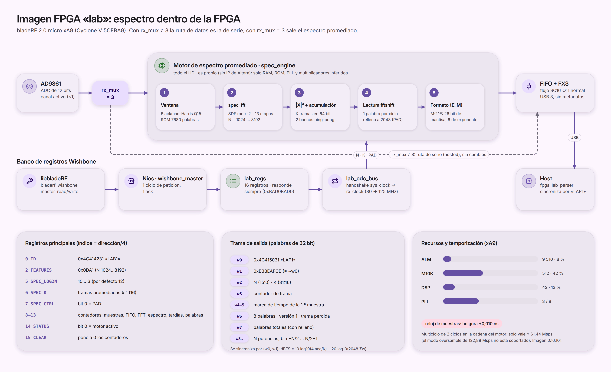
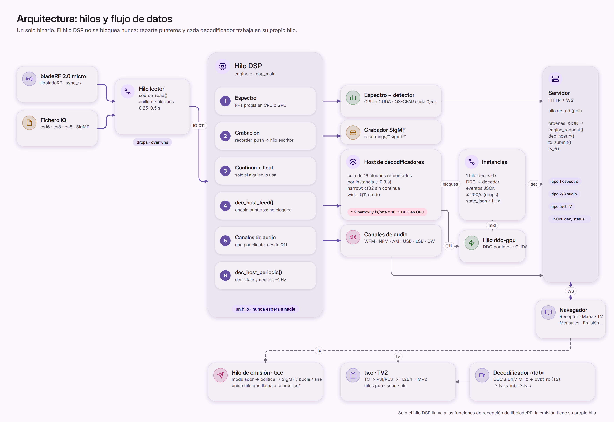

# Hardware (lado host): bladeRF 2.0 micro xA9

## Figuras

<picture>
  <source media="(prefers-color-scheme: dark)" srcset="../img/fpga-lab-dark.png">
  
</picture>

*Figura. Imagen FPGA «lab»: motor de espectro en la ruta de RX y banco de registros Wishbone (detalle en [FIRMWARE.md](FIRMWARE.md); sin probar todavía en la placa).*

<picture>
  <source media="(prefers-color-scheme: dark)" srcset="../img/arquitectura-dark.png">
  
</picture>

*Figura. Dónde encaja el hardware: solo el hilo DSP llama a las funciones de recepción de libbladeRF; la emisión usa su propio hilo.*

Qué hace el servidor con las funciones de la FPGA 0.16 / libbladeRF 2.6.1. Código:
`src/sdr/source.{h,c}` (fuente), `src/sdr/sweep.{h,c}` (barrido), enganches en
`src/engine.c` y órdenes en `src/main.c`. Pruebas: `tests/test_source.c`.

Estado de verificación: lo marcado **(sin hardware)** se ha probado con ficheros y con
un radio simulado (`tests/test_source.c`), no con el bladeRF, porque durante el
desarrollo lo tenía abierto el servicio `openwebrx`. Hay que repetir esas pruebas en
el equipo libre (ver el final).

## 1. Modo oversample (hasta 122,88 Msps)

- Se activa solo: si la tasa pedida supera 61,44 Msps (`SOURCE_RATE_NATIVE_MAX`),
  `source_set_rate()` para el flujo, hace `bladerf_enable_feature(OVERSAMPLE)`,
  fija la tasa (libbladeRF reescribe los registros del AD9361 en cada
  `set_sample_rate`) y reconfigura el flujo en **SC8_Q7_META**. Al volver a
  ≤ 61,44 Msps lo desactiva y vuelve a SC16_Q11_META. Con el AD9361 funcionando al
  doble de reloj, libbladeRF informa la mitad de la tasa real; la API ya lo corrige.
- Disponibilidad: bladeRF 2.0 con FPGA ≥ 0.15 (`rate_max_oversample` en el estado; `null`
  si no hay). `engine_sanitize` y `alloc_block` aceptan > 61,44 Msps solo entonces
  (un fichero puede llevar cualquier tasa).
- **Conversión**: `source_read()` entrega siempre Q11 int16 (±2048). SC8→Q11 es
  `x·16` (`source_sc8_to_q11`, vectorizado). Razón de no llevar int8 por todo el
  programa: espectro CPU/GPU, grabador SigMF, canales y los decodificadores WIDE
  (`process_raw`) están escritos para int16; la conversión cuesta ~0,1 ns/muestra
  frente a ≈2,6 ns/muestra del resto de la ruta. La escala se conserva (los dBFS
  son comparables), pero el suelo de cuantización es el de 8 bit (≈ −48 dBFS por
  muestra; por bin de FFT queda ≈ 10·log10(N/2) dB más abajo) y el LSB útil es 16.
- Buffers: a > 30,72 Msps el flujo usa 64 transferencias de 64 Ki muestras (colchón
  ≈ 34 ms a 122,88 Msps); con menos tasa, los de siempre.
- Limitaciones: en oversample no se fija el ancho de banda analógico (libbladeRF avisa
  de "resultados desconocidos"); la TX se rechaza (`source_tx_configure`); la
  calibración de ganancia no se ofrece (`dbm_offset: null`); no hay quick-tune.
- Estado (`status`): `format` ("sc16q11" | "sc8q7" | "cs16" | "cs8" | "cu8"),
  `oversample` (bool), `device.rate_max_oversample` (Hz | null). `device.rate_max`
  sigue siendo 61,44 M (el máximo "normal").

### Medidas (fichero SC8 a 122,88 Msps, sin hardware)

Reproducción de un SC8 de 12,3 Msamp en bucle, `--no-gpu`, sin GPU, 1 núcleo del DSP:

| Caso | Tasa medida | Carga DSP |
|---|---|---|
| 122,88 Msps, sin clientes (sin espectro) | 122,78 Msps | 0,32 |
| 122,88 Msps, 1 cliente con espectro CPU (FFT 4096, 20 fps) | 106,8 Msps | 0,88 (no sostiene) |
| 61,44 Msps, 1 cliente con espectro CPU | 61,40 Msps | 0,60 |

Conclusión: la CPU sostiene la conversión y el reparto a 122,88 Msps (un tercio de un
núcleo); el espectro en CPU no llega y a esa tasa habrá que usar la GPU (`CUDA=1`) o
bajar `fps`/FFT. Lo que **no** se ha medido es el USB 3: 122,88 Msps × 2 B = 246 MB/s
(SC16 a 61,44 Msps es lo mismo en bytes/s), cerca del techo práctico del FX3.
**(sin hardware)** Pendiente: overruns reales con el equipo libre y el caso del issue
nuand/bladeRF#940 (¿tasa efectiva a la mitad a 50 Msps en oversample?).

## 2. Modos de ganancia

`gain_mode` en `config` (orden WebSocket, fichero de configuración y `status`):

| Valor | libbladeRF | Comportamiento |
|---|---|---|
| `auto` | `BLADERF_GAIN_DEFAULT` | AGC por defecto (en el 2.0 micro, lenta) |
| `manual` | `BLADERF_GAIN_MGC` | ganancia fija = `gain` (dB) |
| `fast` | `FASTATTACK_AGC` | AGC rápida: ráfagas (ADS-B, buscas); "bombea" el ruido |
| `slow` | `SLOWATTACK_AGC` | AGC lenta: señales continuas |
| `hybrid` | `HYBRID_AGC` | lenta con ataque rápido ante sobrecarga |

Compatibilidad: `"auto"`/`"manual"` como antes; se aceptan también los alias `mgc`,
`agc_fast`, `agc_slow`, `agc_hybrid`. Un valor desconocido devuelve un `error`. Con
AGC el campo `gain` se ignora y `gain_now` informa de la ganancia real.

## 3. Calibración de ganancia → dBm

libbladeRF 2.6 trae tablas de calibración de ganancia por unidad
(`<serie>_rx_gain_cal.tbl/.csv`, en `~/.config/Nuand/bladeRF`, `/etc/Nuand/bladeRF`,
…; las mide Nuand con un generador de señal). Al abrir el equipo, `source.c` intenta
`bladerf_load_gain_calibration(RX0, NULL)` y, si hay tabla, `bladerf_enable_gain_calibration`.
Con la tabla activa `set_gain` compensa la respuesta de esa unidad y

    dBm = dBFS − gain_target        (como `bladeRF-power`; gain_target = bladerf_get_gain_target)

`status.dbm_offset` = `−gain_target` (dB; se suma al nivel en dBFS) o `null` si no hay
tabla, si la biblioteca cargada es anterior a 2.6, o en oversample. Se refresca cada
2 s y al aplicar la configuración. Los dBFS del espectro tienen 0 dBFS = tono complejo
de 2048 de amplitud, igual que `bladeRF-power` (2047; diferencia 0,004 dB).
En este equipo no hay tabla (`~/.config/Nuand/bladeRF` no existe) → `null`.

Nota de enlazado: hay dos `libbladeRF.so` (`/usr/lib/x86_64-linux-gnu`, anterior, y
`/usr/local/lib`, 2.6.1) y el enlazador toma la vieja, que no tiene estas funciones;
por eso se declaran como símbolos débiles (en ejecución se carga la 2.6.1). Sería más
limpio añadir `-L/usr/local/lib -Wl,-rpath,/usr/local/lib` al `Makefile`.

## 4. Barrido rápido

Teoría y algoritmo en la cabecera de `src/sdr/sweep.h`. Resumen: tasa fija
(10–61,44 Msps, la menor con la que caben los saltos en los 256 perfiles de
sintonía rápida del 2.0 micro; p. ej. 70 MHz–6 GHz → 40 Msps, ≈ 212 saltos), FFT de
`N` puntos por salto, 70 % central de cada FFT, tramos contiguos sobre una rejilla de
bins común (sin solapes ni huecos), media restada contra la continua, ganancia
forzada a manual con la actual. Retunes con `bladerf_schedule_retune` a marcas de
tiempo; si hay un overrun, un hueco en las marcas de tiempo o el FPGA va muy por
delante de la lectura, cancela la cola y re-sincroniza (`restarts` en el estado). Si
no quedan perfiles o el retune programado no llega a tiempo 6 veces seguidas, pasa a
modo **lento** (`set_frequency` + descartar hasta la marca posterior).

Órdenes:

    {"cmd":"sweep","start":Hz,"stop":Hz,"fft":N}      N potencia de 2 (256–8192, defecto 1024)
    {"cmd":"sweep_stop"}

Resolución: `bin = tasa / fft` (40 Msps / 1024 = 39 kHz). Mientras barre, el motor
no hace espectro normal, detector, audio, decodificadores ni grabación; una `config`
posterior queda pendiente hasta `sweep_stop`, que repone tasa, frecuencia, ganancia y
espectro. `status.sweep` = `null` o `{"start","stop","fft","rate","hops","bins","mode":"quick"|"slow","sweeps","restarts"}`.
Errores (`error`): fuente de fichero, rango vacío o fuera de 47 MHz–6 GHz, `fft` no válido.

**Mensaje binario tipo 4** (servidor → cliente, little-endian; misma cabecera que el tipo 1):

| Bytes | Campo |
|---|---|
| `[0]` | 4 |
| `[1]` | 0 |
| `[2]` | bandera: bit 0 = pasada completa (si 0, actualización parcial cada 0,25 s) |
| `[3]` | progreso 0–100 (% de saltos de la pasada) |
| `[4..7]` | u32 n = nº de bins |
| `[8..15]` | f64 centro Hz = (inicio + fin)/2 |
| `[16..23]` | f64 "tasa" Hz = fin − inicio = n·bin_hz (así `inicio = centro − tasa/2`, bin i ↔ `inicio + i·tasa/n`) |
| `[24..27]` | f32 dbmin = −140 |
| `[28..31]` | f32 dbstep = 0,5 |
| `[32..]` | n bytes v: dBFS = dbmin + v·dbstep (satura en −12,5 dBFS, como el tipo 1) |

Un cliente que ya pinta el tipo 1 puede pintar el 4 igual (centro/tasa/n); la trama
parcial lleva los bins aún no barridos con el valor de la pasada anterior (o −140
en la primera). **Falta documentarlo en `docs/arquitectura/WEBSOCKET.md` y tratarlo en la web**
(`web/**`: tipo 4, órdenes `sweep`/`sweep_stop`, `status.sweep`, `gain_mode`
nuevo, `format`, `oversample`, `dbm_offset`, `device.rate_max_oversample`).

Límites conocidos del 2.0 micro (libbladeRF 2.6): 256 perfiles de quick-tune por
sesión y no reciclables (se cachean por frecuencia: repetir el mismo barrido no
gasta más; otro rango distinto sí); los perfiles son sensibles a la temperatura (no
se refrescan: si el nivel deriva, reiniciar el servidor); tras usar quick-tune
libbladeRF reinicializa el RFIC al cerrar. **(sin hardware)** Ajustes a validar en el
equipo: `settle` (250 µs por defecto, `sweep_cfg_t.settle_us`), antelación `QAHEAD = 8`
frente al tamaño real de la cola del Nios, y la velocidad (objetivo: un barrido de
70 MHz–6 GHz en ≲ 0,3 s).

## 5. Fuente de fichero

`cs16` (Q11 tal cual), `cs8` (×16), `cu8` (−128, ×16) y SigMF (`ci16_le`, `ci8`, `cu8`;
`ci16_le` con `bladerf_lab:full_scale` < 4096 = Q11, si no ÷16). Se lee en bucle a
ritmo real. `tests/test_source.c` lo verifica (incluida la vuelta del bucle cuando un
bloque da varias vueltas al fichero).

## 6. Pendiente con el equipo libre (solo RX)

1. 122,88 Msps: overruns y `meas_rate` reales; comprobar el issue #940.
2. Barrido: `--replay` no sirve; lanzar `{"cmd":"sweep","start":70e6,"stop":6e9}` y medir
   `sweeps`/`restarts`, nivel de costuras con un generador de señal y retraso real del retune.
3. `dbm_offset` con una tabla de calibración instalada.

## 7. Espectro generado en la FPGA (imagen «lab»)

Fuente de espectro alternativa (CPU / GPU / FPGA) del motor, `src/engine.c` + `src/sdr/fpga_lab.*`.

- **Detección**: `engine_create` llama a `fpga_lab_probe` (versión de FPGA 0.16.101 y marca 0xA en
  `config_gpio` antes de tocar Wishbone; en la imagen de serie no se accede al bus). Aparece en
  `status.fpga_lab.present` (y `version`). Si se carga la lab con el servidor ya arrancado, se
  vuelve a sondear al pedir `spectrum_src: "fpga"`.
- **Activación** (hilo DSP, lector en pausa): RX parado → sondeo → N/K (`fpga_lab_choose_params`:
  N = FFT pedida en 1024…8192, K = rate/(fps·N), con relleno) → RX con rx_mux = 0 → 4 lecturas →
  rx_mux = 3 («late-mux», §16.2 de FIRMWARE.md). El anillo pasa a bloques de 4096 palabras.
- **Datos**: las palabras SC16 van al intérprete de tramas; cada trama se convierte a dBFS y sigue
  el camino normal (relleno del pico de continua, detector, S-meter, mensaje tipo 1 con `[1]` = 2).
- **Salida**: `spectrum_src: "cpu"|"gpu"` (rx_mux = 0, se reinicia el flujo IQ y se reconstruye
  la FFT) o automática si no llegan tramas en 3 s. No hay IQ en modo FPGA: grabar y barrer se rechazan.
- Pruebas sin placa: `tests/test_fpga_spectrum.c`. En placa, secuencia de prueba en el informe de F1.
