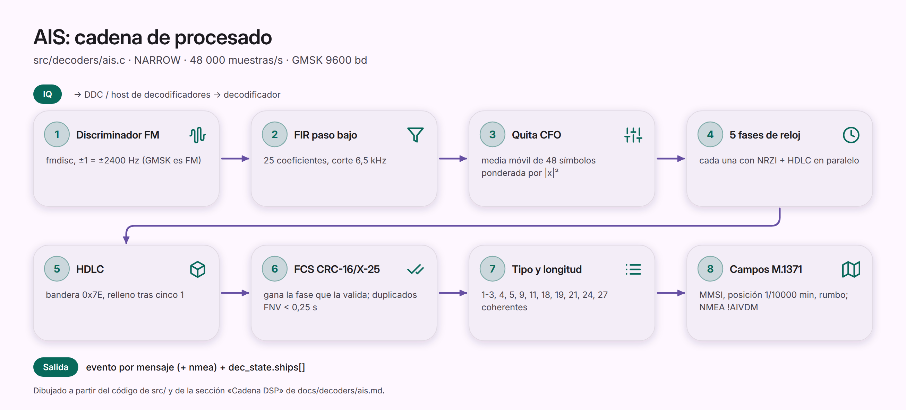
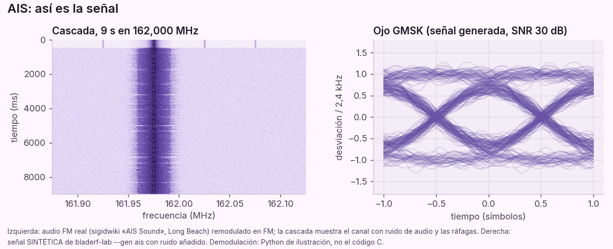
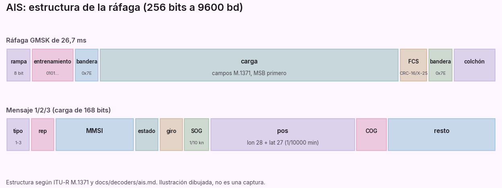
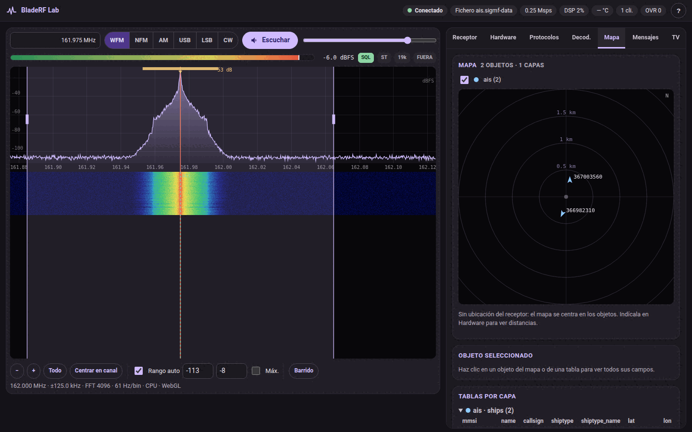

# AIS (Automatic Identification System)

<!-- vision-rapida:inicio (generada por docs/img/src/doc_decoders.py) -->

## Visión rápida

<picture>
  <source media="(prefers-color-scheme: dark)" srcset="../img/decoders/ais-cadena-dark.png">
  
</picture>

*Figura. Cadena de procesado de AIS, dibujada a partir del código de `src/` y de la sección «Cadena DSP» de este documento.*

### Así es la señal

<picture>
  <source media="(prefers-color-scheme: dark)" srcset="../img/decoders/ais-ojo-dark.png">
  
</picture>

*Figura. Cascada de la grabación (audio real remodulado) y diagrama de ojo GMSK de una señal generada.*

<picture>
  <source media="(prefers-color-scheme: dark)" srcset="../img/decoders/ais-estructura-dark.png">
  
</picture>

*Figura. Ráfaga AIS y mensaje 1/2/3.*

La procedencia de cada señal (grabación real o sintética) y qué parte del procesado es Python de ilustración y no el código C se indican en el pie de cada imagen.

### Ejemplo de evento y de estado

Procedencia: audio FM real (sigidwiki «AIS Sound», Long Beach) remodulado en FM. Sacado de ejecutar el decodificador, no escrito a mano (`bladerf-lab --replay ais.sigmf-meta --decode ais@161975000 --print`).

Evento `dec` (campo `msg`, listas largas recortadas):

```json
{
  "msg_type": 1,
  "repeat": 0,
  "mmsi": 367003560,
  "class": "A",
  "lat": 33.767095,
  "lon": -118.217115,
  "sog": 0.0,
  "cog": 0.0,
  "navstat": 15,
  "navstat_name": "no definido",
  "second": 45,
  "nmea": "!AIVDM,1,1,,A,15N07b?P00GRn56CDU`@0?wJ0HKO,0*22",
  "text": "AIS 1 MMSI 367003560 33.7671,-118.2171 0.0 kn"
}
```

Último `dec_state` recibido por WebSocket (`state`, listas recortadas):

```json
{
  "msgs": 2,
  "count": 2,
  "ships": [
    {
      "mmsi": 367003560,
      "name": "",
      "callsign": "",
      "shiptype": 0,
      "shiptype_name": "",
      "lat": 33.76709,
      "lon": -118.21712,
      "sog": 0.0,
      "cog": 0.0,
      "navstat": 15,
      "navstat_name": "no definido",
      "dest": "",
      "bow": 0,
      "stern": 0,
      "port": 0,
      "stbd": 0,
      "draught": 0.0,
      "class": "A",
      "msgs": 1,
      "age": 13
    },
    {
      "mmsi": 366982310,
      "name": "",
      "callsign": "",
      "shiptype": 0,
      "shiptype_name": "",
      "lat": 33.76142,
      "lon": -118.21862,
      "sog": 0.0,
      "cog": 205.6,
      "navstat": 0,
      "navstat_name": "en marcha con motor",
      "dest": "",
      "bow": 0,
      "stern": 0,
      "port": 0,
      "stbd": 0,
      "draught": 0.0,
      "class": "A",
      "msgs": 1,
      "age": 2
    }
  ]
}
```

### En la web



*Captura de la interfaz con un servidor `--replay` propio mostrando AIS.*

<!-- vision-rapida:fin -->

Fuentes: ITU-R M.1371 (capa física anexo 2 §3, mensajes), tabla de campos de
gpsd "AIVDM/AIVDO protocol decoding", Kanaan et al. arXiv:2503.01744 (PLVA, no
implementado).

## Teoría

- Canales 161,975 MHz (AIS 1, "A") y 162,025 MHz (AIS 2, "B"), canal de 25 kHz.
- GMSK con BT = 0,4 a 9600 bit/s, índice de modulación 0,5: cada símbolo gira la
  fase ±π/2, desviación ±2400 Hz. A 48 ksps hay 5 muestras por símbolo.
- Datos: NRZI (0 = cambio de nivel) + HDLC: bandera 0x7E, relleno de ceros tras
  cinco unos, FCS CRC-16/X-25 sobre los bits de carga (LSB primero). La carga son
  campos de bits transmitidos MSB primero (no hay alineación a byte: la FCS se
  calcula bit a bit, `hdlc.c`).
- Ráfaga: rampa, 24 bits de entrenamiento, bandera, carga + FCS, bandera, colchón.

## Cadena DSP (`src/decoders/ais.c`)

1. Discriminador FM (`fmdisc`, ±1 = ±2400 Hz). GMSK es FM de envolvente
   constante: no hace falta fase de portadora.
2. FIR paso bajo de 25 coeficientes con corte 6,5 kHz (la elección se midió: 5,5 y
   8,5 kHz son peores).
3. El CFO es una constante sumada al discriminador. Su media móvil de 48 símbolos
   ponderada por |x|² (sin ponderar, el ruido anterior a la ráfaga la sesgaba: del
   60 % al ~99 % de tramas a 10 dB) es la estimación de CFO.
4. **Segunda pasada (D9)**: el IQ, retrasado 180 muestras (3,75 ms) para que la
   estimación ya haya visto el principio de la ráfaga, se derrota con ese CFO y se
   filtra a ±6 kHz (FIR complejo de 41 coeficientes) antes de un segundo
   discriminador + el mismo paso bajo. El canal del DDC es de 25 kHz porque el CFO
   puede llegar a ±6,25 kHz, pero la señal GMSK (BT 0,4) ocupa ~±7 kHz: ya sin CFO se
   descarta casi la mitad del ruido que entra en el discriminador. Cerca del umbral
   de FM cada dB menos de ruido de entrada vale más a la salida (menos «clics»).
   Se midió el corte (4,5/5,5/6/6,5/8/10/12 kHz) y el retardo (40-300 muestras): ±6
   kHz y 120-200 muestras; con retardo ≥ 300 la estimación se queda fuera del
   principio de la ráfaga y se pierde la trama siguiente.
5. Reloj: cinco desfases de muestreo en paralelo, cada uno con NRZI + HDLC. Gana
   el que valida la FCS; los duplicados (misma carga en menos de 0,25 s) se
   descartan por huella FNV. No hay lazo que enganchar en una ráfaga de 27 ms; a
   ±100 ppm la deriva en 1000 bits es 0,1 símbolo.
6. **Decisión blanda + CRC (D9)**: de cada fase se guarda el nivel NRZI y la
   fiabilidad |y − dc|. Si una trama con bandera de cierre exacta falla el CRC se
   prueban las inversiones de 1 y de 2 de los 16 niveles menos fiables
   (decodificador de Chase de orden 2, con el CRC-16 como juez). Un error de nivel
   son dos errores de bit tras el NRZI, y la inserción de ceros puede cambiar la
   longitud, por eso se rehace todo el desentramado en cada variante
   (`hdlc_check_fcs`). Solo se arma una candidata si hay una ráfaga (potencia de 128
   muestras ≥ 2× el suelo de ruido) y los 24 bits previos a la bandera de inicio
   alternan (la secuencia de entrenamiento, ≤ 12 fallos).
7. El camino 1-3 + HDLC sin derrotar sigue funcionando en paralelo: con dos ráfagas
   solapadas de desvío distinto la derrotación sigue a la más fuerte y pierde la otra
   (la grabación real `ais_la_fm48k.cs8` es un caso: ahora salen sus dos tramas, antes
   una).
8. Tipo y longitud deben ser coherentes (1-3, 4, 11, 9, 18, 24, 27: longitud
   exacta; 5: 420-430; 19: 312; 21: 272-360; los demás tipos solo con su longitud mínima
   de M.1371 y, como no hay campos que validar, solo si hay una ráfaga de potencia).
   El MMSI debe tener una forma válida (MID 201-799, grupo, costera, SAR, AtoN, SART…).

## Sensibilidad frente a SNR (D9, 2026-11-20)

Modulador del test (9 ráfagas: 1, 5, 18, 24A, 24B, 19, 21, 4, 27) + AWGN medido en
48 kHz + filtro de canal de 25 kHz como el DDC; CFO −6250/0/+6250 Hz y −100/0/+100
ppm repartidos; 69 intentos × 9 mensajes = 621 por punto. Tasa de mensajes
distintos recuperados (NMEA igual al de referencia):

| SNR (dB) | antes | después | ajenos (después) |
|---|---|---|---|
| 2 | 0,2 % | 6,9 % | 0 |
| 4 | 3,7 % | 47,0 % | 0 |
| 6 | 35,9 % | 90,0 % | 1 |
| 8 | 82,3 % | 99,5 % | 0 |
| 10 | 98,1 % | 100 % | 0 |
| 12 | 99,4 % | 100 % | 0 |

SNR para el 50 % de los mensajes: **≈ 6,6 dB → ≈ 4,3 dB (−2,3 dB)**. De ese margen,
≈ 1,6 dB los pone la segunda pasada (derrotar y estrechar antes del discriminador) y
≈ 0,7 dB la corrección por fiabilidad. Pocas decenas de mensajes por punto del test
(`test_snr`, 24 intentos): ±5 puntos.
«Ajenos»: eventos con CRC válido cuyo contenido no es ninguno de los 9 (corrección
falsa); ≈ 0,2 % a 3-6 dB. Las correcciones de dos niveles exigen un MMSI ya visto en la
tabla: en tráfico real (cada barco repite cada pocos segundos) pierden menos que en el
test, donde cada intento empieza sin tabla.

Falsos positivos en ruido solo (AWGN filtrado a 25 kHz, 48 ksps): antes ≈ 0,9 por hora
(9 eventos en 10 h, casi todos de tipos sin campos que validar: 7, 12, 14, 15, 23, 25);
ahora **0 en 15 h** y 600 s en `test_ais`. Coste: ≈ 0,05 s de CPU por segundo de señal
en reposo (5 % de un núcleo) y ≲ 0,15 con el canal saturado de ráfagas a 4-6 dB.

## Mensajes

1/2/3 (clase A), 4/11 (estación base, hora UTC), 5 (estáticos y viaje), 9
(aeronave SAR, posición), 18 (clase B), 19 (clase B ampliado), 21 (ayuda a la
navegación), 24 A/B (clase B estáticos), 27 (largo alcance). Posiciones en 1/10000
min (1/10 min en el 27). Cada evento incluye `nmea` con sentencias `!AIVDM`
(checksum correcto, partidas a 60 caracteres de carga, id de secuencia rotativo,
canal A/B según la frecuencia de la instancia).

## Eventos

```json
{"msg_type":1,"repeat":0,"mmsi":265547250,"class":"A","lat":57.66035,"lon":11.832977,
 "sog":13.9,"cog":40.4,"hdg":41,"navstat":0,"navstat_name":"en marcha con motor",
 "second":33,"nmea":"!AIVDM,1,1,,A,...,0*xx","text":"AIS 1 MMSI 265547250 57.6604,11.8330 13.9 kn"}
```
Tipo 5 añade `name, callsign, shiptype(_name), imo, bow/stern/port/stbd, eta, draught,
dest`; tipo 4 `utc`; tipo 21 `aid_type`; tipo 24 `part`. `class`: A, B, S (base), N (ayuda).

## state_json

`{"msgs":N,"count":N,"ships":[{"mmsi","name","callsign","shiptype","shiptype_name",
"imo","lat","lon","dist_km","bearing","sog","cog","hdg","navstat","navstat_name",
"dest","bow","stern","port","stbd","draught","class","msgs","age"}]}`
Caducidad 600 s, máximo 1024 barcos. `dist_km`/`bearing` si el receptor tiene
ubicación (`set_location`).

## Pruebas (`tests/test_ais.c`)

- Capa de carga con las sentencias de gpsd (tipo 1 → MMSI 477553000, 47,58283 N
  −122,34583; tipo 5 de dos partes → MT.MITCHELL, WDA9674, SEATTLE): checksum,
  regeneración exacta de la sentencia tipo 1.
- 9 ráfagas (1, 5, 18, 24A, 24B, 19, 21, 4, 27) limpias: 9/9. Con AWGN 10 dB
  (en 48 kHz, luego filtro de canal de 25 kHz como el DDC), CFO ±6250 Hz y ±100
  ppm: 81/81.
- `test_snr`: curva 2-10 dB (24 intentos); exige > 25 % a 4 dB, > 45 % a 5 dB, > 97 % a
  10 dB y ≤ 2 mensajes ajenos en total (sin la mejora: 4 %, 12 % y 98 %).
- Ruido solo: 20 s y 600 s (60 s con sanitizers): 0 eventos. Coste de CPU < 0,3.
- Grabación real: las dos tramas de la colisión de `ais_la_fm48k.cs8`.

## Limitaciones

- PLVA / MLSE no implementados (Kanaan et al. arXiv:2503.01744 es para colisiones de
  satélite). La sensibilidad queda ~1-2 dB por detrás de un receptor óptimo; el siguiente
  paso sería un MLSE de 4 estados sobre la fase GMSK, en lugar del discriminador.
- La segunda pasada añade 3,75 ms de retardo + 0,8 ms de filtros; con el flujo cortado en
  seco (un fichero sin cola) la última ráfaga necesita ~250 muestras posteriores para salir
  (el camino sin derrotar la entrega igualmente a SNR alta).
- Las correcciones por fiabilidad exigen que las 24 bits de entrenamiento alternen (≤ 12
  fallos) y que la bandera de cierre sea exacta: con una bandera corrompida solo se prueba
  la trama tal cual.
- Constante no verificada contra la norma: si la secuencia de entrenamiento va
  también en NRZI (no se usa en la recepción).
- Mensajes distintos de los listados se descartan.
- Una colisión de dos ráfagas en la misma ranura no se separa.

## Validación con señales reales (V1, 2026-11-15)

Grabaciones de la Signal Identification Wiki: "AIS Sound" (audio FM, Long Beach/Los Ángeles) y
"AIS IQ" (IQ a 48 kHz, Dinamarca, 57°N 10°E). Antes: solo salían mensajes "tipo 8" con MMSI
98xxxxxxx (CRC correcto, campos mal interpretados). **Constante equivocada: el orden de bits de
los campos.** El HDLC transmite cada octeto con el bit menos significativo primero y los campos de
ITU-R M.1371 se definen sobre los octetos ya reordenados: el bit k del flujo recibido es el bit
7 − k%8 del octeto k/8. `ais_unscramble_bytes()` lo aplica antes de `ais_parse()` y el modulador
(`mod_ais.c`) lo deshace antes de `hdlc_encode`. Después: tipo 1, MMSI 367003560/366982310
(EE. UU.), posición 33,767°N 118,217°O, y en el IQ danés buques con MMSI 219…/538… y posiciones en
el Skagerrak. Una implementación independiente (Python: NRZI + HDLC + CRC-16) dio los mismos
tipos/MMSI. Test: `tests/data/ais_la_fm48k.cs8` y las NMEA reales en `tests/test_ais.c`.
Los tipos 5/18/19/21/24 siguen sin contrastar con tráfico real (la grabación solo tiene el 1 y 8
tras corregir). PLVA sigue sin hacerse.
