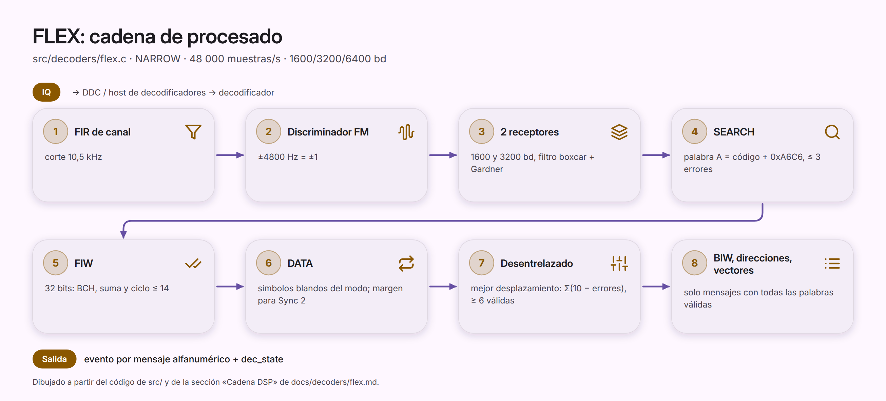
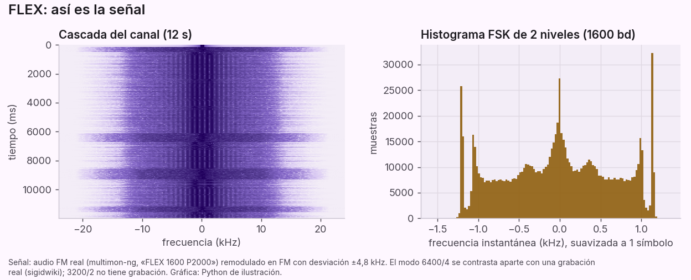
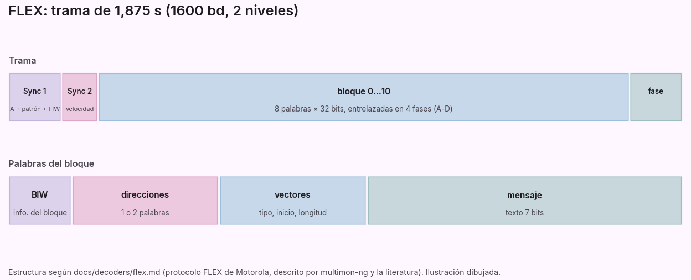
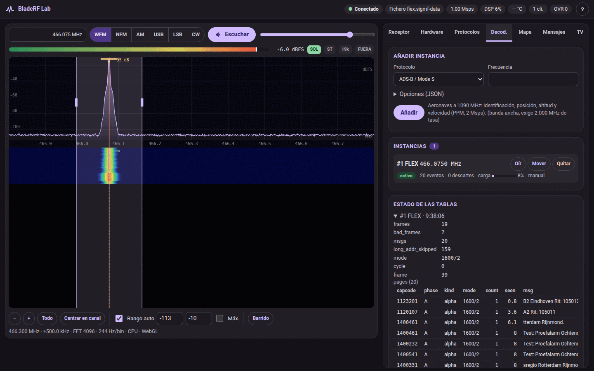

# FLEX

<!-- vision-rapida:inicio (generada por docs/img/src/doc_decoders.py) -->

## Visión rápida

<picture>
  <source media="(prefers-color-scheme: dark)" srcset="../img/decoders/flex-cadena-dark.png">
  
</picture>

*Figura. Cadena de procesado de FLEX, dibujada a partir del código de `src/` y de la sección «Cadena DSP» de este documento.*

### Así es la señal

<picture>
  <source media="(prefers-color-scheme: dark)" srcset="../img/decoders/flex-senal-dark.png">
  
</picture>

*Figura. Cascada y histograma FSK de 2 niveles (audio real remodulado).*

<picture>
  <source media="(prefers-color-scheme: dark)" srcset="../img/decoders/flex-estructura-dark.png">
  
</picture>

*Figura. Trama FLEX.*

La procedencia de cada señal (grabación real o sintética) y qué parte del procesado es Python de ilustración y no el código C se indican en el pie de cada imagen.

### Ejemplo de evento y de estado

Procedencia: audio FM real de multimon-ng (FLEX 1600, P2000) remodulado en FM. Sacado de ejecutar el decodificador, no escrito a mano (`bladerf-lab --replay flex.sigmf-meta --decode flex@466075000 --print`).

Evento `dec` (campo `msg`, listas largas recortadas):

```json
{
  "capcode": 1123102,
  "phase": "A",
  "cycle": 0,
  "frame": 9,
  "kind": "alpha",
  "msg": "Fijne dienst",
  "mode": "1600/2",
  "baud": 1600,
  "levels": 2,
  "corrected": 1,
  "text": "FLEX 1600/2 capcode 1123102 fase A alpha: Fijne dienst"
}
```

Último `dec_state` recibido por WebSocket (`state`, listas recortadas):

```json
{
  "frames": 6,
  "bad_frames": 3,
  "msgs": 0,
  "long_addr_skipped": 127,
  "mode": "1600/2",
  "cycle": 0,
  "frame": 1,
  "pages": []
}
```

### En la web



*Captura de la interfaz con un servidor `--replay` propio mostrando FLEX.*

<!-- vision-rapida:fin -->

Decodificador `src/decoders/flex.c` (+ `flex.h`, `pocsag_fsk.h`), modulador `src/tx/mod_flex.c`, test
`tests/test_flex.c`. Narrow, 48 000 Hz. Modos: 1600/2, 3200/2, 3200/4 y 6400/4 (bit/s / niveles).

## Fuentes y qué está confirmado

FLEX es de Motorola y su especificación no es pública. Se ha usado:

* **[T]** S. McCulley, *Design and Implementation of a Practical FLEX Paging Decoder*, tesis de máster,
  Virginia Tech, 1997 (publicada en la Signal Identification Wiki: `sigidwiki.com/images/d/d0/FLEX_Thesis.pdf`):
  modulación (2FSK ±4,8 kHz; 4FSK ±1,6/±4,8 kHz con Gray `00 01 11 10` de −4,8 a +4,8 kHz), trama de
  1,875 s (ciclo de 128 tramas), Sync 1 de dos palabras de 32 bits separadas por 16 bits de puntos, FIW,
  Sync 2 de 25 ms, 11 bloques de 160 ms, entrelazado 8×32, palabra BCH(31,21)+paridad par, fases.
* **[M]** `demod_flex.c` de multimon-ng, **solo como referencia contrastada**: tabla de palabras de
  sincronía, reparto de bits entre fases, polaridad, tipos de vector, fórmula de la dirección larga. No se ha
  copiado código; se ha ejecutado `multimon-ng -a FLEX_NEXT` sobre las mismas grabaciones para comparar.
* Grabaciones reales (sección «Validación»).

| Elemento | Estado |
|---|---|
| Palabra = 21 datos + BCH(31,21) (g = x¹⁰+x⁹+x⁸+x⁶+x⁵+x³+1) + paridad par; primer bit transmitido = LSB de los datos | [T] + real |
| Trama 1,875 s; Sync 1 (112 bits: BS1 32 + [A, 0xA6C6] + 0xAAAA + [~A, ~0xA6C6]) + FIW 32 a 1600 Bd 2 niveles | [T] (144 bits en total) + real (1600/2, 3200/4, 6400/4) |
| Palabra A → modo: 0x870C 1600 Bd/2 niveles (1600 bit/s, fase A) · 0xB068 1600 Bd/4 (3200 bit/s, fases A, B) · 0x7B18 3200 Bd/2 (3200 bit/s, fases A, C) · 0xDEA0 3200 Bd/4 (6400 bit/s, A–D) · 0x4C7C como 0xDEA0 | 0x870C, 0xB068 y 0xDEA0 **reales**; 0x7B18 y 0x4C7C solo de [M] (sin grabación) |
| FIW: suma de nibbles ≡ 0xF, ciclo ≤ 14, trama 0–127 | real |
| **Polaridad**: los bits de la sincronía son los complementarios de los de datos | real + [M] |
| Sync 2 = 25 ms (40 símbolos a 1600 Bd, 80 a 3200 Bd); final con patrón conocido en 6400/4 | duración [T]/[M]; patrón medido en 6400/4 |
| Reparto por símbolo (4 niveles): bit de signo → fases A y C, bit de nivel interno → fases B y D; a 3200 Bd los símbolos alternan (A,B) y (C,D) | [T] + real (6400/4 y 3200/4) |
| A 3200 bit/s con 2 niveles solo viajan las fases A y C | [M]; sin grabación |
| BIW, dirección corta (capcode = w − 0x8000), vectores (suma, tipo, 1ª palabra, longitud) | real |
| Dirección larga: a1 ∈ [1, 0x8000], a2 ≈ 0x1FFFxx, capcode = a1 + ((a2^0x1FFFFF)<<15) + 0x1F9000 | [M], mismos capcodes que multimon-ng en 6400/4; los rangos fuera de lo observado no están confirmados |
| Alfa: palabra de cabecera (bits 11-12 = 3 → mensaje completo) y 7 bits de firma en la 1ª palabra de datos; con dirección larga la cabecera es la 2ª palabra del vector | real, texto idéntico a [M] |
| Numérico: 2 bits de cabecera (10 en el tipo 7), nibbles LSB primero, `0123456789 U -][`, 0xC = relleno; nº de palabras = bits 14-16 + 1 | real, idéntico a [M] |
| Tono con dígitos (bits 7-8 = 0: 3 dígitos en los bits 9, 13, 17; +5 de la 2ª palabra si es larga) | real, idéntico a [M] |

## Cadena DSP

`IQ → FIR de canal (corte 10,5 kHz) → discriminador FM (±4800 Hz = ±1) →` dos receptores con reloj propio
(1600 Bd y 3200 Bd) con filtro adaptado boxcar y reloj de Gardner (`pocsag_fsk.h`, compartido: no se toca).
La ganancia del lazo de reloj de 1600 Bd (`kp`) se sube a 0,10 mientras se busca Sync 1 y vuelve a 0,03 al
seguir la trama (se ajusta desde `flex.c` sobre el campo `kp` del receptor).

Máquina de estados:

1. `SEARCH`: registro de 64 bits del receptor de 1600 Bd; casa `[A][0xA6C6][0xAAAA][~A]` con < 4 errores
   en el marcador de 32 bits y < 4 en la relación A/~A, en ambas polaridades (la polaridad que casa fija
   `inv`). A da el modo (`mode_of`, < 4 errores). La posición `smp0` es 96 símbolos antes (BS1 + sincronía).
2. `FIW`: 16 bits de puntos + 32 de FIW (dato = complemento del bit de sincronía); BCH, paridad, suma de
   nibbles = 0xF, ciclo ≤ 14.
3. `DATA`: símbolos blandos del receptor de la velocidad del modo: Sync 2 (25 ms) + 24 de holgura + 1760 ms.
   En 4 niveles, los picos medidos al final de Sync 2 son un **suelo** para los seguidores de pico: sin él
   las rachas largas de nivel interno (palabras de relleno) encogen la amplitud estimada y el nivel interno
   se normaliza como externo (con 10 dB de SNR la fase B de 3200/4 tenía 79 de 88 palabras válidas sin el suelo y 88 con él).
4. Decodificación: se prueba cada desfase de Sync 2 (±24 símbolos del nominal) puntuando **solo las fases
   de signo** (A, C; el nivel interno depende de un umbral y las fases en reposo dan palabras válidas con
   cualquier desfase): cada palabra válida del bloque 0 suma 10 − errores y una fase cuenta con ≥ 6 de 8
   válidas. Desempates: el patrón de final de Sync 2 (a 3200 Bd) y la cercanía al desfase nominal.
   **A 3200 Bd un símbolo de desfase intercambia A↔C (B↔D) sin invalidar ninguna palabra**, por eso hace
   falta el patrón de Sync 2 (medido en 6400/4 real: signos canónicos `+ + + − + − − −` en los 8 últimos
   símbolos; en 3200/2 se supone igual, **sin grabación que lo confirme**).
5. Fases de nivel interno (B, D): umbral entre nivel interno y externo. Teórico 2/3 de la amplitud
   externa; con audio real se midió 0,3-0,6 (el nivel interno no cae en 1/3), así que si otro umbral de
   {0,55; 0,45; 0,8; 0,35; 0,25} deja ≥ 4 palabras BCH válidas más que 2/3 se usa ese.
6. Se desentrelaza cada fase, se corrige el BCH (≤ 2 errores + paridad) y se recorren BIW, direcciones
   y vectores. Solo se emiten mensajes con dirección, vector (suma de nibbles) y todas las palabras del
   mensaje válidas. Los fragmentos (bits 10-12 de la cabecera de alfa) se emiten tal cual, sin reensamblar.

## Eventos

```json
{"capcode":123456,"phase":"A","cycle":3,"frame":42,"kind":"alpha","msg":"…","mode":"6400/4",
 "baud":6400,"levels":4,"long":false,"corrected":0,"text":"FLEX 6400/4 capcode 123456 fase A alpha: …"}
```
`kind` = `alpha` | `numeric` | `tone` (en `tone`, `msg` lleva los dígitos si los hay). `baud` = bit/s del modo,
`long` = dirección larga (capcode hasta 4 297 068 542), `corrected` = errores BCH corregidos.
Posición: se emite con `dec_emit_span`; `smp0` = primer símbolo de BS1 (inicio de Sync 1) y `smp1` = último símbolo
de datos de la trama (todos los mensajes de una trama comparten posición). Medido contra la verdad inyectada:
≤ 23 muestras de error en los cuatro modos.

## state_json

`{"frames","bad_frames","msgs","long_addr","mode":"1600/2"|null,"cycle","frame","pages":[…]}` con
los últimos 32 mensajes (`capcode`,`phase`,`kind`,`mode`,`count`,`seen`,`msg`), caducidad 600 s.
(`long_addr` cuenta las direcciones largas decodificadas; antes `long_addr_skipped` contaba las ignoradas.)

## Modulador

Una trama por orden: `{"mode":"6400/4","cycle":3,"frame":42,"messages":[{"capcode":123456,"phase":"A","type":"alpha","text":"…"},…]}`
(`type`: `alpha`, `numeric`, `tone` con hasta 3 dígitos en `text`; capcode 1…4 297 068 542, a partir de 1 933 313 con
dirección larga). Fases por modo: 1600/2 → A · 3200/2 → A, C · 3200/4 → A, B · 6400/4 → A–D. Sin parámetros,
mensajes de ejemplo (alfa, numérico, tono) en A y uno por cada otra fase. La trama es la real: Sync 1 de 112
bits con la polaridad de sincronía invertida respecto a los datos, FIW, Sync 2 con el patrón final y los datos
entrelazados. `air_ok = false`.

## Pruebas

`tests/test_flex.c`: [1] los cuatro modos con AWGN 10 dB, CFO ±3125 Hz (¼ del canal de 12,5 kHz) y ±100 ppm:
capcode, fase, tipo y texto; [1d] direcciones largas, tono con dígitos, máximo capcode; [1b] polaridad
invertida en los cuatro modos; [1c] posición `smp0/smp1`; [2] 20 s de ruido → 0 eventos; BCH; grabaciones
reales (abajo). Coste: ≈ 0,01-0,02 s de CPU por s de señal.

## Validación con señales reales

Las muestras salen de audio FM ya demodulado, remodulado en FM (±4,8 kHz, fase acumulada) a 48 kHz
(`tests/data/real/*.sigmf-*`, CC BY-SA 3.0 de sigidwiki, solo recortes de ≤ 2,2 s).

| Muestra | Modo | Referencia | Resultado |
|---|---|---|---|
| multimon-ng `FLEX_1600_2fsk_P2000_proef_alarm.flac` (P2000, NL; `tests/data/flex_p2000_phase.u8`, `real/flex`) | 1600/2 | multimon-ng | idéntico (capcode 1123201, `B2 Eindhoven Rit: 105012`) |
| sigidwiki «FLEX 2-LVL 1600 bps» (hospital, EE. UU.) | 1600/2 | multimon-ng | 3/3 mensajes idénticos |
| sigidwiki «FLEX 6400bps» (`real/flex6400`: una trama, ciclo 4 nº 56) | 6400/4 (0xDEA0), fases A y C, direcciones largas | multimon-ng | los 24 mensajes de multimon-ng del fichero entero salen con el mismo capcode, trama y texto (más 5 tonos/mensajes que multimon-ng no da) |
| sigidwiki «FLEX» (mismo tipo de tráfico) | 6400/4 | multimon-ng | 29 de 36 (los 7 que faltan son 2 tramas cuyo Sync 1 llega mientras aún se acumulan los datos de la anterior: la grabación está empalmada; no se pierden en una emisión real, donde la trama siguiente empieza cuando acaba la anterior) |
| sigidwiki «Flex 3200» (`real/flex3200`) | 3200/4 (0xB068), fases A y B | **ninguna** (multimon-ng no la decodifica) | 15 mensajes en 2,2 s, números de teléfono y «…-911»; BCH + suma de nibbles válidos, pero sin referencia independiente |

**Corrección de V1:** la nota anterior decía que «3200/4» era 0xDEA0 a 1600 Bd. Es al revés: **0xDEA0 es 6400
bit/s (4FSK a 3200 Bd, fases A–D)** y 0xB068 es 3200 bit/s (4FSK a 1600 Bd, fases A y B); 0x7B18 es 3200 bit/s con
2 niveles (fases A y C). Las dos muestras que V1 llamó «3200/4» eran de 6400 bit/s.

**Lo que sigue sin grabación real:** 3200/2 (0x7B18) y 0x4C7C. Su implementación sale de [T]/[M] y del modulador
propio; el reparto de fases A/C y el patrón de final de Sync 2 en 3200/2 son supuestos.

## Limitaciones

* Los mensajes fragmentados (cabecera con bits 10-12 ≠ «completo») se emiten por separado; no hay reensamblado
  ni grupos (tipo 1, instrucción corta) ni mensajes binarios (tipo 6) ni seguros (tipo 0, cifrados).
* Si el Sync 1 de la trama siguiente llega antes de acabar de acumular los datos de la actual (solo en
  grabaciones empalmadas), esa trama se pierde.
* Una trama por detección de Sync 1.
