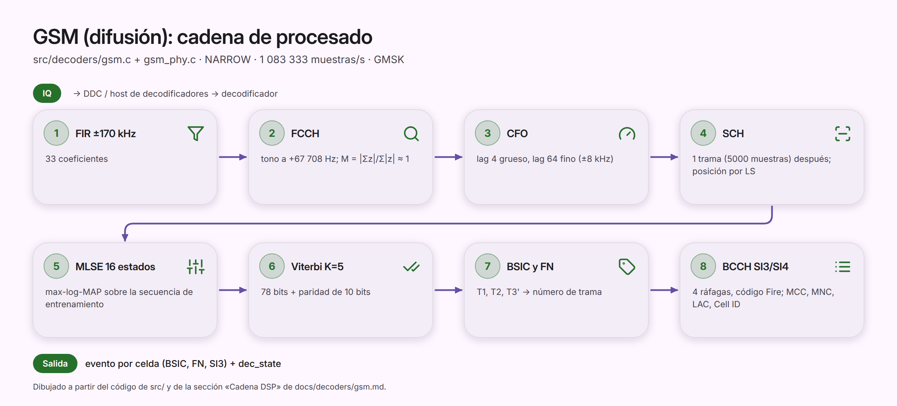
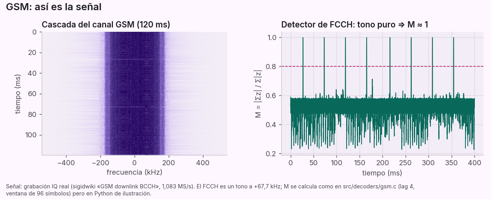
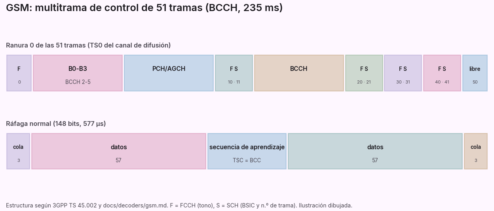
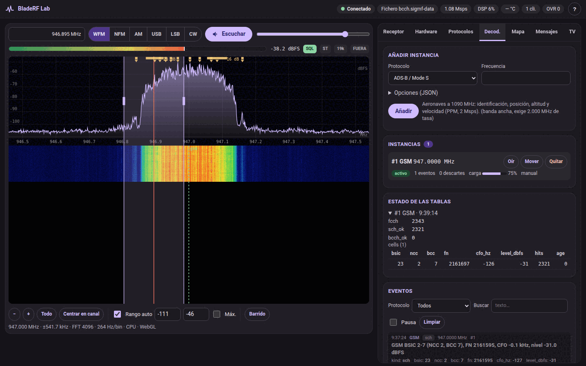

# Decodificador GSM (`gsm`)

<!-- vision-rapida:inicio (generada por docs/img/src/doc_decoders.py) -->

## Visión rápida

<picture>
  <source media="(prefers-color-scheme: dark)" srcset="../img/decoders/gsm-cadena-dark.png">
  
</picture>

*Figura. Cadena de procesado de GSM, dibujada a partir del código de `src/` y de la sección «Cadena DSP» de este documento.*

### Así es la señal

<picture>
  <source media="(prefers-color-scheme: dark)" srcset="../img/decoders/gsm-fcch-dark.png">
  
</picture>

*Figura. Cascada y detector de FCCH sobre la grabación real.*

<picture>
  <source media="(prefers-color-scheme: dark)" srcset="../img/decoders/gsm-estructura-dark.png">
  
</picture>

*Figura. Multitrama de 51 y ráfaga normal.*

La procedencia de cada señal (grabación real o sintética) y qué parte del procesado es Python de ilustración y no el código C se indican en el pie de cada imagen.

### Ejemplo de evento y de estado

Procedencia: grabación IQ real (sigidwiki «GSM downlink BCCH»). Sacado de ejecutar el decodificador, no escrito a mano (`bladerf-lab --replay gsm.sigmf-meta --decode gsm@947000000 --print`).

Evento `dec` (campo `msg`, listas largas recortadas):

```json
{
  "text": "GSM BSIC 2-7 (NCC 2, BCC 7), FN 2161595, CFO -0.1 kHz, nivel -31.0 dBFS",
  "kind": "sch",
  "bsic": 23,
  "ncc": 2,
  "bcc": 7,
  "fn": 2161595,
  "cfo_hz": -127,
  "level_dbfs": -31.0,
  "hits": 1
}
```

Último `dec_state` recibido por WebSocket (`state`, listas recortadas):

```json
{
  "fcch": 313,
  "sch_ok": 310,
  "bcch_ok": 0,
  "cells": [
    {
      "bsic": 23,
      "ncc": 2,
      "bcc": 7,
      "fn": 2162615,
      "cfo_hz": -137,
      "level_dbfs": -30.9,
      "hits": 310,
      "age": 0.0
    }
  ]
}
```

### En la web



*Captura de la interfaz con un servidor `--replay` propio mostrando GSM.*

<!-- vision-rapida:fin -->

Sincronización de una portadora BCCH: FCCH (corrección de frecuencia), SCH → BSIC (NCC, BCC) y número de trama,
y System Information 1, 2, 2bis, 2ter, 3 y 4 del BCCH → MCC, MNC, LAC, Cell ID, ARFCN, portadoras vecinas y parámetros de
selección de celda. Código: `src/decoders/gsm.c`, estructura de
ráfagas y codificación en `gsm_phy.{h,c}` (compartidas con `src/tx/mod_gsm.c`), test `tests/test_gsm.c`.

**Ética (AGENTS.md §0.12):** solo FCCH, SCH y las 4 ráfagas del BCCH (tramas 2–5 de la ranura 0). No se decodifica
ningún PCH/AGCH (aviso/acceso), tráfico, ni se interpreta identidad de abonado alguna; no hay código que lea
ráfagas de otras tramas.

Descriptor: `N`, 1 083 333 Hz (4 muestras/símbolo, 270 833,33 Bd), `bw_hz` 200 000.

## Teoría y cadena DSP

Referencias: 3GPP TS 45.001/45.002 (tramas, multitrama de 51, secuencias de entrenamiento §5.2.3, FN §4.3.3),
TS 45.003 (§4.1 canales de control, §4.7 SCH), TS 45.004 (GMSK), TS 44.018 §9.1.30–36 (SI), §10.5.1.3 (LAI);
gr-gsm y airprobe (organización del receptor); Laurent 1986 (descomposición de CPM).

1. **Filtro** paso bajo de 33 coeficientes (±170 kHz, Kaiser 60 dB): el ruido de 1,08 MHz se reduce ≈ 5 dB.
2. **FCCH.** 148 ceros → fase +π/2 por símbolo = tono +fb/4 = **+67 708 Hz**. `z[n] = x[n]·conj(x[n−4])`, ventana de
   96 símbolos; `M = |Σz|/Σ|z|`: ≈ 1 en un tono, ≈ 0,1 con datos GMSK. Meseta `M ≥ 0,75 … < 0,6` de 150–900 muestras.
   Frecuencia: lag 4 (grueso) + lag 64 (fino, rango ±8 kHz); **CFO = f_tono − 67 708 Hz** (error ≲ 30 Hz). Rango de
   aceptación ±62 kHz alrededor de +67,7 kHz (cubre CFO de ±50 kHz).
3. **Demodulación de ráfaga** (`demod_burst`). Con la codificación diferencial, el primer término de Laurent convierte
   GMSK en BPSK de los bits girado `j^k`: `z_k = x(kT)·(−j)^k = Σ_m h_m b_{k−m} + n`, `b = 1 − 2d`, h de 5 coeficientes.
   Se barre el retardo (±100 muestras para el SCH, ±20 para el BCCH) maximizando la energía explicada por la estimación
   de canal por mínimos cuadrados sobre la secuencia de entrenamiento; luego **MLSE max-log-MAP de 16 estados**
   (conocidos: colas y entrenamiento) con salida blanda LLR.
4. **SCH** = 1 trama (5000 muestras) tras el FCCH: 78 bits blandos (3…41 y 106…144) → Viterbi K=5 r=½ (`conv_gsm_k5`,
   terminación a cero) → 25 bits + paridad de 10 bits (`D^10+D^8+D^6+D^5+D^4+D^2+1`, invertida). Campos MSB primero:
   BSIC(6) = NCC·8+BCC, T1(11), T2(5), T3'(3); `FN = 51·((T3−T2) mod 26) + T3 + 1326·T1`, `T3 = 10·T3'+1`.
5. **BCCH.** Si FN mod 51 = 1, los bloques de FN+1…+4 (SCH + 5000·k) forman un mensaje (en cada multitrama). 456 bits tras
   desentrelazar (45.003 §4.1.4: `B = k mod 4`, `j = 2((49k) mod 57) + ((k mod 8) div 4)`) → Viterbi (224 bits) → código
   Fire `D^40+D^26+D^23+D^17+D^3+1` (paridad invertida, 40 bits) → 23 octetos. **Los octetos salen con el LSB primero**
   (45.003 §4.1.1; la primera versión los leía MSB primero y por eso nunca validaba Fire con señal real).
   **TSC:** 45.002 §5.2.3 exige TSC = BCC, pero la grabación real usa TSC 6 con BCC 7 (residuo del ajuste de canal 100
   veces menor que con la 7). El decodificador prueba las 8 TSC (la BCC primero) sobre la 1.ª ráfaga y se queda con
   la de menor residuo; se memoriza al validar Fire y se vuelve a buscar tras 4 fallos seguidos.
6. **System Information** (44.018 §9.1.31–9.1.36; IE en §10.5.2): primer octeto = L2 pseudo length (`xxxxxx01`), 2.º = 0x06
   (RR), 3.º = tipo. SI3 (0x1B): CI(2), LAI(5), Control Channel Description (10.5.2.11: ATT, BS-AG-BLKS-RES, CCCH-CONF,
   BS-PA-MFRMS, T3212), Cell Options (10.5.2.3: PWRC, DTX, RADIO-LINK-TIMEOUT), Cell Selection Parameters (10.5.2.4:
   histéresis 2 dB/paso, RXLEV-ACCESS-MIN = −110 + n dBm, NECI), RACH Control (10.5.2.29: reintentos, TX-integer,
   CELL-BAR-ACCESS, RE, clases de acceso). SI4 (0x1C): LAI, selección, RACH. SI1 (0x19): Cell Channel Description. SI2
   (0x1A), SI2bis (0x02), SI2ter (0x03): lista BA de vecinas (+ BA-IND, y los NCC permitidos en SI2). Las listas se
   decodifican en formato *bit map 0* (10.5.2.1b.2): ARFCN n ∈ 1…124 en el octeto 16−(n−1)/8, bit (n−1) mod 8 + 1; los
   demás formatos (1024/512/256/128 y mapa variable) se señalan con `"arfcn_list_ok":false`. Asignación a TC =
   (FN div 51) mod 8 (45.002 §6.3.1.3): SI1 0, SI2 1, SI2ter 4, SI2bis 5, SI3 2 y 6, SI4 3 y 7.
   LAI: `MCC2|MCC1, MNC3|MCC3, MNC2|MNC1, LAC(2)`; MNC3 = 0xF → MNC de 2 dígitos. **ARFCN de la portadora** (45.005 §2)
   a partir de la frecuencia del canal + CFO medido (GSM 850, P/E/R-GSM 900, DCS 1800, PCS 1900).

## Eventos y estado

Un evento por celda nueva (`"kind":"sch"`, primer SCH válido de ese BSIC) y otro por cada System Information nuevo o
distinto del último de su tipo en esa celda (`"kind":"si1"|"si2"|"si2bis"|"si2ter"|"si3"|"si4"`), nunca por trama. Todos
llevan los campos acumulados de la celda y, en los de lista, `"arfcns"`/`"ba_ind"`; con `dec_emit_span` el host añade
`sample`/`sample_end` (SCH: una ráfaga; SI: de la 1.ª a la última de las 4 ráfagas; convención de `decoder.h`). Ejemplo
real (SI3 de la grabación de sigidwiki, listas recortadas):

```json
{"text":"GSM BSIC 2-7 ARFCN 60: MCC 231 MNC 02 LAC 1 CI 62301 [si3], 0 vecinas, nivel -30.8 dBFS","kind":"si3",
 "bsic":23,"ncc":2,"bcc":7,"fn":2161687,"cfo_hz":-118,"level_dbfs":-30.8,"arfcn":60,"tsc":6,
 "mcc":231,"mnc":2,"mnc_digits":2,"lac":1,"plmn":"231-02","ci":62301,
 "hyst_db":4,"rxlev_min_dbm":-107,"txpwr_max_cch":5,"neci":1,"cell_bar":0,"max_retrans":4,"reest":0,"ac_barred":0,
 "ccch_conf":0,"bs_ag_blks_res":2,"bs_pa_mfrms":5,"t3212_decih":20,"att":1,"dtx":1,"rlt":20,"pwrc":0,"si_type":27,"hits":10}
```

`state_json`: `{"fcch":n,"sch_ok":n,"bcch_ok":n,"cells":[{bsic,ncc,bcc,fn,cfo_hz,level_dbfs,arfcn,tsc,mcc,mnc,mnc_digits,lac,
plmn,ci,hyst_db,rxlev_min_dbm,…,ncc_permitted,neighbours:[ARFCN],cell_alloc:[ARFCN],hits,si_seen:["si1",…],age}]}`
(caduca a 120 s; la web dibuja la tabla con MCC/MNC/LAC/CI/ARFCN). `air_ok = false`.

## Modulador

`{"ncc":3,"bcc":5,"tsc":5,"fn":816,"frames":161,"mcc":214,"mnc":7,"mnc_digits":2,"lac":4660,"ci":22136,"seed":1,
"cell_alloc":[1,5,9],"neighbours":[10,20]}`: tramas TDMA completas (8 ranuras de 625 muestras); ranura 0: FCCH, SCH, BCCH
(SI1 en TC 0, SI2 en 1, SI3 en 2 y 6, SI4 en 3 y 7, SI2ter en 4, SI2bis en 5) y relleno aleatorio; ranuras 1–7: ráfagas
normales con datos aleatorios. `tsc` (por omisión = `bcc`) permite simular redes con TSC ≠ BCC. Para ver los 7 tipos de
evento hacen falta ≥ 8 multitramas (`frames` ≥ 410). GMSK por integración exacta de fase (`pulse_gmsk`, BT 0,3).

## Pruebas (`tests/test_gsm.c`)

Constantes: las 8 TSC cumplen la propiedad de diseño de la norma (correlación de los 16 bits centrales con la secuencia:
16 en el retardo 0 y exactamente 0 en ±1…±5), la ESQ tiene lóbulos laterales ≤ 6/64. Ida y vuelta de SCH (con errores),
BCCH + Fire + entrelazado, bytes del LAI. **Vectores reales de capa 3:** SI1, SI2, SI2ter, SI3 y SI4 de la grabación
de sigidwiki (copiados como hexadecimal, ida y vuelta por Fire/convolucional y analizados: MCC 231, MNC 02, LAC 1, CI
62301, ARFCN 60, 12 vecinas, NCC permitidos 0x88, T3212 = 20 decihoras, RXLEV mínimo −107 dBm…). Constructor ↔ analizador
de SI1/2/2bis/2ter/3/4. Señal completa a 10 dB con CFO 0/+50/−50/+30 kHz y deriva 0/+100/−100 ppm, dos operadores (MNC
de 2 y 3 dígitos; una con TSC 6 y BCC 2): los 7 eventos (sch + 6 SI), todos los campos, ARFCN y **marca de posición**
(longitud de la ventana ≈ 592 muestras para el SCH y 3·5000 + 592 para el BCCH; inicio en la trama esperada ±24
muestras). Solo ruido → 0 eventos. Grabación real de 0,25 s: SCH (BSIC 23) y un BCCH válido (SI2ter, TSC 6). Coste ≈ 0,03
s/s.

## Limitaciones y constantes no verificadas

* **Validación real.** SCH (211/211), BCCH (42/42 bloques con Fire válido en la grabación de 10 s) y los campos de SI3/SI4
  salen de una captura real; las TSC y la ESQ se contrastaron con sus propiedades de autocorrelación y, por uso, la TSC 6 con
  la grabación. Falta contrastar con otras redes (p. ej. España, MCC 214: la grabación disponible es de la red 231-02,
  Eslovaquia; su MCC/MNC es coherente con una celda de ese país y ARFCN 60 = 947 MHz cae en la banda de bajada GSM 900).
* **BSIC/TSC.** La celda real anuncia BSIC 23 (BCC 7) pero transmite con TSC 6, y su SI2 solo permite los NCC 3 y 7 (0x88),
  no el 2. No se ha podido determinar si es una peculiaridad de la red, de la grabación (p. ej. una captura mezclada) o del
  orden de los bits del BSIC en el SCH (los campos T1/T2/T3' sí se contrastaron). Por eso la TSC se busca en vez de suponerla.
* Un solo término de Laurent y 5 coeficientes de canal (sin multitrayecto largo: no hay ecualizador de 16 símbolos).
* Sin saltos de frecuencia ni combinación de multitramas; cada tipo de SI se ve una vez cada 1–8 multitramas.
* Listas de ARFCN solo en formato *bit map 0*; en la grabación real la SI2ter no lo usa (su primer octeto es 0xDF, bits 8,7 = 11, otro formato: se
  informa `arfcn_list_ok:false`). Los *rest octets* (GPRS, SI13, SI2quater) y el CBCH no se interpretan.
* Sin A5 (el BCCH no se cifra); no se lee ningún canal de aviso/acceso ni identidad de abonado.

## Validación con señal real (V2, 2026-11-15; D8, 2026-11-21)

Grabación: sigidwiki.com `GSM_downlink_BCCH.zip` (IQ 8 bit a 300 kS/s, 10 s; celda con BSIC 23), remuestreada a 1,0833 MS/s.

* FCCH: 211 detecciones; SCH: 211/211 con CRC correcto, **BSIC 23 = NCC 2, BCC 7** en todas.
* **Orden de los campos del SCH:** (BSIC bien, FN mal en la primera versión): d0-d5 BSIC; d6-d15 T1[10..1]; d16 T3'[1]; d17
  T3'[2]; d18-d22 T2 con el **LSB primero**; d23 T1[0]; d24 T3'[0] (se corrigió en V2).
* **BCCH (D8):** la primera versión no decodificaba nunca (0/42) por dos causas: (1) la TSC real es 6, no la BCC (con la 7 el
  residuo del canal es ≈ 4·10⁻⁴ frente a 4·10⁻⁶ con la 6, y los LLR eran ruido); (2) los octetos del nivel 3 van con el LSB
  primero (se leía 0x60 en vez de 0x06). Con ambas correcciones: 42/42 bloques con Fire válido; reparto de tipos: SI1,
  SI2, SI2ter, SI3 y SI4 (cada ≈ 1,2 s; no hay SI2bis en esa red).
* **Celda real:** MCC 231 MNC 02, LAC 1, CI 62301, ARFCN 60 (947 MHz), RXLEV-ACCESS-MIN −107 dBm, histéresis 4 dB,
  reintentos RACH 4, T3212 2 h, CCCH_CONF 0 con 2 bloques AGCH reservados, BS-PA-MFRMS 5, Cell Channel Description
  {39, 79, 103, 110}, 12 vecinas {32, 35, 43, 46, 49, 55, 56, 57, 78, 80, 82, 86}. MCC 231 es Eslovaquia (no España, 214:
  el nombre del fichero es «GSM_TK_03»); MNC 02 es un operador de ese país; el resto de valores es típico de GSM 900.
Fixture: `tests/data/gsm_sigid_bcch_300k.cu8` (150 kB, 0,25 s: una sola multitrama → solo SI2ter; para SI3 reales haría
falta un fragmento de ≥ 2 s).
