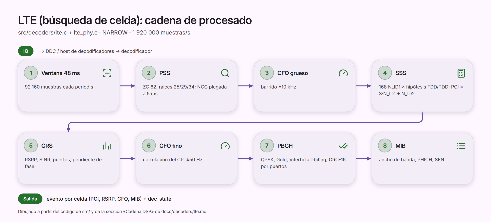
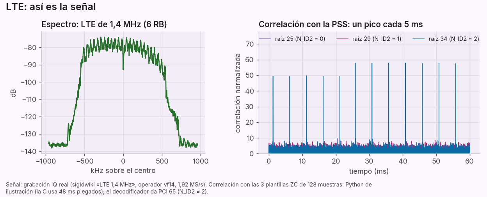
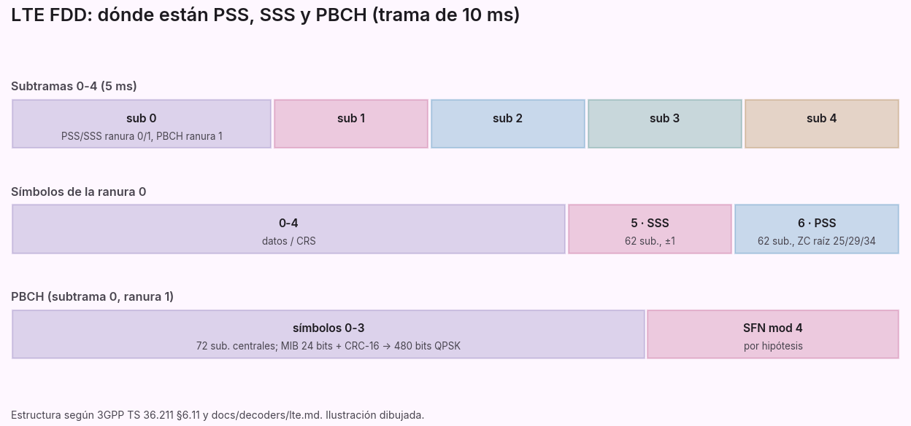
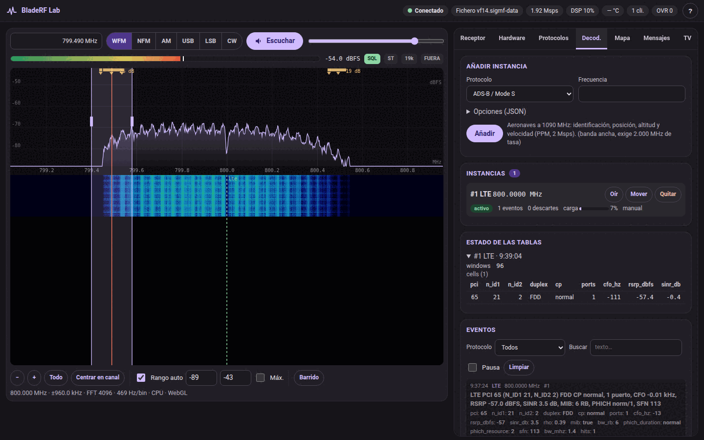

# Decodificador LTE (`lte`)

<!-- vision-rapida:inicio (generada por docs/img/src/doc_decoders.py) -->

## Visión rápida

<picture>
  <source media="(prefers-color-scheme: dark)" srcset="../img/decoders/lte-cadena-dark.png">
  
</picture>

*Figura. Cadena de procesado de LTE, dibujada a partir del código de `src/` y de la sección «Cadena DSP» de este documento.*

### Así es la señal

<picture>
  <source media="(prefers-color-scheme: dark)" srcset="../img/decoders/lte-pss-dark.png">
  
</picture>

*Figura. Espectro y picos de correlación con la PSS cada 5 ms (grabación real).*

<picture>
  <source media="(prefers-color-scheme: dark)" srcset="../img/decoders/lte-estructura-dark.png">
  
</picture>

*Figura. Posición de PSS, SSS y PBCH.*

La procedencia de cada señal (grabación real o sintética) y qué parte del procesado es Python de ilustración y no el código C se indican en el pie de cada imagen.

### Ejemplo de evento y de estado

Procedencia: grabación IQ real (sigidwiki «LTE 1,4 MHz»). Sacado de ejecutar el decodificador, no escrito a mano (`bladerf-lab --replay lte.sigmf-meta --decode lte@800000000 --print`).

Evento `dec` (campo `msg`, listas largas recortadas):

```json
{
  "text": "LTE PCI 65 (N_ID1 21, N_ID2 2) FDD CP normal, 1 puerto, CFO -0.01 kHz, RSRP -57.0 dBFS, SI…",
  "pci": 65,
  "n_id1": 21,
  "n_id2": 2,
  "duplex": "FDD",
  "cp": "normal",
  "ports": 1,
  "cfo_hz": -13,
  "rsrp_dbfs": -57.0,
  "sinr_db": 3.5,
  "rho": 0.39,
  "mib": true,
  "bw_rb": 6,
  "phich_duration": "normal",
  "phich_resource": 2,
  "sfn": 113,
  "bw_mhz": 1.4,
  "hits": 1
}
```

Último `dec_state` recibido por WebSocket (`state`, listas recortadas):

```json
{
  "windows": 14,
  "cells": [
    {
      "pci": 65,
      "n_id1": 21,
      "n_id2": 2,
      "duplex": "FDD",
      "cp": "normal",
      "ports": 1,
      "cfo_hz": -75,
      "rsrp_dbfs": -56.3,
      "sinr_db": -0.7,
      "rho": 0.44,
      "mib": true,
      "bw_rb": 6,
      "phich_duration": "normal",
      "phich_resource": 2,
      "sfn": 477,
      "bw_mhz": 1.4,
      "hits": 10,
      "age": 1.0
    }
  ]
}
```

### En la web



*Captura de la interfaz con un servidor `--replay` propio mostrando LTE.*

<!-- vision-rapida:fin -->

Búsqueda de celdas LTE: PCI, FDD/TDD, prefijo cíclico, CFO, RSRP y SINR aproximadas, nº de puertos, MIB del PBCH
(ancho de banda, PHICH y SFN) y **SIB1** (operador MCC/MNC, banda, TAC, ECI, planificación de los SI) leído del PDSCH.
Solo difusión: PSS, SSS, CRS, PBCH, PCFICH, PDCCH con SI-RNTI y PDSCH de SIB1; no se interpreta ningún otro RNTI ni canal
dedicado (AGENTS.md §0.12). Código: `src/decoders/lte.c` (búsqueda de celda y tabla), `src/decoders/lte_rx.{h,c}` (receptor
de la subtrama 5), `src/decoders/lte_sib.{h,c}` (PCFICH/PDCCH/DCI/turbo/ASN.1) y `lte_phy.{h,c}` (secuencias y PBCH),
compartidos con el modulador `src/tx/mod_lte.c`. Tablas de la norma en `lte_tables.h`. Test: `tests/test_lte.c`.

**Descriptor: `WIDE`, `wide_min_rate` = 1 920 000** (antes `N` a 1,92 Msps). El decodificador recibe las muestras crudas
del hardware y acepta cualquier tasa **1,92·2^n Msps (1,92 / 3,84 / 7,68 / 15,36 / 30,72 / 61,44)**; con otra, `create`
falla con el mensaje «LTE requiere 1,92·2^n Msps». La tasa necesaria para SIB1 la fija el ancho de banda del MIB:

| dl-Bandwidth | RB | tasa mínima | FFT |
|---|---|---|---|
| 1,4 MHz | 6 | 1,92 Msps | 128 |
| 3 MHz | 15 | 3,84 Msps | 256 |
| 5 MHz | 25 | 7,68 Msps | 512 |
| 10 MHz | 50 | 15,36 Msps | 1024 |
| 15 MHz | 75 (13,5 MHz de portadoras) | 15,36 Msps | 1024 |
| 20 MHz | 100 | 30,72 Msps | 2048 |

Si la captura va a menos tasa que la exigida, la celda y la MIB salen igual y el evento lleva `"sib1":false` y
`"sib1_min_rate_msps"`. El centro del hardware debe estar sobre la portadora de la celda (la búsqueda cubre ±10 kHz de CFO
alrededor del centro; la PSS/SSS se buscan en los 6 RB centrales). Una instancia = una portadora. Opción JSON:
`{"period":s}` (segundos entre ventanas de análisis, 1 s por defecto; 0 = ventanas consecutivas, para pruebas).

## Teoría y cadena DSP

Referencias: 3GPP TS 36.211 (§6.11 PSS/SSS, §6.10 CRS, §6.6 PBCH, §6.12 OFDM, §7.2 Gold), TS 36.212 (§5.1.1 CRC,
§5.1.3.1 convolucional, §5.1.4.2 adaptación de velocidad, §5.3.1 PBCH), TS 36.331 (MIB); Nassralla, Mansour,
Jalloul, arXiv:1511.07316 (PSS por correlación con las 3 raíces ZC); Schmidl y Cox, IEEE Trans. Commun. 1997 (CFO).

1. **Ventana.** No se analiza de forma continua: se acumulan 48 ms (92 160 muestras) cada `period` s. Con 1 s el
   coste medido ≈ 0,04–0,12 s de CPU por s de señal.
2. **PSS.** Zadoff-Chu de 62 puntos en frecuencia (raíces 25, 29, 34 ↔ N_ID2 = 0, 1, 2), elemento DC eliminado,
   en el último símbolo de las ranuras 0 y 10 (FDD) o el 3.º de las subtramas 1 y 6 (TDD). Plantilla temporal de
   128 muestras; correlación por FFT con solape-guardado (16 384 puntos) con las 3 plantillas; normalizada
   `NCC[n] = |c[n]|²/Σ|x|²`. Como la PSS se repite cada 5 ms (9600 muestras) la NCC se *pliega* módulo 9600 y el
   estadístico es pico/media (umbral 6; en ruido ≈ 2,5). El pliegue se hace con 7 hipótesis de deriva de reloj
   (−100…+100 ppm) para que el error de reloj no emborrone el pico en 48 ms. Cada ocurrencia se refina por separado y
   una recta `t_i = a + P·i` da la fase y la razón de reloj real.
3. **CFO grueso.** Barrido ±10 kHz (paso 1 kHz, interpolación parabólica) de la correlación con la plantilla
   rotada en las posiciones de las PSS.
4. **SSS.** BPSK ±1 de 62 puntos (§6.11.2: m0, m1 a partir de N_ID1, secuencias s̃, c̃, z̃). Se prueban 4 hipótesis
   de rejilla (FDD/TDD × CP normal/extendido, separación SSS→PSS 137, 160, 412, 480 muestras) × 168 N_ID1 × 2
   (subtrama 0 o 5), con el canal medido en la PSS: `corr = Re Σ Y_sss·conj(H)·d_sss / norma`. La paridad
   de la ocurrencia se combina entre todas las PSS de la ventana. Umbral 0,30 (ruido: ≈ 0,19).
   **PCI = 3·N_ID1 + N_ID2.**
5. **CRS.** Con la trama fijada se correlaciona cada RE de CRS (puertos 0–3, rejilla N_ID mod 6, `c_init =
   2^10(7(ns+1)+l+1)(2N+1)+2N+N_CP`, índices m' = 104…115 para los 6 RB centrales con cualquier ancho de banda) y
   se estima la pendiente de fase (error de temporización) con `arg Σ H_m·conj(H_{m−1})`. Métrica de validación
   `ρ = |ΣH|²/(12 Σ|H|²)` (ruido ≈ 0,08; umbral 0,35). RSRP = potencia media de las CRS menos ruido (dBFS por RE,
   no dBm); SINR = potencia coherente / dispersión entre CRS vecinas (subestima con canal selectivo). Nº de puertos:
   ρ de los puertos 1, 2, 3 sobre 0,3.
6. **CFO fino.** Con la rejilla conocida, correlación del CP: `x[n]·conj(x[n+128])`, `f = −arg(·)·fs/(2π·128)`
   sobre la señal ya desrotada con el CFO grueso. Resultado típico ±50 Hz.
7. **PBCH.** Subtrama 0, ranura 1, símbolos 0–3, 72 subportadoras (240 REs con CP normal, 216 con extendido, sin
   los de CRS de 4 puertos). Canal por puerto interpolado de las CRS (frecuencia lineal, tiempo l = 0 → l = 4 o 3);
   1 puerto: MRC; 2 puertos: decodificación de Alamouti (SFBC). QPSK → desaleatorizado con Gold `c_init = N_ID`
   (índices 480·seg…) → de-adaptación de velocidad (3 corrientes × 40 bits, entrelazador de 32 columnas con el
   patrón `<1,17,9,25,…>` del convolucional) → Viterbi tail-biting r=1/3 (`conv_lte_k7_r3`) → CRC-16 enmascarado por
   puertos (0000…, 1111…, 0101…). Se prueban las 4 hipótesis `SFN mod 4`. MIB: `dl-Bandwidth(3) phich-Duration(1)
   phich-Resource(2) SFN(8) spare(10)`; **SFN = 4·sfn8 + (n_f mod 4)**.

8. **Ventana a varias tasas.** La ventana de 48 ms se guarda a min(tasa, 30,72 Msps) (a 61,44 Msps se diezma antes por 2);
   se quita la continua y se diezma por un FIR de Kaiser a 1,92 Msps para las etapas 2–7 y a la tasa del MIB para SIB1.
   Los retardos de grupo de los diezmadores se compensan al pasar la temporización de una tasa a otra.
9. **SIB1** (solo FDD, CP normal, 1 ó 2 puertos): se procesa la subtrama 5 de las tramas pares (SFN de la MIB: 36.331 §5.2.1.2;
   2–3 candidatas por ventana).
   * *FFT y canal* (`lte_rx.c`): FFT de los 14 símbolos con la ventana 4·N/128 muestras dentro del CP; canal con las CRS de
     todo el ancho (36.211 §6.10.1.1, `m' = m + 110 − N_RB`) en los símbolos 0, 4, 7, 11; retirada de la pendiente de fase del
     retardo, suavizado (1,2,1) (o 1,2,3,2,1 si no aparece ningún DCI) e interpolación lineal en frecuencia y tiempo.
   * *PCFICH* (36.211 §6.7): 4 REG a partir de `k̂ = 6·(N_ID mod 2N_RB)`, QPSK de 32 bits desaleatorizados con
     `c_init = (⌊ns/2⌋+1)(2N_ID+1)2^9+N_ID`; se elige la palabra de código de 36.212 tabla 5.3.4-1 de mayor correlación. Si no es
     fiable (margen < 0,8) se prueban los tres CFI en el PDCCH.
   * *PDCCH* (36.211 §6.8, 36.212 §5.3.3): REG numerados según §6.2.4 (símbolo 0 de 2 REG de 6 subportadoras con 2 CRS, resto de
     4), menos los del PCFICH y PHICH (⌈Ng·N_RB/8⌉ grupos de 3 REG; §6.9.3), entrelazados en 32 columnas con la permutación
     de §6.8.5 y desplazados N_ID. 36 símbolos = 1 CCE. Búsqueda ciega en el espacio común (36.213 §9.1.1: L = 4 y 8, CCE
     `L·m` en los 16 primeros) de DCI 1A y 1C: Viterbi tail-biting r=1/3, CRC-16 enmascarado con SI-RNTI = 0xFFFF.
   * *DCI 1A* (36.212 §5.3.3.1.3): flag, VRB localizado/distribuido, RIV (36.213 §7.1.6.3), MCS (= I_TBS, QPSK), HARQ, RV; con SI-RNTI
     el bit bajo de TPC da N_PRB^1A = 2 ó 3 para la tabla de TBS (36.213 §7.1.7.2.1; se prueba también N_PRB de la asignación).
     *DCI 1C* (§5.3.3.1.4): [gap si N_RB ≥ 50] RIV(N_VRB/N_step) MCS; TBS por la tabla 7.1.7.2.3-1; siempre distribuido.
   * *VRB distribuidos* (36.211 §6.2.3.2): matriz de 4 columnas, N_gap de la tabla 6.2.3.2-1, salto N_VRB/2 en la 2.ª ranura.
   * *PDSCH* (36.211 §6.3–6.4): RE de las PRB asignadas fuera de los símbolos de control, de las CRS de los puertos de la celda y de
     los 6 RB centrales en los símbolos 5 y 6 (PSS/SSS de la subtrama 5), en orden de k y luego l; `c_init = n_RNTI·2^14 + ⌊ns/2⌋·2^9 + N_ID`;
     SFBC con 2 puertos. RV: la del DCI 1A o `{0,2,3,1}[(SFN/2) mod 4]` para el 1C.
   * *DL-SCH* (36.212 §5.1): turbocódigo (RSC de 8 estados g0 = 013, g1 = 015, QPP de la tabla 5.1.3-3, terminación del trellis),
     adaptación de velocidad por búfer circular con RV (§5.1.4.1) y CRC-24A. Decodificador **max-log-MAP propio, 8 iteraciones**
     con factor de extrínseca 0,75 y parada por CRC (K ≤ 6144, un solo bloque de código; SIB1 siempre cabe).
   * *SIB1* (36.331 §6.2.2, ASN.1 UPER de X.691): `plmn-IdentityList` (1–6 PLMN: MCC, MNC de 2 ó 3 cifras), `trackingAreaCode` (16 bits),
     `cellIdentity` (28 bits = eNB·256 + celda), `cellBarred`, `q-RxLevMin` (×2 dBm), `p-Max`, `freqBandIndicator`, `schedulingInfoList`
     (periodicidad en tramas y SIB incluidos), `si-WindowLength` y `systemInfoValueTag`.
   Se decodifica una vez por celda; no hay combinación entre repeticiones de SIB1.

Coste (CPU de un hilo, ventana de 48 ms por segundo, SNR 10 dB): 1,2 % a 1,92 Msps, 5–9 % a 15,36 Msps (10 MHz, con SIB1),
5 % a 30,72 Msps y 7 % a 61,44 Msps (el diezmado dominante; el resto del tiempo solo se descartan muestras).

## Eventos y estado

Un evento por celda nueva o cuyo duplexado, nº de puertos o ancho cambian, o cuya MIB se decodifica por primera
vez (no por trama ni por ventana):

```json
{"text":"LTE PCI 301 (N_ID1 100, N_ID2 1) FDD CP normal, 2 puertos, CFO +3.98 kHz, RSRP -33.1 dBFS, SINR 4.7 dB, MIB: 50 RB, PHICH norm/1, SFN 5",
 "pci":301,"n_id1":100,"n_id2":1,"duplex":"FDD","cp":"normal","ports":2,"cfo_hz":3983,"rsrp_dbfs":-33.1,
 "sinr_db":4.7,"rho":0.76,"mib":true,"bw_rb":50,"bw_mhz":10.0,"phich_duration":"normal","phich_resource":2,
 "sfn":5,"hits":1}
```

Con SIB1 el evento añade (ejemplo real, ver más abajo): `"sib1":true,"plmn":[{"mcc":"231","mnc":"01","reserved":false}],
"mcc":"231","mnc":"01","tac":1807,"cell_id":2854175,"enb_id":11149,"cell_local":31,"band":3,"cell_barred":false,
"intra_freq_reselection":"allowed","csg":false,"q_rxlevmin_dbm":-128,"p_max_dbm":23,"si_window_ms":20,"value_tag":2,
"sched":[{"period_rf":16,"sibs":[]},{"period_rf":16,"sibs":[3]},{"period_rf":64,"sibs":[5]},{"period_rf":64,"sibs":[6]}]`
(`sibs` = tipos de SIB distintos del SIB2, que siempre va en la primera entrada; `cell_id` = ECI de 28 bits). Sin SIB1:
`"sib1":false` y, según el caso, `"sib1_min_rate_msps"` o `"dci_si_seen"` (nº de DCI de SI-RNTI hallados sin que el PDSCH
decodificara). El texto de la línea añade `SIB1: PLMN 231-01, TAC 1807, ECI 2854175 (eNB 11149/31), banda 3`. Se emite un
evento más cuando SIB1 aparece por primera vez.

`phich_resource`: 0 = 1/6, 1 = 1/2, 2 = 1, 3 = 2. `state_json`: `{"windows":N,"cells":[{...mismos campos..., "age":s}]}`
con las celdas vistas en los últimos 120 s (16 como máximo). `air_ok = false`.

## Modulador

`{"pci":301,"cp":"normal|extended","duplex":"fdd|tdd","ports":1|2,"sfn":0,"frames":6,"bw_rb":6|15|25|50|75|100,
"phich_res":2,"phich_ext":0,"seed":1,"sib1":true,"mcc":"001","mnc":"01","tac":4660,"cell_id":19088743,"band":20,"cfi":0,
"rb_start":0,"nprb":0,"mcs":-1,"dci":"1a|1c","os":1}`: señal de ancho completo a la tasa de `bw_rb` (1,92 … 30,72 Msps; `os` = 2 ó 4
sobremuestrea): PSS/SSS, CRS (puertos 0 y 1) en todo el ancho, PBCH real, **SIB1 real en la subtrama 5 de las tramas pares**
(PCFICH + PDCCH con DCI 1A o 1C y SI-RNTI + PDSCH con CRC, turbo, aleatorización y SFBC) y relleno QPSK en el resto de REs; con 2
puertos se suman las dos antenas tras un canal plano. `--gen lte --gen-freq F --gen-center F --gen-rate R` con R = la tasa del
ancho (la señal se genera a esa tasa; con TDD o CP extendido no se genera SIB1).

## Pruebas (`tests/test_lte.c`)

* Propiedades de la norma: PSS/SSS, ida y vuelta del PBCH con errores, CRC-24A, tablas de TBS, tamaños de DCI (1A: 21 bits a 6 RB;
  1C: 8 y 13), RIV, mapeo VRB distribuido, ida y vuelta del turbocódigo con RV 0–3 (Eb/N0 ≈ 1 dB), DCI con SI-RNTI y rechazo de otro
  RNTI, ASN.1 de SIB1 con 2 PLMN (MNC de 2 y 3 cifras).
* Extremo a extremo (modulador → AWGN 10 dB → CFO ±7,5 kHz → ±100 ppm → decodificador a la tasa real): 1,4 / 3 / 5 / 10 / 15 / 20 MHz,
  1 y 2 puertos, DCI 1A localizado y 1C distribuido, 10 MHz capturado a 30,72 Msps, MNC de 3 cifras, TDD y CP extendido (solo MIB),
  captura con menos tasa de la necesaria (aviso), tasa no admitida, solo ruido (0 eventos) y coste.
* **Señal real**: la grabación de 1,4 MHz (PCI 65: celda y MIB; SINR ≈ 3 dB, sin SIB1) y dos celdas reales de 10 MHz de sigidwiki
  (`tests/data/real/lte_or10.*`, `lte_tk10.*`: 50 ms a 15,36 Msps) con **SIB1 completo** (ver abajo).

## Limitaciones y constantes no verificadas

* El PBCH con **4 puertos** (SFBC + FSTD) no se decodifica (se informa `ports:4` sin MIB); sin SIB1 con 4 puertos, TDD,
  CP extendido ni PHICH de duración extendida.
* SIB1 solo si la captura llega a la tasa de la tabla de arriba; no hay combinación de repeticiones, así que celdas con SINR < ≈ 5 dB
  pueden no dar SIB1 (la grabación de 1,4 MHz con SINR 3 dB no lo da: el PCFICH no se decodifica). Un solo bloque de código (TBS + 24 ≤ 6144),
  QPSK (I_MCS ≤ 9 en el DCI 1A).
* PDCCH distribuido de la 1A con N_RB ≥ 50: el bit de gap se toma de la posición de NDI (36.212 §5.3.3.1.3), sin contrastar con una red.
  La 2.ª ranura de los VRB distribuidos (salto N_VRB/2) no se distingue de la 1.ª en las asignaciones simétricas de las dos grabaciones.
* Solo los 6 RB centrales para PSS/SSS/PBCH; no hay Doppler, ni multi-celda con la misma raíz y temporización, ni cuenta de RSRQ/RSSI.
  Una instancia analiza una portadora (centro del hardware sobre ella).
* El perfil `lte` de `profiles.c` (20 MHz de tasa) no es múltiplo de 1,92: hay que usar 30,72 Msps (20 MHz de cell) o 15,36 Msps.
* El mapeo SFBC de pares asume pares consecutivos de la lista de REs, como el modulador y como en la norma.

## Validación con señal real (V2, 2026-11-15)

Grabaciones: sigidwiki.com `LTE_VF_1.4_downlink.zip` (1,4 MHz, IQ 8 bit a 1,25 MS/s, remuestreada a 1,92 MS/s) y
`LTE_OR_10_downlink.zip` (10 MHz, 10 MS/s, pasada por el DDC). Resultado: **PCI 65** (N_ID1 21, N_ID2 2, FDD, CP normal, 1 puerto,
MIB 6 RB, PHICH normal/1, SFN que avanza 498 tramas en 5 s: coherente) y **PCI 44** (N_ID1 14, N_ID2 2, 2 puertos, 50 RB). El CRC del PBCH solo
pasa si la codificación convolucional tail-biting, la adaptación de velocidad, el aleatorizado y la máscara de puertos son los de TS 36.212/36.211:
**las constantes del PBCH están confirmadas sin cambios**. Fixture: `tests/data/lte_sigid_vf14_1p92M.cs8` (192 kB).
Sin validar: TDD, CP extendido y SIB.

## Validación de SIB1 con señal real (D5, 2026-11-21)

Grabaciones de sigidwiki.com (CC BY-SA 3.0), 10 MHz, 10 MS/s, remuestreadas a 15,36 MS/s (`tests/data/real/mkfixtures.py` no las
incluye; se generaron con `scipy.signal.resample_poly(·, 192, 125)`):

| Grabación | PCI | Puertos | PDCCH | PLMN | TAC | ECI | Banda | SI |
|---|---|---|---|---|---|---|---|---|
| `LTE_OR_10_downlink` | 44 | 2 | DCI **1C**, CCE 4, L = 4, MCS 6 (TBS 176) | 231-01 | 1807 | 2854175 (eNB 11149, celda 31) | 3 | SIB2 (16 tramas), SIB3, SIB5, SIB6 |
| `LTE_TK_10_downlink` | 348 | 2 | DCI **1A** localizado, CCE 0, L = 4, MCS 6, RB 0+6 | 231-02 | 1 | 98641 (eNB 385, celda 81) | 20 | SIB2/3 (8), SIB5, SIB6, SIB7 |

(MCC 231 = Eslovaquia). Que el CRC-24A del DL-SCH cuadre en las dos validan juntos el turbocódigo
(QPP, terminación, RM con RV), la aleatorización del PDSCH, el SFBC, el entrelazado y la numeración de REG del PDCCH, los tamaños de DCI,
la tabla de TBS de 1A y de 1C, el mapeo de VRB distribuidos y el ASN.1 de SIB1: **constantes antes sin contrastar, ahora confirmadas**
(salvo las limitaciones de arriba). La grabación de 1,4 MHz (PCI 65) no da SIB1 por SINR.

## Cómo capturar SIB1 en el aire (España)

La portadora debe quedar en el centro de la captura. Frecuencias DL aproximadas: banda 20 (800 MHz) 791–821 MHz, banda 3 (1800 MHz)
1805–1880 MHz, banda 7 (2600 MHz) 2620–2690 MHz, banda 1 (2100 MHz) 2110–2170 MHz. Sin hardware a mano, la frecuencia exacta de la portadora
sale del barrido del espectro (la envolvente de 5–20 MHz con una «T» de 1 MHz de PSS/SSS en el centro):

```
bladerf-lab --freq 806000000 --rate 15360000 --decode lte --print      # 10 MHz (banda 20 aprox.)
bladerf-lab --freq 1815000000 --rate 30720000 --decode lte --print     # 20 MHz (banda 3)
bladerf-lab --freq 2655000000 --rate 30720000 --decode lte --print     # 20 MHz (banda 7)
```

Se puede pedir una tasa mayor que la del ancho (61,44 Msps con USB 3 sin pérdidas): el decodificador la diezma.
