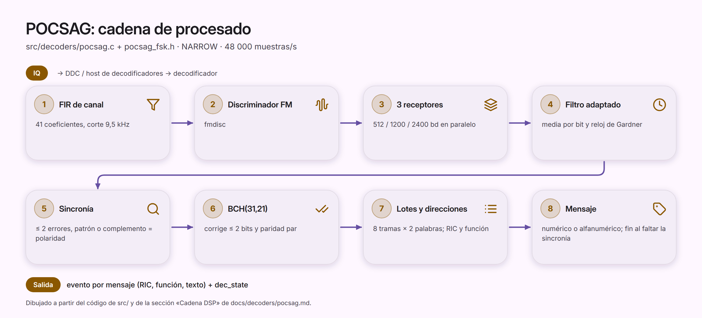
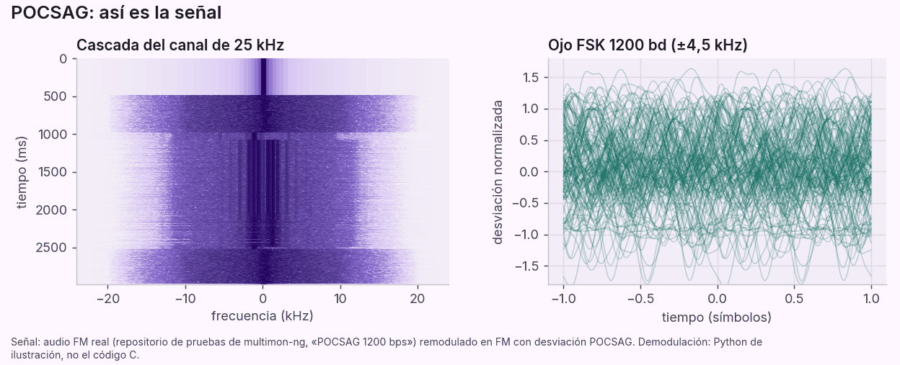
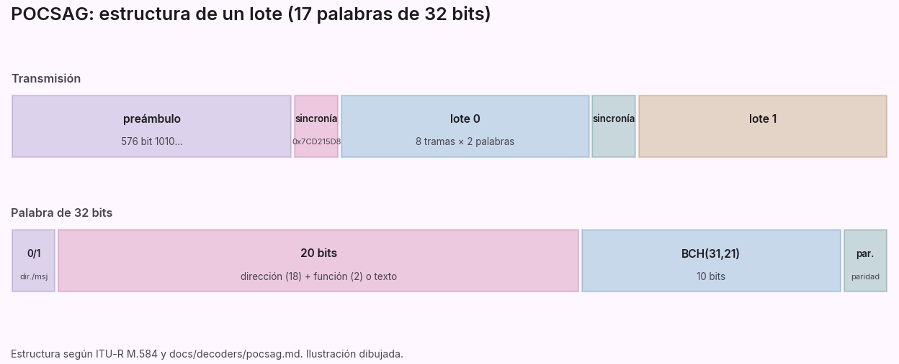
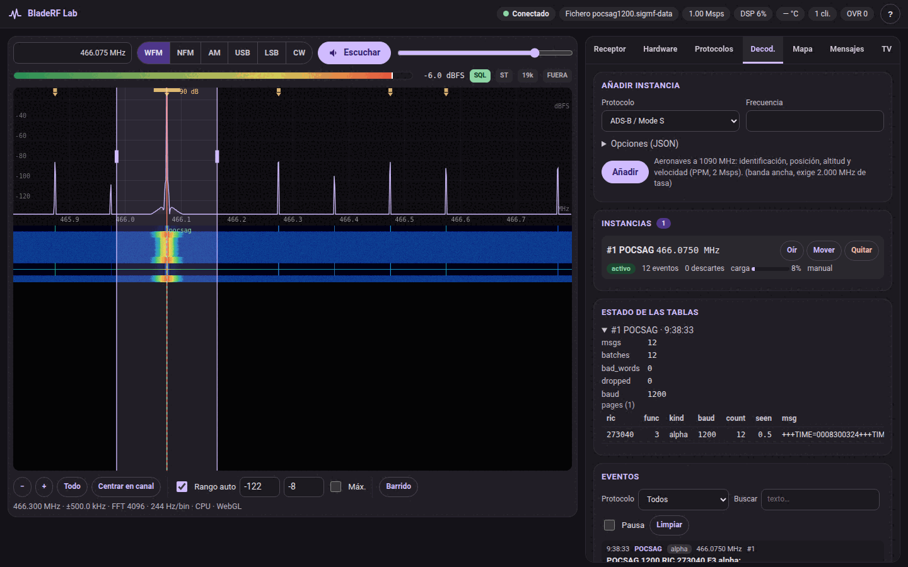

# POCSAG

<!-- vision-rapida:inicio (generada por docs/img/src/doc_decoders.py) -->

## Visión rápida

<picture>
  <source media="(prefers-color-scheme: dark)" srcset="../img/decoders/pocsag-cadena-dark.png">
  
</picture>

*Figura. Cadena de procesado de POCSAG, dibujada a partir del código de `src/` y de la sección «Cadena DSP» de este documento.*

### Así es la señal

<picture>
  <source media="(prefers-color-scheme: dark)" srcset="../img/decoders/pocsag-senal-dark.png">
  
</picture>

*Figura. Cascada y diagrama de ojo FSK a 1200 bd (audio real remodulado).*

<picture>
  <source media="(prefers-color-scheme: dark)" srcset="../img/decoders/pocsag-estructura-dark.png">
  
</picture>

*Figura. Transmisión, lote y palabra POCSAG.*

La procedencia de cada señal (grabación real o sintética) y qué parte del procesado es Python de ilustración y no el código C se indican en el pie de cada imagen.

### Ejemplo de evento y de estado

Procedencia: audio FM real de multimon-ng (POCSAG 1200 bps) remodulado en FM. Sacado de ejecutar el decodificador, no escrito a mano (`bladerf-lab --replay pocsag.sigmf-meta --decode pocsag@466075000 --print`).

Evento `dec` (campo `msg`, listas largas recortadas):

```json
{
  "ric": 273040,
  "func": 3,
  "kind": "alpha",
  "msg": "+++TIME=0008300324+++TIME=0008300324",
  "baud": 1200,
  "corrected": 0,
  "text": "POCSAG 1200 RIC 273040 F3 alpha: +++TIME=0008300324+++TIME=0008300324"
}
```

Último `dec_state` recibido por WebSocket (`state`, listas recortadas):

```json
{
  "msgs": 4,
  "batches": 4,
  "bad_words": 0,
  "dropped": 0,
  "baud": 1200,
  "pages": [
    {
      "ric": 273040,
      "func": 3,
      "kind": "alpha",
      "baud": 1200,
      "count": 4,
      "seen": 1.6,
      "msg": "+++TIME=0008300324+++TIME=0008300324"
    }
  ]
}
```

### En la web



*Captura de la interfaz con un servidor `--replay` propio mostrando POCSAG.*

<!-- vision-rapida:fin -->

Decodificador `src/decoders/pocsag.c` (+ `pocsag.h`, `pocsag_fsk.h`), modulador `src/tx/mod_pocsag.c`,
test `tests/test_pocsag.c`. Narrow, 48 000 Hz, canal de 12,5 kHz.

## Teoría (ITU-R M.584, "Radio-paging code No. 1")

* FSK de 2 niveles, 512, 1200 o 2400 bit/s, desviación nominal ±4,5 kHz (la polaridad depende del equipo).
* Transmisión = preámbulo de ≥ 576 bits alternos (1010…) + lotes. Lote = palabra de sincronía
  `0x7CD215D8` + 16 palabras de 32 bits (8 tramas de 2 palabras). Palabra de reposo `0x7A89C197`.
* Palabra = 21 bits de datos + 10 bits BCH(31,21) (g(x) = x¹⁰+x⁹+x⁸+x⁶+x⁵+x³+1, `bch_init_pocsag`) +
  1 bit de paridad par. Corrige 2 errores (t = 2).
  * dirección: `0 | 18 bits | 2 bits de función`. RIC = (18 bits)·8 + índice de trama (posición/2): los 3 bits
    bajos del RIC no se transmiten.
  * mensaje: `1 | 20 bits`.
* Mensaje numérico: nibbles BCD enviados LSB primero (`0-9`, `*`/spare, `U`, espacio, `-`, `]`, `[`).
  Alfanumérico: ASCII de 7 bits, LSB primero, flujo continuo a través de las palabras de 20 bits, fin con EOT
  (0x04) o relleno. El mensaje continúa a través de los lotes hasta una nueva dirección o una palabra de reposo.

## Cadena DSP

`IQ → FIR de canal (41 coef., corte 9,5 kHz) → discriminador FM → 3 receptores paralelos (512/1200/2400 Bd)`;
cada receptor: filtro adaptado (media por bit) → reloj de Gardner (`pocsag_fsk.h`) → seguidores de pico que
quitan el desvío de frecuencia (CFO) y normalizan → bit. La velocidad se detecta porque solo el receptor a la
tasa correcta encuentra la sincronía (≤ 2 errores, patrón o su complemento → polaridad). Tras cada lote se
espera la sincronía siguiente (≤ 4 errores); si no aparece, termina la transmisión y se emite el mensaje pendiente.

Palabra: BCH con ≤ 2 correcciones; la paridad par se comprueba después de corregir (si falla se cuenta un
error más; con 2 correcciones + paridad mala la palabra se descarta). Un hueco (palabra no corregible) en
mitad de un mensaje lo descarta entero y se cuenta en `dropped` (no se emite nada con integridad dudosa).

### Defectos corregidos en P3c (piloto de inyección, 2026-11-20)

El piloto (`paper/exp/piloto/`) inyectó copias únicas del modulador y destapó dos defectos:

1. **Techo del ≈ 94 % de recuperación, determinista** (a 25 dB y en ruido blanco). Causa: `fskch_push` en
   `pocsag_fsk.h` hacía `if (t1 < 0) t1 = 0` tras `t1 -= 1.0`. Una corrección de RETRASO de Gardner que dejaba la fase
   negativa se perdía, de modo que el lazo solo sabía adelantar. Si el punto de muestreo arrancaba por detrás del pico
   del filtro adaptado (la mitad de las fases iniciales), el lazo no se movía y muestreaba a 0,2–0,5 bit del pico con
   la preámbulo; luego perdía un bit dentro de la palabra de sincronía (> 2 errores) y la copia se perdía. Como el lazo
   conserva su fase entre transmisiones, las mismas copias fallaban en cada ejecución. Con un cuadrado ideal a
   `sps` 20 o 40 el lazo no convergía en 5 de cada 10 desfases; ahora converge en todos (amplitud 0,987). El arreglo
   (dejar `t` negativo) beneficia también a FLEX y DMR, que comparten el receptor (sus tests siguen en verde).
2. **Mensajes erróneos aceptados por el BCH** (114 en blanco, 245 en fondo real, solo con copias presentes).
   Causa: BCH(31,21) con 2 correcciones acepta ≈ 48 % de las palabras de 32 bits al azar; basura tras una falsa
   sincronía (o el receptor de otra velocidad viendo la señal) producía «direcciones» y «tonos» y textos con
   2–5 bits «corregidos». Además 0x00000000 y 0xFFFFFFFF son palabras de código válidas. Ahora: (a) esas dos
   palabras son no válidas; (b) un lote cuyo coste Σ(errores corregidos; 3 por palabra inválida) supera 20 se descarta
   entero (basura ≈ 38, señal con BER del 1 % ≈ 5); (c) un mensaje se emite solo si sus correcciones suman
   ≤ 2 + (nº de palabras de mensaje)/2 y su dirección lleva ≤ 1 error; un tono (sin palabras de mensaje) exige
   dirección sin errores. `state_json` añade `bad_batches` y `rejected`.
   Coste: ≈ 1 dB de sensibilidad a 2400 Bd (de 0 a 2 dB de SNR), a cambio de 0 erróneos hasta −2 dB.

## Eventos

```json
{"ric":1234567,"func":3,"kind":"alpha","msg":"HOLA","baud":1200,"corrected":0,
 "text":"POCSAG 1200 RIC 1234567 F3 alpha: HOLA"}
```
`kind` = `alpha` | `numeric` | `tone` (dirección sin palabras de mensaje). `corrected` = bits corregidos en las
palabras del mensaje. Función 0 → numérico, 3 → alfanumérico, 1/2 → alfanumérico si hay mensaje, si no tono:
convención habitual, no de la norma (M.584 deja el significado de los 2 bits al operador).

## state_json

```json
{"msgs":N,"batches":N,"bad_words":N,"bad_batches":N,"rejected":N,"dropped":N,"baud":1200,
 "pages":[{"ric","func","kind","baud","count","seen":s,"msg"}]}
```
`pages` = últimos 32 mensajes distintos (los repetidos incrementan `count`), caducan a los 600 s.

## Modulador

`{"baud":1200,"invert":false,"messages":[{"ric":1234567,"func":3,"text":"…"},{"ric":2001002,"func":0,"text":"01-23","numeric":true},{"ric":99,"func":1}]}`.
Sin parámetros: un alfanumérico, un numérico y un tono. `air_ok = false`.

## Verificación

* Sintético (modulador → AWGN 10 dB → CFO ±3125 Hz, ±100 ppm → decodificador) para los 3 baudios, polaridad
  invertida y un mensaje de 2 lotes. En barridos con otras semillas se pierde ≈ 1 % de los mensajes a 10 dB
  (2400 Bd, CFO negativo): ruido, no fallo lógico.
* Constantes publicadas: las palabras de sincronía y de reposo de M.584 son palabras BCH(31,21)+paridad
  válidas con el BCH de `fec.c` (comprobado en el test). No hay vectores IQ/audio públicos con licencia clara.
* Ráfagas (test [5]): 120 copias a 512 Bd y 200 a 1200 y 2400 Bd, cada una con RIC y texto únicos, a 15 dB, con 11
  fases de arranque distintas: ≥ 99,5 % recuperadas y 0 eventos erróneos (antes: 1200 Bd 147/200 y 33 erróneos).
* Coste de CPU ≈ 0,005 s por s de señal.

## Limitaciones

* El orden de bits del BCD (LSB primero) y la tabla de símbolos 10-15 salen de la práctica común.
* Sin soporte de mensajes con bit de "secuencia"/fragmentos propios de algunos operadores.
* Sin detección de la lógica de grupo (RIC de grupo se trata como una dirección).

## Validación con señales reales (V1, 2026-11-15)

Las tres muestras públicas `POCSAG_sample_-_{512,1200,2400}_bps.flac` del repositorio de pruebas de
multimon-ng (grabaciones de aire; GPL-2.0, solo datos de prueba), remodulado en FM (±4,5 kHz) y
pasado por `--replay … --decode pocsag@466075000`: 512 bps → RIC 273040 F3 "512 B SIDE ZZZZZZ";
1200 bps → RIC 273040 F3 "+++TIME=0008300324+++TIME=0008300324"; 2400 bps → RIC 1022869 F1, mismo
texto. Coincide con multimon-ng. **Ninguna constante estaba mal** (BCH, trama, paridad, alfa de 7
bits, polaridad). Test: `tests/data/pocsag*_mm_phase.u8`.
