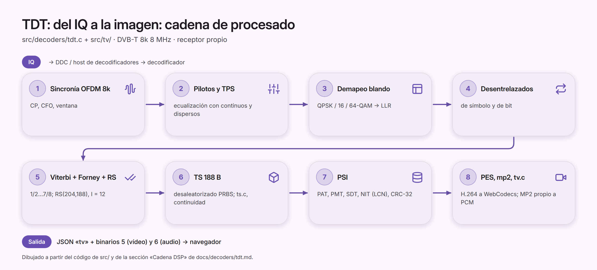
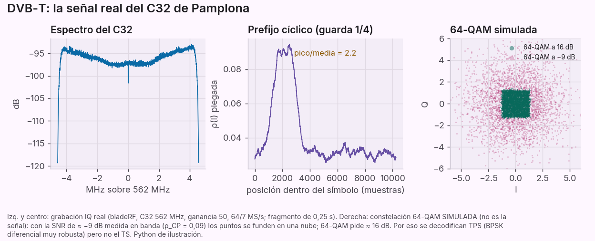
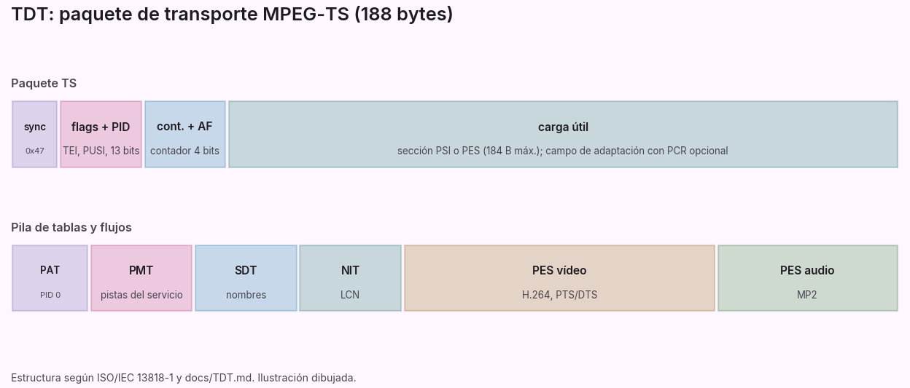
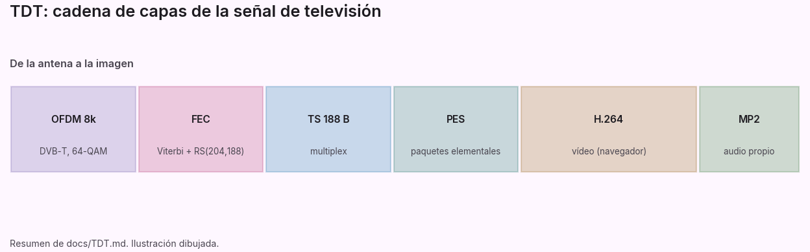
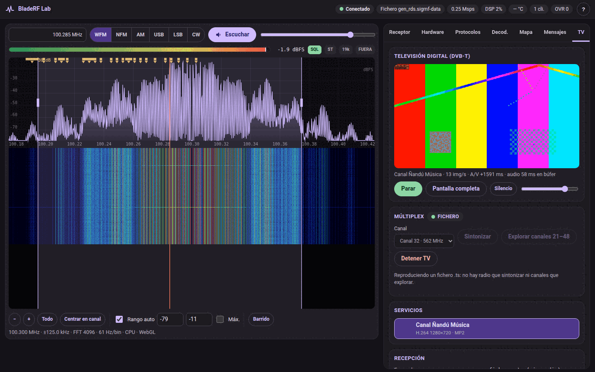
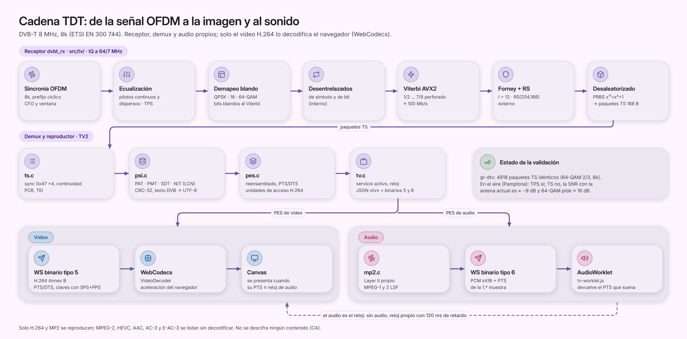

# TDT: demux, audio MP2 y reproductor (TV2)

<!-- vision-rapida:inicio (generada por docs/img/src/doc_decoders.py) -->

## Visión rápida

<picture>
  <source media="(prefers-color-scheme: dark)" srcset="../img/decoders/tdt-cadena-dark.png">
  
</picture>

*Figura. Cadena de procesado de TDT, dibujada a partir del código de `src/` y de la sección «Cadena DSP» de este documento.*

### Así es la señal

<picture>
  <source media="(prefers-color-scheme: dark)" srcset="../img/decoders/dvbt-senal-dark.png">
  
</picture>

*Figura. La señal real del C32 de Pamplona (misma figura que en dvbt.md).*

<picture>
  <source media="(prefers-color-scheme: dark)" srcset="../img/decoders/tdt-estructura-dark.png">
  
</picture>

*Figura. Paquete TS y pila de tablas.*

<picture>
  <source media="(prefers-color-scheme: dark)" srcset="../img/decoders/tdt-estructura2-dark.png">
  
</picture>

*Figura. Capas de la TDT.*

La procedencia de cada señal (grabación real o sintética) y qué parte del procesado es Python de ilustración y no el código C se indican en el pie de cada imagen.

### Ejemplo de evento y de estado

Procedencia: sin evento JSON propio: el decodificador `tdt` publica el mensaje `tv` y los binarios 5 y 6 por WebSocket. Sacado de ejecutar el decodificador, no escrito a mano.

Esta grabación no produce ningún evento `dec`.

### En la web

*Captura de la interfaz con un servidor `--replay` propio mostrando TDT.* El vídeo es un `.ts` de prueba reproducido con `--tv-ts` (carta de ajuste sintética), no una emisión recibida por radio.

<!-- vision-rapida:fin -->

## Figuras

<picture>
  <source media="(prefers-color-scheme: dark)" srcset="../img/cadena-tdt-dark.png">
  
</picture>

*Figura. Cadena completa de la TDT: receptor OFDM 8k (TV1), demux y PSI (TV2), vídeo H.264 por WebCodecs y audio MP2 propio con sincronía por PTS.*

(La parte del receptor DVB-T la documenta TV1 en este mismo fichero o en `docs/protocolos/dvbt.md`.)

## Cadena
`dvbt_rx` (TV1) → `src/decoders/tdt.c` (decodificador narrow a 64/7 MHz, filtro 7,61 MHz) → `tv_ts_in()` →
`ts.c` (sincronía 0x47 repetida 4 veces, continuidad con duplicados, PCR, TEI) → `psi.c` (PAT, PMT, SDT, NIT con LCN,
CRC-32/MPEG-2, texto DVB ISO 6937/8859-x/UCS-2/UTF-8 → UTF-8) → `pes.c` (reensamblado, PTS/DTS, AU H.264 por AUD) →
`tv.c` (servicio activo, reloj, JSON y binarios 5/6) → web (`web/js/tv.js`, `tv-worklet.js`).

## mp2.c
Decodificador propio de Layer II (MPEG-1 y MPEG-2 LSF, estéreo/joint/dual/mono). Las tablas de asignación y la
ventana se contrastaron con la salida de ffmpeg (solo como referencia): error rms < 0,1 LSB en 48/44,1/32/24/22,05/16 kHz
(`tests/test_mp2.c`). Latencia del demux: la AU/trama espera al siguiente PES/sincronía (~80 ms).

## Sincronía A/V
El audio es el reloj: `tv-worklet.js` devuelve el PTS de la muestra que suena (corrigiendo la latencia de salida) y el vídeo
se presenta cuando su PTS ≤ reloj. Sin audio se usa un reloj propio con 120 ms de retardo.

## Limitaciones
* Vídeo: solo H.264 por WebCodecs; MPEG-2 y HEVC se anuncian pero no se reproducen. Hace falta Chrome/Edge con H.264.
* Audio: solo MP2; AAC, AC-3 y E-AC-3 no se decodifican (el servicio se ve sin sonido). Sin descifrado (CA).
* WebCodecs exige contexto seguro (`localhost` o HTTPS).
* El vídeo se difunde a todos los clientes mientras haya un servicio elegido.
* Pruebas sin radio: `bladerf-lab --replay <cualquier .cs16> --tv-ts fichero.ts`.

## Receptor DVB-T (TV1)

`src/tv/dvbt_rx.{h,c}`: IQ a 64/7 MHz → paquetes TS (API en AGENTS.md §8c). Detalle de la cadena,
constantes validadas con gr-dtv, rendimiento y la medida real de Pamplona en
`docs/protocolos/dvbt.md` (sección "Receptor completo hasta TS"). Estado: validado con señal
sintética y con IQ de gr-dtv; con la antena actual la SNR real (≈ −9 dB en C32) no permite TS.
