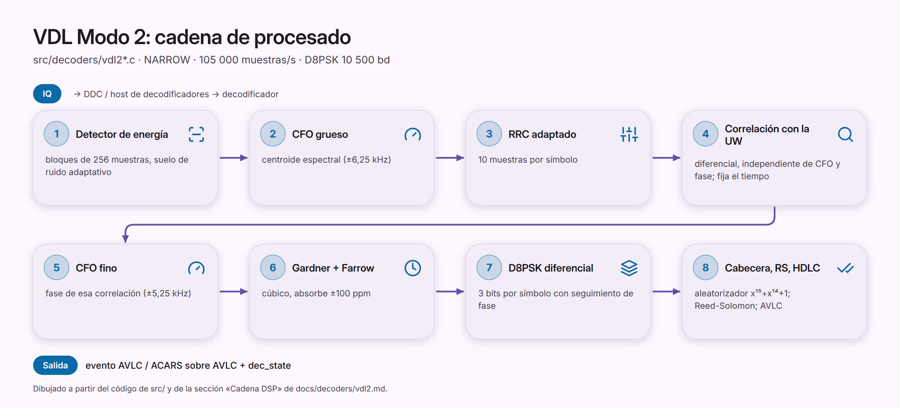
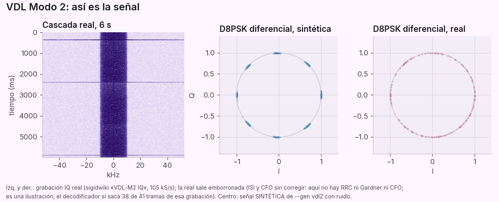
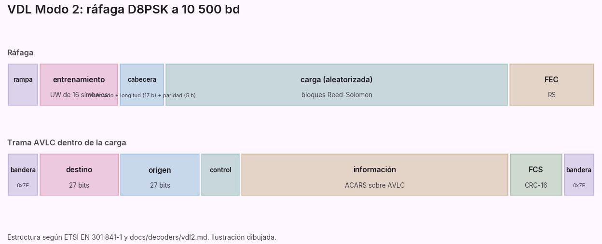
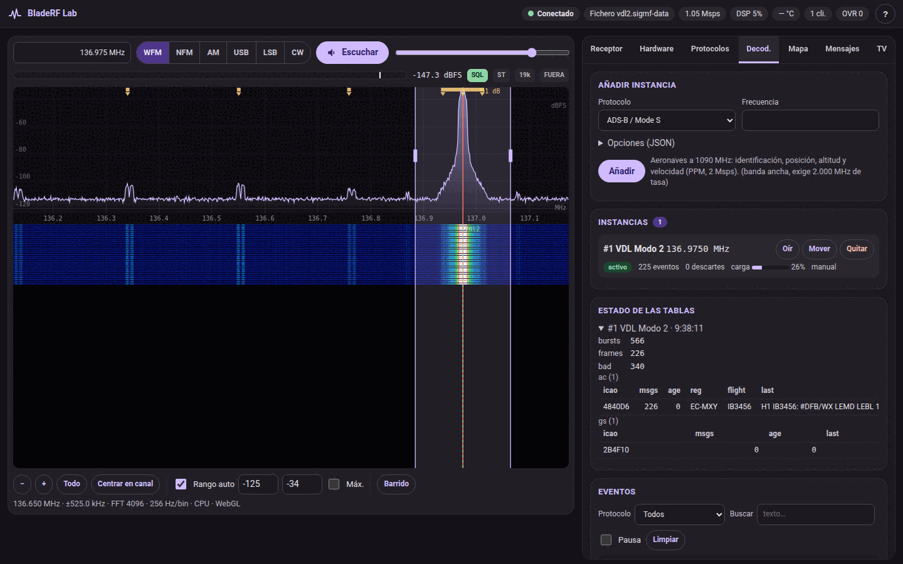

# VDL Modo 2 (D8PSK 10 500 Bd, AVLC, ACARS sobre AVLC)

<!-- vision-rapida:inicio (generada por docs/img/src/doc_decoders.py) -->

## Visión rápida

<picture>
  <source media="(prefers-color-scheme: dark)" srcset="../img/decoders/vdl2-cadena-dark.png">
  
</picture>

*Figura. Cadena de procesado de VDL2, dibujada a partir del código de `src/` y de la sección «Cadena DSP» de este documento.*

### Así es la señal

<picture>
  <source media="(prefers-color-scheme: dark)" srcset="../img/decoders/vdl2-senal-dark.png">
  
</picture>

*Figura. Cascada real y constelación D8PSK diferencial, sintética y real.*

<picture>
  <source media="(prefers-color-scheme: dark)" srcset="../img/decoders/vdl2-estructura-dark.png">
  
</picture>

*Figura. Ráfaga D8PSK y trama AVLC.*

La procedencia de cada señal (grabación real o sintética) y qué parte del procesado es Python de ilustración y no el código C se indican en el pie de cada imagen.

### Ejemplo de evento y de estado

Procedencia: señal sintética de `--gen vdl2` (la grabación real sigue sin decodificarse). Sacado de ejecutar el decodificador, no escrito a mano (`bladerf-lab --replay vdl2.sigmf-meta --decode vdl2@136975000 --print`).

Evento `dec` (campo `msg`, listas largas recortadas):

```json
{
  "proto": "vdl2",
  "src": "4840D6",
  "src_type": "aircraft",
  "dst": "2B4F10",
  "dst_type": "ground",
  "cr": 0,
  "ftype": "I",
  "ctrl": 0,
  "poll": 0,
  "ns": 0,
  "nr": 0,
  "len": 67,
  "info": "01322E45432D4D585915483133024D313241494233343536234446422F5758204C454D44204C45424C20313531…",
  "acars": {
    "mode": "2",
    "reg": "EC-MXY",
    "label": "H1",
    "block": "3",
    "msgno": "M12A",
    "flight": "IB3456",
    "body": "#DFB/WX LEMD LEBL 151200Z 27008KT CAVOK"
  },
  "cfo_hz": -1,
  "rs_fixed": 0,
  "level_db": -7.1,
  "text": "4840D6(aircraft) > 2B4F10(ground) I ns=0 nr=0 | ACARS EC-MXY IB3456 H1: #DFB/WX LEMD LEBL …"
}
```

Último `dec_state` recibido por WebSocket (`state`, listas recortadas):

```json
{
  "bursts": 174,
  "frames": 72,
  "bad": 102,
  "ac": [
    {
      "icao": "4840D6",
      "msgs": 72,
      "age": 0,
      "reg": "EC-MXY",
      "flight": "IB3456",
      "last": "H1 IB3456: #DFB/WX LEMD LEBL 151200Z 27008KT CAVOK"
    }
  ],
  "gs": [
    {
      "icao": "2B4F10",
      "msgs": 0,
      "age": 0,
      "last": ""
    }
  ]
}
```

### En la web



*Captura de la interfaz con un servidor `--replay` propio mostrando VDL2.*

<!-- vision-rapida:fin -->

Ficheros: `src/decoders/vdl2.c` (demodulador y tablas), `vdl2_frame.{c,h}` (cabecera, aleatorizador,
RS entrelazado, HDLC), `vdl2_avlc.{c,h}` (direcciones y control AVLC), `acars_blk.{c,h}` (ACARS sobre
AVLC), `src/tx/mod_vdl2.c`, `tests/test_vdl2.c`.

## Teoría y estado de verificación

VDL Modo 2 (ICAO Anexo 10 vol. III, Doc 9776; ETSI EN 301 841-1; ARINC 631) usa canales de 25 kHz
(136,725/136,775/136,875/136,975 MHz en Europa), modulación **D8PSK a 10 500 símbolos/s** (31,5 kbit/s),
filtro de coseno alzado α = 0,6 (RRC en cada extremo) y acceso CSMA. Una ráfaga:

| campo | contenido | origen de la constante |
|---|---|---|
| rampa | 3-5 símbolos nulos | Kim et al. (KICS 2009), arXiv:2005.11456; ETSI EN 301 841-1 §5.4 |
| palabra única (UW) | 16 símbolos: `000 010 011 110 000 001 101 110 001 100 011 111 101 111 100 010` | arXiv:2005.11456; **contrastada con la grabación real** |
| cabecera | 3 bits reservados (0) + longitud de 17 bits LSB primero (bits del flujo HDLC, con flags y relleno, sin paridad RS) + 5 bits de comprobación | estructura: ETSI EN 301 841-1 §5.4; matriz H: ver abajo |
| datos | HDLC → octetos (LSB primero) → RS(255,249) → entrelazado → todo (cabecera + datos) aleatorizado | **contrastado con la grabación real y con dumpvdl2** |

Codificación diferencial: el triplete (Gray) se convierte a binario y es el incremento de fase en
pasos de π/4 (000→0, 001→1, 011→2, 010→3, 110→4, 111→5, 101→6, 100→7; Tabla 5 de Kim et al.).
Los bits forman un flujo continuo desde la UW (48 bits UW + 25 cabecera = 73 bits: los datos
empiezan a mitad de un símbolo).

**Cabecera (25,20).** Matriz de comprobación `H = [P | I5]` (filas en hex sobre la palabra de 25 bits con el
primer bit recibido en la posición 24): `001FFF0, 07E1FE8, 18E61E4, 1B6A662, 0D3CAA1`. El código corrige 1 bit y
algunos pares de bits; los 3 bits reservados se fuerzan a 0 antes de calcular el síndrome. La norma pública
(EN 301 841-1 V1.1.1) da la estructura pero no la matriz; esta se obtuvo del comportamiento de `dumpvdl2` y se
comprobó con la grabación real: en las ráfagas buenas el síndrome sale 0 (si fuera otra, saldría 0 en 1 de cada 32).

**Aleatorizador.** Aditivo de 15 bits, estado inicial `0x6959`, realimentación `b = s[0] ^ s[14]`
(x¹⁵+x+1 en forma de Fibonacci), salida = bit realimentado. **Actúa desde el primer bit de la cabecera**
(no solo sobre los datos) y sigue sin reiniciarse. (Una versión anterior de este documento lo ponía solo sobre
los datos y con x¹⁵+x¹⁴+1: salió de medir con ráfagas ruidosas y era un artefacto; la comprobación definitiva
es que con este esquema las tramas pasan el FCS.)

**RS y entrelazado.** GF(2⁸) con 0x187, fcr 120, 6 raíces (`rs_init_vdl2`). Bloques de 249 octetos de datos; el
último, más corto, lleva 0/2/4/6 octetos de paridad según tenga <3 / 3-30 / 31-67 / ≥68 octetos (Kim et al.,
Tabla 3); los octetos de paridad no enviados son **borrados**. **Los octetos de cada bloque se leen LSB primero**
del flujo (el primer bit recibido es el bit 0 del octeto). Orden de transmisión: primero TODOS los octetos de
datos entrelazados por columnas (octeto c de cada bloque, c = 0…248, saltando los bloques que ya no lo tienen) y
después TODA la paridad entrelazada igual (6 columnas); no se mezclan datos y paridad por posición.
Con un solo bloque el entrelazado es la identidad.

**HDLC/AVLC.** El flujo contiene flags 0x7E, relleno de ceros tras cinco unos, tramas con octetos LSB primero y
FCS CRC-16/X-25 (byte bajo primero). Trama AVLC: destino(4) origen(4) control(1) información FCS(2).
**Dirección** (contrastada con 17 tramas reales): 4 octetos de 7 bits útiles; el bit 0 de cada octeto es la
extensión (0 = sigue otro, **1 solo en el último octeto del campo de direcciones**, o sea, el 8.º de la trama).
Los 28 bits en orden de línea son: 1 bit de estado, 3 de tipo y 24 de ICAO (los dos últimos MSB primero); en
práctica hay que juntar los 7 bits de cada octeto y **invertir los 28 bits**. Estado: en el origen es C/R (0 orden,
1 respuesta); en el destino es A/G del emisor (0 en vuelo). Tipos: 1 aeronave, 4 y 5 estación de tierra, 7 todas
las estaciones (la grabación real usa 5 para tierra). Control como HDLC módulo 8 (I, RR/RNR/REJ/SREJ,
UI/XID/TEST/SABM/DISC/UA/DM/FRMR). **ACARS sobre AVLC**: la información empieza por `FF FF 01` y sigue el bloque
ACARS (modo, matrícula…) con paridad impar en el bit 7; acaba en ETX/ETB + BCS + DEL.

## Cadena DSP (105 kHz = 10 muestras/símbolo)

Ver la cabecera de `vdl2.c`. Resumen: detector de energía por bloques de 256 muestras con suelo de
ruido adaptativo (coste nulo en reposo) → ráfaga completa en memoria → CFO grueso por centroide
espectral → **búsqueda de la UW por fase** (fasores unitarios, sin ponderar por la amplitud) sobre la señal con
paso bajo de 16 kHz → CFO fino (±5,25 kHz sin ambigüedad) → **hipótesis de filtro de entrada**, en orden: RRC
adaptado (señal directa de antena) y paso bajo de 10, 9, 12 y 8 kHz (señal ya conformada con un Nyquist) →
lazo de Gardner de ganancia baja → decisión diferencial con seguimiento de fase y residuo por símbolo →
aleatorizador → cabecera → RS → HDLC → AVLC. Si la lectura directa no pasa RS + FCS: decodificación tipo Chase
sobre los símbolos menos fiables (hasta 2¹⁰ combinaciones, tope de 2000 pruebas por ráfaga) y RS con borrados
en los octetos menos fiables. Una ráfaga puede tener hasta 3 UW (varias tramas seguidas). Solo se emiten tramas con
FCS correcto y tipos de dirección verosímiles (filtro de falsos positivos para Chase). Coste: ≈ 0,02 s de CPU por
s de señal con tráfico denso (≈ 2 % de un núcleo con la grabación real).

## Eventos

```json
{"proto":"vdl2","src":"4840D6","src_type":"aircraft","dst":"2B4F10","dst_type":"ground","cr":0,
 "ftype":"I","ctrl":0,"poll":0,"ns":0,"nr":0,"len":58,"info":"FFFF01 32…",
 "acars":{"mode":"2","reg":"EC-MXY","label":"H1","block":"3","msgno":"M12A","flight":"IB3456","body":"…"},
 "cfo_hz":2501,"rs_fixed":0,"level_db":-14.0,
 "text":"4840D6(aircraft) > 2B4F10(ground) I ns=0 nr=0 | ACARS EC-MXY IB3456 H1: …"}
```
Solo se emiten tramas con FCS correcto. `info` = primeros 64 bytes en hexadecimal. `acars` aparece si
la información empieza por `FF FF 01` (o por `01` solo) y se interpreta como bloque ACARS.

## state_json

`{"bursts":N,"frames":N,"bad":N,"ac":[{"icao","reg","flight","msgs","age","last"}],"gs":[{"icao","msgs","age","last"}]}`
— aeronaves y estaciones de tierra vistas (TTL 900 s, máx. 256 cada una).

## Pruebas (`make test T=vdl2`)

Autoconsistencia de cabecera (corrección de 1 bit en las 22 posiciones útiles), aleatorizador, RS entrelazado
(bloque corto, 249, 2-3 bloques, ráfagas de 6 bytes repartidas por el entrelazado), HDLC con relleno y
FCS, direcciones; **tramas reales** (direcciones, FCS y bloque ACARS de la grabación de sigidwiki, ver más abajo);
modulador → AWGN 10 dB, CFO ±6,25 kHz, ±100 ppm → eventos; señal ya conformada con un Nyquist (RRC emisor +
RRC); tipos UI/RR/XID/I; trama de 350 bytes (2 bloques RS); ruido solo y tono continuo → 0 eventos; coste con
tráfico denso. Caso real de `tests/realtest.sh` (`tests/data/real/vdl2`): 16 mensajes distintos de la
grabación real, con matrículas y vuelos de ACARS.

## Referencias

* ICAO Annex 10 Vol. III Part I §6 y Doc 9776; ETSI EN 301 841-1; ARINC 631/620 (no consultadas, de pago salvo
  la EN 301 841-1 V1.1.1, pública).
* Kim et al., "VDL Mode-2 D8PSK 모뎀 설계 및 개발", J. KICS 34(11), 2009 (UW, tablas RS, mapa diferencial).
* arXiv:2005.11456, "Advanced Physical-Layer Technologies in VHF Data Link Communications" (formato de ráfaga).
* [dumpvdl2](https://github.com/szpajder/dumpvdl2) 2.6.0 (GPL-3.0, solo como referencia externa y generador de
  datos de comparación; no se enlaza ni se copia código): orden de bits, aleatorizador, cabecera, entrelazado.
* Wavecom, "VDL-M2 Aeronautical Data Link" (visión general).

## Limitaciones

Una ráfaga por vez (hasta 3 UW seguidas; solapes de dos estaciones en el mismo canal no se separan); ráfaga máx.
~20 s de memoria; no se interpretan XID (parámetros), ISO 8208/X.25 ni CLNP/ATN: se da la información en
hexadecimal; no hay reensamblado de mensajes ACARS multibloque. En la grabación completa (47 s) dumpvdl2 decodifica
41 tramas y este decodificador 38 de ellas (93 %) más 4 que dumpvdl2 no saca; las 3 que faltan son largas
(94, 130 y 257 octetos).

## Validación con señales reales (V1, 2026-11-15; D1, 2026-11-20)

Fuente: «VDL-M2 IQ» de la Signal Identification Wiki (IQ estéreo a 48 kHz, 46,9 s, ~50 ráfagas; CC BY-SA 3.0;
`https://www.sigidwiki.com/images/d/df/VDL-M2_IQ.zip`). El WAV trae **I y Q intercambiados** (IQ = derecho +
j·izquierdo). Se remuestrea a 105 kS/s (35/16) con `scipy.signal.resample_poly`.

**Resultado (D1):** de las tramas que decodifica `dumpvdl2` 2.6.0 sobre la misma señal, este decodificador saca
11 de 11 (versión remuestreada con otro filtro, la de V1), 38 de 41 (93 %) en los 46,9 s completos y 16 de 17
(94 %) en el recorte 28,5-37,0 s que es el caso real de `tests/realtest.sh`. Antes (V1) eran 0.

**Qué estaba mal** (cada punto se verificó contra la salida de dumpvdl2 trama a trama; V1 había concluido «ISI
sistemática, BER ~10 %», que era un diagnóstico equivocado):
1. **Aleatorizador y cabecera**: el aleatorizador cubre cabecera y datos, con otro estado inicial; la matriz de la
   cabecera es otra. Con eso la cabecera da síndrome 0 en las ráfagas buenas.
2. **Orden de bits y entrelazado**: los octetos RS se leen LSB primero; los datos y la paridad no se mezclan en el
   entrelazado.
3. **Direcciones AVLC**: orden de línea (estado, tipo, ICAO MSB primero → inversión de 28 bits), extensión solo en el
   último octeto, tipo 5 para tierra; **ACARS sobre AVLC empieza por `FF FF 01`**.
4. **Búsqueda de la UW**: la métrica ponderada por la amplitud daba ≈ 1 en 1-2 productos de una rampa de subida o
   de bajada y desplazaba la UW verdadera 14 símbolos; ahora es de fase pura (como dumpvdl2). Además la puerta de
   amplitud usa el suelo de ruido (no la potencia media de la ráfaga) y la caída de potencia por AGC o fading
   ya no corta la demodulación (la cabecera da la longitud).
5. **Filtro de entrada**: la grabación ya viene conformada con un Nyquist (la respuesta al impulso estimada con
   símbolos conocidos es casi sin interferencia entre símbolos en las muestras: |p(±1)| ≈ 0,06·|p(0)|), de modo
   que el RRC adaptado del decodificador aplica el filtro dos veces: BER ~4 % frente a ~0,5 % con un paso bajo
   suave de 8-10 kHz (el de dumpvdl2 es un Chebyshev de 2 polos de 8 kHz). Se añaden las hipótesis de paso bajo;
   la RRC sigue siendo la primera (señal directa de antena).
6. **Chase y borrados**: en las ráfagas con 1-3 símbolos dudosos más de los que corrige el RS (6 octetos de
   paridad, 3 errores) recuperan varias tramas cortas más.

**Ecualizador adaptativo (evaluado, no incluido).** Se probó fuera de línea (Python, 4 ráfagas con símbolos
verdaderos): ecualizador T/2 de 2×(1-3) coeficientes entrenado con la UW y con decisión dirigida (mínimos cuadrados
por bloques con regularización, referencia de decisiones PSK absolutas con PLL). Con la UW de 16 símbolos como
único entrenamiento sobrajustaba (más errores que la señal sin ecualizar con ≥ 6 coeficientes) y, tras la elección
del filtro de entrada, no quedaba interferencia entre símbolos que corregir: con el paso bajo de 8-10 kHz los
errores de decisión (≈ 0,5 %) están dominados por el ruido, no por la ISI (ni siquiera un ecualizador entrenado
con todos los símbolos verdaderos mejoró el recuento: 12 errores de símbolo sin él frente a 11 con él, en 4 ráfagas). La mejora práctica vino de elegir el filtro de entrada
(hipótesis, validadas por RS + FCS), de la búsqueda de UW y de Chase/borrados, sin coste apreciable de CPU.

**Interoperabilidad:** `bladerf-lab --gen vdl2 …` genera una señal que `dumpvdl2` 2.6.0 decodifica correctamente
(AVLC I, ACARS EC-MXY IB3456, etiqueta H1, mensaje completo), con y sin ruido añadido; antes daba 0 tramas.
Compruébese con `dumpvdl2 --iq-file x.sigmf-data --sample-format S16_LE --oversample 1 --centerfreq <Hz> <Hz>`
(la señal generada ya está en ci16 con escala 2048, y el nivel por encima de ≈ 1000 que exige dumpvdl2).
