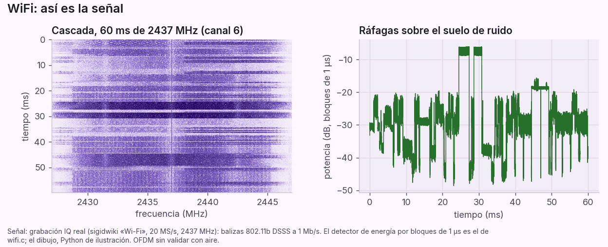

# WiFi (balizas 802.11b/g/a) — `wifi`

<!-- vision-rapida:inicio (generada por docs/img/src/doc_decoders.py) -->

## Visión rápida

<picture>
  <source media="(prefers-color-scheme: dark)" srcset="../img/decoders/wifi-cadena-dark.png">
  
</picture>

*Figura. Cadena de procesado de WiFi, dibujada a partir del código de `src/` y de la sección «Cadena DSP» de este documento.*

### Así es la señal

<picture>
  <source media="(prefers-color-scheme: dark)" srcset="../img/decoders/wifi-senal-dark.png">
  
</picture>

*Figura. Cascada y ráfagas de balizas 802.11b en la grabación real.*

<picture>
  <source media="(prefers-color-scheme: dark)" srcset="../img/decoders/wifi-estructura-dark.png">
  
</picture>

*Figura. PPDU y trama Beacon.*

La procedencia de cada señal (grabación real o sintética) y qué parte del procesado es Python de ilustración y no el código C se indican en el pie de cada imagen.

### Ejemplo de evento y de estado

Procedencia: grabación IQ real (sigidwiki «Wi-Fi», balizas 802.11b DSSS). Sacado de ejecutar el decodificador, no escrito a mano (`bladerf-lab --replay wifi.sigmf-meta --decode wifi --print`).

Evento `dec` (campo `msg`, listas largas recortadas):

```json
{
  "text": "UPC5035941 38:43:7D:EF:D8:7C canal 1 WPA2+WPA n -54 dBFS",
  "kind": "beacon",
  "event": "new",
  "ssid": "UPC5035941",
  "bssid": "38:43:7D:EF:D8:7C",
  "channel": 1,
  "band": "2.4",
  "security": "WPA2+WPA",
  "std": "n",
  "phy": "DSSS 1M",
  "rates": "1,2,5.5,11,9,18,36,54,6,12,24,48",
  "rssi": -54.2,
  "beacon_ms": 102.4,
  "count": 1
}
```

Último `dec_state` recibido por WebSocket (`state`, listas recortadas):

```json
{
  "nets": [
    {
      "ssid": "UPC5035941",
      "bssid": "38:43:7D:EF:D8:7C",
      "channel": 1,
      "band": "2.4",
      "security": "WPA2+WPA",
      "std": "n",
      "phy": "DSSS 1M",
      "rates": "1,2,5.5,11,9,18,36,54,6,12,24,48",
      "rssi": -53.7,
      "beacon_ms": 102.4,
      "count": 2,
      "age": 3
    },
    {
      "ssid": "UPC8443073.2,4G",
      "bssid": "34:2C:C4:18:95:3B",
      "channel": 1,
      "band": "2.4",
      "security": "WPA2+WPA",
      "std": "n",
      "phy": "DSSS 1M",
      "rates": "1,2,5.5,11,9,18,36,54,6,12,24,48",
      "rssi": -36.0,
      "beacon_ms": 102.4,
      "count": 44,
      "age": 0
    },
    "… (11 más)"
  ],
  "bursts": 1496,
  "frames": 188,
  "fcs_err": 256,
  "skipped": 11,
  "noise_dbfs": -84.5
}
```

### En la web


*Captura de la interfaz con un servidor `--replay` propio mostrando WiFi.*

<!-- vision-rapida:fin -->

Decodificador **wide** (20 Msps exactos, muestras Q11) que descubre redes WiFi a
partir de sus **balizas (Beacon)** y **respuestas de sondeo (Probe Response)**.

## Alcance ético (AGENTS.md §0.12)

- Solo tramas de gestión de difusión (tipo 0, subtipos 8 y 5). Del PSDU solo se
  usan el BSSID (dirección 3) y los elementos de información públicos.
- El receptor decodifica primero únicamente el **prefijo** del PSDU (≈ 8 bytes tras
  SERVICE) para leer el control de trama; datos, control, peticiones de sondeo
  (que llevan la MAC del cliente), etc. se **descartan ahí** (contador `skipped`)
  sin desentrelazar ni decodificar el resto.
- La dirección 1 de una respuesta de sondeo es la MAC de un cliente: **nunca se
  lee ni se emite**. Hay un test (`probe_resp` con cliente ficticio
  `02:AA:BB:CC:DD:EE`) que lo comprueba. No se descifra nada.

## Teoría y cadena DSP

0. **Detector de ráfagas.** Potencia por bloques de 1 µs (20 muestras); suelo de
   ruido adaptativo (baja rápido, sube lento, congelado durante una ráfaga). 2
   bloques > 6 dB sobre el suelo abren una ráfaga (con 256 muestras de pre-roll),
   3 bloques bajos la cierran (máx. 10 ms). Todo el DSP posterior solo corre
   sobre ráfagas.
1. **OFDM 802.11a/g** (Bloessl et al., SRIF 2013; IEEE 802.11-2020 cl. 17, 6–54 Mb/s):
   - Schmidl-Cox sobre el STF: `P(n)=Σ x[n+k]·x*[n+k+16]`, `M=|P|²/R²` > 0,5
     sostenido 24 muestras → inicio; CFO grueso `f=−arg(P)·fs/(2π·16)` (±625 kHz).
   - Correlación cruzada con el LTF conocido (dos picos separados 64) → inicio de
     símbolo; CFO fino con el desfase entre los dos LTF (retardo 64).
   - Canal `H(k)=media(Y₁,Y₂)·L(k)`, ecualización `Z=Y·H*/|H|²` regularizada.
     Por símbolo, ajuste LS de la fase de los 4 pilotos `θ₀+b·k` (error común/CFO
     residual y deriva de reloj). Las ventanas FFT arrancan 4 muestras antes del
     final del GI para tolerar ecos.
   - SNR: de los dos LTF idénticos, `E|Y₁−Y₂|²=2N` y `E|Y₁+Y₂|²/4=|H|²+N/2`.
   - SIGNAL: BPSK 1/2 → Viterbi K=7 (133,171) → paridad par, RATE (Tabla 17-6, las
     8 tasas), LENGTH. Después, prefijo → control de trama → resto.
   - Demapeo blando (§17.3.5.8, Gray): por eje, bit 1 = nivel x, bit 2 = 2−|x| (16-QAM)
     o 4−|x| (64-QAM), bit 3 = 2−||x|−4|; **el peso de fiabilidad |H|²/media se aplica
     después** de estas no linealidades (aplicarlo antes deformaba los umbrales y dejaba
     un suelo de error con multitrayecto en 16/64-QAM).
   - Datos: desentrelazado (dos permutaciones), reinserción de borrados
     (punzonado 3/4: `A0 B0 A1 · · B2`; 2/3 de 48 Mb/s: `A0 B0 A1 ·`), Viterbi con cola, desaleatorizado
     (semilla de los 7 primeros bits de SERVICE, que son 0), FCS CRC-32.
2. **DSSS 802.11b 1 Mb/s** (si no hay STF): la correlación Barker-11 se evalúa
   directamente a 20 Msps con interpolación de Catmull-Rom en las posiciones de
   chip `p+i·20/11` (tabla de pesos por fase, mismas en todos los símbolos);
   búsqueda de fase en 80 pasos de 0,25 muestra; seguimiento temprano/tardío de
   reloj (±100 ppm); DBPSK diferencial con CFO por `arg(Σd²)/2`;
   desaleatorizador autosincronizado `z⁻⁷+z⁻⁴+1`; SFD `0xF3A0` precedido de unos;
   cabecera PLCP con CRC-16 (solo se acepta SIGNAL = 0x0A, 1 Mb/s); FCS CRC-32.

## Parámetros y salida

`create` exige exactamente 20 Msps. Sin opciones. El canal se toma del IE DS
Parameter Set; si falta, del IE HT Operation o de la frecuencia central.

**Evento** (uno por red nueva o cuando cambian SSID/canal/seguridad/estándar):

```json
{"text":"BladeRF-Lab 02:00:5E:10:00:01 canal 6 WPA2 g -13 dBFS","kind":"beacon",
 "event":"new","ssid":"BladeRF-Lab","bssid":"02:00:5E:10:00:01","channel":6,
 "band":"2.4","security":"WPA2","std":"g","phy":"OFDM 6M","rates":"6,9,12,…",
 "rssi":-12.9,"beacon_ms":102.4,"count":1}
```
`security`: `open`, `WEP`, `WPA`, `WPA2`, `WPA2-EAP`, `WPA3`, `WPA2/WPA3`
(+`+WPA` si también hay IE de proveedor WPA); `std`: `b`, `g`/`a` (según banda),
`n`, `ac`, `ax` (por presencia de IEs HT/VHT/HE). `rssi` en dBFS (potencia de
ráfaga menos suelo); `snr` en dB (OFDM: de los LTF; DSSS: potencia de ráfaga/suelo);
`band` `"2.4"`/`"5"` según la frecuencia central; `freq` = frecuencia de captura (Hz);
`country` del IE 7; `last` = hora Unix de la última baliza. En 5 GHz no existe el IE DS
Parameter Set: el canal sale del IE HT Operation o, si no, de la frecuencia central
(5180 MHz → 36). **Posición** (`dec_emit_span`): `sample` = primer símbolo modulado (inicio
del STF; en DSSS, 128 µs de SYNC antes del SFD) y `sample_end` = último símbolo de datos.

**state_json**: `{"nets":[{ssid,bssid,channel,band,freq,security,std,phy,rates,rssi,
snr,beacon_ms,count,country?,last,age}],"bursts","frames","fcs_err","skipped","noise_dbfs"}`.
Las redes caducan a los 300 s; tabla de 64.

Modulador (`mod_wifi.c`, `--gen wifi`): dos redes de ejemplo (OFDM 6 Mb/s WPA2 y
DSSS 1 Mb/s abierta); `{"std":"g|a|b|gb" (a = 5 GHz, sin IE DS),"ssid","bssid","channel","security",
"rate":6|9|12|18|24|36|48|54,"ht","repeat","gap_us","frame":"beacon|probe_resp|data"}`.
`air_ok=false`.

## Pruebas (`tests/test_wifi.c`)

Independientes del modulador: secuencia PRBS del aleatorizador (56 primeros bits),
polaridad de pilotos p₀…p₁₅, CRC-32 de "123456789", posiciones de portadoras de
datos, entrelazador. De sistema (SNR de potencia media): OFDM y DSSS con
CFO ±100…150 kHz, ±100 ppm, 2 ecos (OFDM), 10–15 dB; **las 8 tasas OFDM con CFO de
±¼ del espaciado (78,1 kHz), ±100 ppm y 2 ecos (−6 y −10 dB, 150 y 350 ns)**; SNR de
prueba por tasa 10 dB (6/9/12), 12 (18), 14 (24), 22 (36), 26 (48), 28 (54). Barrido
medido (mismo canal, CFO 78 kHz, 100 ppm): 6–12 Mb/s decodifican desde 8 dB, 18–24 desde
10, 36 desde 18, 48 desde 20–24 y 54 desde 24 dB, coherente con la sensibilidad de la Tabla
17-18 de la norma; las tasas altas no pueden exigirse a 10 dB. También 5 GHz (canal 36 y
100), continua del receptor de 0,05 FS, posición `smp0`/`smp1`, seguridad; probe-resp y datos (ética);
solo ruido; coste: ~0,10 s de CPU/s con ≈25 % de ocupación del aire, ~0,45 s/s con
el canal 100 % saturado (peor caso no realista; domina el Viterbi de las balizas).

## Limitaciones y riesgos

- **No hay IQ real OFDM contrastado** aquí (pendiente de capturar con el bladeRF en el
  aire, ver más abajo): las tablas
  (STF, LTF, entrelazador, punzonado 3/4 y 2/3, polaridad, orden de bits del SIGNAL,
  CRC-16 PLCP transmitido MSB primero, orden de bits del SFD) están escritas de la
  norma de memoria y verificadas solo por coherencia con el modulador y por los
  vectores citados. **Riesgos principales**: punzonado 3/4 (9 y 18 Mb/s) y el orden
  de bits de la paridad CRC-16 DSSS. 6 Mb/s OFDM y la cadena BPSK/Viterbi son lo
  mejor contrastado (PRBS y polaridad coinciden con la norma).
- OFDM 6–54 Mb/s y DSSS 1 Mb/s; no 2/5,5/11 Mb/s (CCK). Solo se decodifican por completo
  balizas y respuestas de sondeo; HT/VHT/HE (802.11n/ac/ax) solo se identifican por sus IEs
  (el preámbulo legado de las balizas siempre es 802.11a/g).
- Se resta la continua del receptor con un seguidor de un polo (τ ≈ 0,2 ms).
- Ráfagas pegadas (SIFS) no se separan; ráfaga máxima de 10 ms (≈ 1200 bytes a
  1 Mb/s).
- Con ruido de fondo muy alto o interferencia continua el suelo adaptativo puede
  no abrir ráfagas; con Wi-Fi muy cargado el coste sube (Viterbi).
- La muestra Q11 debe llegar a 20 Msps exactos (el host lo exige).

## Referencias

- IEEE Std 802.11-2016, cl. 16 (DSSS), 17 (OFDM), 9.3.3.3 (Beacon), 9.4.2 (IEs).
- Bloessl, Segata, Sommer, Dressler, "An IEEE 802.11a/g/p OFDM Receiver for GNU
  Radio", SRIF 2013, DOI 10.1145/2491246.2491248; informe técnico CCS-2013-02.
- Schmidl & Cox, "Robust frequency and timing synchronization for OFDM", IEEE
  Trans. Commun. 45(12), 1997.

## Validación con señal real (V2, 2026-11-15)

Grabación: sigidwiki.com `Wi-Fi.zip` (IQ 8 bit a 18 MS/s, 0,3 s; routers UPC de operador), remuestreada a 20 MS/s. Decodifica **8 BSSID
reales** en 802.11b DSSS 1 Mb/s (SSID `UPC5035941`, `UPC8443073.2,4G`, `UPC Wi-Free`…, canal 1 del IE DS, seguridad WPA2/WPA2-EAP, 102,4 ms de intervalo):
**preámbulo/SFD, CRC-16 del PLCP, DBPSK/Barker, aleatorizador y FCS confirmados**. Fixture: `tests/data/wifi_sigid_beacon_20M.cs8` (152 kB).
Sin validar: **OFDM** (6 Mb/s, punzonado 3/4 y CRC de SIGNAL): esta grabación no contiene tramas OFDM decodificables.

## Captura en el aire (orden para el usuario)

20 Msps exactos, un canal por captura (la tasa fija el ancho). Canal 6 de 2,4 GHz y canal 36 /
100 de 5 GHz (ganancia manual ≈ 40 dB; con USB 3 no hay pérdidas a 20 Msps):

```
build/bladerf-lab --freq 2437000000 --rate 20000000 --decode wifi@2437000000 --print --duration 60
build/bladerf-lab --freq 5180000000 --rate 20000000 --decode wifi@5180000000 --print --duration 60
build/bladerf-lab --freq 5500000000 --rate 20000000 --decode wifi@5500000000 --print --duration 60
build/bladerf-lab --profile wifi          # servidor + web: 2437 MHz; luego cambiar a 5180 MHz en la web
```
Para validar OFDM con aire real: grabar con el botón de grabación de la web (SigMF, orden `record`) y repetir con `--replay`.
En 2,4 GHz esperar balizas DSSS (1 Mb/s) y OFDM (la mayoría de AP modernos); en 5 GHz solo OFDM
a 6 Mb/s (tasa básica): ahí `std` sale `a` (o `n/ac/ax` por los IEs) y el canal 36/100.
